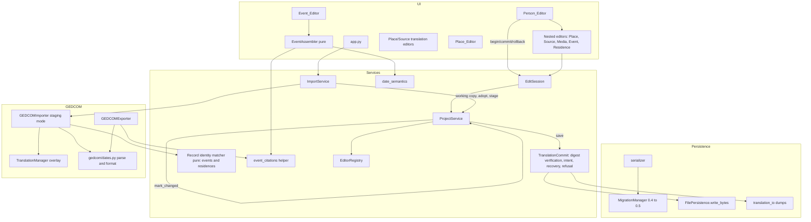

# Design Document: Data Integrity and Loss Prevention (Package 1, release 0.3.0)

## Overview

This design fixes ten confirmed data-loss and consistency bugs (B1-B10) and adds the model structure that the fixes need. The design follows six ideas. All approval items AP1 to AP5 are decided (AP1, AP2, AP3 and AP5 as proposed, AP2 extended with digest verification, AP4 changed to include residences); see "Decisions".

1. **Edit sessions replace live mutation.** The person editor mutates live `ProjectData` today. An `EditSession` takes a full snapshot when the editor opens and either restores it in place (Avbryt) or commits it (Spara). Dirty state is computed from the difference between snapshot and current state, so "dirty exactly when data changed" holds by construction. The snapshot is never reduced in scope to meet a time target.
2. **Edit a copy, do not rebuild.** The event editor rebuilds `Event(...)` from form fields and so loses every field it does not know (`from_place`, citations on places, new fields). The new pure assembler starts from a deep copy of the stored event and overwrites only fields the user edited. When the user clears or changes a cited date, place or from-place, a prompt decides what happens to the citations.
3. **One citation helper.** All reads of citations go through `event_citations(event)`. A guard test forbids direct reads elsewhere.
4. **Structured dates.** `DateValue` gains `qualifier`, `value_to`, `calendar` and `original_text`. A new `Date_Semantics` module validates, bounds and formats dates. A date that cannot be interpreted reliably (unknown phrase, dual year, impossible day) is stored as an *unparsed* date with its original text, never dropped and never given a misleading exact value. Julian dates are stored as written. The exceptional Swedish calendar of 1700-1712 is not modelled.
5. **Durable GEDCOM identity for events and residences.** Events created by GEDCOM import carry an `origin` record, and residences carry an `origins` list, both in the project file. One pure matching function decides whether an incoming record is an existing event or residence. It claims a record only on `_UID`, equal record hash or exact legacy content, never on position or on equal date and place, and preserves every existing record when identity is uncertain. Residences were the last known duplication source on update import (former known limitation 2); they now follow the same rules as events.
6. **Atomic, crash-consistent and conflict-safe import save.** The import runs on a working copy. The importer writes no translation file. The translation data it produced is held in memory with a digest record of the files it was based on, and written together with the project at the next save, through a write-ahead intent file. Before any file is replaced, during the save and during the open-time recovery, the actual file contents are checked by digest against the expected old and new state. A file that matches neither is never overwritten; the save or the open is refused with a Swedish message that names the file, and the intent is kept.

Format version moves from "0.4" to "0.5". The migration is additive and version-only.

Scope boundaries:

- Package 2 (Advanced Person Filtering) is out of scope. The only preparation is `date_bounds(date_value)` in Date_Semantics, which returns open-ended day bounds that a later filter can use.
- No code is written by this spec workflow. Tasks implement it later.

## Verified facts that shaped the design

Each fact below was read in the code during this revision. File and line references are exact for the current working tree.

| # | Fact | Where | Consequence for the design |
|---|---|---|---|
| F1 | The dirty setter increments `revision` and `content_revision` and notifies listeners; `is_saved_state` needs `content_revision == clean_content_revision`; `adopt_committed_state` clears dirty and bumps counters. | `project_service.py:268-277, 293-299, 327-350` | Rollback must not bump `content_revision` for a clean project. `adopt_working_copy` must not clear the dirty flag. |
| F2 | Merge in progress and pending merge journal are tracked and refuse `save_project`. | `project_service.py:183, 300-303, 313-326, 528-545` | These are Session_Start_Conditions (c); the save protocol reuses the same refusals, and Import_Save_Unfinished and the Conflict_Refusal reuse the same `is_merge_journal_pending` gate (F36). |
| F3 | `save_project` writes only the project file (`FilePersistence.save`, temp file plus `os.replace`). `encode` uses `gzip.compress`, so two encodes of equal data are not guaranteed byte-equal. | `project_service.py:545`, `file_io.py:43-47, 50-82` | The save protocol encodes once and writes those exact bytes; the intent file records the hash of those bytes. `FilePersistence` gains `write_bytes`. |
| F4 | The importer saves translation files itself at the end of `import_file`, before the project is saved. `write_all` writes three files in turn with plain `write_text`, not atomically. | `importer.py:1318`, `translation_io.py:425-448, 486-505` | Today a close without saving leaves translation files ahead of the project. The importer gets a staging mode and writes nothing. |
| F5 | `TranslationManager.map_place` and `map_source` re-read the translation files from disk on every call; the importer loads once at the start and mutates its own copy. | `translation/__init__.py:83-94, 166, 230`; `importer.py:1225` | Staging needs an overlay mode for `TranslationManager`, so that all reads use the effective translation (pending or disk). Behaviour within one import does not change, because the disk state is the pre-import state in both cases. |
| F6 | Mappings are tolerant of missing targets: a place or source mapping whose target is gone is ignored; a person mapping whose person is gone recreates the person with the same id; a family mapping whose family is gone recreates the family with the same id. | `place_translation.py:355-357`, `source_translation.py:608-613`, `importer.py:2083-2107, 2615-2660` | Missing targets are survivable. The hazard is the opposite: a mapping that points at an id which now belongs to another entity (F7). |
| F7 | New ids derive from live ids plus retired ids and a stored mark, so an id whose entity vanished (unsaved import, closed project) can be issued again. | `id_registry.py:150-165`, `importer.py:1105-1131` | Writing translation files at import time and then closing without saving leaves a mapping that a new person can alias; a re-import would then overwrite that person (`importer.py:2113-2128`). This rules out "write at import time". |
| F8 | The merge commit journal and recovery know exactly two roles, `persons` and `project`, and decide by a table over those two states. `sources.json` and `places.json` are not covered. The merge requires a saved project and reads the translation from disk. | `transaction.py:66, 136-200`, `recovery.py:504-505`, `merge_engine.py:100-135, 244-253` | Extending the journal to a group of translation files means changing a 556-line recovery table. A smaller write-ahead file with two recovery cases gives the same guarantee for the import save (Component 8). The merge needs no change because it demands a saved state. |
| F9 | Person identity on re-import is by fingerprint, because xrefs are renumbered between exports. The matched app id comes from classification, and the translation xref is updated afterwards. | `importer.py:1587-1591, 1735-1790, 1953-1990` | `owner_xref` is unstable. `Event.origin` stores the resolved `owner_id` and matching uses it, never the xref. |
| F10 | A record that resolves to a merged identity (alias) is not imported at all: no person update, no events; only `_person_xref_map` is set. | `importer.py:1780-1900` (docstring 1788-1790, skip and warning 1874-1893) | Events of a retired person are never touched by re-import. The matcher is not called for Merged_Identity_Records. |
| F11 | The merge never removes or combines events. Participants are rewritten on a deep copy of the event, so every other field, including a new `origin`, passes through. Retired person mappings become identity aliases. | `merge_planner_person.py:289-291, 317`, `merge_planner.py:537, 614`, `merge_planner_candidates.py:165-176`, `merge_engine.py:297-319` | The merge engine needs no change for `Event.origin`. It needs an inventory row (F12) and tests. |
| F12 | The completeness check flags only dataclass fields whose name ends in `person_id` or `person_ids`; `owner_id` is not flagged, so no allow-list entry is needed (corrected in this revision). A new inventory row is still wanted to document the historical location, and every row needs a rule test and appears in the planner's reference summary. | `person_reference_index.py:172-215` (name test L182-183, scan L197-215); `tests/test_services/test_merge_reference_rules.py:1253-1266`; `tests/test_services/test_merge_planner_refs.py:182-189` | Rows `event.origin` and `residence.origins` (rule H, no handler) are added. Two rule tests (`test_reference_rule_event_origin`, `test_reference_rule_residence_origins`) are added to the existing test module, otherwise `test_every_inventory_row_has_a_rule_test` fails. |
| F13 | On update, an existing family's events are deleted from `project_data.events` and recreated, and `family.event_ids` is replaced by the recreated ids. | `importer.py:2700-2751` | This contradicts "update import never removes events" and destroys user edits and citations of family events. Replaced by the matcher (Requirement 10.14). |
| F14 | `_update_person` rebuilds an existing-event key set from `(type, date.value, place_id)` and `_create_event` skips matches. Dateless events with equal type and place collide (B10). | `importer.py:2127-2136, 2986-2992` | Replaced by the matcher. |
| F15 | `_create_residence` generates an id first (L2253), then always appends a new ResidenceFact (L2349), also when the person is updated. The update path builds an event key set only (L2127-2136), so residences have no duplicate guard at all. | `importer.py:2157-2159` (dispatch), `2238-2349` | Closed by Requirement 22 (AP4 changed). Properties 16 and 17 now include `RESI`. See F26 to F40. |
| F16 | The parser joins `CONC` and `CONT` into the parent value. `_UID` is not read anywhere in `gedcom/`. | `parser.py:263-303` | The record hash needs no continuation handling. `_UID` matching serves third-party files only. |
| F17 | The current date parser knows English month abbreviations only, accepts `FROM`, `TO` and `BET` as prefixes but cannot parse the remainder, returns `None` for any failure (the date is dropped) and marks `BEF`, `AFT`, `ABT`, `EST`, `CAL` all as precision `approximate`. | `importer.py:191-205, 304-376` | Confirms B9. Also confirms that `precision == "approximate"` cannot tell `BEF` from `ABT`. |
| F18 | The exporter writes `ABT` for every `precision == "approximate"` event date and endpoint. | `exporter.py:522, 1149` | `BEF 1850` is exported as `ABT 1850` today. Requirement 11.8. |
| F19 | Consumers that read `date.value` as an exact date without checking precision: residence inference (birth and death), residence coverage, residence edit ops, person summary, merge similar-event rule, foster sync ordering, calendar checks. | `residence_inference.py:242, 268`, `residence_coverage.py:461`, `residence_edit_ops.py:742`, `person_summary.py:63-67, 177`, `merge_rules.py:287-307`, `foster_sync.py:506-508`, `calendar_checks.py:65`, `comparison_session.py:440` | The date audit (task 5.4) fixes these. A qualified date must never feed a derivation that needs an exact day. |
| F20 | `is_valid_swedish_calendar` models only the 1753 switch (treats every date before 1753-02-18 as Julian and rejects 18-28 February 1753). It does not model 1700-1712 or 30 February 1712. `parse_date_value` copies `dv.precision` into `ParsedDate.precision`, whose documented values are `exact`, `about`, `before`, `after`. | `date_utils.py:30, 33-61, 149-197` | The earlier design statement that this function interprets the 1712 rule was wrong. Date_Semantics must not claim to model 1700-1712. `parse_date_value` is changed to fill `precision` from the effective qualifier. |
| F21 | `date_span.is_valid_iso` and `expand_iso` use the Gregorian calendar (`calendar.monthrange`, `datetime.date`). A Julian-only day such as `1700-02-29` is reported as absent. `validators._ISO_DATE_RE` checks the shape only. | `date_span.py:69-118`, `validators.py:62-65` | Julian dates need a calendar-aware path in Date_Semantics. Consumers of `expand_iso` treat such values as absent, which is conservative. |
| F22 | The Event_Editor builds `Event(...)` from form fields and `PlaceRef(place_id=...)` freshly; it has no `from_place` widget at all; source rows are written to the date and dropped when the date is empty. | `event_editor.py:2043-2052, 2085, 2133-2149, 902` | Confirms B6, B7, B8. The "clear the from-place field" criterion needs a new widget (approval AP3). |
| F23 | `ProjectData` has about thirty persistent fields: persons, families, events, residences, places, sources, media, repositories, DNA, research, merge, `leverantorer`, `kalltyper`, `project`, `connection_overrides`. The Person_Editor can reach research editors and source editors that create `leverantorer` or `kalltyper`. | `model/project.py:46-91`, `app.py:2033-2196` | The snapshot covers every persistent field, not eight collections. A guard test keeps it that way. |
| F24 | `PersonEditor` is opened at three places in `app.py`; `_dirty = True` is assigned at ten places. | `app.py:351, 433, 877`; `app.py:380, 459, 536, 1012, 1564, 1607, 1637, 2170, 2201, 2281` | Task 7.2 integrates the session at all three editor sites. |
| F25 | Editors that copy files into the project: the source editor media copy and the DNA editor logo copy. No editor under `ui/editors` deletes files. | `source_editor.py:937-938`, `dna_editor.py:186-189` | Created files are registered with the session and deleted on rollback. No deferred deletion is needed. |
| F26 | The RESI date goes through `_parse_resi_date` (English month abbreviations only; `ABT`, `BEF`, `AFT`, `EST` and `CAL` all give precision `approximate`; an uninterpretable date yields unknown endpoints plus a warning). `Endpoint.precision` is descriptive only and never takes part in classification. | `importer.py:394-438, 454-533, 2256-2269`; `residence.py:39-41` | The legacy fingerprint compares interpreted bounds and ignores `precision`, so a change of the date parser's precision labels cannot block a claim. |
| F27 | Place resolution has side effects: `_resolve_place` appends Place records and a place mapping to the translation data, `_apply_coordinates` writes coordinates, `_resolve_single_word_place` creates a Place. | `importer.py:3140-3198` (mapping append L3190), `3200-3234`, `3236-3290` | An unchanged record must not resolve places. The legacy fingerprint resolves the place only for a record that reaches step 3 of the matcher, which becomes a new record unless it is claimed, and a claim needs an existing place. |
| F28 | A RESI `SOUR` becomes one Observation (quality `secondary`, no years) only when its xref is in `_source_xref_map`; other SOUR lines are dropped silently; `NOTE`, `PAGE` and similar children are never read. The exporter writes `NOTE Observation: ...` under each SOUR that the importer never reads back. | `importer.py:2330-2340`; `exporter.py:596-614` | The record hash covers the whole RESI subtree (same rules as events). The derived content used for the legacy fingerprint covers only DATE, PLAC and SOUR. |
| F29 | The exporter writes RESI lossy: DATE only from `start.latest` and `end.earliest`; `start.earliest`, `end.latest`, role and notes as NOTE lines; `Endpoint.event_id` is never written. | `exporter.py:527-616` | Links between residences and flytt events never reach a GEDCOM file. Re-importing an own export of an edited residence into the same project is a changed record: a new residence plus a notice (Requirement 22.8). |
| F30 | The importer creates flytt events only from `EVEN` with TYPE Flytt, through `_create_event`; that method reads neither a `from_place` nor any link. `_create_residence` creates no event and sets no `Endpoint.event_id`. Links are made only by `ResidenceEditor._on_create_flytt`; deleting an event clears the links; validation only reports mismatches. | `importer.py:2198-2206, 2939-3028`; `residence_editor.py:1637-1748` (links at L1694-1735); `delete_service.py:319-323`; `residence_validation.py:391-445` | Import cannot duplicate or detach a flytt event through a residence. Requirements 22.23 and 22.24 pin this, and flytt events from `EVEN` records follow the event matcher. |
| F31 | `ResidenceFact` is rebuilt field by field at 16 sites. `ResidenceEditor.build_fact_from_fields` builds the saved fact from form fields with the stored id, so it drops every field it does not copy. | `residence_edit_ops.py:145, 183, 227, 316` (keep id), `420, 446` (split), `584` (merge); `residence_editor.py:1009, 1023, 1407-1450, 1705, 1735, 2088`; `person_editor.py:1793, 1864`; `importer.py:2341` | Without a change, `origins` would be lost at the first user save of an imported residence and the next import would create it again. Task 10.4 replaces each rebuild with `dataclasses.replace` and adds a guard against new constructor calls. |
| F32 | Person merge deep-copies a residence and changes only `person_id`. Inventory rows `residence.person` (R) and `residence.refs` (S) exist; the index builder reads `fact.person_id`. | `merge_planner_person.py:335-345`; `merge_planner.py:607-616`; `person_reference_index.py:100-104, 312-313` | `origins` pass through a merge unchanged. A row `residence.origins` (H) documents the historical `owner_id`. |
| F33 | `_serialize_dataclass` omits `None` optionals and empty `default_factory=list` fields without special code. Nested registries need entries for new nested types. Residences load tolerantly and ignore unknown fields. | `serialization.py:185-215, 314, 349, 563-600` | `origins` is written only when non-empty by construction. Two registry entries are needed: `(ResidenceFact, "origins")` and `(Event, "origin")`. |
| F34 | The importer's id generator is a plain `IDGenerator` seeded with live ids and does not write `id_high_water_marks`. | `importer.py:1129`; compare `id_registry.py:127-148` | An id issued for a record that is then skipped does not change the Canonical_Form. The importer still issues ids only for new records. |
| F35 | `ImportResult` has no residence or claim counters. | `importer.py:74-97, 1325-1337` | Fields `residences_added`, `residences_claimed`, `events_claimed` are added. |
| F36 | The open-time refusal pattern: `recover_if_needed` raises `RecoveryRefusedError`; `open_project` records the path in `_refused_projects`, which makes `is_merge_journal_pending` true and blocks saves; the app shows the message through `_report_open_failure` and `show_recovery_refusal`; `log_recovery_refusal` reads attributes with `getattr`; `show_recovery_outcome` uses the merge title. The application has no read-only open mode. | `recovery.py:188-197, 343`; `project_service.py:313-322, 464-497, 543`; `app.py:1804-1824`; `recovery_dialogs.py:19-30, 52-61` | The Conflict_Refusal reuses this pattern with its own refusal class and message; `show_recovery_outcome` gets a title parameter. |
| F37 | `FilePersistence.load` reads the whole file once and a migration only creates a backup, it does not rewrite the file. `open_project` records no digest. `create_project` writes the project file at creation. | `file_io.py:85-135, 137-160, 239-262`; `project_service.py:428, 499` | The digest of the bytes read at open is the digest of the file on disk. `FilePersistence.load_with_digest` returns both. After a save the Disk_Digest is the digest of the bytes written. |
| F38 | Reusable commit helpers: `CommitFs`, `RealFs`, `sha256_hex`, `temp_path_for`, `Preflight.check`. `write_file_durable` writes in place, not through a temp file. | `fs_ops.py:91-105, 108-150`; `journal.py:91-102`; `preflight.py:34-77` | The intent must be written to a temp file and then replaced, so that it is either absent or complete. |
| F39 | Translation files are written with a plain `path.write_text`; the Place and Source translation editors write them directly. | `translation_io.py:425-448, 486-505`; `place_translation_editor.py:419-423, 866`; `source_translation_editor.py:95-99, 343` | The commit writes each translation file through a temp file and a replace, after digest verification. |
| F40 | `ImportService.run` receives the project folder and derives `translation/` from it; `app.import_gedcom` returns when no project is open. | `import_service.py:109-110`; `app.py:1133-1135` | The translation directory and the project file path for digests come from the Project_Service. |

## Architecture



Data flow for a person edit: `Person_Editor.open` → `ProjectService.begin_edit_session` (refuses under any Session_Start_Condition) → editors mutate live data as today → `Spara`: `session.commit()` compares snapshot and current state and calls `mark_changed` once if different; `Avbryt`: `session.rollback()` restores in place and notifies once without touching dirty state.

Data flow for an import: `app.import_gedcom` → `ImportService.run` → refuse if session or unsaved editor → record the translation base digests (unless a Pending_Translation exists) → deep copy → importer runs on the copy in staging mode (reads the effective translation, writes nothing; the identity matcher decides per event and per residence record whether it exists) → compare copy and original, compare staged and effective translation → `ProjectService.adopt_working_copy` (one `mark_changed`, stores the Pending_Translation with its base). Later `Spara` → `TranslationCommit` verifies the digests of the project file and the translation files, writes the intent, replaces the project file, replaces the translation files (verifying again before each replace) and removes the intent. `open_project` runs the intent recovery before loading; a file that matches neither the old nor the new state refuses the open.

## Components and Interfaces

### 1. `EditSession` (new, `slaktbusken/services/edit_session.py`)

```python
SESSION_EXCLUDED_FIELDS = {
    "format": "constant",
    "version": "set by the file loader",
    "merge_load_findings": "transient, never serialised",
    "unreadable_merge_items": "raw stored items, not edited by any editor",
    "id_high_water_marks": "monotonic; rolling back would re-issue ids",
}

class EditSession:
    def __init__(self, service: "ProjectService", owner_title: str) -> None: ...
    def mark_changed(self, reason: str = "") -> None:
        """Deferred: records that a session-owned change happened."""
    def register_created_file(self, path: Path) -> None:
        """A media or logo file copied into the project folder during the session."""
    def has_changes(self) -> bool:
        """Snapshot vs current, using dataclass equality per entity and list identity."""
    def commit(self) -> bool:
        """Discard snapshot. Call service.mark_changed once when has_changes(). Return it."""
    def rollback(self) -> None:
        """Restore in place. Delete files registered by register_created_file."""
```

**Snapshot scope (OQ7, Requirement 1.1).** The covered fields are `dataclasses.fields(ProjectData)` minus `SESSION_EXCLUDED_FIELDS`. Every list field is stored as `(entity, copy.deepcopy(entity))` pairs in list order. `project` (a `ProjectMetadata`) and `connection_overrides` (a dict) are stored as deep copies. A guard test (`test_session_snapshot_covers_every_project_data_field`) fails when a field of `ProjectData` is neither covered nor excluded with a reason, so a future collection cannot be forgotten.

Rollback, per list field:

1. `lst[:] = [entity for entity, _ in pairs]` restores membership and order and keeps the list object.
2. For each pair where `entity != copy`, `entity.__dict__.clear(); entity.__dict__.update(copy.__dict__)` restores the entity in place. References to the entity stay valid.
3. Entities added during the session are not in `pairs` and so disappear. Entities removed during the session are in `pairs` and so return, as the same Python object.

`project` and `connection_overrides` are restored in place the same way. Id high-water marks are not rolled back; they only grow, so an id issued during a cancelled session is never issued again.

**Session_Start_Conditions (OQ3, Requirement 1.9).** `begin_edit_session` raises one of these and the Person_Editor does not open:

| Condition | Exception | Swedish message |
|---|---|---|
| (a) another session is active | `EditSessionBusy` | "En annan redigering pågår. Spara eller avbryt den först." |
| (b) a registered editor has unsaved changes | `UnsavedEditorsBlock(titles)` | `Spara eller stäng "{editor_title}" innan du öppnar personredigeraren.` (one line per editor; the title is the Swedish `editor_title` of the registry entry, for example "Personredigerare: Anna Svensson (person_12)" or "Kandidatredigerare: …") |
| (c) merge in progress, merge journal pending or recovery refusal | `EditSessionRefused` | "En sammanslagning pågår eller har avbrutits. Öppna projektet på nytt." |
| (c2) Import_Save_Unfinished holds (an interrupted import save is waiting for the next open) | `EditSessionRefused` | "En sparning av en import är inte avslutad. Starta om Släktbusken för att slutföra eller kontrollera filerna." |
| (d) a GEDCOM import is running | `EditSessionRefused` | "En import pågår. Vänta tills den är klar." |
| (e) no project is open | `EditSessionRefused` | "Inget projekt är öppet." |
| (f) the snapshot cannot be created | `EditSessionRefused` | "Det gick inte att förbereda redigeringen. Inget har ändrats." |

Condition (d) is a new flag `ProjectService.set_import_in_progress` set by `ImportService.run`. A single-writer policy is safe because the person editor and its nested editors are application-modal (`QDialog.exec()`), so no other editor can change data while the session is active; the revision check at rollback is a second line of defence.

**Conflict check at rollback.** `service.content_revision` must equal the value at session start (session-owned changes are deferred and never bump it). If not, a change came from outside the session. The session raises `EditSessionConflict`, restores nothing and leaves the editor open (Requirement 1.11).

**Performance (OQ7).** The snapshot is always the full snapshot. Task 1.2 measures it on the 10,000-person project and reports the figure to the user. The target of 1.5 s is a reported goal. The mandatory test prints the time, emits a `UserWarning` above 1.5 s and fails above 10 s (about seven times the goal; it only catches a pathological regression). Exceeding 1.5 s does not change the implementation.

**Reduced-scope snapshot: proof obligation and approval gate.** A closure-scoped snapshot would be cheaper, but a nested editor can create or edit any place, source, media item, repository, `leverantor`, `kalltyp` or research object, and a scoped snapshot can only protect what is registered in advance. It may be introduced only if all of these hold: (1) every mutation that a Nested_Editor can perform on any collection is routed through `session.protect(entity)` or `session.track_created(entity)`; (2) Property 1 is run again with the scoped snapshot over the same mutation generator, including creations and modifications of entities outside the edited person's closure, and the Canonical_Form after rollback equals the full-snapshot result in every case; (3) the user approves the change after seeing the measured figure. None of this is implemented in this spec.

### 2. `ProjectService` additions

```python
def mark_changed(self, reason: str = "") -> None
def begin_edit_session(self, owner_title: str) -> EditSession   # raises the exceptions above
@property
def active_edit_session(self) -> Optional[EditSession]
def set_import_in_progress(self, running: bool) -> None
def delete_place(self, place_id: str) -> None          # B3, one mark_changed
def add_places(self, places: Sequence[Place]) -> int   # B4, one mark_changed, none if empty
def adopt_working_copy(self, work: ProjectData, pending: PendingTranslation, reason: str) -> None
@property
def pending_translation(self) -> Optional[PendingTranslation]   # staged data + Translation_Base
@property
def disk_digest(self) -> str                            # sha256 of the project file bytes read at open or written at save, or "absent"
@property
def import_save_unfinished(self) -> bool                # Import_Save_Unfinished state
def save_project(self) -> None                          # extended, see Component 8
```

`mark_changed` is the only public way to set the dirty state. While a session is active it records the call in the session and returns without touching counters. `adopt_working_copy` assigns every field of `work` onto the existing `ProjectData` instance (same object, new entity objects), stores `staged` as the Pending_Translation and then calls `mark_changed` once. Unlike `adopt_committed_state` it does not clear the dirty flag. `close_project` and `open_project` clear the Pending_Translation, its base and the Import_Save_Unfinished state. `open_project` stores `disk_digest` from `FilePersistence.load_with_digest`; `save_project` stores the digest of the bytes it wrote. `is_merge_journal_pending` also returns true while Import_Save_Unfinished holds or after a Conflict_Refusal for the path, so the existing save refusal (F36) covers both.

### 3. `event_citations` helper (new, `slaktbusken/model/event_citations.py`)

```python
class CitationContext(str, Enum):
    EVENT = "event"; DATE = "date"; PLACE = "place"; FROM_PLACE = "from_place"

@dataclass(frozen=True)
class EventCitation:
    context: CitationContext
    ref: SourceRef            # the stored object, not a copy

def event_citations(event: Event) -> list[EventCitation]
def cited_source_ids(event: Event) -> set[str]
def event_cites_source(event: Event, source_id: str) -> bool
def context_label_sv(context: CitationContext) -> str   # "Händelse", "Datum", "Plats", "Från plats"
def identical_reference(a: SourceRef, b: SourceRef) -> bool   # source id, quality, note, aspects (ordered)
```

Order is fixed: event, date, place, from_place, each in list order. The helper is the only code outside the model and serializer allowed to read the `source_refs` attributes of `Event`, `DateValue` and `PlaceRef`. A guard test scans `slaktbusken/**/*.py` with `ast` for attribute reads named `source_refs` whose receiver is not a research action, and allows only `model/`, `persistence/serialization.py` and `model/event_citations.py`. The research modules read `ResearchAction.source_refs`; the guard distinguishes them through an allow-list of module paths (`model/research_case.py`, `services/research_*`, `ui/editors/research_case_editor.py`, `reports/research_consistency.py`, `persistence/serialization.py`).

Consumers that change: `kallrapport`, `ansedel`, `source_stats`, `usage_detail_dialog`, `source_editor`, `validation_service`, `exporter`, `comparison_session`, the person editor has-source icon, and the merge planner count (pinned by a test; `_count_instances` counts by dataclass walk, so event-level references are counted once the field exists).

The unique-source reports deduplicate by `source_id` and keep, under each source, the list of `EventCitation` contexts with quality, note and aspects, so two citations of the same source with different pages are both shown.

### 4. `date_semantics` (new, `slaktbusken/model/date_semantics.py`)

```python
QUALIFIERS = ("exact","about","estimated","calculated","before","after",
              "between","from_to","from","to","interpreted","unparsed")
CALENDARS = ("gregorian","julian")

def effective_qualifier(dv: DateValue) -> str
def is_real_date(iso: str, calendar: str) -> bool        # leap-year rules per calendar, day-level only matters
def validate_date_value(dv: DateValue) -> list[str]      # Swedish error messages
def julian_to_gregorian(y: int, m: int, d: int) -> date  # via Julian Day Number, used for bounds only
def in_swedish_window(iso: str) -> bool                  # 1700-02 <= iso[:7] <= 1712-02
def date_bounds(dv: DateValue) -> DateBounds
def format_date_sv(dv: DateValue) -> str
def is_exact(dv: DateValue) -> bool                      # effective qualifier is exact
def exact_value(dv: Optional[DateValue]) -> Optional[str]   # ISO value, or None unless exact
def sort_key(dv: Optional[DateValue]) -> tuple           # exact day first, then bound start, unknown last
```

**Effective qualifier (OQ6, Requirement 14.6).** `effective_qualifier` returns `about` only for the legacy combination qualifier `exact` plus precision `approximate`. For every other qualifier it returns the qualifier itself, whatever the precision is. Code that today treats `precision == "approximate"` as "about" (`exporter.py:522, 1149`, `date_utils.py:59`) is replaced by calls to `effective_qualifier`. A test builds `before` and `after` dates with precision `approximate` and asserts that neither is `about`.

**Bounds (Requirement 14.8).** `DateBounds(earliest: Optional[date], latest: Optional[date], known: bool)`. `known` is false for `unparsed` and for Julian endpoints in the Swedish window; both bounds are then `None`.

| Effective qualifier | Gregorian bounds |
|---|---|
| `exact`, `about`, `estimated`, `calculated`, `interpreted` | day span of `value` (year `1850` is 1850-01-01 to 1850-12-31) |
| `before x` | `(None, day before the first day of x)` |
| `after x` | `(day after the last day of x, None)` |
| `between`, `from_to` | `(first day of value, last day of value_to)` |
| `from x` | `(first day of x, None)` |
| `to y` | `(None, last day of y)` |
| `unparsed` | unknown |

Julian dates: when any endpoint's year-month lies in the Swedish_Calendar_Window (1700-02 to 1712-02), the bounds are unknown. Otherwise each endpoint span is computed twice, as written and converted to the proleptic Gregorian calendar, and the bound is the minimum of the two earliest days and the maximum of the two latest days. The reason: a stored date with calendar `gregorian` means "as written, not converted" (an unlabeled pre-1753 Swedish date is usually Julian in fact), so a comparison between a Julian-labelled date and an unlabeled one cannot know which reading applies. The union never excludes the true day. The stored `value` is never changed. No code in Date_Semantics converts or shifts dates in the Swedish window. Because `date_span.expand_iso` uses the Gregorian calendar (F21), Date_Semantics builds Julian spans itself with `is_real_date` and its own month-length table.

`date_bounds` is for sorting, comparison and Package 2. Derivations that need an exact day use `exact_value`, which returns `None` for every non-exact date and for any date with a non-Gregorian calendar.

**Consumer audit table (task 5.4).** Each row of fact F19 is changed to one of two behaviours: skip the date unless exact, or display through `format_date_sv`.

| Consumer | Change |
|---|---|
| `residence_inference.py:236-295` (birth and death bounds) | use `exact_value`; skip other dates |
| `residence_coverage.py:461`, `residence_edit_ops.py:742` (event year) | use `exact_value`; skip other dates |
| `person_summary.py:63-67, 177` | show `format_date_sv`; year only from exact dates |
| `merge_rules.py:287-307` (similar-event rule) | compare only exact dates; non-exact dates never count as a date match |
| `foster_sync.py:506-508` (ordering) | use `sort_key` |
| `calendar_checks.py:65` | run the 1753 check only for exact Gregorian-labelled dates |
| `comparison_session.py:440` | display through `format_date_sv`; compare qualifier and calendar as separate items |
| `date_utils.parse_date_value` | return `None` for unparsed; fill `ParsedDate.precision` from the effective qualifier (`exact`, `about`, `before`, `after`, `estimated`, ...); age and interval functions return `None` unless both dates are exact |

`date_utils.is_valid_swedish_calendar` and `_to_julian_day_number` are not changed.

### 5. GEDCOM date parser and formatter (new, `slaktbusken/gedcom/dates.py`)

```python
@dataclass
class ParsedGedcomDate:
    value: DateValue          # always present for non-empty text
    warnings: list[str]       # Swedish, for the import log

def parse_gedcom_date(text: str) -> ParsedGedcomDate
def format_gedcom_date(dv: DateValue) -> str            # structured fields only
def export_gedcom_date(dv: DateValue) -> tuple[str, list[str]]   # original_text rules + warnings
```

Grammar (case-insensitive, whitespace collapsed):

```
date_expr   := [calendar] ( range | period | approx | interp | simple )
range       := "BET" endpoint "AND" endpoint
period      := "FROM" endpoint ["TO" endpoint] | "TO" endpoint
approx      := ("ABT"|"EST"|"CAL"|"BEF"|"AFT") endpoint
interp      := "INT" endpoint "(" text ")"
endpoint    := [calendar] simple
calendar    := "@#DJULIAN@" | "@#DGREGORIAN@"       (any other escape -> unparsed)
simple      := [day] [month] year | iso | dotted
month       := JAN FEB MAR MARS APR MAY MAJ JUN JUNI JUL JULI AUG SEP OKT OCT NOV DEC
iso         := YYYY | YYYY-MM | YYYY-MM-DD
dotted      := DD.MM.YYYY | MM.YYYY
```

A calendar escape before the whole expression applies to every endpoint. An escape before an endpoint applies to that endpoint. All endpoints of one date must end up in the same calendar; otherwise the date is unparsed. The exporter always writes the escape before each endpoint.

**Which inputs become what (OQ2, Requirements 9.6 to 9.11, 15).**

| Input | Result |
|---|---|
| `1850`, `MAR 1850`, `5 MAR 1850`, `1850-03-05`, `05.03.1850`, `5 MARS 1850` | `exact`, calendar `gregorian`; `original_text` kept when the export form differs |
| `ABT`, `EST`, `CAL`, `BEF`, `AFT` plus a date | `about`, `estimated`, `calculated`, `before`, `after` |
| `BET x AND y`, `FROM x TO y`, `FROM x`, `TO y` | `between`, `from_to`, `from`, `to`; `value_to` for the two ranges |
| `INT x (text)` | `interpreted`, `value` from x, whole expression in `original_text` |
| `@#DJULIAN@ d` with every endpoint a real Julian day | calendar `julian`, endpoints as written (also in the Swedish window; bounds then unknown) |
| `@#DGREGORIAN@ d` | calendar `gregorian` |
| a day that exists in neither calendar (`32 JAN 1900`, `31 FEB 1900`, `30 FEB 1712`) | `unparsed` |
| a Julian-only day without escape (`29 FEB 1700`, `29 FEB 1500`) | `unparsed`, because the calendar of the writer is unknown |
| dual year `YYYY/YY` (any form with a slash after the year) | `unparsed`, because no single year is historically reliable (the year start differs by country and period) |
| other calendar escape, mixed calendars in one date, reversed range, `(okänt)`, free text | `unparsed` |

Every unparsed result carries one Swedish warning: `Datumet "{text}" för {händelse} ({person}) kunde inte tolkas och sparades som originaltext.` For a dual year the text is `Dubbelt årtal i datumet "{text}" kan inte tolkas entydigt och sparades som originaltext.`

Further rules:

- Every parse returns a `DateValue`; no non-empty DATE line is ever dropped.
- Day validity uses `is_real_date` for the stated calendar. The residence path keeps the `Endpoint` result of `_parse_resi_date` but delegates tokenising and validation to this module (Requirement 9.13). Existing residence tests must stay green.
- `original_text` policy: store it when `normalise(input) != normalise(format_gedcom_date(result))`, where `normalise` collapses whitespace and upper-cases. `ABT 1850` stores nothing; `MARS 1850` and `1850-03-05` store the original.
- Export: `export_gedcom_date` returns `original_text` verbatim when it is present and `parse_gedcom_date(original_text)` yields the same `value`, `value_to`, `qualifier` and `calendar` as the stored fields (the date was not edited since import). Otherwise it returns `format_gedcom_date` and a warning ("Originaltexten stämmer inte med datumet och användes inte"). For `unparsed` it always returns `original_text`. `precision == "approximate"` alone never produces `ABT`; the effective qualifier decides.
- Precision for new data: `exact` keeps `day`, `month` or `year` from the length of the ISO string; any other qualifier gets precision `approximate`.

### 6. Event assembler and editor (new `slaktbusken/ui/editors/event_assembler.py`, changes in `event_editor.py`)

The editor logic that builds an `Event` moves into a pure, Qt-free module.

```python
@dataclass
class CitationRow:
    context: CitationContext
    ref: SourceRef

@dataclass
class EventFormState:
    type: str; custom_type_name: Optional[str]; cause_of_death: Optional[str]
    date: DateFormState          # text, qualifier, range end, calendar, and "unchanged" marker
    place_id: Optional[str]; from_place_id: Optional[str]
    citation_rows: list[CitationRow]
    participants: list[Participant]; media_ids: list[str]

class CitationChoice(Enum):
    KEEP_FOR_NEW_PLACE; MOVE_TO_EVENT; REMOVE_LINKS; CANCEL

@dataclass(frozen=True)
class PromptNeed:
    context: CitationContext        # DATE, PLACE or FROM_PLACE
    kind: str                       # "removed" or "changed"
    count: int                      # rows affected
    allowed: tuple[CitationChoice, ...]

def prompts_needed(base: Event | None, form: EventFormState) -> list[PromptNeed]
def assemble_event(base: Event | None, form: EventFormState,
                   choices: Mapping[CitationContext, CitationChoice]) -> Event
```

`assemble_event` works on `copy.deepcopy(base)` and sets only fields that the form controls: type, custom type name, cause of death, participants, media ids, date, place, from_place and the citations. Fields the form does not know (`origin`, future fields) pass through. This fixes B8 for every current and future field.

**When a prompt is needed (Requirements 6.2, 7.4, 7.5).** `prompts_needed` looks at the rows of the Källor table at save time.

- *Removed:* rows with context `DATE` exist but the date text is empty; rows with context `PLACE` exist but no place is selected; rows with context `FROM_PLACE` exist but no from-place is selected. Choices: `MOVE_TO_EVENT`, `REMOVE_LINKS`, `CANCEL`.
- *Changed:* rows with context `PLACE` (or `FROM_PLACE`) exist, the selected `place_id` differs from the loaded one, and a place is selected. Choices: `KEEP_FOR_NEW_PLACE`, `MOVE_TO_EVENT`, `REMOVE_LINKS`, `CANCEL`.
- *Unchanged:* if the date, place and from-place equal the loaded ones, `prompts_needed` is empty and every row stays in its context. If the user changes the place and then changes it back before saving, the comparison with the loaded state finds no change and no prompt is shown.

The editor asks the prompts in the order date, place, from-place. It collects every answer first and calls `assemble_event` only when none is `CANCEL`. A `CANCEL` returns to the dialog with nothing changed.

**Prompt texts (Swedish).**

| Case | Text | Buttons (default marked) |
|---|---|---|
| Date removed | `Datumet har {n} källhänvisning(ar). Vad vill du göra med dem?` | **Flytta till händelsen**, Ta bort källhänvisningarna, Avbryt |
| Place removed | `Platsen har {n} källhänvisning(ar) och platsen tas bort. Vad vill du göra med dem?` | **Flytta till händelsen**, Ta bort källhänvisningarna, Avbryt |
| From-place removed | `Från-platsen har {n} källhänvisning(ar) och från-platsen tas bort. Vad vill du göra med dem?` | same |
| Place changed | `Platsen byts ut och den gamla platsen har {n} källhänvisning(ar). Vad vill du göra med dem?` plus informative text `Att flytta dem till händelsen bevarar beläggen utan att påstå att de stöder den nya platsen.` | Behåll för nya platsen, **Flytta till händelsen**, Ta bort källhänvisningarna, Avbryt |
| From-place changed | same with "Från-platsen" | same |

**Why the default for a change is also "Flytta till händelsen" (Requirement 7.9).** The citations were made for the old place. Carrying them to a different place by default would assert, without the user saying so, that the evidence supports the new place. Removing them is destructive. Moving them to the event keeps the evidence and claims only that it concerns the event, and the user can still reassign a row to a place deliberately through the "Gäller" column or choose "Behåll för nya platsen" in the prompt.

**Effects of the choices.**

- `KEEP_FOR_NEW_PLACE`: the rows stay with context `PLACE` (or `FROM_PLACE`) and are written, unchanged, to the new `PlaceRef`.
- `MOVE_TO_EVENT`: the rows are appended to `event.source_refs` through `append_moved`.
- `REMOVE_LINKS`: the rows are dropped. No Source record is touched.
- `CANCEL`: nothing changes.

**Duplicates when moving (Requirement 6.7, 6.8).** `append_moved(target, moved)` appends each moved reference unless `identical_reference` holds against a reference already in `target` (including references appended earlier in the same move). Nothing else is deduplicated: references that were already in a context keep their order and multiplicity, and two references that differ in any of source id, quality, note or aspects are both kept. The effect is that the set of distinct `(source id, quality, note, tuple(aspects))` tuples of the event is unchanged by a move. This is information-preserving: an identical reference adds no information.

**Date handling in `assemble_event`.**

- If the form date fields equal the loaded values, the stored `DateValue` is kept as is (including `original_text`, `calendar`, `qualifier`, `value_to`); only its `source_refs` follow the rows.
- If the user changed any date field, a new `DateValue` is built from the form, validated with `validate_date_value`, with `original_text=None`.
- An `unparsed` date is shown read-only: the label "Tolkades inte vid import", the original text, and the explanation `Det ursprungliga datumet i GEDCOM-filen kunde inte tolkas och sparas som text: "{text}". Det bevaras oförändrat tills du anger ett nytt datum.` Typing a new date replaces it.

**UI additions in `event_editor.py`.** A "Gäller" column in the Källor table with a combo per row (Händelse, Datum, Plats, Från plats); a qualifier combo next to the date field (Exakt, Ungefär, Uppskattat, Beräknat, Före, Efter, Mellan, Från–till, Från, Till); a second date field enabled for `Mellan` and `Från–till`; a calendar choice ("Gregorianskt", "Julianskt"); and (approved AP3) a "Från plats" combo shown while the event type is `flytt`. The combo lists the project places, is bound to `EventFormState.from_place_id`, and its citations keep their own context "Från plats" with the prompts of the table above. The combo is hidden for other types; changing the type away from `flytt` keeps the stored `from_place` and its citations untouched, because `assemble_event` only overwrites fields the user edited. The existing precision control ("approximate") is reconciled in task 9.2: its "approximate" choice maps to qualifier `about`.

The Residence_Editor path that creates flytt events (`residence_editor.py:1667-1678`) builds a new event with `from_place`, so it already carries the field; task 9.3 adds a test and routes any edit of an existing flytt through the assembler so that `from_place` and its citations are preserved.

### 7. Record identity matcher for events and residences (new, `slaktbusken/gedcom/translation/record_identity.py`) [AP1, AP4 and AP5 approved]

One pure function serves both record kinds. Events and residences are matched in separate calls, because their pools and fingerprints differ.

```python
@dataclass(frozen=True)
class IncomingRecord:
    kind: str                # "event" | "residence"
    owner_kind: str          # "INDI" | "FAM"
    owner_id: str            # app id resolved by the importer in this run
    owner_xref: str          # informational only
    tag_key: str             # "BIRT", "EVEN:flytt", "RESI", ...
    index: int               # occurrence among records with this tag_key under the owner (informational)
    record_hash: str
    uid: Optional[str]
    fingerprint: Callable[[], str]    # lazy: content the importer would create (may resolve a place, see below)

@dataclass(frozen=True)
class PoolEntry:
    obj: Event | ResidenceFact
    origin: RecordOrigin              # an event has one entry; a residence has one entry per origin

class Outcome(Enum):
    UNCHANGED; CHANGED_UID; LEGACY_CLAIMED; NEW; NEW_AMBIGUOUS

@dataclass
class MatchResult:
    incoming: IncomingRecord
    existing: Optional[Event | ResidenceFact]   # claimed object (UNCHANGED, CHANGED_UID, LEGACY_CLAIMED)
    candidates: list[Event | ResidenceFact]     # NEW_AMBIGUOUS: unclaimed objects that might be the earlier version
    outcome: Outcome

def record_hash(record: GedcomLine, source_ids: Mapping[str, str]) -> str
def event_fingerprint(event: Event) -> str
def residence_fingerprint(fact: ResidenceFact) -> str
def tag_key_of(event: Event) -> str                 # origin.tag_key, or derived from type for legacy events
def match_records(incoming: Sequence[IncomingRecord], pool: Sequence[PoolEntry],
                  legacy_pool: Sequence[Event | ResidenceFact],
                  foreign: Sequence[Event | ResidenceFact]) -> list[MatchResult]
```

The function is pure (no Qt, no file access), so it is property-testable.

**Candidate sets (Requirements 19.4 and 22.4).** For one owner record the importer builds:

- `pool`: for events, one entry per event whose `origin.owner_kind` and `origin.owner_id` equal the owner kind and the owner id resolved in this run; for residences, one entry per `(ResidenceFact, RecordOrigin)` pair with owner kind `INDI` and the same owner id.
- `legacy_pool`: objects without any origin that belong to the owner: for `INDI` events, events in which the resolved person participates; for `FAM`, events whose id is in `family.event_ids`; for residences, ResidenceFacts with an empty `origins` list and `person_id` equal to the owner id.
- `foreign`: unclaimable objects the owner participates in whose origin has a different `owner_id` (for example events or residences of a retired person after a merge). They are listed in notices and never claimed.

`owner_xref` and `index` never take part in matching.

**Algorithm, per owner and kind, incoming records in file order (Requirements 19.5 and 22.5):**

1. **UID.** If `uid` is set and exactly one unclaimed pool entry has the same `origin.uid`, claim it. The outcome is `UNCHANGED` when the hash is equal and `CHANGED_UID` otherwise (the importer leaves the object unchanged and logs a notice).
2. **Tag key and hash.** Group the remaining incoming records by `(tag_key, record_hash)` and the unclaimed pool entries by `(origin.tag_key, origin.record_hash)`. Pair each group one to one in file order against the entries ordered by stored `origin.index`. Paired records are `UNCHANGED`. Surplus incoming records stay unresolved; surplus pool entries stay unclaimed. This gives the rules for reordering (hashes still pair), insertion (one unresolved record), removal (one unclaimed entry), identical records (pairing by count) and user edits (the stored hash is that of the GEDCOM record, not of the edited object).
3. **Legacy fingerprint.** Only when `legacy_pool` still holds an unclaimed object: for each remaining incoming record, evaluate `fingerprint()` and claim the first unclaimed `legacy_pool` object whose fingerprint is equal. Outcome `LEGACY_CLAIMED`. Each legacy object is claimed at most once.
4. **Otherwise no claim.** The record is `NEW`. If unclaimed objects with the same tag key exist in `pool`, `legacy_pool` or `foreign`, they are returned in `candidates` and the outcome is `NEW_AMBIGUOUS`.

There is no step that claims by tag and occurrence index. Event type and place alone never claim an event. Equal date and place never claim a residence. The fingerprint is evaluated lazily and only in step 3, so after the first 0.5 import (when no legacy object is left) it is never evaluated and no place is resolved for an unchanged record (F27).

**Pool entry claims.** The unit of a claim is the pool entry. A residence that carries two origins (after a merge of two residences, Component 9) can be claimed by two different incoming records, once per origin. A claim never writes to the object, so two claims on one residence are harmless.

**Record hash (Requirements 19.3 and 22.3; correction B).** `record_hash` is SHA-256 over a canonical text form of the event record or `RESI` record:

1. Lines are `"{depth} {TAG} {VALUE}"`, depth taken from the tree, tags upper-cased, values with runs of whitespace collapsed and trimmed. `CONT` and `CONC` need no handling because the parser already joined them (F16).
2. Subtrees with tag `CHAN`, `_UPD`, `_CRE` or `_UID` are excluded.
3. A `SOUR` pointer value is replaced by the resolved app source id when `source_ids` has it, and by the raw pointer otherwise. Every other pointer value (`@...@`, for example `FAMC`) is replaced by the token `@PTR@`. Xrefs are renumbered between exports (F9), so raw pointers would make the hash unstable.
4. Children are canonically ordered by tag: groups of siblings are sorted by tag name, and **the relative file order of siblings with the same tag is kept**. So `PLAC` before `DATE` and `DATE` before `PLAC` hash the same, while `SOUR A, SOUR B` and `SOUR B, SOUR A` hash differently, as do two `NOTE` lines in a different order. The rule is applied recursively.
5. The tag line is included, so `BIRT` and `CHR` differ. For `EVEN` the `TYPE` child is part of the content. For `RESI` the tag line is `1 RESI`.

The whole `RESI` subtree takes part, including `NOTE` children that the importer does not read (F28). A change that the importer would not interpret therefore still yields a new residence with a notice, exactly as for events. This keeps one rule for both kinds and never hides a changed record.

A golden-vector test (`test_record_hash_golden_vectors`) pins the hash of fixed event and `RESI` records, so a change of the canonical form is a conscious decision. Changing the canonical form later requires a migration of stored hashes, because every stored hash would otherwise stop matching and every record would be created again.

**Fingerprints.**

- `event_fingerprint(event)`: SHA-256 over `(type, custom_type_name, qualifier, value, value_to, calendar, original_text, place_id, sorted participants, cause_of_death)`.
- `residence_fingerprint(fact)`: SHA-256 over `(person_id, place_id, start.earliest, start.latest, start.event_id, start.note, end.earliest, end.latest, end.event_id, end.note, role_in_household, notes, [(source_id, quality, observed_from, observed_to, page_note) for each observation in order])`. `Endpoint.precision` is excluded because it is descriptive only and the date parser's precision labels changed (F26).
- The incoming side builds the content with the importer's own derivation code (`_derive_residence`, Component 8), so both sides are produced by the same function. The place id of the incoming record comes from the importer's normal place resolution, which only runs in step 3 (F27).

**Legacy claim rule (AP1 for events, AP4 for residences, one rule).** A legacy object is claimed only on exact content equality, one to one. A claim writes the origin onto the object, counts as a project change, and is counted in the import log. An object that differs in any compared field is not claimed and the incoming record becomes a new object with a notice. Duplicates that earlier imports created stay; one of them is claimed and the others are reported (Requirement 22.16). A residence that the user typed by hand and that equals exactly what the importer would create (same place, dates, source observation, empty role and notes) is indistinguishable from an import and is claimed too; the alternative would create an identical second residence.

### 8. Importer integration for events and residences (changes in `gedcom/importer.py`)

**Events (Requirements 10 and 19).**

- `_create_person_events` and the family-event loops of `_create_family` and `_update_family` first collect the event-bearing child records (`_INDI_EVENT_TAGS`, `ADOP`, `EVEN`, `_FAM_EVENT_TAGS`) into `IncomingRecord` objects, call `match_records` once per owner and then act per result in file order:
  - `UNCHANGED`: skip. No id, no place resolution, no write, no placement bookkeeping.
  - `CHANGED_UID`: skip; Swedish notice `GEDCOM-posten för händelsen {typ} ({person}) har ändrats sedan importen men har samma _UID. Den befintliga händelsen lämnades oförändrad.`
  - `LEGACY_CLAIMED`: set `event.origin` (the only modification of an existing event); counted for the log line `{n} befintliga händelser kopplades till GEDCOM-posterna och fick ursprungsmärkning.`
  - `NEW` and `NEW_AMBIGUOUS`: create the event through the existing creation code with its `Event_Origin`; for `NEW_AMBIGUOUS` add the Swedish notice `En ny händelse {typ} skapades för {person} eftersom GEDCOM-posten inte kunde kopplas till en befintlig händelse. Befintliga händelser som inte kopplades: {lista}. Granska och ta bort det som är inaktuellt.` The list shows at most five candidates and then "och {n} till". The existing placement bookkeeping (`_imported_placement_events`) runs for new events only.
- `_update_family` no longer removes events (F13). It keeps every id in `family.event_ids` and appends the ids of new events. `existing_family.partners`, `children` and `parent_child_links` are still replaced as today.
- Records of a Merged_Identity_Record or an ambiguous record never reach `_create_person_events` (F10), so the matcher is not called for them.
- For a person recreated after deletion (`importer.py:2083-2107`) the pool is built the same way.
- The importer's whole-project post-steps (`importer.py:1292-1315`) run on every import. Property 16 pins their idempotence; if the property fails, task 10.2 makes the failing step idempotent.

**Residences (Requirement 22).** `_create_residence` is split into three parts so that the content derivation is a pure function that the fingerprint can reuse:

```python
def _resolve_residence_place(self, resi_record, person_id) -> str      # side effects: places, mappings, coordinates, warnings (F27)
def _derive_residence(self, resi_record, person_id, place_id) -> ResidenceFact   # pure: dates via _parse_resi_date, observations from SOUR (F26, F28); id is ""
def _add_residence(self, person_id, resi_record, incoming: IncomingRecord) -> str    # issues the id, sets origins=[origin], appends
```

`_create_person_events` collects the `RESI` children of the person into `IncomingRecord` objects (kind `residence`, tag key `RESI`, index counted among the `RESI` children), calls `match_records` once, and then walks the children in file order, so that ids are issued in the same order as before for new records. Per result:

- `UNCHANGED`: skip entirely (no id, no place, no coordinates, no mapping, no warning).
- `CHANGED_UID`: skip; notice `GEDCOM-posten för ett boende ({person}) har ändrats sedan importen men har samma _UID. Det befintliga boendet lämnades oförändrat.`
- `LEGACY_CLAIMED`: `fact.origins = [origin]`; counted. When other unclaimed legacy residences of the person have the same fingerprint, add the notice of Requirement 22.16.
- `NEW` and `NEW_AMBIGUOUS`: `_resolve_residence_place`, `_derive_residence`, `_add_residence`. The date and place warnings of the current code (`importer.py:2260-2269, 2297-2328`) are produced here, so they now appear only for residences that are created, not on every re-import. For `NEW_AMBIGUOUS` add the notice `Ett nytt boende skapades för {person} ({datum}, {plats}) eftersom GEDCOM-posten inte kunde kopplas till ett befintligt boende. Befintliga boenden som inte kopplades: {lista}. Granska och ta bort det som är inaktuellt.` with the same five-candidate cap.

`ImportResult` gains `residences_added`, `residences_claimed` and `events_claimed`; `ImportService.format_result` adds the line `Boenden: {n} nya, {m} kopplade till befintliga`. The Import_Log carries the Swedish notices above.

**Flytt events and residences (Requirements 22.23 and 22.24).** The importer creates flytt events only from `EVEN` records with TYPE Flytt (F30), and those go through the event matcher. `_create_residence` and its replacement create no event and write no `Endpoint.event_id`. The matcher never writes to a claimed or unclaimed residence except to add `origins` to a claimed legacy one, so a link made by `ResidenceEditor._on_create_flytt` (two residences and one flytt event) is never touched by an import: not when the residences are `UNCHANGED`, not when they are left unclaimed, and not when the flytt event itself is `UNCHANGED`. If the user deleted the flytt event, `delete_service.py:319-323` already cleared the links, and a re-import creates the flytt event again (known limitation 1) without re-linking it. A test builds exactly this case. Should a later change create flytt events from residence records, it must go through `match_records` with a deterministic link, and that change needs its own spec.

**Merge compatibility (Requirements 19.9, 19.10, 22.21).**

- The merge keeps events and deep-copies them when it rewrites participants (F11), and deep-copies residences when it changes `person_id` (F32), so every origin survives. `test_merge_preserves_event_origin` and `test_residence_merge_origin` run the planner and engine on projects with imported events and residences and assert that every origin is equal before and after and that the counts are unchanged.
- After a merge the retired person's GEDCOM mappings become aliases of the survivor (F11). The retired record is a Merged_Identity_Record and is skipped (F10). The survivor's record resolves to the survivor id, so the pool contains only entries whose `origin.owner_id` is the survivor; events and residences whose `owner_id` is the retired id are `foreign` and appear only in notices. Their `owner_id` is never rewritten, because it records provenance. Residences that moved to the survivor without origin are legacy candidates of the survivor.
- `RecordOrigin.owner_id` is documented by the inventory rows `event.origin` and `residence.origins` (rule H), each with a rule test (F12).

### 9. Residence origins in every edit path (changes in `residence_edit_ops.py`, `residence_editor.py`, `person_editor.py`)

F31 shows that 16 places rebuild a `ResidenceFact` from named fields, so any new field is silently lost at the first user edit. This design removes the cause for `origins` and for future fields.

| Operation | Sites | Rule for `origins` |
|---|---|---|
| Edit that keeps the id: attach observations, exact start, exact end, remove observation, role, Endpoint link to a flytt, editor save | `residence_edit_ops.py:145, 183, 227, 316`; `residence_editor.py:1009, 1407-1450 (build_fact_from_fields), 1705, 1735, 2088`; `person_editor.py:1864` | Build the result with `dataclasses.replace(existing, ...)`, so every field not named stays equal. When no existing fact is present (new residence) the field is empty. |
| Split at a gap | `residence_edit_ops.py:420, 446` | Both halves get `copy.deepcopy(fact.origins)`. A later import claims at most one pool entry per record, so the second half stays as a user-made residence. |
| Merge of two residences | `residence_edit_ops.py:584` | `earlier.origins` followed by the origins of `later` that are not equal to one already present. A later import then still recognises both GEDCOM records and does not create the merged-away one again. |
| New residence typed by the user | `residence_editor.py:1023`, `person_editor.py:1793` | Empty list. |
| Importer | `importer.py:2341` | Set by `_add_residence`. |

The Residence_Editor `build_fact_from_fields` builds from `self._residence` with `dataclasses.replace` when it edits an existing fact. A guard test (`test_guard_residence_construction_preserves_origins`) parses `slaktbusken/ui` and `slaktbusken/services` with `ast` and fails on a direct `ResidenceFact(...)` call that neither passes `origins=` nor appears in `tests/test_dataskydd/residence_construction_allowlist.py` with a reason (the two new-residence sites). A property test applies every operation to residences with arbitrary origins and checks the rule of the table.

The edit session needs no change: the snapshot copies whole `ResidenceFact` objects (F23), so `origins` are restored with them. `test_edit_session_restores_residence_origins` pins that.

### 10. Import atomicity, staged translation and conflict-safe crash-consistent save (OQ4, AP2 approved with hash verification)

**Why not write at import time.** F4 and F7: writing the translation files at import time leaves them ahead of the project whenever the user closes without saving or the process dies. After that a new person can receive an id that a mapping already points to, and the next import overwrites that person. A `test_unsaved_import_then_new_person_never_aliases_mapping` test pins the fixed behaviour.

**Residences and the translation protocol.** The residence fix adds no staged data. `origins` live in `project.json`, so they are saved atomically with the residences they describe. The only translation data that a RESI record touches is the place mapping that `_resolve_place` appends (F27). For an unchanged re-import no place is resolved, so no new mapping is staged; for a new or legacy-claimed residence the mapping is staged exactly as for events. The save protocol therefore needs no residence-specific step. What changes in this revision is only the AP2 safeguard below (digests and refusals).

**Staging mode.**

- `TranslationManager(translation_dir, *, overlay: Optional[TranslationData] = None)`. With an overlay, `load_translations()` returns a deep copy of the overlay and `map_place` and `map_source` read a shared read-only view of it. Without an overlay the behaviour is unchanged.
- `GEDCOMImporter(project_data, translation_dir, *, overlay=None, stage_only=False)`. With `stage_only=True` the call at `importer.py:1318` is skipped and the translation data the importer mutated is returned in `ImportResult.translation`. The default stays `False`, so existing callers and tests are not affected.
- `ImportService.run` passes `overlay=project_service.pending_translation.data` (or `None` to read the files) and `stage_only=True`. The import writes no translation file.
- Reads during one import see the pre-import state in both modes (F5), so a staged import produces the same project data and the same translation data as today.
- The diagnostic log `C:\Temp\gedcom_import.log` (`importer.py:1362`) and the project log folder written by `app._write_import_log` are not project data and are outside the byte-identity guarantee.

**Translation base.** `PendingTranslation(data: TranslationData, base: dict[str, str])`, where `base` maps `translation/persons.json`, `translation/places.json` and `translation/sources.json` to the SHA-256 digest of the file bytes or the marker `absent`. `ImportService.run` captures `base` from the three files before the importer starts, when no pending translation exists, and captures it again after the importer finished; if the two captures differ, a file changed during the import and the import is aborted with `Översättningsfilerna ändrades under importen. Ingenting har ändrats.` before anything is adopted. A second import that starts from a pending translation keeps `base` of the first (Requirement 20.15).

**Working copy and adoption.** `ImportService.run`:

1. Refuses when a session is active or an editor has unsaved changes (Requirement 20.13), refuses while Import_Save_Unfinished holds (Requirement 20.19), sets `import_in_progress`.
2. Captures the translation base, deep-copies `project_data`, runs the importer on the copy, validates the copy, captures the base again and compares.
3. Computes `project_changed = canonical(copy) != canonical(project_data)` and `translation_changed = staged != effective` (compared through `translation_io` serialisation of all three files).
4. If neither changed, adopts nothing. Otherwise `ProjectService.adopt_working_copy(copy, pending, reason)` (one `mark_changed`), where `pending` is `PendingTranslation(staged, base)` when the translation data changed and `None` when only the project changed (a project-only change uses the normal save).
5. Any exception or cancellation before step 4 leaves the live data, the pending translation and the files untouched.

**Digest states.** For a file with expected digests `old` and `new`, `state(file)` is `OLD` when the actual digest equals `old` (an absent file equals `old == "absent"`), `NEW` when it equals `new`, and `OTHER` otherwise. When `old == new` the state is `OLD`. A file that cannot be read gives an error, not a state; the protocol treats it as a failed verification (code T5 at open, a refused save otherwise).

**Save protocol.** `ProjectService.save_project` keeps its refusals (merge in progress, pending journal or refusal, Import_Save_Unfinished; F2, F36). Then:

```python
project_bytes = FilePersistence.encode(data)            # encode once
if pending is None:
    FilePersistence.write_bytes(project_bytes, path)     # same temp + os.replace as save()
    self._disk_digest = sha256_hex(project_bytes)
else:
    TranslationCommit(path, fs).commit(project_bytes, pending, expected_project_digest=self._disk_digest)
```

`TranslationCommit` (new, `slaktbusken/services/commit/translation_commit.py`, Qt-free, uses `CommitFs`, `Preflight`, `sha256_hex`, `temp_path_for`):

| Step | Action | If it fails or finds a conflict |
|---|---|---|
| S1 | Pre-flight (`Preflight.check` for the project file and the translation files; writable, space). Encode the new translation files with `translation_io.dumps_*` and compute their digests. Verify: project file `OLD` (digest equals `expected_project_digest`); each translation file `OLD` (digest equals `pending.base[file]`) or `NEW` (digest equals the digest of the content to write). | A file `OTHER`: `SaveConflict(files)`. Nothing was written. Message of Requirement 20.8. State unchanged, no intent. |
| S2 | Write the Translation_Intent to `temp_path_for(intent, txid)` durably. | Error: remove the temp, `SaveFailed`. |
| S3 | `replace(intent temp, intent)`, `fsync_dir`. The intent is now either absent or complete. | Error: remove intent and temps, `SaveFailed`. |
| S4 | Write the project temp `temp_path_for(project, txid)` durably; read it back and compare its digest with the new digest. | Error: remove intent and temps, `SaveFailed`. |
| S5 | For each changed translation file: write `temp_path_for(file, txid)` durably and verify its digest. Doing this before the commit point puts disk-space and permission errors before the project is replaced. | Error: remove intent and temps, `SaveFailed`. |
| S6 | Commit point. Verify again that the project file is `OLD`; `replace(project temp, project)`. | Project `OTHER`: remove only the artifacts this save created (intent and temps; nothing was replaced), `SaveConflict`, state unchanged. Other error: remove artifacts, `SaveFailed`. |
| S7.i | For each changed translation file in name order: verify the state again. `OLD`: `replace(temp, file)`. `NEW`: remove the temp, continue. `OTHER`: stop. | `OTHER` or an error: keep the intent and the temps, `ImportSaveUnfinished(files)`; the project is saved (clean) and Import_Save_Unfinished holds (Requirement 20.11, 20.20). |
| S8 | Remove the intent, remove stray temps, `fsync_dir`. Clear the pending translation. | An error here: Import_Save_Unfinished (the next open completes the removal, because project and files are `NEW`). |

After S6 the Project_Service sets `disk_digest` to the new digest, clears Dirty_State and records the save. The pending translation is cleared at S8. A `BaseException` (a simulated or real crash) at any step leaves every artefact where it is; the recovery decides.

**Why the conflict before S6 removes the artifacts and a conflict after S6 keeps them.** Before S6 the save has replaced nothing, the pending translation is still in memory and the project is still dirty, so the intent and the temps hold no information that is not in memory; removing them lets the user fix the file and press "Spara" again. After S6 the project file is new, and the intent is the only record of what the translation files must become; it is kept, and so are the temps. A conflict that is found before the intent is written (S1) leaves no artifact at all. This follows the user's rule to keep the intent and the recovery artifacts whenever overwriting would be unsafe and a recovery could be needed.

**Recovery at open (Requirements 20.16 to 20.18, 20.21).** `open_project` calls `recover_translation_intent(project_file, fs)` right after the merge recovery and before loading. It reads the intent, verifies its checksum and schema, then computes the state of the project file (`old_project_sha256`, `new_project_sha256`) and of each translation file named in the intent (`old_sha256`, `new_sha256`), reading each file once and before any write:

| Intent | Project | Translation files | Action |
|---|---|---|---|
| absent | any | any | Remove leftover `.new` temps of this protocol; nothing else. |
| valid | `NEW` | every file `OLD` or `NEW` | Write each `OLD` file from the intent through temp and replace (verifying immediately before each replace); remove the intent and temps; message "En avbruten sparning slutfördes." |
| valid | `OLD` | every file `OLD` | Remove the intent and temps; translation files unchanged; message "En avbruten sparning återställdes." |
| valid | `OTHER` or missing | any | Conflict_Refusal T1. |
| valid | `NEW` or `OLD` | any file `OTHER` | Conflict_Refusal T2. |
| valid | `OLD` | any file `NEW` | Conflict_Refusal T3. (The protocol replaces translation files only after the project file, so this combination means an outside change.) |
| unreadable, wrong checksum or unknown schema | any | any | Conflict_Refusal T4. The intent file is kept byte for byte. |
| any | any | a file that cannot be read | Conflict_Refusal T5. Nothing is changed. |

Every crash point of the protocol ends in one of the first three rows: before S3 nothing exists but temps; between S3 and S6 the project is `OLD` and the translation files are `OLD` (the intent is removed); after S6 the project is `NEW` (files completed, whichever subset is already `NEW`). A crash during the recovery's own writes ends in the second row again, so the recovery is idempotent (Requirement 20.21). The recovery writes nothing in the refusal rows.

**Conflict_Refusal at open and what the user can do (decision: reuse the merge-recovery refusal).**

- `ImportSaveRefusal` (frozen dataclass in `translation_commit.py`: `code`, `project_path`, `intent_path`, `temp_paths`, `file_states`, and a `message` property) is raised inside `RecoveryRefusedError`, which only needs a `.message`. `ProjectService.open_project` adds the path to `_refused_projects` and re-raises, exactly as for a refused merge recovery (F36). The project does not open, no normal save of that path is possible until the application is restarted, and the app shows the message through `_report_open_failure` and `show_recovery_refusal`. `log_recovery_refusal` already reads its fields with `getattr`, so it logs the new refusal without change.
- Message (Swedish), assembled from fixed parts:

```
Projektet kunde inte öppnas. En tidigare sparning av en import avbröts, och Släktbusken kan inte avgöra
säkert hur filerna ska slutföras, eftersom en eller flera filer har ändrats utanför Släktbusken.

Orsak: {orsak}

Projektfil:           {sökväg}   ({läge})
Importintention:      {sökväg}
Översättningsfiler:
  - translation/places.json   ({läge})
  - translation/persons.json  ({läge})
Temporära filer:      {lista eller "inga"}

Alla dessa filer har lämnats orörda. Ta inte bort dem.
Nästa steg: återställ de filer som är markerade "okänd" från en säkerhetskopia eller versionshistorik.
När filerna är kontrollerade: flytta importintentionen ut ur projektmappen och starta om Släktbusken.
```

  `{läge}` is "oförändrad", "ny", "okänd, ändrad utanför Släktbusken" or "saknas". The reasons are: T1 "Projektfilen stämmer varken med läget före eller efter sparningen." T2 "En översättningsfil stämmer varken med läget före eller efter sparningen." T3 "Filerna är i en kombination som inte kan förklaras av sparningen." T4 "Importintentionen är skadad eller har ett okänt format." T5 "En fil kunde inte läsas. Ingenting har ändrats. Försök igen när filen går att läsa."
- **Recommendation and alternative.** Refusing the open is the only existing pattern and keeps every file as it is. A read-only open mode would let the user look at the project, but the application has none (F36), and building one is outside this package. The cost of the refusal is a manual step, which is acceptable because the state only arises when a file was changed outside Släktbusken while an interrupted save was pending.
- `show_recovery_outcome` gets an optional `title` argument so that "En avbruten sparning slutfördes." is not shown under the merge title (F36).

**Conflict at save time and what the user can do (Requirements 20.8, 20.10, 20.11).**

- A conflict found before or at the commit point (S1, S6) shows a Swedish message box with the text of Requirement 20.8: `Projektet sparades inte. {n} fil(er) har ändrats utanför Släktbusken sedan importen:` followed by one line per file with its path and "okänd, ändrad utanför Släktbusken", then `Inga filer har ändrats. Återställ filen och välj Spara igen, eller stäng projektet utan att spara och importera GEDCOM-filen på nytt.` The project stays open and dirty with its pending translation, and every later save repeats the verification, so a restored file lets the save succeed.
- A conflict found after S6 (a translation file changed between the project replace and its own replace) enters Import_Save_Unfinished and shows `Projektet är sparat, men översättningsfilen {filnamn} har ändrats utanför Släktbusken och skrevs inte över. Starta om Släktbusken för att kontrollera filerna.` The next open reaches Conflict_Refusal T2 and the manual path above.
- While Import_Save_Unfinished holds, `save_project`, `ImportService.run` and the translation editors refuse with `En sparning av en import är inte avslutad. Starta om Släktbusken för att slutföra eller kontrollera filerna.` `begin_edit_session` refuses under Session_Start_Condition (c) with the same text (Component 1 table).

**Other readers of the translation files while an import is pending.**

- Place and source translation editors read and write the files directly (`place_translation_editor.py:419-423, 866`, `source_translation_editor.py:95-99, 343`). While `pending_translation` is set or Import_Save_Unfinished holds they refuse to open (Requirements 20.12 and 20.19); otherwise their save would be overwritten by the pending data, or would trigger a conflict, at the next save.
- The merge planner reads the files (`app.py:1744-1755`) and the merge engine reads them (`merge_engine.py:244-253`), but the merge requires a saved state (`merge_engine.py:100-135`), and a pending translation implies a dirty project, so the merge is refused before it reads stale mappings. Import_Save_Unfinished makes `is_merge_journal_pending` true, so the merge is refused then as well.
- Closing the project or opening another one discards the pending translation and its base. The files then still match the saved project.

**Fault injection (Requirements 20.22; Properties 24 and 27).** `tests/test_dataskydd/fault_fs.py` provides `FaultFs`, a `CommitFs` wrapper that counts operations, fails at the n-th call with `OSError` (mode `exception`) or raises `SimulatedCrash(BaseException)` (mode `crash`), and runs a callback before a chosen call so that a test can modify a file externally at an exact point. A dry run counts the operations N of a save and of a recovery; the exhaustive tests run every `n in range(N)` in both modes. After a crash the test discards the Project_Service, creates a new one and calls `open_project`, so the real recovery runs on the real files in a temporary directory. The named step tests map to operation names: before intent (`write_file_durable` of the intent temp), after intent (`replace` of the intent), after project write (`replace` of the project), after each translation write (`replace` of each translation file, parametrised over the files) and before intent removal (`remove` of the intent).

**Rejected alternatives.** (B) Extend `MergeTransaction` and its recovery table to a group of translation files. It would reuse the most code, but `recovery.py` decides by a two-role table (`recovery.py:504-505`) and 556 lines of refusal rules; adding more targets multiplies the cases for the same guarantee. (C) Write the files at import time and rely on tolerant mappings (F6). F7 shows that tolerance is not enough. (D) Rename a conflicting intent to `.orphan` and open the project anyway (the first revision). It lets the application run with files whose relation is unknown, and it moves the user's recovery artifact; a refusal that keeps everything is safer.

## Data Models

### DateValue (changed)

```python
@dataclass
class DateValue:
    value: str                       # ISO partial YYYY, YYYY-MM, YYYY-MM-DD; "" only for unparsed
    precision: str                   # day | month | year | approximate (unchanged enumeration)
    source_refs: list[SourceRef] = field(default_factory=list)
    qualifier: str = "exact"         # see QUALIFIERS
    value_to: Optional[str] = None   # range end for between / from_to
    calendar: str = "gregorian"      # gregorian | julian; "gregorian" means as written, not converted
    original_text: Optional[str] = None
```

Invariants (checked in `validate_date_value` and in the model validators):

| Qualifier | `precision` | `value` | `value_to` | `original_text` |
|---|---|---|---|---|
| `exact` | day, month or year, equal to the granularity of `value`; legacy files may hold `approximate` | valid ISO | none | optional |
| `about`, `estimated`, `calculated`, `before`, `after`, `from`, `to`, `interpreted` | `approximate` | valid ISO | none | optional (required for `interpreted`) |
| `between`, `from_to` | `approximate` | valid ISO | valid ISO, not earlier than `value`, same calendar | optional |
| `unparsed` | `approximate` | `""` | none | required, non-empty |

"Valid ISO" for a Julian date means a real Julian day, checked by `is_real_date`, not by `date_span.is_valid_iso` (F21). Existing 0.4 values stay valid and are not rewritten on open. The combination `exact` plus `approximate` is accepted only as the legacy combination and is never produced by new code.

### RecordOrigin, Event and ResidenceFact (changed)

```python
# slaktbusken/model/record_origin.py
@dataclass
class RecordOrigin:
    owner_kind: str          # "INDI" | "FAM"
    owner_id: str            # app person or family id resolved at import; used for matching
    owner_xref: str          # "@I12@" at import time; informational, never used for matching
    tag_key: str             # "BIRT", "EVEN:flytt", "RESI"
    index: int               # occurrence among records with this tag_key; informational, never updated
    record_hash: str         # sha256 hex of the canonical record
    uid: Optional[str] = None

# slaktbusken/model/event.py
@dataclass
class Event:
    ...existing fields unchanged...
    source_refs: list[SourceRef] = field(default_factory=list)   # event-level citations
    origin: Optional[RecordOrigin] = None                        # Event_Origin

# slaktbusken/model/residence.py
@dataclass
class ResidenceFact:
    ...existing fields unchanged...
    origins: list[RecordOrigin] = field(default_factory=list)    # Residence_Origins; empty for user-made and legacy residences
```

`ResidenceFact.origins` is a list, not a single field, for one reason: the Residence_Editor can merge two imported residences into one (`residence_edit_ops.merge`, `residence_edit_ops.py:584`). With a single origin the merged-away GEDCOM record would be created again by the next update import, which is the duplication this requirement removes. Events are never merged by the application, so `Event.origin` stays a single optional record.

Validators (`model/validators.py`, next to `validate_residence` at L1363): `owner_kind` in `INDI`, `FAM`; for residences `owner_kind == "INDI"` and `tag_key == "RESI"`; `record_hash` is 64 lowercase hex characters; `index >= 0`. A violation is reported as a validation finding; it never blocks opening a project.

### Serialization (format 0.5)

Keys are written only when they differ from the default:

| Key | Written when |
|---|---|
| `event.source_refs` | list is non-empty |
| `event.origin` | not none (the `uid` key only when set) |
| `residence.origins` | list is non-empty (each element as `origin`, the `uid` key only when set) |
| `date.qualifier` | not `exact` |
| `date.value_to` | not none |
| `date.calendar` | not `gregorian` |
| `date.original_text` | not none |

The deserializer reads missing keys as defaults. The omission needs no new code: `_serialize_dataclass` already omits `None` optionals and empty default lists (F33). The registries `_NESTED_OPTIONAL_TYPES` gain `(Event, "origin"): RecordOrigin` and `_NESTED_LIST_TYPES` gain `(ResidenceFact, "origins"): RecordOrigin`; the deep-nested list table gains `(Event, "source_refs"): SourceRef`. Example of an unparsed date:

```json
{"value": "", "precision": "approximate", "qualifier": "unparsed", "original_text": "1700/01-15"}
```

Example of a Julian range kept as written:

```json
{"value": "1600-02-15", "value_to": "1600-03-10", "precision": "approximate",
 "qualifier": "between", "calendar": "julian",
 "original_text": "BET @#DJULIAN@ 15 FEB 1600 AND @#DJULIAN@ 10 MAR 1600"}
```

Example of a residence with its origin:

```json
{"id": "residence_4", "person_id": "person_2", "place_id": "place_9",
 "start": {"latest": "1850"}, "end": {"earliest": "1860"},
 "origins": [{"owner_kind": "INDI", "owner_id": "person_2", "owner_xref": "@I2@",
              "tag_key": "RESI", "index": 0, "record_hash": "9f2c...e1"}]}
```

`DateValue.source_refs` and `PlaceRef.source_refs` keep their current serialization. A reader of an older application ignores the unknown `origins` key of a residence (F33), but an older application refuses a 0.5 file by version in any case.

### Migration 0.4 to 0.5

```python
@MigrationManager.register("0.4", "0.5")
def _migrate_0_4_to_0_5(data: dict) -> dict:
    data["format_version"] = "0.5"
    data["version"] = "0.5"
    return data
```

`MigrationManager.CURRENT_VERSION` and `file_io.CURRENT_VERSION` (`file_io.py:20`) become "0.5"; the default `ProjectData.version` (`model/project.py:51`) too. All new fields are optional, so the migration changes only the version, and a migrated project has no `origin` or `origins` key until the first import. `file_io` creates the backup `project_v0.4.json.gz` (and the existing translation copies) before migrating, as it does today. No data is corrected on open: a 0.4 `approximate` date stays `precision: approximate` without `qualifier` and is read as `about`. An application at 0.4 refuses a 0.5 file through the existing `is_too_new` check. Other places that carry the literal "0.4" (test fixtures, `create_project`) are found with a repository search in task 2.3.

### Translation data

No new translation file. Event and residence identity live in `project.json`, so they are saved and restored atomically with the objects they describe. The file `<project>.import-intent.json` exists only between steps S3 and S8 of a save with a pending translation, or after a failed or interrupted one. Its content:

```json
{"schema": 1, "txid": "a1b2c3d4",
 "project": {"old_sha256": "...", "new_sha256": "..."},
 "files": [{"name": "translation/places.json", "old_sha256": "...|absent", "new_sha256": "...", "new_text": "..."}],
 "checksum": "<sha256 over the canonical JSON of the fields above>"}
```

### Test data

- `tests/fixtures/project_v0_4.json.gz`: a real 0.4 project with approximate dates, place citations, flytt events with `from_place`, date citations, imported events without origin, and residences without origin, including residences that earlier imports duplicated and two residences linked through a flytt event.
- `tests/fixtures/gedcom_resi_*.ged`: small GEDCOM files with `RESI` records in every date form, with and without `PLAC`, `_ADPL`, `MAP`, `SOUR`, `NOTE` and `_UID`, with identical records, and with an `EVEN` TYPE Flytt.
- `tests/helpers/large_project.py`: a deterministic generator for N persons with events, families, residences, places and sources, used by the performance test.
- `tests/test_dataskydd/fault_fs.py`: the fault-injecting `CommitFs` described in Component 10.

## Known limitations

1. **Deleted imported events reappear.** No deletion record is kept, so an imported event the user deleted is created again by the next import of the same record. `test_deleted_imported_event_reappears_known_limitation` pins this. A later spec may add tombstones.
2. **Deleted imported residences reappear.** Same reason, same pin: `test_deleted_imported_residence_reappears_known_limitation`. This replaces the former limitation "residences are duplicated on update import", which Requirement 22 closes.
3. **Legacy records are claimed only on exact content** (Requirements 19.7 and 22.6). An event or residence from before 0.5 that the user edited, or whose date the 0.3.0 parser reads differently, is not claimed; the import creates a new record and a notice. Duplicate residences from earlier imports are kept and reported, never merged.
4. **Update import overwrites matched persons' name, sex, title, occupation and notes** (`importer.py:2113-2128`). Unchanged.
5. **Swedish calendar not modelled.** Dates in the Swedish_Calendar_Window keep their text and have unknown bounds. `1 March 1700` to `30 February 1712` conversions are left to a later spec.
6. **Dual years are preserved, not interpreted.**
7. **Unlabeled dates are "as written".** `calendar = "gregorian"` means that no conversion is applied. An unlabeled date before 1753 may in fact be Julian; the conservative Julian bounds (Component 4) account for that when a Julian-labelled date is compared with it.
8. **A changed GEDCOM record without `_UID` creates a new event or residence** next to the old one and is reported, because no safe way to tell an edit from a replacement exists. The user removes the stale record.
9. **Events and residences removed from the GEDCOM file are kept.** The import log gives a count only.
10. **Translation editors wait for the save** after an import (Requirement 20.12).
11. **A conflict blocks the project until the user acts by hand** (Requirements 20.17 and 20.18). There is no read-only open mode.
12. **The digest check has a small time-of-check to time-of-use window.** A file can still change between the last verification and its replace. The window is a few milliseconds and cannot be closed without file locking, which the application does not use.

## Decisions

### Resolved decisions (binding, from the user)

| ID | Decision | Where it is realised |
|---|---|---|
| D1 | Rollback of every change, including nested creations | Component 1, Requirements 1, 2 |
| D2 | Prompt with "Flytta till händelsen" preferred; cancel preserves; no Source deleted | Component 6, Requirements 6, 7 |
| D3 | Qualifiers, `value_to` and original text preserved until the user changes the date | Components 4, 5 |
| D4 | Conservative identity | Component 7 |
| D5 | Format 0.5 with migration and backup | Data Models |
| D6 | Mandatory "Dataskydd" group | Requirement 23 |
| D7 | Read-only display of unparsed dates | Requirement 16 |
| OQ1 | `Event.origin` in the project file; no position claims; explicit rules for reorder, insert, remove, identical, edited, merged; deleted events reappear (limitation) | Components 7, 8, Requirements 10, 19 |
| OQ2 | Julian dates as written with calendar and original text; no automatic dual-year conversion; no conversion of Swedish-calendar dates; conservative bounds | Components 4, 5, Requirements 9, 14, 15 |
| OQ3 | Single writer; the blocking editor is named by its Swedish title; no start when rollback cannot be guaranteed | Component 1, Requirement 1.9 |
| OQ4 | Working-copy import; translation staged; crash consistency analysed | Component 10, Requirement 20 |
| OQ5 | Both `unparsed` and `interpreted` qualifiers | Requirement 14 |
| OQ6 | `precision = "approximate"` for non-exact qualifiers; semantics from the qualifier | Component 4, Requirement 14 |
| OQ7 | Full snapshot benchmarked and reported; no automatic switch; scoped snapshot needs proof and approval | Component 1, Requirement 1.12, 1.13 |
| AP1 | Write `origin` onto a legacy event only on a safe one-to-one content match; project change; count reported in the Swedish import log | Components 7, 8, Requirement 19.7 |
| AP2 | Staged translation plus write-ahead intent file at save; extended: digest verification before every replace, in normal saving and in recovery; conflict refusal that keeps the intent and overwrites nothing; project file checked the same way; fault-injection and external-modification tests | Component 10, Requirement 20 |
| AP3 | "Från plats" selector for flytt events; separate citation contexts and prompts kept | Component 6, Requirement 8 |
| AP4 (changed) | Residence duplication fixed in this package: `ResidenceFact.origins`, the same matcher and hash rules as events, exact-content legacy claim, no automatic merging, deleted residences reappear | Components 7, 8, 9, Requirement 22 |
| AP5 | Family events kept on update import; matcher decides; review notice when a changed record cannot be identified | Component 8, Requirements 10.14, 19 |

### Decisions made in this revision (derived from the verified facts)

These are design decisions inside the approved frame. None needs a new approval, and each has a stated alternative so that the user can still change it.

- **`ResidenceFact.origins` is a list, `Event.origin` stays single.** The Residence_Editor merges residences (F31, `residence_edit_ops.py:584`); a single origin would lose the second GEDCOM record. Alternative: a single `origin` with the limitation "merged-away imported residences reappear".
- **The residence hash uses exactly the event rules over the whole `RESI` subtree**, as requested, so a change in an unread child such as `NOTE` creates a new residence with a notice. Alternative: hash only the interpreted children (DATE, PLAC, SOUR); it would reduce notices but would hide changed records.
- **The legacy residence claim is AP1's rule**: exact content, one to one, `precision` excluded, counted and reported. The alternative "never claim" would create a second copy of every legacy residence at the first update import.
- **Place resolution is lazy.** An unchanged record resolves no place (F27), and the legacy fingerprint resolves a place only when an unclaimed legacy object exists.
- **A conflict is a refusal, not a read-only open** (Component 10). No read-only mode exists (F36). Alternative: build one; it is a larger change and is not needed for correctness.
- **A conflict found before the project file is replaced removes only the artifacts this save created; a conflict after it keeps the intent and the temps.** Reason in Component 10. This is the one point where the rule "keep the intent on every conflict" is narrowed: before the commit point nothing was replaced and the pending translation is still in memory. Alternative: keep the intent in both cases; then a conflict in the milliseconds before S6 would block saving for the whole session.
- **The intent is written through a temp file and a replace**, so it is never partially present; a damaged intent therefore means outside damage and is refused, not repaired (T4).
- **The translation base is captured before and after the import**, and an import during which a translation file changed is aborted.
- **`origin.index` is never updated**, and an unchanged record writes nothing (Requirements 19.8, 22.7).
- **`origin` stores `owner_id`, not only the xref** (F9). The user approved `Event.origin` with an owner xref; the xref is kept as information, and matching uses the resolved owner id.
- **Family events are no longer deleted and recreated on update** (F13, AP5).
- **The place-change prompt defaults to "Flytta till händelsen"** (justification in Component 6).
- **Duplicates are removed only when a moved reference is identical to one already in the target context** (Requirement 6.7).
- **Performance test bound is 10 s with a reported 1.5 s goal** (Component 1).
- **`pending_translation` is stored only when the staged translation differs from the effective one.** A project-only change uses the normal save.

### Approval items

No decision of this revision needs the user's approval. The five items AP1 to AP5 are decided above. The only choices that the user may still want to veto are listed in "Decisions made in this revision" with their alternatives; the most consequential are the narrowed intent-keeping rule before the commit point, the refusal instead of a read-only open, and the `origins` list.

## Correctness Properties

*A property is a characteristic or behavior that should hold true across all valid executions of a system-essentially, a formal statement about what the system should do. Properties serve as the bridge between human-readable specifications and machine-verifiable correctness guarantees.*

Reflection on the prework: cancel-restores-state and "dirty and revision unchanged" are one property (1). Event editor requirements 7.2, 7.3, 8.1, 8.3, 12.3 and 16.2 are all instances of "open then save without edits is the identity" and are merged into property 3. The place, from-place and date prompts are one family and are merged into property 4. Export checks 11.1 to 11.5 and 11.7 reduce to one round-trip property (8) plus the stale-text exception (9) and the qualifier-semantics property (22). Calendar validity (10) and bounds (11) stay separate because they test different functions. Re-import stability for reorder, insert, remove, identical records, user edits, legacy records, merged persons and flytt links is one property (16) with a perturbation generator that now includes `RESI` records, instead of a second residence property; the matcher (14) and the hash (15) are likewise stated once for both record kinds. Residence origins under edit operations (25), the exact-content legacy claim (26) and external modification (27) are new because no earlier property covers them. Merge preservation of origins (23) and the crash-consistent save (24) cover both record kinds and the translation files.

### Property 1: Cancelling an edit session restores state exactly

*For any* project and *for any* sequence of session mutations on any collection (add, edit or remove events, residences, families, places, sources, media, repositories, `leverantorer`, `kalltyper`, research and DNA objects, and the project metadata), rolling back the Edit_Session SHALL leave the Canonical_Form equal to the one recorded at session start, SHALL keep every pre-existing entity as the same Python object and every collection as the same list object, and SHALL leave `is_dirty`, `content_revision` and `clean_content_revision` unchanged.

**Validates: Requirements 1.1, 1.2, 1.3, 1.4, 2.2, 2.3**

### Property 2: Committing an edit session marks the project changed exactly when data changed

*For any* project and *for any* sequence of session mutations, including sequences that net to no change, committing the Edit_Session SHALL increase `content_revision` by exactly one and set the dirty state if and only if the Canonical_Form differs from the one at session start.

**Validates: Requirements 1.6, 1.7, 2.5**

### Property 3: Opening and saving an event without edits is the identity

*For any* event with arbitrary event-level, date, place and from_place Source_References, any qualifier, calendar, original text, unparsed date, origin and from_place, assembling the event from a form loaded from it and unchanged SHALL produce an event equal to the original, and `prompts_needed` SHALL be empty.

**Validates: Requirements 7.2, 7.3, 8.1, 8.3, 12.3, 16.2**

### Property 4: Removing or changing a date, place or from-place preserves or drops citations as chosen

*For any* event whose date, place or from_place has Source_References, *for any* removal or change of that context and *for any* allowed choice: `MOVE_TO_EVENT` SHALL append the affected references to `event.source_refs` skipping only references identical to one already there, so that the set of distinct `(source_id, quality, note, aspects)` tuples of the event is unchanged and references that were not moved keep their order and multiplicity; `KEEP_FOR_NEW_PLACE` SHALL attach the references unchanged to the new place reference; `REMOVE_LINKS` SHALL remove exactly the affected references; `CANCEL` SHALL leave the stored event unchanged; and no choice SHALL alter `project.sources`.

**Validates: Requirements 6.1, 6.3, 6.4, 6.5, 6.7, 6.8, 7.4, 7.5, 7.6, 7.7, 7.8, 7.10, 7.11, 8.6**

### Property 5: The citation helper returns every reference exactly once

*For any* event, `event_citations(event)` SHALL return one entry for each Source_Reference in `event.source_refs`, `date.source_refs`, `place.source_refs` and `from_place.source_refs`, each with the Citation_Context it was found in, and `cited_source_ids(event)` SHALL equal the set of their source ids.

**Validates: Requirements 13.1, 13.2**

### Property 6: Consumers agree on cited sources and keep distinct citation contexts

*For any* project, the set of source ids reported by the source usage statistics, the source usage dialog, the source deletion check, the kallrapport, the ansedel report, the validation service and the GEDCOM export SHALL equal the union of `cited_source_ids` over all events, and a unique-source report SHALL list each source id once with one entry per distinct (context, quality, note, aspects).

**Validates: Requirements 13.3, 13.4, 13.5, 13.7**

### Property 7: GEDCOM date parsing is total and never loses or falsifies a date

*For any* non-empty string, `parse_gedcom_date` SHALL return a Date_Value. When the string denotes no supported date, or has a dual year, an unsupported calendar escape, mixed calendars, a reversed range, a day that exists in neither calendar, or a Julian-only day without escape, the Date_Value SHALL be `unparsed` with `original_text` equal to the whitespace-normalised input and `value` empty. The result SHALL be an `exact` Date_Value only when the input denotes a single real date; inputs with `BET`, `FROM`, `TO`, `BEF`, `AFT`, `ABT`, `EST`, `CAL` or `INT` SHALL never produce an `exact` Date_Value; and for a Julian input with real endpoints the stored endpoints SHALL equal the written endpoints.

**Validates: Requirements 9.1, 9.2, 9.3, 9.4, 9.5, 9.6, 9.7, 9.8, 9.9, 9.10, 9.11, 9.12**

### Property 8: Structured dates round-trip through GEDCOM text

*For any* valid Date_Value (any qualifier, either calendar), `parse_gedcom_date(export_gedcom_date(dv))` SHALL produce a Date_Value with the same `value`, `value_to`, `qualifier` and `calendar`; and *for any* Date_Value whose `original_text` interprets to its structured fields, `export_gedcom_date` SHALL return the `original_text` verbatim, and *for any* `unparsed` Date_Value it SHALL return `original_text`.

**Validates: Requirements 9.6, 9.13, 9.14, 11.1, 11.2, 11.3, 11.4, 11.5, 11.7**

### Property 9: A stale original text is never exported

*For any* Date_Value whose `original_text` interprets to different structured fields than the stored ones, `export_gedcom_date` SHALL return the text built from the structured fields and one warning.

**Validates: Requirements 11.6**

### Property 10: A day date is accepted exactly when it is real in its calendar

*For any* year, month, day and calendar, `is_real_date` SHALL return true if and only if the day exists in that calendar under the stated leap-year rule, and the GEDCOM parser and the Event_Editor validation SHALL accept the date if and only if `is_real_date` is true.

**Validates: Requirements 9.9, 9.11, 15.1, 15.2, 15.3, 15.5, 15.8**

### Property 11: Date bounds are consistent, conservative for Julian dates and unknown in the Swedish window

*For any* valid Date_Value, `date_bounds` SHALL satisfy `earliest <= latest` whenever both are present; *for any* Julian Date_Value with no endpoint in the Swedish_Calendar_Window the bounds SHALL contain both the as-written span and the span converted to the proleptic Gregorian calendar; *for any* Date_Value with a Julian endpoint in the Swedish_Calendar_Window the bounds SHALL be unknown; the `value` SHALL be unchanged by bounds computation; and `julian_to_gregorian` SHALL convert back to the same Julian date.

**Validates: Requirements 9.10, 14.8, 15.4, 15.6**

### Property 12: Date, event and residence serialization round-trips and omits defaults

*For any* valid event and *for any* valid residence with any combination of the new fields (event citations, event origin, residence origins, qualifier, range end, calendar, original text), deserializing the serialized object SHALL produce an equal object, and the serialized form SHALL contain the keys `source_refs`, `origin`, `origins`, `qualifier`, `value_to`, `calendar` and `original_text` only when the field is not at its default.

**Validates: Requirements 12.1, 12.2, 14.1, 14.7, 16.5, 19.1, 22.1**

### Property 13: Original text survives edits that do not change the date

*For any* event whose date has `original_text`, saving after any change to fields other than the date SHALL keep the Date_Value equal, and saving after the date fields changed SHALL produce a Date_Value with no `original_text`.

**Validates: Requirements 16.2, 16.3, 16.4**

### Property 14: The identity matcher claims each record at most once, only on identity evidence

*For any* record kind (event or residence), *for any* pool of entries, legacy pool and foreign objects, and *for any* list of incoming records, `match_records` SHALL claim each pool entry and each legacy object at most once; SHALL claim an object only through `_UID` equality, equal tag key and record hash, or equal legacy fingerprint of an object without origin; SHALL never claim an object because of equal tag and occurrence index, equal event type and place, or equal residence date and place; SHALL never claim a `foreign` object; with k identical incoming records and m pool entries of that hash SHALL pair min(k, m) of them and return `NEW` for the rest; SHALL return `NEW_AMBIGUOUS` with the unclaimed same-tag objects as candidates when nothing claims the record; SHALL evaluate no fingerprint while the legacy pool is empty; and SHALL never alter any object.

**Validates: Requirements 10.1, 10.8, 10.10, 10.11, 19.4, 19.5, 19.6, 19.7, 22.4, 22.5, 22.9, 22.14, 22.25**

### Property 15: The record hash is canonical for harmless differences and sensitive to meaningful ones

*For any* GEDCOM event record or `RESI` record, the record hash SHALL be unchanged when whitespace is collapsed, when `CHAN`, `_UPD`, `_CRE` or `_UID` subtrees are added, removed or changed, when sibling groups with different tags are reordered at any depth, and when source xrefs are renumbered while the resolved source ids stay equal; and SHALL change when the tag, a date, a place, a note or a resolved source id changes, or when the relative order of two different siblings with the same tag (for example two `SOUR` lines or two `NOTE` lines) is swapped.

**Validates: Requirements 19.3, 22.3, 22.19**

### Property 16: Repeated import is stable and never removes, merges, duplicates or silently rewrites events and residences

*For any* generated GEDCOM file (person and family event records, `RESI` records with every date form, `PLAC`, `SOUR`, `NOTE` and `_UID` children, identical records, and `EVEN` TYPE Flytt records) imported twice into a project, and *for any* perturbation of the second import's file or of the project between the imports taken from {none, reorder the records of an owner, remove a record, insert a record, edit an imported event or residence in the project (including residence merge and split and a flytt link between two residences), change a record without `_UID`, replace the imported records by legacy records without origin, merge two persons}: the set of event ids and the set of residence ids present before the second import SHALL be subsets of the sets after it; every event and residence that existed before SHALL be equal to itself before and after (the only allowed difference is a newly added origin on a legacy record that matches exactly); every `Family.event_ids` list SHALL keep all its previous ids; every `Endpoint.event_id` link and every flytt event SHALL be unchanged; with perturbation none, reorder, remove or edit the Canonical_Form SHALL be equal before and after the second import; with insert exactly one event or residence per inserted record SHALL be added; with a changed record exactly one new event or residence SHALL be added and a notice logged; and no residence SHALL be created for a Merged_Identity_Record.

**Validates: Requirements 10.2, 10.4, 10.5, 10.6, 10.7, 10.9, 10.10, 10.14, 10.15, 19.8, 22.7, 22.10, 22.11, 22.12, 22.13, 22.15, 22.20, 22.21, 22.23, 22.24, 22.25**

### Property 17: Dateless events and identical residence records stay distinct

*For any* person with k dateless events of the same type and place, or k identical `RESI` records, in a GEDCOM file (k at least 1), the first import SHALL create exactly k events or k residences, and every later import of the same file SHALL create none.

**Validates: Requirements 10.1, 10.3, 22.14**

### Property 18: A failed or cancelled import changes nothing

*For any* injected failure point of the import (parse error, error in the middle of event creation, error in the middle of residence creation, validation error, a translation file changing during the import, cancellation), the Project_Data Canonical_Form, the Pending_Translation, the Translation_Files (byte for byte) and the dirty state SHALL equal their values before the import.

**Validates: Requirements 20.1, 20.2, 20.5**

### Property 19: A successful import marks the project changed exactly once, and a no-op import not at all

*For any* project and GEDCOM file, a successful import SHALL increase `content_revision` by one, set the dirty state and store a Pending_Translation if the project Canonical_Form or the translation data changed, and SHALL leave all three unchanged if neither did.

**Validates: Requirements 3.1, 3.2, 3.3, 3.5, 20.3, 20.4**

### Property 20: Every mutation path marks the project changed exactly when data changed

*For any* Mutation_Path in the change-path registry and *for any* generated project fixture the path is applied to, `content_revision` SHALL increase by one and the dirty state SHALL be set if and only if the Canonical_Form differs after the path.

**Validates: Requirements 3.1, 4.1, 5.1, 5.2, 17.1, 18.2, 18.3**

### Property 21: Migration to 0.5 is additive and idempotent

*For any* valid 0.4 project dictionary, `migrate` SHALL return a dictionary that equals the input except for `version` and `format_version`, and applying the migration function twice SHALL give the same result as once.

**Validates: Requirements 21.2, 21.4, 21.5**

### Property 22: Qualifier semantics never read a qualified date as exact or `before` as `about`

*For any* Date_Value, `is_exact` SHALL be true only when the effective qualifier is `exact`; a Date_Value with qualifier `exact` and precision `approximate` SHALL have effective qualifier `about`; a Date_Value with any other qualifier SHALL have effective qualifier equal to its qualifier whatever its precision is; `exact_value` SHALL return `None` for every non-exact date; and the GEDCOM export of a Date_Value with qualifier `before`, `after`, a range or `from`/`to` SHALL never start with `ABT`.

**Validates: Requirements 11.8, 14.2, 14.3, 14.6, 14.10**

### Property 23: A merge preserves every event and residence origin

*For any* small generated project with imported events and residences and *for any* executable merge plan of two persons, after the merge every event and residence that existed before SHALL still exist with equal origins, the event and residence counts SHALL be unchanged, and a later import of the survivor's record SHALL consider only events and residences whose origin has the survivor id as owner (plus origin-less legacy objects of the survivor).

**Validates: Requirements 19.9, 19.10, 22.21, 22.26**

### Property 24: A save with a pending translation is crash-consistent

*For any* project, pending translation and *for any* single failure injected at any file-system operation of the save protocol (intent temp write, intent replace, project temp write, translation temp writes, project replace, each translation replace, intent removal; both as an `Exception` and as a simulated crash followed by the open-time recovery), and *for any* single further failure injected at any operation of that recovery, the resulting disk state after a final recovery SHALL be either the old project with the old Translation_Files or the new project with the new Translation_Files, and never a mixture, and no intent file and no temporary file SHALL remain.

**Validates: Requirements 20.6, 20.9, 20.16, 20.21**

### Property 25: Residence origins survive every residence edit operation

*For any* residence with any list of origins and *for any* operation of {Residence_Editor save, attach observations, exact start, exact end, remove observation, role change, flytt link, split at a gap, merge with another residence of the same person and place}: an operation that keeps the id SHALL leave `origins` equal; a split SHALL give both resulting residences `origins` equal to the original; a merge SHALL give the merged residence the origins of the earlier residence followed by those of the later one that are not already present; and no operation SHALL change the owner id, record hash or index of any origin.

**Validates: Requirements 22.22**

### Property 26: A legacy residence is claimed only on exact content, one to one

*For any* person with legacy residences (empty `origins`) and *for any* incoming `RESI` records, a legacy residence SHALL be claimed only when its person id, place id, Endpoint bounds, event ids and notes, role, notes and Observations equal the content that the importer derives from the incoming record; a legacy residence that differs in any one of those fields SHALL NOT be claimed, even when date and place are equal; each legacy residence SHALL be claimed at most once; the number of claimed residences SHALL not exceed the number of incoming records; and every claim SHALL change only `origins` of the claimed residence.

**Validates: Requirements 22.6, 22.8, 22.16, 22.25**

### Property 27: A file changed outside Släktbusken is never overwritten

*For any* project, pending translation, *for any* file among the project file and the Translation_Files, *for any* replacement content that matches neither the expected old nor the expected new state, and *for any* point in time among {before the save, between any two file-system operations of the save, between a crash and the recovery}, the changed file SHALL be byte-identical to the replacement content after the save or the recovery; the save or the open SHALL be refused with a message that names the file; no save step after the detection SHALL replace any file (a conflict before the commit point removes only the intent and temps that the save created, a conflict after it keeps them); and a recovery that refuses SHALL leave the intent file byte-identical to its content before the recovery.

**Validates: Requirements 20.7, 20.8, 20.10, 20.11, 20.16, 20.17, 20.18**

## Error Handling

| Situation | Behaviour |
|---|---|
| Person editor opened under any Session_Start_Condition | Matching exception of Component 1; the editor does not open; Swedish message from the table, naming the blocking editor by `editor_title` |
| Foreign change detected at rollback | `EditSessionConflict`; nothing is restored; message "Projektet har ändrats utanför redigeringen. Avbrytning kan inte ångra ändringarna säkert. Spara eller håll redigeraren öppen."; the editor stays open |
| Snapshot cannot be taken (memory) | The editor does not open; message "Det gick inte att förbereda redigeringen. Inget har ändrats."; no data changed |
| Media file created during a cancelled session | The file is deleted on rollback. A deletion failure is logged and shown as a warning; project data is already restored |
| Date text invalid in the Event_Editor | Save is blocked; Swedish message names the problem ("Datumet finns inte i den valda kalendern.") |
| Citation prompt cancelled | The save is aborted and the dialog stays open with the state the user had; nothing is changed |
| GEDCOM date not interpretable | `unparsed` date with original text and Import_Log warning; the import continues |
| GEDCOM changed record without `_UID` (event or residence) | New event or residence created; notice names the new record and at most five candidates; existing records untouched |
| GEDCOM `_UID` match with different hash | Existing event or residence unchanged; notice |
| Legacy events or residences claimed | Origin added to the exact matches only; the project becomes dirty; the log gives the count ("{n} befintliga händelser kopplades ..." and "{n} befintliga boenden kopplades ...") |
| Identical legacy residences left over | Kept unchanged; notice "{n} identiska boenden för {person} lämnades orörda. De kan vara dubbletter från tidigare importer." |
| GEDCOM import error or cancel | Working copy is dropped; project, pending translation and translation files unchanged; error shown through the existing import error path |
| A translation file changed during the import | Import aborted before adoption: "Översättningsfilerna ändrades under importen. Ingenting har ändrats." |
| Save finds a file in state OTHER before the first write (S1) | Save refused; nothing written; no intent; message of Component 10 naming each file; project stays dirty with its pending translation |
| Save finds the project file or a translation file in state OTHER between S2 and S6 | The artifacts this save created are removed; nothing was replaced; save refused with the same message; pending translation and dirty state kept |
| Save fails with an error before the project file is replaced | Intent and temps removed; project and translation files unchanged; project stays dirty, pending translation kept; message "Projektet kunde inte sparas. Inga filer ändrades." |
| Save finds a translation file in state OTHER after the project file was replaced | That file is not replaced; intent and temps kept; Import_Save_Unfinished; message "Projektet är sparat, men översättningsfilen {filnamn} har ändrats utanför Släktbusken och skrevs inte över. Starta om Släktbusken för att kontrollera filerna." |
| Save fails with an error after the project file was replaced | Intent and temps kept; Import_Save_Unfinished; message "Projektet är sparat. Översättningsfilerna slutförs när projektet öppnas nästa gång." |
| Save, import or translation editor while Import_Save_Unfinished | Refused with "En sparning av en import är inte avslutad. Starta om Släktbusken för att slutföra eller kontrollera filerna." |
| Open finds an intent and the files are in an explained state | Recovery completes or discards (table of Component 10); message "En avbruten sparning slutfördes." or "En avbruten sparning återställdes." |
| Open finds an intent and a file matches neither state, or the intent is damaged, or a file cannot be read | Conflict_Refusal T1 to T5: the project does not open, no file changes, the intent and temps stay, normal saves of that path are refused until restart; the message names the files and their states and the next steps |
| Translation editor opened while an import is pending | Refused with "Spara projektet innan du redigerar översättningarna. En import väntar på att sparas." |
| Original text inconsistent with fields at export | Export uses structured fields; warning in the export log |
| `origin` present but event type changed by the user | Treated as ordinary event; matching uses the stored origin only |
| Residence edited, split or merged by the user | `origins` follow the rules of Component 9; the next import treats the residence by its origins |
| Project file newer than 0.5 | Existing refusal message of `file_io` |
| Backup before migration fails | Existing behaviour: migration is aborted and the file stays unchanged |

## Testing Strategy

### Approach

Both unit tests and property-based tests are used. Property tests cover the 27 properties above. Example tests cover the acceptance tests named in the requirements, the UI behaviour (prompts, read-only display, table column, from-place selector), the static guards and the refusals.

Property-based testing applies: the date parser and formatter, the date semantics, the event assembler, the matcher, the record hash, the serializer, the migration, the edit session, the residence edit operations, the change-path registry and the save protocol (with a fault-injecting file system) are pure or in-memory logic with large input spaces. It does not apply to the Qt layout of the Event_Editor (example tests with `QT_QPA_PLATFORM=offscreen`, following the conventions in `tests/test_ui`) or to the real file system backup step (integration test with a temporary directory). The fault-injection and external-modification tests run the real recovery on real files in a temporary directory and enumerate every file-system operation, which is exhaustive rather than random; Property 24 and 27 are implemented with Hypothesis only for the choice of project content, pending translation, file and replacement bytes, while the injection point is enumerated.

### Libraries and configuration

- Property tests use **Hypothesis** with the existing profile `sbk`. Each property runs at least 100 examples (`max_examples >= 100`). The performance test, the merge property (23), the import failure-injection tests and the fault-injection properties (24, 27) use a smaller fixed number of examples because each case is expensive; the number is stated in the test.
- No property-based testing library is implemented from scratch.
- Each property test carries the comment `# Feature: data-integrity-0-3-0, Property N: <title>` and is named `test_dp_property_N_<slug>`. One property is implemented by one test.
- Strategies live in `tests/test_dataskydd/strategies.py` and in area modules `strategies_*.py` (so that tasks of one wave never write the same file) (dates, date values, events with citations, residences with origins, projects, GEDCOM event records and `RESI` records and perturbations, session mutation sequences, merge plans on small projects, save-protocol failure points).

### Test modules (all under `tests/test_dataskydd/`, all in the Dataskydd_Group, marker `mandatory_integrity`)

| Module | Covers |
|---|---|
| `test_edit_session.py` | Requirements 1, 2 (properties 1, 2), `test_edit_session_restores_residence_origins` |
| `test_edit_session_performance.py` | Requirement 1.12 |
| `test_change_paths.py` | Requirements 3, 4, 5, 17, 18 (property 20) |
| `test_change_path_guards.py` | Requirement 18.4 to 18.6, `change_path_allowlist.py` |
| `test_event_assembler.py` | Requirements 6, 7, 8, 16 (properties 3, 4, 13) |
| `test_event_editor_ui.py` | UI examples of Requirements 6, 7, 8, 16 (including the from-place selector) |
| `test_event_citations.py` | Requirements 12, 13 (properties 5, 6) and the citation guard |
| `test_date_semantics.py` | Requirements 14, 15 (properties 10, 11, 22) |
| `test_gedcom_dates.py` | Requirements 9, 11 (properties 7, 8, 9) |
| `test_record_identity.py` | Requirement 19 and 22.3 to 22.9 (properties 14, 15), golden vectors, matcher and hash for both kinds |
| `test_merge_origin.py` | Requirements 19.9, 19.10, 22.21, 22.26 (property 23), inventory rows |
| `test_reimport.py` | Requirement 10 (properties 16, 17 for events and residences, generators with `RESI`) |
| `test_residence_reimport.py` | Requirement 22.6 to 22.25 examples: idempotence, reorder, insert, remove, identical, edited, changed, legacy, merged persons, flytt linkage |
| `test_residence_legacy.py` | Requirement 22.6, 22.16 (property 26), counts and notices |
| `test_residence_edit_paths.py` | Requirement 22.22 (property 25) and the construction guard (allow-list `residence_construction_allowlist.py`) |
| `test_import_atomicity.py` | Requirements 3, 20.1 to 20.5, 20.12 to 20.15 (properties 18, 19) |
| `test_translation_commit.py` | Requirement 20.6, 20.9, 20.16, 20.21 (property 24), step and exhaustive fault tests, recovery faults |
| `test_translation_conflicts.py` | Requirements 20.7, 20.8, 20.10, 20.11, 20.17 to 20.20 (property 27), external-modification tests, refusal messages and blocked states |
| `fault_fs.py` | The fault-injecting `CommitFs` (helper, not a test module) |
| `test_serialization_0_5.py` | Requirements 12, 14, 19, 22.1 (property 12) |
| `test_migration_0_5.py` | Requirement 21 (property 21) |
| `test_round_trips.py` | save/reopen/export/import round trips across the above, including residences |
| `test_group_registration.py` | Requirement 23 |

### Regression coverage required by the brief

- Avbryt after nested edits: `test_edit_session.py`.
- Preserving `from_place`, selecting it, and its separate citation context and prompts: `test_event_assembler.py`, `test_event_editor_ui.py`.
- Preserving all citation locations and prompts for date, place and from-place: `test_event_assembler.py`, `test_event_citations.py`.
- Save, reopen, export and import round trips: `test_round_trips.py`.
- Dirty-state notifications: `test_change_paths.py`, `test_import_atomicity.py`.
- Import identity for events (reorder, insert, remove, identical, edited, merged) and for residences (the same, plus legacy, save and reopen, repeated import): `test_record_identity.py`, `test_reimport.py`, `test_residence_reimport.py`, `test_residence_legacy.py`, `test_merge_origin.py`, `test_round_trips.py`.
- Residence origins through every residence edit operation: `test_residence_edit_paths.py`.
- Flytt linkage not duplicated or detached by import: `test_residence_reimport.py`.
- Translation consistency across crash, close and reopen: `test_translation_commit.py`.
- Refusal to overwrite a changed file in saving and in recovery: `test_translation_conflicts.py`.

### Mandatory-group integration

`tests/mandatory_groups.py` gets a `MandatoryGroup(key="data_protection", title_sv="Dataskydd", ...)` in the final task. The previous spec froze this file; this spec authorises the addition. `required_tests` lists every acceptance test named in the requirements; property tests are matched by the prefix entries `test_dp_property_N_*`. The `properties` field of the group depends on how the existing guard treats design property numbers, which collide with the numbering of the earlier spec. Task 1.1 reads `tests/test_meta/test_mandatory_groups_guard.py` and records the result: either `properties=()` (preferred) or a numbering offset. No test in the group may be skipped. The runner `scripts/run_mandatory_tests.py` needs no change beyond the registry entry.

### Static guards

- **Citation guard** (Requirement 13.8): an `ast` walk over `slaktbusken/**/*.py` that reports any attribute read `.source_refs` outside the allow-listed modules.
- **Dirty guard** (Requirement 18.4): an `ast` walk over `slaktbusken/app.py`, `slaktbusken/ui` and `slaktbusken/services` that reports `X._dirty = ...` where `X` is not the name `self`. Editor-local `self._dirty` flags are legitimate and pass. `ProjectService` itself uses `self._dirty`.
- **Collection mutation guard** (Requirement 18.5): an `ast` walk that reports calls `.append/.extend/.insert/.remove/.pop/.clear`, `del x[...]` and slice assignment on attribute chains ending in a `ProjectData` collection name in `slaktbusken/app.py` and `slaktbusken/ui`, unless the `(module, function)` pair is in `change_path_allowlist.py`. The initial allow-list is generated once from the current code, each entry is reviewed and given a reason, and entries that mutate outside an Edit_Session are replaced with Project_Service calls in task 6.2 instead of being listed.
- **Residence construction guard** (Requirement 22.22): an `ast` walk over `slaktbusken/ui` and `slaktbusken/services` that reports a `ResidenceFact(...)` call that does not pass `origins=` and is not in `residence_construction_allowlist.py`. The allow-list holds the two sites that create a new user residence.
- **Snapshot field guard** (Requirement 1.14): `test_session_snapshot_covers_every_project_data_field`.
- **Person-reference rows**: the existing completeness test does not flag `owner_id` (F12); the inventory rows `event.origin` and `residence.origins` are covered by `test_reference_rule_event_origin` and `test_reference_rule_residence_origins`, which `test_every_inventory_row_has_a_rule_test` requires.
- **Hash golden vectors**: `test_record_hash_golden_vectors` pins the hash of fixed event and `RESI` records.

### Performance test

`test_edit_session_10k_persons_reports_time_within_bound` builds the 10,000-person project with `tests/helpers/large_project.py`, runs `begin_edit_session`, applies a fixed mutation set and `rollback`, prints the snapshot and rollback times, emits a `UserWarning` above 1.5 s and asserts that the total is below 10 s. Task 1.2 runs the same measurement first and reports it to the user before any decision about scope is considered.
