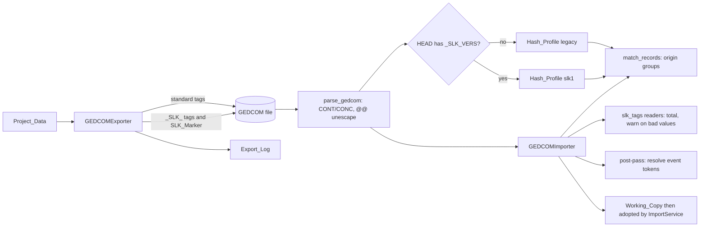

# Design Document: GEDCOM export and round-trip data loss (release 0.3.0)

## Overview

The GEDCOM 5.5.1 exporter writes only a subset of what the project holds, and the importer reads back only a subset of what the exporter writes. This design closes the confirmed gaps with three techniques, in this order of preference:

1. **Standard 5.5.1 tags first** (`NOTE`, `TITL`, `OCCU`, `NAME.TYPE`, `QUAY`, `PAGE`, `REPO`, `CALN`, `SEX U`), so that other programs read the data.
2. **Documented custom tags** with the prefix `_SLK_` where 5.5.1 has no structure (citation context, residence endpoints, partner roles, per-parent parentage). Each has a standard fallback so that a program that ignores the tag still sees the standard content.
3. **Report, do not guess**, for what is not exported (media, place types, DNA, research data, merge history). The Export_Log says so.

Two cross-cutting rules keep this safe:

- **Record identity stays stable.** New nodes change the SHA-256 that `record_hash` computes for event and RESI records. A new Hash_Profile `slk1`, selected by the HEAD marker `_SLK_VERS`, removes exactly the nodes that this spec adds. Files without the marker keep the current rules (Requirement 12, section "Record hash and cross-version identity").
- **The importer never aborts on tags it does not know.** Unknown `_SLK_` tags are ignored and uninterpretable values of known tags give a warning and the standard fallback (Requirement 11, section "Error Handling").

No code is written by this spec. The only model change is the approved optional field `Event.extra_origins` (see "Data Models"); project format 0.5 stays. Package 2 (person filtering) is not touched.

### Verified facts and root causes

All line numbers refer to the working tree of branch Features0.3.0 when this spec was written. "Exporter" is `slaktbusken/gedcom/exporter.py`, "Importer" is `slaktbusken/gedcom/importer.py`.

| # | Loss | Root cause (function, lines) |
|---|---|---|
| 1 | One of six marriages missing | `_write_family` (974-1031) writes family events only through `for event_id in family.event_ids` (1025-1031) and the tag table `_FAMILY_EVENT_TYPE_TO_TAG` (93). `_write_person` (320-398) loops over `data.events` (353) but `_EVENT_TYPE_TO_TAG` (79) has no family types, so an event outside `Family.event_ids` is never written. |
| 2 | Notes, title (and occupation) missing | `_write_person` writes only NAME (340-343), SEX (346-347), family links, events and RESI. The Importer already reads `TITL`, `OCCU` and `NOTE` in `_extract_gedcom_person` (751-759) and stores them in `_create_person` (2111) and `_update_person` (2169). Only the exporter side is missing. The exporter has no CONT/CONC writer: `_write_residence` writes `2 NOTE {residence.notes}` (604) with raw line breaks, which breaks the file structure when the note has several lines. |
| 3 | Name types lost | Exporter line 343 writes `NAME` without `TYPE`. The Importer keeps `(given, surname)` tuples only: `_extract_gedcom_person` (709-726, first NAME is the main name, later ones go to `additional_names`), `_create_person` (2128-2137) and `_update_person` (2210-2241) build `birth` for the first and `other` for the rest. `_update_person` replaces `existing_person.names` (2241), so a re-import also resets the types of existing names. `Name.event_id` has no file representation. |
| 4 | HUSB/WIFE and partner roles | `_write_family` partner loop (1000-1017) slots by `role in ("husband","father")` and `("wife","mother")`; roles such as "make/maka" and "partner" fall through to list order. `_write_person` (346) writes SEX only for `M` and `F`, so `U` has no line and `X` is lost. The Importer hard-codes `husband` and `wife`: `_create_family` (3084-3091), `_update_family` (3175-3179, 3220-3224) and sets `existing_family.partners = partners` (3249), which overwrites stored roles on every re-import. `_process_family_events` (2598) uses the role `spouse`. |
| 5 | Citation semantics | `_write_event_detail` (1067-1112, loop 1101-1110) and `_write_flytt_event` (671-679) flatten `event_citations(event)` into `2 SOUR` plus `3 TEXT <build_citation_text(source)>`. Context, quality, note and aspects are not written, and `FROM_PLACE` citations are skipped. The Importer creates `SourceRef(quality="secondary")` for every SOUR child: `_create_event` (3544-3550), `_create_family_event` (3617-3623), `_derive_residence` (2913), and reads no `QUAY`. 5.5.1 has no SOUR under `DATE` or `PLAC`. |
| 6 | Residences | `_write_residence` (538-625) writes `DATE FROM start.latest TO end.earliest`, `PLAC`, Swedish NOTE lines (594-604) and, per observation, `2 SOUR` plus `3 NOTE Observation: from-to` (607-625). `_derive_residence` (2886-2923) reads only `DATE` and the SOUR pointers, so earliest, latest-as-exact, role, notes, observation periods, quality and event links are never read. `Endpoint.event_id` and `Name.event_id` need an event identity inside the file, which GEDCOM does not have. |
| 7a | Media | `_collect_omissions` (1148-1195) only counts `data.media`; no `OBJE` is written. |
| 7b | Repositories, provider, source type, reference fields | `_write_source` (1038-1062) writes `TITL` and `TEXT` (citation text) only. The Importer maps by `map_gedcom_source` (`gedcom/translation/source_translation.py` 161-349): `detect_source_type` (356-433) guesses the type from keywords, `_derive_provider` (784-802) uses `AUTH` or the ArkivDigital pattern, `parse_church_book_citation` (436-515) rebuilds `image` and `page` as `int` and sets `page` to `None`. `_process_sources` (1625-1683) ignores `REPO` except `_attach_arkiv_digital_repository` (1685-1723). |
| 7c | Place type | The Importer builds places from the `PLAC` text (`_resolve_place`, 3703; `translation/place_translation.py` infers types from the hierarchy), so "church" becomes "ort". |
| 7d | Participant roles | `_create_person_events` (2252-2327) creates every INDI event participant with the role `subject` (2303). |
| 8 | Event types without export | `_EVENT_TYPE_TO_TAG` (79-91) lacks `confirmation`, `will`, `blessing`, `first_communion`; `_FAMILY_EVENT_TYPE_TO_TAG` (93) lacks `divorce_filed`; `custom_individual_event` and `custom_family_event` have no export. The Importer reads all of them (`_INDI_EVENT_TAGS` 216, `_FAM_EVENT_TAGS` 236, `_indi_event_spec` 2329, `_fam_event_spec` 2369). Events of these types are dropped silently. This is a finding beyond the user's list. |
| 9 | Hash side effect | `record_hash` (`record_identity.py` 77) hashes the whole subtree below the record except `_EXCLUDED_TAGS` (50: CHAN, _UPD, _CRE, _UID). Every node that the exporter adds changes the stored `RecordOrigin.record_hash` of the next import (see "Record hash and cross-version identity"). |

## Architecture



Flow of an import after this spec (the order inside `_import_file`, 1279-1479, stays): read HEAD and choose the Hash_Profile; sources and repositories; persons (names with types, notes, title, occupation, INDI events with roles and tokens, RESI); families (partners with roles, parentage links, family events with participants); placement finalisation (`_finalize_placement_events`, 3310); **new** post-pass `_resolve_event_links` that sets `Name.event_id` and `Endpoint.event_id` from tokens, because the marriage events exist only after the families are processed.

The import-atomicity rules of `data-integrity-0-3-0` apply unchanged: the importer works on the Working_Copy of `ImportService`; nothing in this spec writes to Project_Data outside that path.

## Components and Interfaces

### C1. Text writer and reader (new `slaktbusken/gedcom/text_lines.py`; change in `gedcom/parser.py`)

```python
def text_lines(level: int, tag: str, text: str, max_len: int = 200) -> list[str]: ...
def escape_text(text: str) -> str: ...      # leading "@" -> "@@" (5.5.1)
```

`text_lines` splits `text` at `\n` into `CONT` lines and splits lines longer than `max_len` characters into `CONC` lines at a character boundary (never inside a surrogate pair; spaces at the split point stay in the line that precedes `CONC`, because the parser appends `CONC` without separator, `parser.py` 263-303). All free-text writes in the exporter use it: person NOTE, TITL, OCCU, residence notes, role, citation notes, `_SLK_RNOTES`, `_SLK_NOTE`. The parser unescapes `@@` to `@` in values that are not pointers (`_parse_line`, 231). A test (Property 2) pins the round trip.

### C2. Exporter: persons (`_write_person`, 320)

- `1 NAME <given> /<surname>/` followed by `2 TYPE <value>` with the mapping of Requirement 3 (`birth`, `married`, `aka`, `adopted`, `other`) and, through the Event_Link_Module only (C13), `2 _SLK_EREF <token>` directly under `1 NAME` (level 2; level 3 under a level-1 NAME is invalid GEDCOM; under `2 _SLK_START`/`2 _SLK_END` it is level 3) when `Name.event_id` is set.
- `1 SEX M|F|U`; for `X`: `1 SEX U` with `2 _SLK_SEX X`.
- `1 TITL`, `1 OCCU`, `1 NOTE` (CONT/CONC) when the values are not empty.
- Order inside INDI: NAME…, SEX, TITL, OCCU, NOTE, FAMC/FAMS, events, RESI. The order of existing lines does not change.

### C3. Exporter: families (`_write_family`, 974)

Slot rule `_assign_slots(partners, persons) -> SlotAssignment` (the slot is a Partner_Placeholder; see "Partner representation in GEDCOM"):

1. Two partners, both sexes known (`M`/`F`) and different: `M` is HUSB, `F` is WIFE (role and order ignored).
2. Two partners, otherwise (same sex, or one or both `U`/`X`): partner list order, HUSB then WIFE. A single known sex never reorders the pair.
3. One partner: the slot of a known sex `M` (HUSB) or `F` (WIFE), else HUSB. No second partner exists, so no order is lost.
4. Never two lines of the same slot (replaces the existing role-based slotting at 1000-1017).
5. `SlotAssignment` also lists the Placeholder_Conflicts (partner of sex `M` in WIFE, `F` in HUSB, `X` in either). For each conflicting family the exporter adds one Swedish warning, for example "Familj F12 (Anna Berg, Eva Berg): Eva Berg (kvinna) står som HUSB. HUSB/WIFE är en teknisk platshållare, inte ett påstående om kön eller roll. Rätt roller och ordning finns i _SLK_PARTNER.", and after the last such warning one closing line that programs which do not read `_SLK_PARTNER` show the slots as husband and wife.

Then `1 _SLK_PARTNER <xref>` with `2 _SLK_ROLE <role>` per partner in list order, `1 CHIL` as before. `_SLK_PARTNER` is written for every family with at least one partner, so the roles and order are tied to the individuals, not to the slots.

Family events: `_family_events_for(family, data)` returns the events listed in `family.event_ids` that are family-type and not yet written, then orphan events whose participant person-id set equals the partner person-id set of this family and for which this family is the only match. A set `self._written_family_events` guarantees "exactly once". Orphan events with zero or several matching families go to the Individual_Fallback (C4) and into the Export_Log. Participants are written as `2 _SLK_PART <xref>` with `3 _SLK_ROLE <role>` for every participant that has an INDI record. Types: `marriage` MARR, `divorce` DIV, `engagement` ENGA, `divorce_filed` DIVF, `custom_family_event` `EVEN` with `2 TYPE <custom_type_name>`.

Parentage: `_write_family_links` (400) keeps `PEDI` unchanged (output for existing cases is byte-identical) and appends one `2 _SLK_PLINK <parent xref>` with `3 TYPE <parentage_type>` per ParentChildLink whose type is not `biological`, in link order. A link without parent gets an empty value.

### C4. Exporter: events (`_write_person` event loop 353-390, `_write_event_detail` 1067)

- Cause (Requirement 8.10): `_write_event_detail` writes `Event.cause` as the standard `2 CAUS` (through `text_lines`) for death events and every other event type that carries a cause. The importer already reads `CAUS`. The `slk1` profile skips `CAUS` (C11), so a file with and a file without `CAUS` hash equally; old exports never contained `CAUS` from this exporter. Catalog entry K56 changes from `deferred` to `fixed`.
- Tag selection: `_EVENT_TYPE_TO_TAG` gains `confirmation CONF`, `will WILL`, `blessing BLES`, `first_communion FCOM`. `custom_individual_event` and unknown types become `1 EVEN` with `2 TYPE` and, for unknown types, `2 _SLK_EVTYPE <type>`.
- `2 _SLK_EID <event id>` on every exported event structure (all contexts), `2 _SLK_ROLE <role>` when the participant role is not `subject` and the event is not a placement event (`_is_placement_child`, 861, keeps its own rule).
- Individual_Fallback for orphan family events: `1 EVEN`, `2 TYPE <Swedish label>`, `2 _SLK_EVTYPE <type>`, `2 _SLK_EID <token>`, `2 _SLK_ROLE`, date, place and citations as for any event, on the INDI of every participant. The token is the event id, so every participant of one event carries the same token, and different marriages always carry different tokens, even with equal date and place.
- **Fallback import rule (decision 4).** The importer groups `1 EVEN` structures that have `_SLK_EVTYPE` of a family type by `(file, token)` and by nothing else. Structures without a token, and tokens that occur on one INDI only, become single-participant events. A token that occurs twice on one INDI uses the first structure and warns. Date, place, type and participant set are never used to join or to separate.
- **Origin rule for a merged event.** `Event.origin` holds the first contributing record and `Event.extra_origins` holds one RecordOrigin for each other contributing record (user decision, see "Data Models"). The matcher pool has one entry per origin of the owner (`origin` and every `extra_origins` entry), so a second import creates nothing. The merged Event receives one RecordOrigin per contributing INDI record `(file, INDI xref, slk1 hash of that INDI's EVEN structure)`, all in one Origin_Group (the group mechanism of `data-integrity-0-3-0` for objects built from several records). On re-import each INDI record's structure matches its stored origin through `match_records`, so the group is found as a whole and no event, participant or origin is created. If only some of the origins match (a participant was added to the file), the matched origins keep the existing Event, and the unmatched record adds its participant to that Event and one origin to the group, never a second Event.
- Flytt (`_write_flytt_event`, 632): keeps `2 NOTE Från:`; adds `2 _SLK_FROMPLAC <hierarchy>`; the `FROM_PLACE` citations are no longer skipped (671-672).

### C5. Exporter: citations (shared `_write_citation`)

One function writes a citation for an event or an observation:

```python
def _write_citation(self, level, source, ref: SourceRef, ctx: CitationContext | None, *, event_text: bool) -> list[str]
```

Output below `<level> SOUR <xref>`:

| Line | Condition |
|---|---|
| `QUAY 3/2/1` | quality `primary`/`secondary`/`tertiary` |
| `_SLK_QUAL <text>` | any other quality text |
| `_SLK_CTX date/place/from_place` | context other than `event` (events only) |
| `NOTE <note>` | `ref.note` not empty (events); observations use `_SLK_NOTE` |
| `_SLK_ASP <aspect>` | one per aspect, in order |
| `TEXT <build_citation_text(source)>` | events, kept unchanged (OQ-6) |

#### Citation quality: QUAY versus Source_Quality

GEDCOM 5.5.1 defines `QUAY` as the submitter's certainty assessment of the evidence: 3 direct and primary evidence, 2 secondary evidence, 1 questionable reliability, 0 unreliable or estimated. Source_Quality classifies the kind of source (original, derived, compiled). The two overlap but are not the same scale. The mapping is therefore a compatibility convention (decision 3):

| Source_Quality | Written | Read |
|---|---|---|
| `primary` | `QUAY 3` | 3 gives `primary` |
| `secondary` | `QUAY 2` | 2 gives `secondary` |
| `tertiary` | `QUAY 1` | 1 and 0 give `tertiary` |
| any other non-empty text | `_SLK_QUAL <text>`, no QUAY | `_SLK_QUAL` |
| absent | nothing | `secondary` |

`QUAY 0` is never written. The importer reads `_SLK_QUAL` first, so a Släktbusken file never depends on the QUAY scale. The three-value mapping is a bijection, which makes the Släktbusken-to-Släktbusken round trip lossless; `_SLK_QUAL` is written exactly when QUAY could not hold the value. A foreign file that sets QUAY 0 or 1 becomes `tertiary` and is exported as QUAY 1: this is a documented, accepted difference for foreign files (not a Round_Trip of Släktbusken data).

### C6. Exporter: residences (`_write_residence`, 538)

Existing lines are kept byte for byte (DATE, PLAC, the three NOTE prose lines, the SOUR and `3 NOTE Observation:` lines), because they are inside the record hash. New lines:

```
1 RESI
2 DATE FROM 1838 TO 1848                      (unchanged)
2 _SLK_START
3 _SLK_EARLIEST 1830
3 _SLK_LATEST 1838
3 _SLK_PREC year
3 _SLK_EREF event_12
3 _SLK_NOTE …
2 _SLK_END                                      (same children)
2 _SLK_HHROLE piga
2 _SLK_RNOTES …
2 SOUR @S3@
3 NOTE Observation: 1840-1845                 (unchanged)
3 QUAY 2
3 PAGE <page_note>
3 _SLK_OBSFROM 1840
3 _SLK_OBSTO 1845
3 _SLK_NOTE <source_ref.note>
3 _SLK_ASP …
```

`_SLK_START` and `_SLK_END` are written whenever the endpoint has any value, so exact endpoints (earliest equal to latest) and one-sided endpoints round-trip without relying on `DATE`. Observations whose source is not exported keep the existing behaviour (not written).

### C7. Exporter: sources and repositories (`_write_source`, 1038)

`1 TITL`, `1 TEXT` stay. New: `1 _SLK_STYPE`, `1 _SLK_PROV`, `1 _SLK_LEV`, `1 _SLK_KTYP`, `1 _SLK_SREF` with `2 _SLK_FLD <key> <json>`.

Repositories use standard structures first (decision 10). `0 @Rn@ REPO` with `1 NAME`, `1 ADDR`, `1 PHON` / `1 EMAIL` / `1 WWW` (one per list entry), `1 NOTE`; extra `1 _SLK_RTYPE` (`Repository.type`) and `1 _SLK_XID` (one per external id). Used repositories come first in order of first use, then unreferenced repositories in project order; the importer imports top-level REPO records even when no SOUR refers to them (Requirement 9.7). Per RepositoryRef under SOUR: `1 REPO @Rn@`, `2 CALN <call_number>`, `3 MEDI <media_type>` (standard), `2 NOTE <notes>`, and the extras `2 _SLK_RSTYPE`, `2 _SLK_RIMG`, `2 _SLK_RPAGE`, `2 _SLK_RMEDNAME`. Repository ids use the numeric suffix like `_to_gedcom_id` (227) with prefix `R`. Import finds a Repository by (name, type, address) or creates one, so two SOUR records pointing at one REPO share it, and a second import adds nothing. Media (`OBJE`) stays deferred. Source fields without a representation (`provider_ref`, `short_note`, `free_note`, `arkivreferens`, `arkivreferenser`, `media_ids`) are catalogued as `deferred` or `app_only`.

### C8. Exporter: head, log, omissions

`_write_head` (305) adds `1 _SLK_VERS 1` when any SLK_Tag is written (in practice always). `_collect_omissions` (1148) keeps the DNA, research and merge entries (class D) and adds a warning text for media and place types. Warnings are Swedish, as for the existing ones.

### C9. Importer: tolerant readers (new `slaktbusken/gedcom/slk_tags.py`)

Pure functions that take a `GedcomLine` and return values, never raise on bad input, and return a list of problems that the importer turns into `WarningEntry` items:

```python
SLK_TAG_REGISTRY: dict[str, SlkTag]     # the table below, as code
def read_citation(node: GedcomLine) -> CitationData   # quality, ctx, note, aspects
def read_endpoint(node: GedcomLine) -> EndpointData | None
def read_partners(fam: GedcomLine) -> list[tuple[str, str]] | None
def read_plinks(famc: GedcomLine) -> list[PlinkData]
def read_name_type(name: GedcomLine) -> str | None
def read_source_fields(sour: GedcomLine) -> SourceExtras
```

The unknown-tag rule lives here: any child whose tag starts with `_SLK_` and is not in the registry is skipped without a warning (info line in the import log).

### C10. Importer integration points

| Function | Change |
|---|---|
| `_extract_gedcom_person` (691) | collect `(given, surname, type_or_None)`; read `_SLK_SEX`; keep `title`, `occupation`, `notes`. |
| `_create_person` (2111), `_update_person` (2169) | build names through one helper `_build_names(gp, existing)` that applies Requirement 3 (types, positional fallback only when no NAME has TYPE, existing types kept on update). |
| `_create_person_events` (2252), `_create_event` (3502) | `participant_role` from `_SLK_ROLE`; citations through `read_citation`; `_SLK_EID` into the token map; `_SLK_EVTYPE`; `_SLK_FROMPLAC`; shared token merges participants (OQ-12). |
| `_indi_event_spec` (2329), `_fam_event_spec` (2369) | `EVEN` with `_SLK_EVTYPE`. |
| `_process_one_family` (3035), `_create_family` (3066), `_update_family` (3145) | partners from `read_partners` when it matches HUSB/WIFE, else husband/wife; update keeps roles for an equal partner set; links from `read_plinks`. |
| `_process_family_events` (2581), `_create_family_event` (3578) | participants from `_SLK_PART`. |
| `_derive_residence` (2886), `_incoming_residence_fingerprint` (2696) | endpoints from `read_endpoint`, observations with period/quality/note, role and notes; fingerprint for the legacy claim leaves out `event_id`. For files without the SLK_Marker only, `read_legacy_prose` (in `slk_tags.py`) parses the exact formats below (decision 9). |
| `_finalize_placement_events` (importer.py), `foster_sync._reconcile_derived_family` | **Placement sync fix (task 5.4).** The placement event is recorded on the child's FAMC family only when that family is placement-derived. When the FAMC family is an imported regular family, the importer creates or reuses a separate placement-derived family for the placement, so `_reconcile_derived_family` never drops biological siblings, resets partner roles or order from `_SLK_PARTNER`, or loses a parentless donor link of an imported family. Foster round-trip behaviour (PEDI foster, `EVEN TYPE Fosterhem` with FAMC, paired end events) stays as before. |
| `_import_file` (1279) | read HEAD, choose Hash_Profile, init token map; the Event_Link_Module hook (C13) runs after `_finalize_placement_events`. |
| `_process_sources` (1625), `map_gedcom_source` (source_translation 161) | `_SLK_STYPE`, `_SLK_PROV`, `_SLK_LEV`/`_SLK_KTYP`, `_SLK_SREF`, `REPO` records and refs with the repository tags of the registry. |

**Import counters (Requirement 12.9).** `ImportResult.families_added` counts only families that do not exist in the project before the import. A derived foster family that the importer rebuilds and folds back into an existing family is not counted, so the re-import of the `MergeTest.json` export reports 0.

**Legacy prose (decision 9).** `read_legacy_prose(resi: GedcomLine) -> LegacyResidence` accepts exactly these line forms and nothing else: `NOTE Tidigast början: <ISO date>`, `NOTE Senast slut: <ISO date>`, `NOTE Roll: <text>` under RESI, and `NOTE Observation: YYYY` or `Observation: YYYY-YYYY` under a `SOUR` of the RESI. Prefixes match case-sensitively at the start of the line; dates and years are validated (ISO calendar date, four-digit years, start not after end). A line with an invalid value stays ordinary note text and gives a warning. It runs only when HEAD has no `_SLK_VERS`. No other free text is interpreted.

### C11. Record hash (`record_identity.py`)

`record_hash(record, source_ids, profile="legacy")` gains the `profile` parameter. For `slk1` the canonical walk (`_canonical_lines`, 65) skips: every node whose tag starts with `_SLK_`; every `CAUS` child of an event record (Requirement 8.10); below any `SOUR` line the children `QUAY`, `PAGE`, `DATA`, `OBJE` and every `NOTE` whose value does not start with `Observation:`. The callers `_match_owner_events` (2397) and `_match_person_residences` (2641) pass `self._hash_profile`. `residence_fingerprint` (116) gets `ignore_links: bool` for the legacy claim.

### C12. Verification harness (tests only, `tests/test_gedcom_roundtrip/`)

- `stable_view.py`: `stable_view(data) -> StableView`, no ids. Person key: sorted tuple of `(name type, given, surname)` plus sex plus birth date. Events: `(type, custom_type_name, date, place chain, sorted participants (person key, role), citations (source title, context, quality, note, aspects), cause)`. Families: sorted partner keys with roles, child keys, parentage types. Residences: person key, place chain, endpoints, role, notes, observations, linked event keys.
- `difference_catalog.py`: code, Difference_Class, status (`fixed`, `deferred`, `app_only`), requirement.
- `comparison.py`: `compare(a, b) -> list[Difference]`.
- `scripts/gedcom_roundtrip_report.py`: runs the Fixture_Set, prints Markdown with counts per class and status.

### C13. Event_Link_Module (new `slaktbusken/gedcom/event_links.py`; implemented last)

Decision 5 puts `Name.event_id` and `Endpoint.event_id` into 0.3.0 but isolates them so they can be dropped without touching the core fixes:

```python
def export_name_link(name: Name, tokens: EventTokens) -> list[str]: ...      # line `2 _SLK_EREF <token>`
def export_endpoint_link(endpoint: Endpoint, tokens: EventTokens) -> list[str]: ...
def resolve_event_links(data: ProjectData, pending: PendingLinks, token_map: dict[str, str], log: ImportLog) -> None: ...
```

- The exporter calls `export_name_link` and `export_endpoint_link` from one hook each (inside the NAME and endpoint writers). The importer collects `_SLK_EREF` values into `PendingLinks` through one hook and calls `resolve_event_links` once, after `_finalize_placement_events`.
- No other function reads or writes `_SLK_EREF`, `Name.event_id` or `Endpoint.event_id`. The core writers and readers skip the tag as an unknown child.
- All tests are in `tests/test_gedcom_roundtrip/test_event_links.py` (Property 10). Removing the module and that test file leaves every other test green (Requirement 16 criterion 5).
- `residence_fingerprint(ignore_links=True)` stays in the core, because legacy matching must work without the module.

## Tag Registry

The prefix `_SLK_` is approved (decision 1). Every `_SLK_` tag carries data that its fallback column already represents in a poorer form, so an ordinary GEDCOM reader that ignores all extensions still gets a useful file. The table is the specification of `SLK_TAG_REGISTRY` in `slk_tags.py`.

Rules for all rows:

- "Structure" gives the parent tag, the children and the cardinality per parent (`0:1` optional once, `0:n` repeatable, `1:1` required once).
- **Bad value rule.** A value that the reader cannot interpret gives one `WarningEntry` (Recoverable_Input_Problem), the standard fallback of the row is used, and the import continues. A tag that occurs below a parent that the registry does not list is ignored without a warning. An unknown `_SLK_` tag and its children are ignored with one info line.
- Where the Cardinality is `0:1` and the tag occurs twice, the first occurrence is used and a warning is added.
- Rows 6.x of requirements say which tags the exporter writes when.

| Tag | Purpose | Structure | Supported values | Importer behaviour (including bad values) | Standard fallback |
|---|---|---|---|---|---|
| `_SLK_VERS` | Marks a file as written to this registry; selects Hash_Profile `slk1` | HEAD; no children; `0:1` | `1` | Absent: profile `legacy`. Any other value: profile `legacy`, one warning (no `slk1` rules are guessed) | `HEAD.SOUR` names Släktbusken |
| `_SLK_EID` | Names one Event inside the file so that other structures and the fallback can refer to it | event structure (INDI event, FAM event, `EVEN`); none; `0:1` | non-empty text without spaces | Empty: ignored, event is single. Twice on one INDI with equal token: first used, warning | none |
| `_SLK_EVTYPE` | Släktbusken event type of an `EVEN` | `EVEN`; none; `0:1` | event type text | Known type: that type. Unknown type: `custom_individual_event` with the `TYPE` text, warning | `EVEN.TYPE` text |
| `_SLK_ROLE` | Participant role of an INDI event, event participant or partner | INDI event, `_SLK_PART`, `_SLK_PARTNER`; none; `0:1` | role text | Empty or absent: `subject` (INDI event), `spouse` (FAM event participant), `husband`/`wife` by slot (partner, only if no `_SLK_PARTNER` is usable) | none |
| `_SLK_PART` | Participant of a family event | FAM event; child `_SLK_ROLE`; `0:n` | `@Ix@` of an INDI in the file | Pointer to no INDI: entry skipped, warning. No usable entry: participants and role `spouse` as before | `HUSB`, `WIFE` of the FAM |
| `_SLK_PARTNER` | Partner list entry: order and role, tied to the individual | FAM; child `_SLK_ROLE`; `0:n` | `@Ix@` of an INDI in the file | Used only if the entries name exactly the persons of HUSB and WIFE; else all entries ignored, warning, partners from HUSB/WIFE with roles `husband`, `wife`. Never changes `Person.sex` | `HUSB`, `WIFE` (placeholders) |
| `_SLK_SEX` | Sex `X` | `SEX`; none; `0:1` | `X` | Other value: ignored, warning, sex from `SEX` | `SEX U` |
| `_SLK_PLINK` | Parent-child link with its own parentage type | `FAMC` (child side); child `TYPE`; `0:n` | `@Ix@` of a parent, or empty for a link without parent | Pointer to no INDI: link without parent, warning. Unknown `TYPE`: `PEDI` of the `FAMC` is used, warning | `PEDI` |
| `_SLK_QUAL` | Citation quality that QUAY cannot hold | citation `SOUR`; none; `0:1` | non-empty text | Read before `QUAY`. Empty: ignored, `QUAY` used | `QUAY` |
| `_SLK_CTX` | Context of a citation of an event | citation `SOUR` of an event; none; `0:1` | `date`, `place`, `from_place` | Other value: context `event`, warning. Context whose carrier (date, place, from_place) is absent: event level, no warning | event-level `SOUR` |
| `_SLK_ASP` | One aspect of a citation | citation `SOUR`; none; `0:n`, order kept | text | Empty: skipped | none |
| `_SLK_FROMPLAC` | `from_place` of a flytt event | `EVEN` of a flytt; none; `0:1` | place hierarchy text | Empty: no `from_place` | `NOTE Från:` |
| `_SLK_START`, `_SLK_END` | Container of one residence endpoint | `RESI`; `_SLK_EARLIEST`, `_SLK_LATEST`, `_SLK_PREC`, `_SLK_EREF`, `_SLK_NOTE`; `0:1` each | none | Present: the endpoint is built from the children, `DATE` and prose are ignored for it. All children bad: endpoint from `DATE`, warning | `DATE FROM … TO …` |
| `_SLK_EARLIEST`, `_SLK_LATEST` | Endpoint bounds | `_SLK_START`/`_SLK_END`; none; `0:1` each | ISO date `YYYY`, `YYYY-MM` or `YYYY-MM-DD` | Invalid date: that bound unset, warning | `DATE`, prose `NOTE` |
| `_SLK_PREC` | Endpoint precision | `_SLK_START`/`_SLK_END`; none; `0:1` | `day`, `month`, `year`, `approximate` | Other value: precision derived from the date, warning | `ABT` in `DATE` |
| `_SLK_EREF` | Link of a Name or an endpoint to an Event (Event_Link_Module) | `NAME`, `_SLK_START`, `_SLK_END`; none; `0:1` | an Event_Token of the file | Token without event: link empty, warning. Module removed: ignored | none |
| `_SLK_NOTE` | Endpoint note or note of an observation citation | `_SLK_START`/`_SLK_END`, citation `SOUR` of a RESI; none; `0:1` | text (CONT/CONC) | Empty: ignored | none |
| `_SLK_HHROLE` | `ResidenceFact.role_in_household` | `RESI`; none; `0:1` | text | Empty: unset | `NOTE Roll:` |
| `_SLK_RNOTES` | `ResidenceFact.notes` | `RESI`; none; `0:1` | text | Empty: unset | `NOTE` |
| `_SLK_OBSFROM`, `_SLK_OBSTO` | Observation period | `SOUR` under `RESI`; none; `0:1` each | `YYYY` | Invalid year or start after end: period from `NOTE Observation:`, else unset, warning | `NOTE Observation:` |
| `_SLK_STYPE` | `Source.source_type` | SOUR record; none; `0:1` | a known source type | Unknown value: keyword detection of `detect_source_type`, warning | keyword detection |
| `_SLK_PROV` | `Source.provider` | SOUR record; none; `0:1` | text | Empty: provider as before | `AUTH` |
| `_SLK_LEV`, `_SLK_KTYP` | Leverantör and Källtyp by name | SOUR record; none; `0:1` each | name text | No such name in the project: ids stay empty, no warning | none |
| `_SLK_SREF` | Container of structured reference fields | SOUR record; `_SLK_FLD`; `0:1` | none | Empty or all fields bad: reference text parsed as before | `TEXT` |
| `_SLK_FLD` | One structured reference field | `_SLK_SREF`; none; `0:n` | `<key> <json>` where json is a string, an integer or `null` | Bad JSON or unknown key: field skipped, warning | `TEXT` |
| `_SLK_RTYPE` | `Repository.type` | REPO record; none; `0:1` | text | Empty: type empty | none |
| `_SLK_XID` | One entry of `Repository.external_ids` | REPO record; none; `0:n` | text | Empty: skipped | none |
| `_SLK_RSTYPE` | `RepositoryRef.source_type` | `1 REPO` of a SOUR; none; `0:1` | text | Empty: unset | none |
| `_SLK_RIMG`, `_SLK_RPAGE` | `RepositoryRef.image_number`, `page_number` | `1 REPO` of a SOUR; none; `0:1` each | non-negative integer | Not an integer: unset, warning | none |
| `_SLK_RMEDNAME` | `RepositoryRef.media_name` | `1 REPO` of a SOUR; none; `0:1` | text | Empty: unset | `CALN.MEDI` holds the media type only |

Standard tags used with their 5.5.1 meaning: `NAME.TYPE` (aka, birth, immigrant, maiden, married, user-defined), `QUAY`, `PAGE`, `NOTE`, `TITL`, `OCCU`, `REPO`, `CALN`, `MEDI`, `ADDR`, `PHON`, `EMAIL`, `WWW`, `SEX U`, `DIVF`, `CONF`, `WILL`, `BLES`, `FCOM`. `TYPE` under `_SLK_PLINK` and under NAME are read by the same tolerant reader.

## Partner representation in GEDCOM

**Question (decision 2).** Is there a more faithful GEDCOM 5.5.1-compatible representation of partners than HUSB/WIFE slots chosen by the exporter?

**Findings.**

- GEDCOM 5.5.1 allows at most one `HUSB` and at most one `WIFE` per FAM record. The 5.5.1 text describes the pair as husband and wife. Other programs read the two slots as the two parents.
- GEDCOM 7 keeps `HUSB` `{0:1}` and `WIFE` `{0:1}`, says the FAM record may be used "regardless of the gender of the partners", and states that sex, gender, titles and roles of partners should not be inferred from the slot (source: [FamilySearch GEDCOM 7 specification](https://gedcom.io/specifications/FamilySearchGEDCOMv7.html)). It allows displays to use the slots as layout hints, and says the FAM structure will be revised later.
- GEDCOM 5.5.5 (unofficial re-issue): this session could not fetch the primary text. A reader project ([genea-app README](https://github.com/genea-app/genea-app/blob/main/README.md)) describes same-sex families as being stored in the HUSB and WIFE records and states that GEDCOM has no gender-neutral partner record. Treat the claim that 5.5.5 reads the slots as partner 1 and partner 2 as unverified.
- Two `HUSB` or two `WIFE` lines violate the cardinality of 5.5.1 and 7. No specification says which line a reader keeps, and this research found no documentation of what the common programs do. Two `HUSB` lines would therefore risk a lost partner or a rejected file, and the design does not use them.
- `ASSO`/`RELA` on an INDI links two persons without a FAM. 5.5.1 defines `RELA` as the role of the person that `ASSO` points to. [Geneawiki](https://fr.geneawiki.com/wiki/Informatique_-_saisie_des_couples) recommends this for same-sex couples. A FAM without HUSB/WIFE has no parent link between the persons and the children in the other program, because only the FAM record links parents and children. Gramps reports ASSO as recognised but not supported on import, and drops its subordinate lines ([Gramps forum](https://gramps.discourse.group/t/difficulty-migrating-witness-data-from-heredis-to-gramps-via-gedcom/7974)).
- Family events (`MARR`, `DIV`) and the children belong to the FAM record, so a partnership needs a FAM with its partners.

**Result.** No 5.5.1-valid representation exists that is both faithful to the roles and readable by other programs as a family. The chosen representation is the documented compromise of Requirement 4:

1. The FAM keeps `HUSB` and `WIFE` as **Partner_Placeholders**, so that parents, children and events stay linked in every program.
2. `_SLK_PARTNER` with `_SLK_ROLE` records the original partner order and roles, tied to the individuals by pointer.
3. Placeholder rule: when both sexes are known and differ, the slot follows sex; otherwise partner list order. The slot is a structural placeholder, never a fact about sex or role.
4. No list order or slot is ever turned into a sex or a role by Släktbusken. The exporter warns in Swedish for every family whose placeholder contradicts a known sex (Requirement 4 criterion 14).

**Sex-inference finding.** `grep` of `slaktbusken/gedcom/importer.py` shows that `Person.sex` is set only in `_extract_gedcom_person` (728-732) from the `SEX` line (default `U`, invalid values `U`) and copied in `_create_person` (2141, 2219) and `_update_person` (2231). `_extract_gedcom_family` (784-826) reads HUSB and WIFE only as pointers. The family code (3047-3224) uses HUSB/WIFE only to assign the roles `husband` and `wife`, and the only comparison of sex is the match test at 2033, which reads `gp.sex`. **No code path infers sex from HUSB or WIFE.** The roles `husband` and `wife` assigned from the slots of a file without `_SLK_PARTNER` are role labels, not sex; Requirement 4 criteria 12, 13 and 18 pin this by tests. The only weakness found is the role assignment for foreign files (3084-3091, 3175-3179, 3220-3224), which this spec leaves as the standard reading of the slots.

**Third-party compatibility limitations.**

| Case | What another program shows |
|---|---|
| Same-sex family, or unknown sex | A husband and a wife (or two parents) in the slot order; the shown role may contradict the person's sex |
| Gender-neutral roles ("make/maka", "partner") | Husband and wife |
| Partner order not equal to slot order | Order of the slots |
| Programs that drop unknown tags on save | `_SLK_PARTNER` is lost after one save; the placeholder slots remain |
| Programs that validate sex against the slot | May warn about a conflict; the exporter's warning already names these families |
| Individual_Fallback events (orphan marriages) | `EVEN` structures on each person, not a marriage of the couple |
| Citation context, aspects, quality kind | Event-level citations with `QUAY`; quality appears as a certainty value |
| Residence endpoints, observations | `RESI` with `DATE FROM … TO …` and Swedish `NOTE` lines |
| Event links, repository extras, structured reference fields | Not shown |

## Decisions

All open questions of the first draft are resolved. The OQ numbers stay for traceability.

| # | Decision | Effect |
|---|---|---|
| OQ-1 | `_SLK_` prefix approved with the full Tag_Registry (five columns) | Tag Registry above, `SLK_TAG_REGISTRY` in code |
| OQ-2 | Conditional approval: HUSB/WIFE placeholders only as a documented compromise with safeguards (a) to (g) | "Partner representation in GEDCOM", Requirement 4 criteria 1 to 18, task 5 |
| OQ-3 | QUAY 3, 2, 1; 0 read as tertiary; `_SLK_QUAL` whenever QUAY is not lossless; QUAY versus Source_Quality documented | C5, Requirement 6 criteria 1, 6, 13 to 16 |
| OQ-4 | Individual_Fallback with token-only reconstruction; origin rule for merged events | C4, Requirement 1 criteria 8 to 14 |
| OQ-5 | Event links in 0.3.0, implemented last, isolated in `event_links.py` | C13, Requirement 16, task 11 |
| OQ-6 | Keep `3 TEXT` and the Swedish NOTE lines; add structured metadata without changing re-import identity | Hash_Profile `slk1`, Requirement 12 |
| OQ-7 | Replace the two loss-pinning assertions by equality assertions | Testing Strategy, Requirement 15 criterion 5 |
| OQ-8 | New mandatory group "GEDCOM-rundresa"; Dataskydd stays mandatory | Requirement 15, task 14 |
| OQ-9 | Parse only the known legacy Swedish formats with exact prefixes and validated values, only for files without the SLK_Marker | C10, Requirement 7 criteria 7 to 7b |
| OQ-10 | `MergeTest.json` is a demo file with fictive persons; the fixtures may be committed | Fixture_Set under `tests/fixtures/gedcom_roundtrip/` |
| OQ-11 | Repositories, providers and source types now, with standard SOUR/REPO/CALN where possible | C7, Requirement 9 |
| OQ-12 | Merge individual events by `_SLK_EID` token only | C4, Requirement 1 criteria 8 to 14 |

**Implementation priority** (the hash profile and the test harness stay first): 1. missing events and family roles; 2. names, notes, titles; 3. citation context, quality, aspects; 4. residence observations and source metadata; 5. repository interoperability (media stays deferred); 6. event links last.

## Data Models

**Accepted schema addition (user decision, added by task 6.2).** `Event.extra_origins: list[RecordOrigin]`, optional, default empty. A shared event rebuilt from several INDI records of one file (the Individual_Fallback joined by `_SLK_EID`) keeps one RecordOrigin per contributing record: `origin` is the first record, the others are in `extra_origins`. The field is omitted from the project JSON when empty, so the format stays 0.5 and old files are unchanged. It is registered in the person reference inventory as `event.extra_origins` (rule H) with a rule test, and `validators.py` validates it. Requirement 13.3 names this as the single exception. No other dataclass changes, no other project field, no format change.

The other new structures are in code and tests:

```python
@dataclass(frozen=True)
class SlkTag: name: str; parents: tuple[str, ...]; value_kind: str; fallback: str
@dataclass(frozen=True)
class CitationData: quality: str; context: str; note: str; aspects: tuple[str, ...]; problems: tuple[str, ...]
@dataclass(frozen=True)
class EndpointData: earliest: str | None; latest: str | None; precision: str | None; event_token: str | None; note: str | None
@dataclass
class Difference: code: str; klass: Literal["A","B","C","D"]; where: str; expected: object; actual: object
```

The Event_Token map `dict[str, str]` (token to event id) lives on the importer instance for one import. It is not stored.

## Record hash and cross-version identity

**Question: does adding new sub-tags change the record hash of records exported before this change?** No: the hash of a stored origin never changes. What changes is the hash of a *new export* of the same data, and therefore whether a re-import finds the old object.

Without a mitigation the effects are:

1. A project was imported from an old file. The stored `RecordOrigin.record_hash` is the hash of the old record (for example `1 BIRT / 2 DATE / 2 SOUR / 3 TEXT`). The new file has the same record plus `_SLK_EID`, `QUAY`, `_SLK_CTX`. `match_records` step 2 (`record_identity.py` 298) finds no bucket with that hash. Step 3 (318) looks only at legacy objects without origin. Step 4 (344) classifies the record `NEW_AMBIGUOUS`: **a second copy of the event or residence is created for each record that gained a node**, with a review warning, and the old object is counted in `events_missing_from_file`.
2. The reverse direction (old file into a project imported from a new file) gives the same duplicates, because the old record lacks the new nodes.
3. Records that gain no node (for example a plain `BIRT` with DATE and PLAC) keep their hash. Only citation-bearing events, RESI records and FAM events change, which are the records of this spec.

**Mitigation (decided in this design, approval item OQ-6 covers the alternative):**

- Hash_Profile `slk1` removes exactly the nodes this spec adds (see C11) before hashing. The exporter keeps every pre-existing line of event and RESI records byte for byte (Requirement 12.8): `3 TEXT` under event citations, `2 NOTE Tidigast början:`, `Senast slut:`, `Roll:`, the plain notes and `3 NOTE Observation:`. A record from the new exporter then hashes to the value that the old exporter's record had.
- The marker `_SLK_VERS` in HEAD selects the profile. Files from other programs and from old Släktbusken versions have no marker and use `legacy`, so foreign files that contain `QUAY` or `PAGE` keep their stored hashes (excluding `QUAY` globally would give duplicates on the first re-import of every foreign file).
- Golden vectors for `legacy` do not change (`record_identity_golden.py`). New vectors pin `slk1`.
- A re-import whose hash is equal but whose `_SLK_` content differs from the stored object leaves the object unchanged, as `data-integrity-0-3-0` requirement 10.14 requires. That is a documented limit (Known limitations).
- The legacy fingerprint claim (step 3) for user-made residences improves: `_incoming_residence_fingerprint` (2696) compares the residence the importer would create, which now contains earliest, latest, role, notes and observation fields, so an exported and re-imported legacy residence is claimed instead of duplicated. Event links are left out of the comparison (they resolve after the families exist).

Alternatives considered: (a) add `_SLK_` to `_EXCLUDED_TAGS` only (simple, but `QUAY`, `PAGE`, citation `NOTE` still change the hash); (b) move `3 TEXT` and the Swedish prose to standard places and add a one-time "rehash claim" step (cleaner file, new matcher rule that conflicts with "nothing is claimed by content" of the previous spec); (c) accept one-time duplicates. The chosen mitigation costs nothing in the matcher and leaves the file slightly redundant.

## Scope for 0.3.0 versus deferred

Size: S under one day, M one to three days, L more. Risk: data risk for existing projects and files.

| Item | Recommendation | Size | Risk | Differences (class) |
|---|---|---|---|---|
| Hash_Profile `slk1`, marker, golden vectors, cross-version tests | Implement now (first) | M | M (identity matcher) | K41 |
| Text writer CONT/CONC/`@@` and parser unescape | Implement now | S | L | K5 (A) |
| Person NOTE, TITL, OCCU | Implement now | S | L | K3, K4, K42 (A) |
| NAME.TYPE export and import, keep types on update | Implement now | S | L | K6 (A), K7, K8 (B) |
| Sex U and X | Implement now | S | L | K13 (A/C) |
| Family events exactly once, orphan attach, Individual_Fallback | Implement now | M | M | K1, K2 (A) |
| Sex-based HUSB/WIFE, `_SLK_PARTNER`, roles kept on update | Implement now | M | M | K10 (A), K11, K12 (B/C) |
| Parentage per parent `_SLK_PLINK` | Implement now | S | M | K14 (A/C), K15 (B) |
| Missing event types, participant roles, `_SLK_EID`, `_SLK_EVTYPE` | Implement now | M | M | K27 (A), K28 (C) |
| Multi-participant individual events merged by token only | Implement now (decision 4) | S | M | K29 (A/B) |
| Citation block: QUAY, context, note, aspects, import quality | Implement now | M | M | K16, K17, K18, K20 (A/B/C) |
| `from_place` via `_SLK_FROMPLAC` | Implement now | S | L | K21 (C) |
| Residence structured endpoints, observations, role, notes | Implement now | M | M | K22, K23, K24, K26 (B/C) |
| Event links `Name.event_id`, `Endpoint.event_id` via tokens (decision 5) | Implement now, last, isolated in `event_links.py` (C13); can be dropped | M | M | K9, K25 (C) |
| Repositories (`REPO`, `CALN`, `MEDI`, extras), provider, source type, structured reference, Leverantör by name | Implement now (decision 10) | M | L | K31, K32, K33, K34 (A/B) |
| Export log: media, place types, fallback, DNA etc. | Implement now | S | L | K30, K35, K37 (log) |
| Legacy prose parse of old RESI NOTE lines, exact formats, no-marker files only (decision 9) | Implement now | S | M | K22, K24 (B) |
| Verification harness, catalog, report script, mandatory group | Implement now | M | L | all |
| `3 TEXT` under citations moved to a standard place | Defer (needs hash migration, OQ-6) | M | H | K19 (A) |
| Media: `OBJE`, portraits, links, file packaging | Defer to 0.4.0 (needs a zip or folder export format) | L | M | K30 (A, C) |
| Place type, alternative names, notes, external ids, region levels | Defer (touches place translation) | M | M | K35, K36 (C) |
| Full backup in GEDCOM (DNA, research, merge history, `connection_overrides`) | Do not export; use the project file | n/a | n/a | K37, K38 (D) |
| `_UID` export for events | Defer (interacts with `CHANGED_UID` outcome) | M | H | none |

### Classification of every known difference

Class: A missing from the GEDCOM output; B present in the GEDCOM but lost or changed by the importer; C not representable in 5.5.1 without extensions; D Släktbusken-only data that is not exported. Where two classes apply the first is the root cause and the second the reason an extension is needed. Status `fixed` means the comparison must report zero such differences after this spec.

| Code | Difference | Class | Status after 0.3.0 |
|---|---|---|---|
| K1 | Marriage outside `Family.event_ids` not written | A | fixed |
| K2 | Orphan family event without unique family | A | fixed (fallback and log) |
| K3 | Person notes not written | A | fixed |
| K4 | Person title not written | A | fixed |
| K5 | Multi-line text breaks the file (residence notes) | A | fixed |
| K6 | NAME written without TYPE | A | fixed |
| K7 | Name type chosen by position on import | B | fixed |
| K8 | Update import resets existing name types | B | fixed |
| K9 | `Name.event_id` | C | fixed (decision 5) |
| K10 | HUSB/WIFE by list order | A | fixed |
| K11 | Partner roles collapse to husband and wife | B, C | fixed |
| K12 | Update import overwrites partner roles | B | fixed |
| K13 | Sex `X` written without SEX; `U` comes back as `U` (no loss) | A, C | fixed |
| K43 | HUSB/WIFE placeholder shown by other programs as husband and wife; `_SLK_PARTNER` ignored by them | C | deferred (third-party limitation, documented) |
| K14 | Parentage `legal`, `step`, `unknown_donor`, `donation` not written | A, C | fixed |
| K15 | One PEDI applied to both parents | B | fixed |
| K16 | Date and place citations flattened to event level | C | fixed |
| K17 | Citation quality not written; `QUAY` ignored; import sets `secondary` | A, B | fixed |
| K18 | Citation note and aspects not written | A, C | fixed |
| K19 | `3 TEXT` under a citation holds source text | A | deferred (decision 6) |
| K20 | `from_place` citations skipped | C | fixed |
| K21 | `from_place` not restored | C | fixed |
| K22 | Observation periods (prose written, ignored by importer) | B, C | fixed |
| K23 | Observation quality | A, B | fixed |
| K24 | `start.earliest`, `end.latest`, exact endpoints (prose ignored) | B, C | fixed |
| K25 | `Endpoint.event_id` | C | fixed (decision 5) |
| K26 | Residence role and notes (prose written, ignored) | B | fixed |
| K27 | Event types without export tag | A | fixed |
| K28 | Participant roles become `subject` | C | fixed |
| K29 | Individual event with several participants written once per person, imported as separate events | A, B | fixed (decision 4) |
| K30 | Media, portraits, media links | A, C | deferred |
| K31 | Repositories and call numbers | A, B | fixed (decision 10) |
| K32 | Provider, `leverantor_id`, `kalltyp_id` | A, C | fixed |
| K33 | `source_type` invented by keywords | A, B | fixed |
| K34 | Structured reference value types, `page` null | B | fixed |
| K35 | Place type (`church` to `ort`) | C | deferred |
| K36 | Other place attributes (alternative names, notes, external ids) | C | deferred |
| K37 | DNA, clusters, research cases, merge history, `connection_overrides` | D | app_only |
| K38 | Event origins, retired ids, translation files, edit state | D | app_only |
| K39 | Generated ids (person, family, event, source ids) | D | app_only |
| K40 | Person `profile_media_id` | A, C | deferred (media) |
| K41 | Record hash changes for records with new nodes | B (identity) | fixed (mitigation) |
| K42 | Person `occupation` not written | A | fixed |

## Correctness Properties

*A property is a characteristic or behavior that should hold true across all valid executions of a system-essentially, a formal statement about what the system should do. Properties serve as the bridge between human-readable specifications and machine-verifiable correctness guarantees.*

Redundancy was removed as follows. Criteria 3.1 to 3.4 form one name-type round trip. Criteria 4.4, 4.5, 4.8 and 4.9 form one partner and sex round trip. Criteria 6.x, 6.11 and 6.12 form one citation round trip. Criteria 7.x form one residence round trip. Criteria 1.1, 1.3 and 1.5 form one family-event check. Criteria 11.1 and 13.5 form one output-hygiene check. Criteria 8.x and 1.6 form one event round trip. Examples (old-file behaviour, log texts, schema smoke tests) are unit tests.

### Property 1: Every family event is written exactly once, in the right family, without changing the project

*For any* project with families and family-type events, some listed in `Family.event_ids` and some not, exporting writes each family-type event exactly once: in the first family that lists it, else in the single family whose partner set equals its participant set, else as an Individual_Fallback with an Export_Log warning; the number of FAM records equals the number of families, and the serialized project is unchanged by the export.

**Validates: Requirements 1.1, 1.2, 1.3, 1.4, 1.5**

### Property 2: Free text round-trips

*For any* text (line breaks, leading and trailing spaces, `@`, non-ASCII, lines longer than 255 characters) used as person note, title, occupation, residence note, role or citation note, the text equals the original after export and import, and no output line is longer than 255 characters.

**Validates: Requirements 2.1, 2.2, 2.3, 2.5, 2.6**

### Property 3: Name types and order round-trip

*For any* person with a list of names whose types come from `birth`, `married`, `alias`, `adopted`, `other`, the imported person has the same names with the same types in the same order, whatever the list position.

**Validates: Requirements 3.1, 3.2, 3.3, 3.4, 3.6**

### Property 4: Placeholder slots follow the placeholder rule and never repeat

*For any* family with one or two partners of any sex and role, the FAM record has at most one HUSB and at most one WIFE, every partner is written in exactly one slot, a pair of known and different sexes `M` and `F` has the `M` partner as HUSB, any other pair is in partner list order, and the Export_Log has one family warning for exactly each family with a Placeholder_Conflict.

**Validates: Requirements 4.1, 4.2, 4.3, 4.14**

### Property 5: Partners, roles, order and sex round-trip, and sex is never inferred

*For any* family with partners of any role text (including `make`, `maka`, `partner`), any order and any combination of sexes `M`, `F`, `U`, `X` (same-sex and unknown-sex included), the imported family has the same partners in the same order with the same roles, every imported person has the sex of the original (unknown stays `U`, explicit sex is never changed by the HUSB or WIFE slot), and importing the same file without `_SLK_PARTNER` leaves every sex unchanged.

**Validates: Requirements 4.4, 4.5, 4.8, 4.9, 4.11, 4.12, 4.13, 4.17, 4.18**

### Property 6: Parentage links round-trip

*For any* family with children and ParentChildLinks of any parentage type (including a link without parent), the imported family has the same set of links with the same types.

**Validates: Requirements 5.2, 5.3, 5.4**

### Property 7: Events round-trip with roles, types and participants

*For any* event of any known type, with any participant roles (except placement events), the imported project has an event of the same type with the same participants and roles, and custom types keep their names.

**Validates: Requirements 1.6, 8.1, 8.3, 8.4, 8.5, 8.6**

### Property 8: Citations round-trip with context, quality, note and aspects

*For any* event with citations in the contexts `event`, `date`, `place` and `from_place`, with any quality, note and aspects, the imported event has the same citations in the same contexts (a citation in the context `date`, `place` or `from_place` whose carrier is absent is stored at event level).

**Validates: Requirements 6.1, 6.2, 6.3, 6.4, 6.6, 6.7, 6.8, 6.9, 6.10, 6.11, 6.12**

### Property 9: Residences round-trip with all structured data

*For any* residence, including exact endpoints, one-sided endpoints, precision, endpoint notes, role, notes and observations with period, quality, page note and aspects, the imported residence has the same values.

**Validates: Requirements 7.1, 7.3, 7.4, 7.5, 7.8**

### Property 10: Event links resolve to the matching event

*For any* project in which a Name or a residence endpoint refers to an event, the imported Name or endpoint refers to the imported event with the same stable content (type, date, participants); a link to an event that the file does not hold is empty and warns.

**Validates: Requirements 3.8, 3.9, 7.9, 8.8, 8.9**

### Property 11: Sources and repositories round-trip

*For any* source with a source type, provider, structured reference fields of type string, integer or null, a Leverantör and Källtyp name, and repository references with call numbers, the imported source has the same values and value types.

**Validates: Requirements 9.1, 9.2, 9.3, 9.4, 9.5, 9.6, 9.7, 9.8**

### Property 12: The slk1 record hash ignores exactly the nodes that this spec adds

*For any* event or RESI record, adding any number of `_SLK_` nodes, `QUAY`, `PAGE`, `DATA`, `OBJE` or non-`Observation:` `NOTE` children below its `SOUR` lines leaves the `slk1` hash unchanged, and the `legacy` hash of a record without these nodes equals the `slk1` hash.

**Validates: Requirements 12.2, 12.3**

### Property 13: Re-imports across versions create no duplicates

*For any* project, importing the new export into a project imported from the old export creates only objects the old export did not contain; importing the old export into a project imported from the new export creates nothing; importing the same new export twice creates nothing in the second import, and keeps origins and Origin_Groups.

**Validates: Requirements 7.10, 12.4, 12.5, 12.6, 12.7**

### Property 14: Unknown and invalid custom tags never abort and never change known data

*For any* valid GEDCOM file and any inserted lines with `_SLK_` tags (unknown names, known names with invalid values, at any depth), the import succeeds and the imported known data equals the import of the file without the inserted lines, apart from warnings.

**Validates: Requirements 11.3, 11.4, 11.5, 11.6**

### Property 15: Export output is registered, deterministic and valid

*For any* project, every `_SLK_` tag in the output is in the Tag_Registry, two exports of the same project are byte-identical, the output parses without warnings, and every SLK_Tag line has its parent tag from the registry.

**Validates: Requirements 11.1, 13.4, 13.5**

### Property 16: A round trip leaves no unclassified difference

*For any* generated project, the Stable_View comparison of the project and its round trip contains no difference with status `fixed` and no difference without a catalog entry.

**Validates: Requirements 14.1, 14.3, 14.4, 14.6**

### Property 17: Event tokens join and nothing else joins

*For any* project with family-type events written as Individual_Fallback, including separate marriages that share date and place, importing creates one Event per token with the participants of that token, never merges events with different tokens, and importing the same file a second time creates no Event, participant or origin.

**Validates: Requirements 1.8, 1.9, 1.10, 1.12, 1.13**

### Property 18: Legacy prose is read only in exact formats

*For any* RESI record of a file without the SLK_Marker, NOTE lines in a Legacy_Prose_Format with valid values are read into the structured fields, and NOTE lines with another prefix, a changed case or an invalid value leave the structured fields unchanged and the text as note text.

**Validates: Requirements 7.7**

## Error Handling

| Situation | Behaviour |
|---|---|
| `_SLK_` tag not in the registry (future version) | Ignored with its children; one info line in the import log; no abort |
| Known `_SLK_` tag with a value that cannot be read (for example `_SLK_PREC month2`, `_SLK_EARLIEST 18x0`) | `WarningEntry` (Recoverable_Input_Problem), the standard fallback is used (`DATE`, `QUAY`, `HUSB`/`WIFE`, `PEDI`), import continues |
| `_SLK_PARTNER` persons differ from HUSB/WIFE | Entries ignored, warning, partners from HUSB/WIFE |
| `_SLK_EREF` token without event | Link empty, warning |
| `_SLK_EVTYPE` unknown type | `custom_individual_event` with the `TYPE` text, warning |
| `_SLK_CTX date` or `place` when the event has no date or place | Citation stored at event level, no warning (Requirement 6.7, 6.8) |
| Orphan family event without unique family | Individual_Fallback; Export_Log warning with type, date, participants |
| Any other exception in the reader code | Not caught; `ImportAborted` as in `data-integrity-0-3-0` (Correction 1). The readers in `slk_tags.py` are total over `GedcomLine` trees and are fuzzed (Property 14), so a reader exception is a defect that the abort rule exposes |
| Export of text longer than a line | Split with CONC; never truncated |
| Source of a citation not in the export | The citation is skipped as today (`source` is `None` check at 1103) |

Messages are Swedish like all existing warnings, for example "Vigseln 1977-11-22 för Siv och Arne Svensson hör till ingen enskild familj och exporterades som individhändelse." and "Medieobjekt exporteras inte (17 st)."

## Testing Strategy

PBT is applicable: the export and import are deterministic functions of in-memory data and text. Library: Hypothesis, profile `sbk` of the root `tests/conftest.py` (at least 100 examples). Each property is one test; each test carries a comment `Feature: gedcom-roundtrip-0-3-0, Property N: <text>`. Unit tests cover the old-file examples, log texts and edge cases. The importer runs on the Working_Copy as in `tests/test_dataskydd/test_round_trips.py` (`Session` helper), so atomicity is exercised too.

**Test layout.** New package `tests/test_gedcom_roundtrip/`:

| Module | Content |
|---|---|
| `fixtures.py`, `test_fixture_set.py` | Loader and presence check of the Fixture_Set (fails with a message naming the file) |
| `stable_view.py`, `comparison.py`, `difference_catalog.py` | Harness (C12) |
| `synthetic.py` | Builder of the fixture shape: heterosexual family, same-sex family, unknown-sex person, foster family (FAMC PEDI foster, EVEN Fosterhem), orphan marriage with `make/maka` roles, date-level citations, residences with event-linked endpoints |
| `strategies.py` | Hypothesis strategies for projects |
| `test_text_roundtrip.py` | Property 2 |
| `test_persons_roundtrip.py` | Properties 3 and 5 (sex), notes, titles, name update |
| `test_families_roundtrip.py` | Properties 1, 4, 5, 6 |
| `test_events_roundtrip.py` | Properties 7 and 17 |
| `test_event_links.py` | Property 10 (Event_Link_Module only) |
| `test_citations_roundtrip.py` | Property 8 |
| `test_residences_roundtrip.py` | Properties 9 and 18 |
| `test_sources_roundtrip.py` | Property 11 |
| `test_slk_tags.py` | One regression test per registry tag (`test_slk_tag_<name>`), Property 14, Property 15 |
| `test_hash_profile.py` | Property 12, golden vectors for `slk1` |
| `test_cross_version.py` | Property 13 with `exporttest.ged` and generated old-format files |
| `test_fixture_roundtrip.py` | Fixture_Set comparison and Property 16; asserts every difference is in the catalog and that `fixed` entries are zero |
| `test_export_log.py` | Warnings and omissions |

**Fixture-based tests.** `MergeTest.json` is the original. `exporttest.ged` is the old export (a frozen old-exporter output, used for the backward-compatibility and cross-version tests). `exporttest.json` is the project that the old importer made from it; it is the baseline for "same result as before, apart from catalogued improvements". The mandatory tests do not depend on the fixtures alone: the synthetic builder reproduces the same shape, so the Roundtrip_Group is meaningful when the files change. A missing fixture fails (no skip, because skips are not allowed in mandatory groups).

**Mandatory group (decision 8).** Approved: a new group `gedcom_roundtrip`, title "GEDCOM-rundresa", registered in `tests/mandatory_groups.py` beside `data_protection`, with all modules above as `modules` and one required test per property plus one per registry tag. Reasons: the Dataskydd group is bound to requirement 23 of the previous spec and has 25 modules; a separate group gives a separate runner line and failure attribution; the 100-example guard in `tests/reduced_example_counts.py` and `tests/test_meta/test_mandatory_groups_guard.py` is extended to the new directory. Alternative: add the modules to `_DP_MODULES`, which inherits the guard at once but mixes two requirement sets. The existing Dataskydd modules `test_round_trips.py`, `test_reimport.py`, `test_residence_reimport.py`, `test_origin_groups.py` stay in their group and must stay green.


**Partner tests (Requirement 4 criterion 16).** `test_families_roundtrip.py` and `test_persons_roundtrip.py` hold example tests and Properties 4 and 5 for: M+F; M+M; F+F; U partner; X partner; roles make/maka; role partner for both; one partner; reversed list order. Each asserts roles, order and sex restored exactly, at most one line per slot, and a warning exactly when a Placeholder_Conflict exists. A separate test pins that the importer never sets sex from HUSB or WIFE (a file with a `SEX M` person in WIFE and no `_SLK_PARTNER` keeps `M`; a person without SEX in HUSB stays `U`).

**Final checkpoint report.** Before any commit the final checkpoint runs the Dataskydd and GEDCOM-rundresa groups and the relevant regression tests, and reports the third-party limitations (table in "Partner representation in GEDCOM") and the remaining Round_Trip differences (catalog entries `deferred` and `app_only`).

**Existing tests that pin documented limits and must be changed deliberately (Requirement 15.5).**

| Test | Assertion | Change |
|---|---|---|
| `tests/test_dataskydd/test_round_trips.py::test_export_import_keeps_dates_citations_and_texts` (line 381) | `got.date.source_refs == []` ("citations return as event-level") | Replace by the equality of the citations per context |
| `test_round_trips.py::test_export_import_flytt_documented_limits` (407-421) | `flytt[0].from_place is None`; residence `event_id is None` | Replace by `from_place` equal; the residence-link equality moves to `test_event_links.py` (event links are last and isolated) |
| `tests/test_gedcom/test_exporter_resi.py`, `tests/test_model/test_residence_gedcom_export_property.py` | NOTE prose lines | Unchanged, because the prose lines stay |
| `tests/test_gedcom/test_exporter.py`, `test_exporter_famc_pedi.py`, `test_exporter_placement_events.py` | HUSB/WIFE for roles husband/wife, PEDI, placement structures | Expected to stay green (sex `U` or matching roles); any change is reported before it is made |

**Unit-test focus:** old-file behaviour (no TYPE, no marker, `exporttest.ged`), orphan marriage in family_22 shape, same-sex and unknown-sex families, foster family round trip, mixed TYPE presence, `_SLK_PARTNER` mismatch, unresolved tokens, `CONC` at 255, `@@`.

**Regression run.** `python scripts/run_mandatory_tests.py` (Dataskydd and Roundtrip groups) and `python -m pytest` separately, as `tests/MANDATORY_TESTS.md` requires.

## Open Questions

None. OQ-1 to OQ-12 are resolved (section "Decisions").

## Known limitations

- A re-import never updates an existing event, residence or name set from changed `_SLK_` content when the standard lines are equal (requirement 10.14 of the previous spec). A user who edits only a citation quality in project A and exports again sees no change in a project that imported the earlier export.
- `3 TEXT` under event citations stays non-standard (K19).
- Media, place types and other place attributes are not exported (K30, K35, K36, K40).
- Programs that drop unknown tags on save lose the `_SLK_` data; the standard fallback keeps the poorer form.
- Individual_Fallback events appear as `EVEN` structures in other programs.
- HUSB/WIFE are placeholders; other programs show the slots as husband and wife (table "Partner representation in GEDCOM").
- QUAY is a certainty scale and Source_Quality a source classification; foreign QUAY 0 and 1 both become `tertiary`.
- K54: a family with partial or missing parent-child links comes back with biological links for every partner, because biological links are not written (finding of task 5.3). This is a documented limitation and is not part of task 5.4.
- K52: a legacy (origin-less) residence whose endpoint links an event is not claimed on re-import, because Dataskydd Property 26 treats the link as content.
- K53: a foster-only imported family without events is replaced by a derived family (new id, same roles). Links without a placement event get a derived placement event.
- Place types and media are not exported (deferred); the export log warns (Requirement 10.2, 10.3).
- K55: `3 TEXT` and the Swedish NOTE lines stay in the file to keep record hashes stable.
- Old-exporter xrefs: for ids without a numeric suffix the old exporter wrote `@X<abs(hash(id)) % 99999>@`, which varied per Python run. The new exporter numbers them deterministically. Importing an old file with such xrefs into a project that holds a new export of the same data creates duplicates of those records (MergeTest: 2 families and 2 marriages). This is a known limitation against Requirements 12.4 and 12.5. No matcher is added, because the old xrefs were never stable. It is cataloged as K57 (deferred, class B, Requirement 12.10).
- `Event.extra_origins` is the one approved exception to "no schema change" (Requirement 13.3, section "Data Models").
- Media (`OBJE`) is deferred; `Source.provider_ref`, `short_note`, `free_note`, `arkivreferens` and `arkivreferenser` are not exported.
