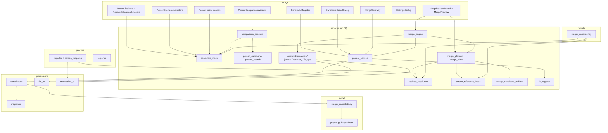
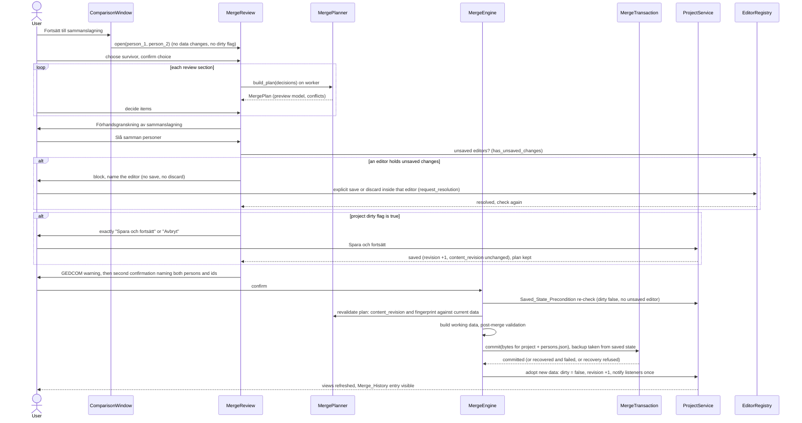
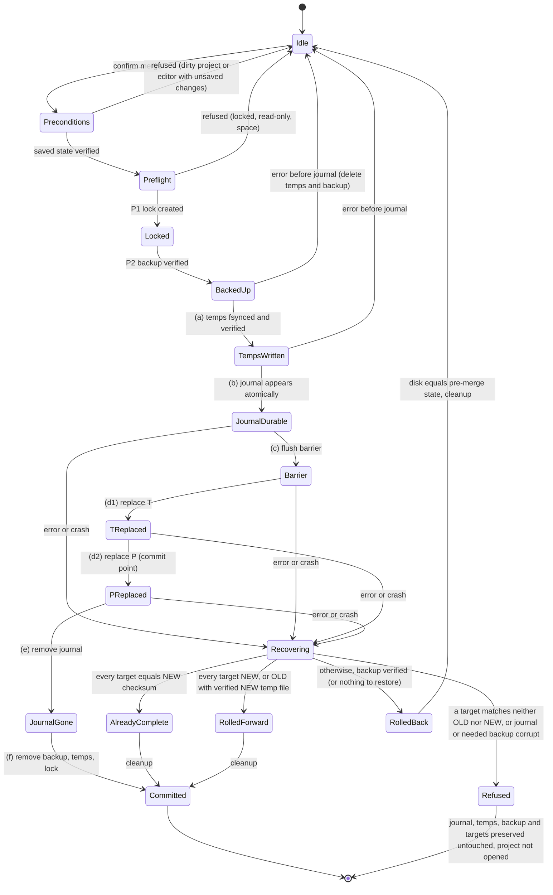
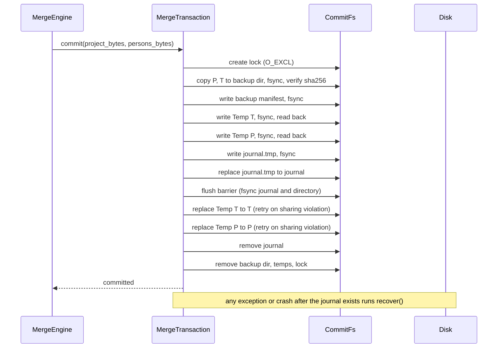

# Design Document

## Overview

This feature adds three connected workflows to Släktbusken: a project-level register of **merge candidates**, a **person comparison** window with two family views and a comparison table, and a reviewed, previewed and atomic **person merge**. It follows the vertical-slice pattern that research cases (format 0.3) and residence facts (format 0.2) established: new dataclasses in `slaktbusken/model/`, new top-level collections on `ProjectData`, reflection-based JSON persistence plus a registered migration, Swedish-returning validators, a rebuild-on-demand index, `ProjectService` methods that set the dirty flag, a gateway for cross-window navigation, a consistency report, and settings changes.

Three things make this feature different from research cases and drive most of the design:

1. **A merge rewrites references everywhere and must not lose information.** The design therefore has a documented Person_Reference_Inventory with one handler per location, a pure planner that builds a Merge_Plan on a copy, and a post-merge validation that compares an information ledger before and after.
2. **A merge changes two storage locations.** The project file (`*.json.gz`) and `translation/persons.json` are written as one recoverable Merge_Transaction with temporary files, a checksummed Merge_Journal, an on-disk backup, and a deterministic startup recovery algorithm.
3. **Identity must survive GEDCOM re-import.** Today an update import silently re-creates a person that a mapping points to but that no longer exists. The design adds Identity_Alias entries and an importer guard so a retired id can never come back.

### Governing principle

Different person ids are separate records until the user explicitly merges them. Comparison is not merging, a candidate is not a confirmed identity, a confirmed duplicate is not a completed merge. Nothing in this design computes a similarity score, proposes a pair, or merges relatives (Requirements 24, 33).

### User decisions carried into this design

These seven decisions were made by the user before this document was written. Each is traced to the section that implements it.

| # | Decision | Where it is realised |
|---|----------|----------------------|
| 1 | Redirect B↔C to A↔C. Confirmed becomes possible, rejected stays rejected, disabled stays disabled, nothing else changes. | "Candidate redirect and collision algorithm" |
| 2 | On collision keep both original assessments and both comment histories. If assessments conflict, mark the surviving candidate `unreviewed` with a dated Swedish explanatory comment. Never silently keep one. Deterministic order of operations as in Requirement 29. Archive the full original in Merge_History. | "Candidate redirect and collision algorithm" |
| 3 | Equivalent families stay separate and are shown as review warnings. Family merge is out of scope. Plan and preview are computed on a working copy after derived foster and adoptive relationships were synchronised (`sync_parentage_links` equivalent). | "10.3 Working data and copy-on-write" and "10.12 Families and relatives" |
| 4 | Project file and `translation/persons.json` are one recoverable logical operation, including crash recovery between the two file writes. | "13. Commit protocol and recovery" |
| 5 | Person-list checkbox "Forskningsuppslag och dubletter". Person-list column header "Forskningsuppslag". Diagram checkboxes "Forskningsuppslag" and "Sammanslagningskandidater", independent. | "Settings and labels" |
| 6 | The seven distinct children of the two-Brita example are never identified, paired or merged automatically. | "10.12 Families and relatives" and the two-Brita test |
| 7 | 1 s (candidate index) and 2 s (comparison family views) are upper limits at 20,000 persons and 2,000 candidates. Aim much faster. Deterministic realistic benchmark with a documented environment. | "Performance design" |

### Decisions from the requirements update (round 2)

The requirements were updated after the first version of this design (Requirements 7.13, 7.14, 10.5, 17, 18.14, 26.6, 26.11 to 26.15, 27, 30.13 to 30.15, 33.10, 35 and the glossary terms Saved_State_Precondition, Revision_Counter, Recovery_Refusal, Research_Gateway, Mandatory_Test_Group). Each decision below is traced to the section that implements it. Where it replaces an earlier choice, the earlier choice is gone from this document.

| # | Decision | Where it is realised |
|---|----------|----------------------|
| R1 | After a successful commit the dirty flag is cleared, the Revision_Counter is incremented by exactly one and listeners are notified exactly once. The engine's adopt step, `ProjectService.revision` and the sequence diagram follow this. | "5. Revision counter and saved state", "12. Merge engine" step 8, "Merge workflow overview" |
| R2 | **Changed.** Saved_State_Precondition: a merge executes only from a saved project. A dirty project offers exactly "Spara och fortsätt" and "Avbryt". Open editors with unsaved changes block the merge until the user saves or discards explicitly in that editor (editor registry with `has_unsaved_changes()` and `request_resolution()`); nothing is saved or discarded automatically. The commit never contains pre-merge unsaved edits. The Recovery_Point is taken from the saved state and the engine re-checks the precondition. A save does not force a plan rebuild (`content_revision`). | "5. Revision counter and saved state", "5a. Editor registry", "12. Merge engine", "15.8 Merge review wizard and preview" |
| R3 | Recovery is checksum based: a target equal to the expected NEW checksum is already replaced, equal to OLD is not yet replaced. Roll forward when every target is NEW, or OLD with a verifiable NEW temp file. Otherwise roll back from a verified backup. A target that matches neither state, or a corrupt journal or backup, makes recovery **refused** (Recovery_Refusal): everything is preserved, the project is not opened, a Swedish message names the paths. | "13.2 Protocol", "13.3 State diagram", "13.7 Startup recovery", "13.8 Decision tables", "13.9 Fault-injection design" |
| R4 | Format version 0.4: compatibility tests permit differences in `version` and `format_version` only, through one normalising helper. | "3.2 Format version and migration", "Compatibility comparison helper" in the Testing Strategy |
| R5 | The comparison family views show parents, partners, children and siblings. | "15.2 Comparison window" |
| R6 | The existing research gateway (`show_research_for_entity`) and the research overview accept an optional person filter. Clicking the research indicator in the person list or in a diagram box opens the overview filtered to that person. | "15.11 Research gateway person filter" |
| R7 | The GEDCOM update warning in the wizard is a temporary limitation. Non-destructive GEDCOM update handling is mandatory before Släktbusken 1.0, tracked as item TRK-1, outside this feature. | "14. GEDCOM import and export changes" (design note), "Tracked items" |
| R8 | The six Mandatory_Test_Groups of Requirement 35 are mapped to test modules and properties, and enforced by a conftest hook, a guard test and one documented command. | "Mandatory test groups" in the Testing Strategy |

### Findings from the code that shape the design

Each finding below was verified by reading the current source. They are the reason several design choices differ from what the requirements text alone would suggest.

1. **Format version is 0.3 in four places**: `MigrationManager.CURRENT_VERSION`, `file_io.CURRENT_VERSION`, the `ProjectData.version` default, and the literal `version="0.3"` in `ProjectService.create_project`. The new version is **0.4** and all four change together.
2. **Person ids are generated without any high-water mark.** `app.py` (two call sites), `GEDCOMImporter.__init__` and `ParentService.__init__` seed `IDGenerator` from live person ids only. Only research prefixes use `id_high_water_marks`. A retired id with the highest suffix would be reissued today.
3. **The GEDCOM updater resurrects missing persons.** `GEDCOMImporter._update_person` builds a new `Person` with the mapped `app_id` when that person no longer exists ("Person was deleted since last import"). Without a guard, a `PersonMapping` that still points to a retired id would recreate the retired person with the retired id.
4. **`classify_persons` would mis-handle a redirected mapping.** If a mapping were simply re-pointed to the survivor, the "claimed elsewhere" heuristic in `person_mapping.py` would treat the record as an xref reassignment, fall through to fingerprint matching, find nothing, and classify the record as `NEW`, creating a duplicate. Aliases must therefore be kept outside `TranslationData.persons` and resolved before classification.
5. **`rewire_entity_merge` mutates objects in place** (it assigns `link.entity_id` on shared `ResearchEntityLink` objects). It must be run on copies in the planner.
6. **`sync_parentage_links` mutates families in place**, including reassigning `family.event_ids` on every family in `_reattach_end_events`. It cannot be run on the live project to produce a preview. The planner runs it on a structural clone.
7. **The existing family view is O(events) per box.** `family_view._build_display_data` scans all events, all DNA profiles and all clusters per person box, and `_find_person` scans all persons. At 20,000 persons (about 60,000 events) the 2 s limit would not hold. A render-scoped lookup is required.
8. **The person list uses `SingleSelection` and draws research as an item icon plus text** in column 10, with no delegate. Selecting two persons and giving the indicator two click targets require a selection-mode change and a delegate for that column.
9. **`show_research_for_entity` filters only the case table.** `Application.show_research_for_entity` calls `show_research_overview("cases")` and then `ResearchOverview.filter_to_entity`, which sets the entity type filter and the status filter to "all" for the case page only; the to-do and hypothesis pages stay unfiltered, and there is no banner naming the filter (only the "Valfritt objekt..." button text). Clicking the research cell in the person list does nothing beyond selecting the row. Only the diagram box (`person_box.py`) calls the gateway.
10. **There is no general-purpose project backup feature in the code, and none is part of this design.** The only backup is `MigrationManager.create_backup`, which copies the project file only. Requirements 7.9 and 7.10 apply to exactly two backups: `MigrationManager.create_backup` and the Merge_Transaction backup (Recovery_Point) of Requirement 27. The content rules (copy `translation/persons.json` with the project file, no error when it is absent) are implemented only there. The design adds no other backup, no backup menu command and no backup setting, and any later general backup feature is outside this feature.
11. **`FilePersistence.save` does not fsync**, and `translation_io._write_json` uses a plain `Path.write_text` (not atomic). The merge commit uses its own durable writer. The existing ordinary save path is left unchanged.
12. **`execute_person_deletion` does not touch** `dna_profiles`, `dna_clusters`, `connection_overrides`, `main_person_id` or `research_notes`. A merge must handle all of them.
13. **`ParentChildLink` has only `child_id`, `parent_id` and `parentage_type`.** There is no per-link metadata or citation field, so "preserve link metadata and citations" (23.2, 23.3) reduces to preserving the three fields and the family events.
14. **`PersonBoxConfig` is read by two hand-written readers**: `settings_io.read_settings` (project `settings.json`) and `app_settings_io` (application settings). Both need the new field. Writing uses `asdict` and needs no change.
15. **`Person.names[0]` is the primary name** everywhere (list, boxes, search). Choosing a primary name means reordering.
16. **There is no common "unsaved changes" protocol for editors.** `ProjectService._dirty` is set directly from many call sites (`project_service.py`, `DeleteService`, `app.py`). Some editors expose `is_dirty()` (`place_translation_editor`, `source_translation_editor`), others (the Person_Editor among them) keep unsaved edits privately with no query method. Requirement 26.14 therefore needs a new, small registry and protocol (section 5a).

## Architecture

### Layers and modules



### Module layout

| Path | New or changed | Responsibility | Qt |
|------|----------------|----------------|----|
| `model/merge_candidate.py` | new | `MergeCandidate`, `MergeCandidateComment`, `MergeHistoryEntry`, `ArchivedCandidate`, `MergedIdentityMapping`, constants, pure helpers (`pair_key`, `assessment_label`) | no |
| `model/project.py` | changed | `merge_candidates`, `merge_history`, transient `merge_load_findings`; version default `0.4` | no |
| `model/id_generator.py` | changed | prefixes `mergecand_`, `mergecomment_`, `merge_` registered in `_PREFIXES` | no |
| `model/validators.py` | changed | `validate_merge_candidate`, `validate_merge_candidate_comment`, `validate_merge_history_entry` | no |
| `persistence/serialization.py` | changed | write and tolerant-read the two collections | no |
| `persistence/migration.py`, `file_io.py` | changed | `0.3 → 0.4` migration; version constants; `FilePersistence.encode` split out of `save` | no |
| `persistence/translation_io.py` | changed | `IdentityAlias`, `TranslationData.person_aliases`, `dumps_persons` (bytes), alias read/write | no |
| `persistence/settings_io.py`, `app_settings_io.py` | changed | `PersonBoxConfig.merge_candidates` read/write | no |
| `services/id_registry.py` | new | `ProtectedIdGenerator`, `reconcile_id_high_water_marks` (research and merge prefixes), `issue_person_id` | no |
| `services/editor_registry.py` | new | `UnsavedChangesParticipant` protocol, `EditorRegistry` (weak references), `unsaved_editors()`; Qt-free so the engine can re-check the precondition | no |
| `services/merge_candidate_service.py` | new | pure candidate operations (create, assess, comment, enable, link case) | no |
| `services/candidate_index.py` | new | `CandidateIndex`, `indicator_colour`, tooltip lines | no |
| `services/redirect_resolution.py` | new | `RedirectResolver` over Merge_History | no |
| `services/person_summary.py` | new | `PersonSummaryIndex` (name, life years, birth and death place) built in one pass | no |
| `services/person_search.py` | new | `PersonSearchIndex` (name, id, date substring search) | no |
| `services/diagram_lookup.py` | new | render-scoped indexes that replace per-box scans in the three diagram views | no |
| `services/comparison_session.py` | new | slots, navigation stack, selections, comparison rows, Shared_Person set | no |
| `services/person_reference_index.py` | new | `PERSON_REFERENCE_INVENTORY`, `PersonReferenceIndex`, completeness check | no |
| `services/merge_rules.py` | new | pure rule functions for attributes, names, participants, links | no |
| `services/merge_candidate_redirect.py` | new | redirect and collision algorithm | no |
| `services/merge_planner.py` | new | `MergeDecisions`, `MergePlan`, conflicts, warnings, synchronised working copy | no |
| `services/merge_engine.py` | new | validate, apply, post-validate, commit, adopt | no |
| `services/commit/fs_ops.py` | new | `CommitFs` protocol, `RealFs`, Windows replace with retry | no |
| `services/commit/preflight.py` | new | locked and read-only pre-checks, disk space | no |
| `services/commit/journal.py` | new | Merge_Journal and backup manifest read and write | no |
| `services/commit/transaction.py` | new | `MergeTransaction.commit` | no |
| `services/commit/recovery.py` | new | `recover_if_needed`, checksum classification, decision tables, `RecoveryRefusal` | no |
| `services/project_service.py` | changed | candidate methods, merge listeners, `revision` and `content_revision`, `clean_content_revision`, `is_saved_state()`, recovery on open, save guard while a journal is pending | no |
| `gedcom/capabilities.py` | new | `NON_DESTRUCTIVE_UPDATE_AVAILABLE = False`; the wizard shows the GEDCOM update warning while it is false | no |
| `ui/research_overview.py`, `app.py`, `ui/research_gateway.py` | changed | optional person filter (section 15.11) | yes |
| `services/import_service.py`, `gedcom/importer.py` | changed | alias resolution before classification, retired-id guard, import result fields | no |
| `gedcom/exporter.py` | changed | omission counts for candidates and history (informational) | no |
| `reports/merge_consistency.py` | new | `check_merge_consistency`, `generate_merge_consistency_report` | no |
| `ui/merge/*` | new | comparison window, family view wrapper, slot search, table, candidate panel and editor, register, wizard pages, preview, history dialog, gateway | yes |
| `ui/person_list_panel.py`, `ui/context_menu_builder.py`, `ui/widgets/person_box.py`, `ui/views/*_view.py`, `ui/diagram_panel.py`, `ui/main_window.py`, `ui/report_menu.py`, `ui/dialogs/settings_dialog.py`, `ui/editors/person_editor.py` | changed | indicators, menus, labels, selection mode, diagram lookup, candidate section | yes |

All services are importable and testable without a `QApplication` (Requirement 34.5, 34.6). Services never import from `slaktbusken.ui`, with one existing exception kept as is: `reports/` imports `ui.swedish_locale` for labels, like `research_consistency.py`.

### Data flow invariants

1. **Single source of truth.** Candidates and history live only in `ProjectData.merge_candidates` and `ProjectData.merge_history`. No name, date or place is copied into a candidate (Requirement 2.8). The only stored display strings are `merged_person_name` and `merged_person_lifespan` in Merge_History, because the person no longer exists.
2. **Derive, never cache-and-invalidate.** `CandidateIndex`, `PersonSummaryIndex`, `PersonSearchIndex`, `PersonReferenceIndex` and `DiagramLookup` are built on demand from `ProjectData`, read-only, and rebuilt after a change, following `ResearchIndex` and `foster_sync._ProjectIndex`.
3. **Mutation only through `ProjectService`** for candidate edits, and only through `MergeEngine` for a merge. A candidate edit sets the dirty flag and notifies listeners. A merge starts only from a saved project (Saved_State_Precondition) and on success clears the dirty flag, increments the Revision_Counter by one and notifies listeners once.
4. **Planning never mutates.** `MergePlanner` reads `ProjectData` and returns a `MergePlan`. Every object it needs to change is cloned first (copy-on-write). Nothing in `ProjectData`, translation files or settings changes before the engine commits.
5. **Comparison never mutates.** The Person_Comparison_Window only reads, except for candidate edits that go through `ProjectService`.
6. **No computed identity.** The code base contains no function that scores, ranks or proposes a pair of persons. Relatives are matched across the two family views only by identical id (Requirement 33.3).

### Merge workflow overview



### Threading and responsiveness

* Plan building runs on a worker (`QThreadPool`, the same pattern as `ui/workers/check_worker.py`). The worker reads `ProjectData` while the Merge_Review is modal, so the main window cannot edit. A `ProjectService.content_revision` counter and a plan fingerprint detect any change anyway (Requirement 26.9, section 5).
* The disk phase of the commit runs on a worker too, with the progress overlay shown and no cancel button (Requirement 27.11). The worker only performs file I/O on already prepared bytes. All in-memory adoption happens on the UI thread after the worker finishes, so no data race is possible.
* Everything else runs on the UI thread.

## Components and Interfaces

### 1. Model layer: `model/merge_candidate.py`

All plain `@dataclass` with `id` first and `from __future__ import annotations`, no Qt and no I/O, matching `research_case.py`. The definitions are listed under "Data Models". Constants:

```python
CANDIDATE_ASSESSMENTS = ("unreviewed", "possible", "confirmed", "rejected")
ASSESSMENT_LABELS_SV = {
    "unreviewed": "Ej granskad",
    "possible": "Möjlig dubblett",
    "confirmed": "Bekräftad dublett",
    "rejected": "Inte samma person",
}
MAX_COMMENTS_PER_CANDIDATE = 500
MAX_COMMENT_TEXT = 5000

def pair_key(a: str, b: str) -> tuple[str, str]:
    """Unordered pair identity: (A, B) and (B, A) give the same key."""
    return (a, b) if a <= b else (b, a)
```

Comment dates reuse `research_case.is_valid_calendar_date` (Requirement 4.3). The labels live in `ui/swedish_locale.py` through `get_candidate_assessment_label`, and `ASSESSMENT_LABELS_SV` in the model exists only so services that build Swedish comment text (redirect comments) need no UI import. A unit test asserts the two tables are equal.

### 2. Identifiers, retired ids and high-water marks

**Prefixes.** `IDGenerator._PREFIXES` gains `'merge_candidate': 'mergecand_'`, `'merge_candidate_comment': 'mergecomment_'`, `'merge_history': 'merge_'`. The anchored regex in `_high_water_mark` (`^merge_(\d+)$`) does not match `mergecand_3`, so the three prefixes cannot interfere with each other. A unit test pins this.

**`services/id_registry.py`** generalises the research mechanism without changing it:

* `PROTECTED_ENTITY_TYPES` = the four research types plus the three merge types.
* `live_protected_ids(data)` returns live ids per prefix, including candidate comments nested in candidates.
* `reconcile_id_high_water_marks(data)` raises each protected prefix's mark to at least the highest live suffix. `research_service.reconcile_id_high_water_marks` delegates to it so `deserialize` and `ResearchIdGenerator` keep working and the 34.9 reconciliation happens on every load.
* `ProtectedIdGenerator(data).generate(entity_type)` is `ResearchIdGenerator` generalised; `ResearchIdGenerator` becomes a thin subclass kept for compatibility.
* An empty `id_high_water_marks` stays empty for a project with no research and no merge data, so such a project serialises exactly as before (Requirement 32.1).

**Person ids.** `issue_person_id(data)` replaces the four direct `IDGenerator(...).generate("person")` call sites (`app.py` twice, `GEDCOMImporter.__init__`, `ParentService.__init__`). It seeds the generator with live person ids, with `retired_person_ids(data)` (derived from `merge_history`), and with a stand-in for `id_high_water_marks["person_"]`. At merge commit the engine raises `id_high_water_marks["person_"]` to at least the numeric suffix of the retired id. A retired id with the highest suffix is therefore never reissued, also after save and reopen (Requirements 7.5, 28.3). The mark is only written when a merge has happened, so unmerged projects keep an empty map. The importer additionally adds `retired_person_ids` to its own seed set because it builds its own generator.

**Retired ids are derived, not stored separately.** `retired_person_ids(data) = {e.merged_person_id for e in data.merge_history}`. The high-water mark is the second line of defence for the case where a history entry is malformed on load (Requirement 7.7).

### 3. Persistence

#### 3.1 Serialization (`persistence/serialization.py`)

* `serialize` adds `merge_candidates` and `merge_history` to `entity_fields`. `_serialize_dataclass` already omits empty lists, so an empty collection is absent from the file. Order, ids, comment order and Swedish characters are preserved (`ensure_ascii=False`).
* `_NESTED_LIST_TYPES` gains `(MergeCandidate, "comments"): MergeCandidateComment`, `(MergeHistoryEntry, "archived_candidates"): ArchivedCandidate`, `(ArchivedCandidate, "comments"): MergeCandidateComment`, `(MergeHistoryEntry, "identity_mappings"): MergedIdentityMapping`.
* **Tolerant section loader.** The generic `_deserialize_typed` raises `TypeError` when a required field is missing and returns non-dict items as-is, so it cannot meet Requirement 7.7. A dedicated `_deserialize_merge_section(cls, raw_items, findings)` is used for the two collections:
  * a dict item becomes an instance; a missing required field gets the neutral default (`""`, `None`, `[]`) and a `LoadFinding(section, entry_id, fields, kind="missing_field")` is recorded; a field whose JSON type differs from the expected type keeps the raw value and records `kind="wrong_type"`;
  * a non-dict item or an item that cannot be parsed is kept verbatim in `ProjectData.unreadable_merge_items[section]` and written back unchanged on save, so nothing is deleted;
  * findings are stored on the transient field `ProjectData.merge_load_findings` (excluded from serialisation) and reported by the Merge_Consistency_Report.
* A present but non-list `merge_candidates` or `merge_history` raises `CorruptedFileError` naming the section, like the research sections do.
* A missing assessment is reported by the validator (Requirement 3.2) because the loader leaves `assessment` as `""` for a missing field instead of silently defaulting to `unreviewed`.

#### 3.2 Format version and migration

* New version **0.4**. Updated together: `MigrationManager.CURRENT_VERSION`, `file_io.CURRENT_VERSION`, `ProjectData.version` default, and the literal in `ProjectService.create_project`. A test asserts that these four values are equal and that the migration registry has a path from every earlier version.
* Registered migration `0.3 → 0.4` is additive and idempotent:

```python
@MigrationManager.register("0.3", "0.4")
def _migrate_0_3_to_0_4(data: dict) -> dict:
    for key in ("merge_candidates", "merge_history"):
        if key not in data:
            data[key] = []
    data["format_version"] = "0.4"
    data["version"] = "0.4"
    return data
```

* `MigrationManager.create_backup` is unchanged for the project file (same name and location rules, Requirement 7.8) and gains a companion step: when `translation/persons.json` exists beside the project it is copied to `translation/persons_v<old>.json` (Requirement 7.9). A missing file is skipped without error (Requirement 7.10). The helper `backup_project_files(path, old_version)` is the single place that decides what these two backups contain; the merge Recovery_Point uses the same helper's file list. These are the only two backups to which Requirements 7.9 and 7.10 apply; no general-purpose backup feature is part of this design (finding 10).
* **Equivalence and the two permitted differences (Requirements 7.14, 32.1; resolved).** A project without merge data serialises to the same content as the 0.3 output except for the top-level `version` and `format_version` values. Every compatibility and regression test compares the before and after serialisations through one helper, `normalise_version_fields` (Testing Strategy, "Compatibility comparison helper"), which replaces exactly those two top-level keys with a fixed placeholder and nothing else, so any other difference fails the test.

#### 3.3 Translation files and Identity_Alias

`persons.json` today:

```json
{
  "person_mappings": [{"gedcom_id": "@I1@", "app_id": "person_1", "fingerprint": "ab12..."}],
  "family_mappings": [{"gedcom_id": "@F1@", "app_id": "family_1"}]
}
```

**Design choice (Requirement 30.1): move, do not re-point.** A mapping whose `app_id` is the retired id is **moved** from `person_mappings` into a new top-level array `identity_aliases`. `gedcom_id` and `fingerprint` are copied unchanged. This keeps aliases invisible to the existing import code paths that iterate `translation_data.persons` (`classify_persons`, `_update_translation_xref`, `existing_fingerprints`), which is what finding 4 requires.

```json
{
  "person_mappings": [ ... unchanged ... ],
  "family_mappings": [ ... unchanged ... ],
  "identity_aliases": [
    {"gedcom_id": "@I7@", "fingerprint": "cd34...", "person_id": "person_1", "merge_id": "merge_3"}
  ]
}
```

* `person_id` is the **current** surviving person, not the retired one, so no alias refers to a retired id (Requirement 30.10). The retired id is recoverable through `merge_id` → `MergeHistoryEntry.merged_person_id`.
* When the survivor of an earlier merge is merged into a third person, every alias whose `person_id` equals the retired survivor is rewritten to the final survivor in the same transaction. The same applies to `PersonMapping` entries of the retired person, which are moved to aliases.
* `read_persons` keeps its two-list return value. A new `read_person_aliases(path)` reads the extra array; `read_all` fills `TranslationData.person_aliases`. `write_persons` gets an optional `aliases` argument and `write_all` passes `data.person_aliases`, so an ordinary import save preserves aliases. A file without `identity_aliases` loads with an empty list and no error (Requirement 30.3). Reading then writing yields equal content (Requirement 30.2).
* `dumps_persons(person_mappings, family_mappings, aliases) -> bytes` is the pure function that `write_persons` and the commit protocol share, so the transaction writes exactly the bytes an ordinary write would.

### 4. Person_Reference_Inventory

This table is the authoritative inventory (Requirement 1.7). It was built from the dataclasses in `model/`, the grep of every field named `*person_id` or `*person_ids`, and the code that reads or rewrites person references (`delete_service`, `photo_service`, `research_service`, `foster_sync`, `serialization`, `importer`). A location is listed even when the correct rule is "not a person reference", so that the completeness test has nothing left unexplained.

Rules: **R** `rewire`, **M** `merge_and_deduplicate`, **S** `preserve_separately`, **E** `require_explicit_resolution`, **H** `preserve_historical`. For R locations "dedupe" states whether a resulting duplicate is removed so one entry remains, or kept as separate entries.

| # | Location (verified in code) | Rule | Handling | Dedupe after rewrite |
|---|-----------------------------|------|----------|----------------------|
| 1 | `Family.partners[].person_id` | R | replace id in place; role is kept as stored | Both persons in one family → **Blocking_Conflict** (self-partner). No silent dedupe. |
| 2 | `Family.children` | M | replace id in place | Duplicate child entry in one family collapses to the first position; reported as Merge_Warning. |
| 3 | `Family.parent_child_links[].child_id` | M | replace id | Same (child, parent, type) collapses to one link; different `parentage_type` for the same pair stays as separate links and yields one Merge_Warning per pair. |
| 4 | `Family.parent_child_links[].parent_id` | M | replace id; `None` (unknown donor) is not a person reference and is left alone | As row 3. A link whose child and parent become equal → **Blocking_Conflict**. |
| 5 | `Family.event_ids` | S | event ids, not person ids; unchanged | n/a |
| 6 | `Event.participants[].person_id` | M | replace id | Same person twice with the same role → one entry at the first position; different roles → **E**: user must choose a role (Blocking until chosen). |
| 7 | `ResidenceFact.person_id` | R | `dataclasses.replace(fact, person_id=survivor)` | Never collapsed, also when date or place are equal (Requirement 21.16). |
| 8 | `ResidenceFact.observations[]`, `Endpoint.event_id` | S | source and event ids; unchanged | n/a |
| 9 | `Person.profile_media_id` | E | media id owned by the person. Equal or one empty → keep non-empty; both non-empty and different → user chooses. The media item not chosen gets a person link to the survivor ensured. | n/a |
| 10 | `Person.sex` | E | `U` counts as unknown (keep the known value); equal → keep; two different known values → user chooses | n/a |
| 11 | `Person.title`, `Person.occupation` | E | equal or one empty → keep non-empty; both non-empty and different → user chooses | n/a |
| 12 | `Person.notes` | M | one empty → keep other; both non-empty → keep survivor's, keep other's, or concatenate with a visible separator (default concatenate) | n/a |
| 13 | `Person.names[]` | M | union of all names; exact duplicates (given, surname, type, event_id after trim) collapse to one; the user picks the primary name, which is moved to index 0 | Identical string with different `type` or `event_id` stays as two entries. |
| 14 | `Person.names[].event_id` | S | event id; unchanged | n/a |
| 15 | `MediaItem.linked_entities` with `entity_type == "person"` | M | replace id | Duplicate links to the survivor collapse into the first; `role` becomes the first non-empty role in original order. |
| 16 | `MediaItem.mentioned_person_ids` | M | replace id | Duplicates collapse to the first position. |
| 17 | `MediaItem.annotations` with `entity_type == "person"` | R | replace `entity_id` | **Kept as separate entries** (each has its own region coordinates). Two regions for the same person on one photo give a Merge_Warning. |
| 18 | `MediaItem.mentioned_names` | S | free-text names, not ids; unchanged | n/a |
| 19 | `ResearchNote.linked_entities` with `entity_type == "person"` | M | replace id | Duplicates collapse to one per note (Requirement 22.13). |
| 20 | `DnaProfile.person_id` | R | replace id | Profiles are never merged; counts unchanged. |
| 21 | `DnaProfile.admin_person_id` | R | replace id when equal to the retired id | n/a |
| 22 | `DnaCluster.person_ids` | M | replace id | Duplicate collapses, order of the others preserved. |
| 23 | `DnaMatch.profile1_id/profile2_id`, `DnaSegment.match_id`, `DnaTriangulation.profile_ids` | S | profile and match ids, not person ids; unchanged. Listed with counts for review. A match whose two profiles now belong to one person gives a Merge_Warning. | n/a |
| 24 | `ResearchCase.primary_entity_ref`, `ResearchCase.linked_entities` (type `person`) | M | `rewire_entity_merge(shell, "person", retired, survivor)` on a copy | Collapsed by the helper; counts reported separately (Requirement 22.11). |
| 25 | `ResearchHypothesis.linked_entities` (type `person`) | M | same helper call | Same. |
| 26 | `ResearchAction`, `HypothesisComment` | S | no person fields; unchanged | n/a |
| 27 | `ProjectMetadata.main_person_id` | R | set to survivor when equal to retired id; listed in the preview | n/a |
| 28 | `ProjectData.connection_overrides` keys (child person id) | E | only retired has an entry → move key; only survivor → keep; both with equal value → keep one; both with different values → user chooses | n/a |
| 29 | `MergeCandidate.person_1_id`, `person_2_id` | special | redirect, collision or archive per the candidate algorithm | At most one candidate per unordered pair afterwards. |
| 30 | `MergeHistoryEntry.surviving_person_id`, `merged_person_id` | H | never rewritten; later merges are followed through Redirect_Resolution | n/a |
| 31 | `ArchivedCandidate.person_1_id/person_2_id` inside history | H | original ids as archived | n/a |
| 32 | `translation/persons.json` `person_mappings[].app_id` | special | mappings of the retired person move to `identity_aliases` | n/a |
| 33 | `translation/persons.json` `identity_aliases[].person_id` | R | earlier aliases pointing at the retired person are rewritten to the survivor (Requirement 30.10) | n/a |
| 34 | `translation/persons.json` `family_mappings[].app_id` | S | family ids; a merge does not combine families | n/a |
| 35 | `ProjectSettings` (`settings.json`) and `AppSettings` | S | verified: `UiState` holds only window geometry and `last_view`; app settings hold recent project paths and visual config; neither stores a person id | n/a |
| 36 | `MediaItem.publication`, `photo_date` | S | free-form dicts with newspaper, date, page; no person ids (verified in `media_editor.py`) | n/a |

**Additional locations discovered beyond the list in Requirement 1.1:** rows 5, 8, 14, 18, 23, 26, 34, 35 and 36 are non-reference locations that look like references and were checked; rows 9–13 are single-valued or text attributes that need a decision rather than a rewrite; row 17 (`annotations`) needs "no dedupe"; row 21 (`admin_person_id`) is a separate field from row 20; row 31 (archived candidates) is new with this feature.

**Mechanism.**

```python
@dataclass(frozen=True)
class ReferenceLocation:
    key: str                  # "family.partners", "event.participants", ...
    owner_class: str          # dataclass name, or "translation:persons.json"
    field_path: str           # "partners[].person_id"
    rule: str                 # R | M | S | E | H | special
    handler: str | None       # name of the handler function; None only for S/H rows
    dedupe: str               # "none" | "collapse" | "block" | "n/a"

PERSON_REFERENCE_INVENTORY: tuple[ReferenceLocation, ...]
```

* Each handler is a function in `merge_planner` registered by key. `MergeEngine.execute` first calls `assert_inventory_handled()`; if any row with rule R, M, E or special has no registered handler, it returns an error naming each such location and changes nothing (Requirement 1.6). Handlers are applied by iterating the inventory, never by a recursive string replacement (Requirement 1.4).
* **Completeness test (Requirement 1.8).** A test walks `slaktbusken.model` dataclasses with `dataclasses.fields`, collects every field whose name ends in `person_id` or `person_ids` (this finds `FamilyPartner.person_id`, `Participant.person_id`, `ResidenceFact.person_id`, `DnaProfile.person_id`, `DnaProfile.admin_person_id`, `DnaCluster.person_ids`, `MediaItem.mentioned_person_ids`, `ProjectMetadata.main_person_id`, and the new candidate fields), and fails naming the class and field when one is absent from the inventory. A second test covers fields that carry person ids under a generic name (`LinkedEntity.entity_id`, `Annotation.entity_id`, `ResearchEntityLink.entity_id`, `ParentChildLink.child_id/parent_id`, `ProjectData.connection_overrides`) through an explicit allow-list, so a new generic reference field also forces a decision.
* `PersonReferenceIndex.build(data, {survivor, retired})` makes **one pass** over each collection and records, for the two ids only, which objects reference them per location. Every later lookup is a dictionary access (Requirement 32.5). Row counts for the preview (Requirement 22.17) come from this index.

### 5. Candidate service and `ProjectService` API

Pure functions live in `services/merge_candidate_service.py`. `ProjectService` wraps them, sets `_dirty`, bumps `revision` and notifies merge listeners, following `add_research_case`.

```python
# ProjectService (new methods)
def add_merge_candidate(self, person_1_id: str, person_2_id: str) -> MergeCandidate: ...
def get_or_create_merge_candidate(self, person_1_id: str, person_2_id: str) -> tuple[MergeCandidate, bool]: ...
def set_candidate_assessment(self, candidate_id: str, assessment: str) -> MergeCandidate: ...
def set_candidate_enabled(self, candidate_id: str, enabled: bool) -> MergeCandidate: ...
def set_candidate_research_case(self, candidate_id: str, case_id: str | None) -> MergeCandidate: ...
def create_research_case_for_candidate(self, candidate_id: str, title: str) -> ResearchCase: ...
def add_candidate_comment(self, candidate_id: str, date: str, text: str) -> MergeCandidateComment: ...
def update_candidate_comment(self, candidate_id: str, comment_id: str, date: str, text: str) -> MergeCandidateComment: ...
def delete_candidate_comment(self, candidate_id: str, comment_id: str) -> bool: ...
def add_merge_listener(self, listener) -> Callable[[], None]: ...
def notify_merge_changed(self) -> None: ...
@property
def revision(self) -> int: ...
```

**Validation order for `add_merge_candidate`**, each failure raising `ValidationError` with the Swedish text and leaving the project and dirty flag untouched:

1. ids equal → "En person kan inte vara kandidat till sig själv." (2.5)
2. either id not an active person → message naming the id (2.6)
3. unordered pair already present, enabled or not → "Paret är redan registrerat som sammanslagningskandidat." (2.9). `get_or_create_merge_candidate` returns the existing candidate and `created=False` instead of raising, which is what the UI uses (5.6).

The new id comes from `ProtectedIdGenerator(data).generate("merge_candidate")`, which advances `id_high_water_marks["mergecand_"]` immediately, so a deleted candidate id is never reissued (2.3).

**Copy-validate-swap for edits.** Assessment, enabled, research case and comment edits build a modified copy of the candidate, validate it, and replace the stored object by index only if validation passes. An exception at any point leaves the stored candidate and its comments unchanged and the dirty flag untouched (3.9, 15.8). The assessment change never touches `comments` (3.6, 4.5), and none of these methods read or modify a `Person` (2.4, 3.7).

**`create_research_case_for_candidate`** is all-or-nothing (6.3, 6.4): it builds the `ResearchCase` (title default "Möjlig dubblett: <namn 1> / <namn 2>") with two `ResearchEntityLink(entity_type="person", ...)` in `linked_entities` and the first person as `primary_entity_ref`, validates both objects, and only then calls `add_research_case` and sets `research_case_id`. If any step raises, a `try/except` removes a case that was appended and restores `research_case_id`; the research id high-water mark may have advanced, which is harmless.

**Case deletion (6.8).** `delete_research_case` and `DeleteService` are not changed; they never see candidates. A candidate that references a deleted case keeps its stored `research_case_id`, and the report lists it (6.7).

**Listeners.** `add_merge_listener` mirrors `add_research_listener`. `Application` bridges it to a Qt signal `merge_changed` (new `ui/merge/merge_signals.py`, same shape as `research_signals.py`). The register, the person-editor section, the person list and the diagram refresh from it.

**Revision counter and saved state (Revision_Counter, Saved_State_Precondition; Requirements 26.9, 26.12, 27.1, 27.22, 27.24).**

`ProjectService` keeps three counters and one flag. All are in-memory and never serialised.

| Member | Meaning | Changes |
|--------|---------|---------|
| `_dirty` (property `is_dirty`) | unsaved changes exist | the setter keeps its current name and meaning, so the many existing `self._dirty = True` call sites (including `DeleteService` and `app.py`) work unchanged |
| `revision` (Revision_Counter) | number of completed change notifications | +1 for each completed notification: a candidate or research edit, a legacy `_dirty = True` write, a completed save, and a completed merge commit |
| `content_revision` | number of notifications that changed project content | +1 together with `revision` for everything above **except** a save, because a save writes the content that already exists |
| `clean_content_revision` | the `content_revision` at the last open, save or merge commit | set by `open_project`, `save_project` and the merge adopt step |

* The `_dirty` setter, when it receives `True`, calls `_record_change()`, which increments `revision` and `content_revision` and notifies listeners. Setting `False` never increments anything. The completed-notification rule gives "exactly once" for a merge: the adopt step does **not** go through the `True` setter (it writes the private value `False`) and calls `_record_change(content=True, notify=once)` explicitly.
* `is_saved_state()` returns `not _dirty and content_revision == clean_content_revision`. The second term catches a mutation that forgot to set the flag. This is the project half of the Saved_State_Precondition.
* **Fingerprint and revision handling after "Spara och fortsätt" (Requirement 26.12).** A `MergePlan` records `content_revision` and its `fingerprint` (SHA-256 over every object the plan read, plan step 17). `save_project` increments `revision` (listeners learn that the dirty flag cleared) but **not** `content_revision`. The wizard decides whether the plan is stale with `plan.content_revision == service.content_revision`, then recomputes the fingerprint over the plan's input objects (one pass through `PersonReferenceIndex`, a few milliseconds). A save alone therefore leaves both equal and the wizard continues to the second confirmation **without rebuilding the plan**, exactly as Requirement 26.12 says, because the saved content equals the content the plan was built on. If any editor or other action changed content between the plan and the save, `content_revision` or the fingerprint differs and the wizard rebuilds the plan, shows "Projektet har ändrats. Granska förhandsgranskningen igen." and disables execution until the user re-confirms (26.9).
* **Where the counters are used.** Lists, diagrams, indexes, the Person_Editor, the Candidate_Register, research views and open Merge_Reviews refresh from the `merge_changed` signal that the notification emits. The title-bar asterisk follows `is_dirty`. The wizard polls only `content_revision`.
* **Save during a merge.** `save_project` raises `MergeInProgressError` while the engine runs (the engine holds the project lock of 27.13) or a journal is pending (section 13.7).

#### 5a. Editor registry (Requirement 26.14, 27.23)

The engine cannot know what is inside an editor, and the wizard must never save or discard editor content on the user's behalf. A small Qt-free protocol lets the wizard ask.

```python
class ResolutionResult(Enum):
    SAVED = "saved"
    DISCARDED = "discarded"
    STILL_UNSAVED = "still_unsaved"      # the user cancelled inside the editor

class UnsavedChangesParticipant(Protocol):
    editor_title: str                     # Swedish, e.g. "Personredigerare: Anna Svensson (person_12)"
    def has_unsaved_changes(self) -> bool: ...
    def request_resolution(self) -> ResolutionResult: ...
        # brings the editor to the front and lets the EDITOR ask the user
        # ("Spara", "Kasta ändringar", "Avbryt") in its own dialog

class EditorRegistry:
    def register(self, editor: UnsavedChangesParticipant) -> None: ...      # held by weak reference
    def unregister(self, editor: UnsavedChangesParticipant) -> None: ...
    def unsaved_editors(self) -> list[UnsavedChangesParticipant]: ...       # registration order
```

* One `EditorRegistry` instance belongs to `Application` and is passed to `MergeReviewWizard` and `MergeEngine`. Every editor class that can modify the Project (`PersonEditor`, `EventEditor`, `FamilyEditor`, place, source, media, DNA, research case and translation editors) registers itself on construction and unregisters on `destroyed`. Editors that already expose `is_dirty()` (place and source translation editors) implement `has_unsaved_changes()` by delegating to it; the Person_Editor implements it by comparing its widgets to the loaded person (the same comparison its close prompt needs). A test enumerates the editor classes in `slaktbusken/ui/editors` and fails for any `QWidget` subclass that is not registered or exempted with a reason, so a new editor cannot be forgotten.
* `request_resolution()` runs the editor's own prompt as a modal dialog parented to the editor. The wizard is application-modal, but a new modal dialog opened from an editor is the top-most modal window and stays operable. The wizard calls `request_resolution()` only when the user presses the button "Gå till redigeraren" next to the editor's name; it never calls any save or discard method of the editor itself. The `ResolutionResult` is only used to re-run the check.
* **Wizard behaviour.** When the user presses "Slå samman personer", the wizard first asks the registry. If any editor reports unsaved changes the wizard shows a blocking message listing each editor by title: "Redigeraren <titel> har osparade ändringar. Spara eller kasta ändringarna i redigeraren och försök igen." The choice "Spara och fortsätt" is **not** offered and the second confirmation is not shown (26.14). After each `request_resolution()` the wizard re-checks and removes resolved editors from the list. Only when the list is empty does the wizard evaluate the project dirty flag (the choice of 26.11). Saving inside an editor typically sets the dirty flag, so the user then sees "Spara och fortsätt" and "Avbryt".
* **Engine re-check (27.22, 27.23).** `MergeEngine.execute` runs `Preconditions.check` as its first step, before pre-flight, with the live registry: (1) `service.is_saved_state()` else refuse with "Projektet har osparade ändringar. Spara projektet innan sammanslagningen."; (2) `registry.unsaved_editors()` empty else refuse with the 26.14 message naming the editors. A refusal changes nothing in memory or on disk, leaves the dirty flag unchanged, and calls no save, commit or discard method of anything. Tests use a counting fake editor to assert that `save`, `discard` and `request_resolution` are never called by the engine.
* A discard performed by the user in an editor changes no project data, so it cannot make the plan stale. A save in an editor changes content, so `content_revision` differs and the plan is rebuilt.

### 6. Redirect resolution (`services/redirect_resolution.py`)

```python
class RedirectResolver:
    def __init__(self, history: list[MergeHistoryEntry]) -> None: ...
    def resolve(self, person_id: str) -> str | None: ...
    def is_retired(self, person_id: str) -> bool: ...
    def merged_into(self, survivor_id: str) -> list[MergeHistoryEntry]: ...   # transitive, ordered
    def cycles(self) -> list[list[str]]: ...
```

Algorithm. Entries are sorted by `(merge_date, numeric suffix of id)`. The map is `retired → surviving` from `merged_person_id → surviving_person_id`. `resolve(x)` follows the map with a visited set and memoisation:

```text
resolve(x):
    seen = {}
    while x in retired_map:
        if x in seen: return None        # cycle, Requirement 28.8
        seen.add(x); x = retired_map[x]
    return x                              # x is not retired: the final survivor
```

* Terminates for any stored history: each step either leaves the map or visits a new retired id, and there are finitely many.
* A retired id that appears in two entries (malformed) is ambiguous and also resolves to `None` and is reported.
* History entries are **not rewritten** when the survivor is merged later (Requirement 28.6). A later merge only adds an entry; resolution follows the chain, so every earlier retired id resolves to the final survivor, and earlier entries stay byte-identical.
* `resolve(x)` returns `x` itself for an ordinary active person and for an id that never existed; callers that need "is it an active person" check the person id set separately.
* `merged_into(survivor)` returns every entry whose resolved survivor equals the given person, which is what the grey indicator and the Merge_History view list (28.4, 28.9).

### 7. Indicator precedence and the candidate index

**Single colour function** (Requirement 19.1), in `services/candidate_index.py`:

```python
def indicator_colour(rel: PersonCandidateRelations) -> str:
    """Return 'blue', 'orange', 'grey' or 'none'. The only place the rule exists."""
    if rel.has_active_confirmed:                       return "blue"
    if rel.has_active_possible or rel.has_active_unreviewed: return "orange"
    if rel.has_rejected or rel.has_disabled or rel.has_history: return "grey"
    return "none"
```

`PersonCandidateRelations` is a small frozen dataclass with those six booleans plus the candidates themselves.

```python
class CandidateIndex:
    @classmethod
    def build(cls, data: ProjectData) -> "CandidateIndex": ...   # O(candidates + history)
    def relations(self, person_id: str) -> PersonCandidateRelations: ...
    def colour(self, person_id: str) -> str: ...
    def candidates_for(self, person_id: str) -> tuple[MergeCandidate, ...]: ...
    def candidate_for_pair(self, a: str, b: str) -> MergeCandidate | None: ...
    def tooltip_lines(self, person_id: str, summaries: PersonSummaryIndex) -> list[str]: ...
```

* Built **once** per person-list refresh, diagram render, register refresh or comparison refresh. `by_person: dict[str, list[MergeCandidate]]` and `by_pair: dict[tuple[str,str], MergeCandidate]` are filled in a single pass over `merge_candidates`; history entries are grouped by `RedirectResolver.resolve(surviving_person_id)`. Row and box code only calls `relations(person_id)`, which is a dict lookup, so there is no scan of `merge_candidates` per row or box (32.2).
* Candidates whose person ids are missing still contribute: the colour is computed for the ids that exist; the tooltip shows "Okänd person" (19.11).
* `has_disabled` means an existing candidate with `enabled == False` regardless of assessment; `has_active_*` require `enabled == True`. A disabled `confirmed` candidate therefore contributes only to grey (19.4).

**Tooltip lines** (19.6–19.11). Each relation yields `(group_rank, sort_name, text)` with ranks confirmed=0, possible or unreviewed=1, rejected=2, disabled=3, merged=4, and the lines are ordered by `(group_rank, name ascending, id)`. If more than five, the first five are shown plus one summary line "… och N till (totalt M relationer)". Forms:

| Relation | Line |
|----------|------|
| confirmed | `Bekräftad dublett med <namn> (<år–år>)` |
| possible | `Möjlig dublett med <namn> (<år–år>)` |
| unreviewed | `Ej granskad kandidat: <namn> (<år–år>)` |
| rejected | `Inte samma person som <namn> (<år–år>)` |
| disabled | `Dublettkontroll avstängd: <namn> (<år–år>)` |
| merged | `Slogs samman med <namn> (<år–år>)` |

Lifespan text: both years `1829–1890`, birth only `(1829)`, death only `(–1890)`, neither omits the parentheses. Names and years come from `PersonSummaryIndex` built lazily on first tooltip request (the tooltip is only built on hover), or from `merged_person_name` and `merged_person_lifespan` for merged persons. An unresolvable other person gives `Okänd person` without a lifespan.

**Hover delay.** The 500 ms hover requirement is met by the tooltip mechanism: the person list delegate answers `QHelpEvent` after Qt's standard wake-up delay, which is set to 500 ms through a `QProxyStyle` hint `SH_ToolTip_WakeUpDelay` on the two indicator widgets only; the diagram box uses its own `hoverMoveEvent` with a 500 ms `QTimer` before calling `QToolTip.showText` (the box already shows tooltips from `hoverMoveEvent`).

### 8. Summary and search indexes, and the render-scoped diagram lookup

**`PersonSummaryIndex.build(data)`** makes one pass over events to record for each person the first `birth` and `death` date and place text, and one pass over persons for the primary display name. It yields `name(person_id)`, `lifespan_text(person_id)`, `birth_text`, `death_text`. Complexity O(persons + events). It is used by tooltips, the register, the editor section, the report and the search index.

**`PersonSearchIndex`** (Requirement 9.7). Each entry stores `person_id`, a display tuple (name, life dates, birth place, id) and one lower-cased haystack string: all name parts, the id, and the birth and death date strings. `search(text, limit=50)` requires at least two characters, lower-cases the query, and returns the first 50 matches in name order. A linear `in` test over 20,000 haystacks takes a few milliseconds, so the search runs on each keystroke without debouncing. The widget (below) shows "Ingen person hittades." when the result is empty and leaves the slot unchanged (9.8).

**`DiagramLookup`** (finding 7). A module-level render context next to `begin_diagram_render`:

```python
def begin_diagram_render(project_data, research_enabled: bool = True, candidates_enabled: bool = True) -> None:
    # existing research index, plus:
    #   _diagram_candidate_index = CandidateIndex.build(project_data) if candidates_enabled else None
    #   _diagram_lookup = DiagramLookup.build(project_data)
```

`DiagramLookup.build(data)` makes one pass over each of persons, families, events, DNA profiles and DNA clusters and fills: `person_by_id`, `parent_families_by_child`, `partner_families_by_person`, `events_by_person` (only birth, death and marriage events are retained per person), `dna_company_ids_by_person`, `clusters_by_person`, `place_by_id`. The three `_find_person`, `_find_parent_families`, `_find_partner_families` helpers and `_build_display_data` in `family_view.py`, `ancestry_view.py` and `descendants_view.py` use the lookup when one is active and otherwise fall back to the current scans, so behaviour outside a render context is unchanged. A test renders the same project with and without the lookup and asserts identical `display_data` dictionaries for every person (equivalence test). The comparison window builds one lookup per refresh and shares it between both views.

* When the "Sammanslagningskandidater" diagram setting is off, `begin_diagram_render` builds no candidate index (18.8) and `diagram_candidate_state(person_id)` returns `none`.
* The lookup build is O(persons + families + events), roughly 0.1 to 0.2 s at 20,000 persons, and is paid once per render or comparison refresh instead of once per box.

### 9. Comparison session (`services/comparison_session.py`)

The window is thin; all behaviour that has a requirement is in this Qt-free class so it can be property-tested.

```python
@dataclass
class ViewContext:                    # one navigation-stack entry (Requirement 14.1)
    slot_persons: tuple[str | None, str | None]
    focus: tuple[str | None, str | None]
    expansion: tuple[frozenset[str], frozenset[str]]
    zoom: tuple[float, float]
    selection: tuple[str | None, str | None]

class ComparisonSession:
    MAX_DEPTH = 20
    def set_slot(self, slot: int, person_id: str | None) -> SetSlotResult: ...   # rejects same id (9.10)
    def swap(self) -> None: ...                                                   # works with an empty slot (9.6)
    def select(self, view: int, person_id: str | None) -> None: ...               # one per view (13.1)
    def pair_action_state(self) -> PairActionState: ...                            # enabled / reason (13.2, 13.3, 13.5)
    def compare_selected(self) -> PushResult: ...                                  # push + replace slots (14.1, 14.10)
    def back(self) -> bool: ...                                                    # pop exactly one (14.4)
    def shared_person_ids(self, left_visible: set[str], right_visible: set[str]) -> set[str]: ...
    def candidate_relation(self, left_id: str, right_id: str, index: CandidateIndex) -> MergeCandidate | None: ...
    def rows(self) -> list[ComparisonRow]: ...                                     # comparison table
    def can_continue_to_merge(self) -> bool: ...                                   # two different persons (20.2, 20.3)
```

* **Shared_Person markers** are `left_visible & right_visible` on person ids, nothing else (12.1, 12.7, 33.3). Same-named siblings never intersect unless their ids are identical.
* **Candidate relation on boxes** (12.3, 12.5): for each pair `(left_id, right_id)` with different ids where `index.candidate_for_pair` exists, both boxes show the assessment. No candidate means no marker, no line, no suggestion (12.5, 12.6).
* **Opening from different entry points** sets the slots exactly as Requirements 9.1 to 9.5 state; the selection order follows the tree row order, obtained by sorting the selected `QTreeWidgetItem`s by `indexOfTopLevelItem`.
* **Replacing a slot** never copies assessment or comments from the previous pair (9.12): the candidate panel always re-reads `candidate_for_pair` for the new pair.
* **Navigation stack** is a list of at most 20 `ViewContext`. `compare_selected` returns `DEPTH_REACHED` at 20 entries and changes nothing (14.10). Unsaved comment text is handled by the window before it calls `compare_selected` or `back` (prompt save, discard or stay; 14.6 to 14.8).

**Comparison table rows** (Requirement 11). Each `ComparisonRow` holds `key`, Swedish `label`, left and right value lists, and `status`:

| Row | Values compared |
|-----|-----------------|
| Namn | primary name |
| Alternativa namn | set of other names |
| Kön | `sex` |
| Födelse, Död | date (value + precision) and place |
| Yrke, Titel | text |
| Anteckningar | text |
| Profilfoto | media title or id |
| Händelser | identity events: `birth`, `baptism`, `christening`, `death`, `burial`, `marriage`, `divorce`, `adoption`, `foster_home` as present in the project; one sub-row per type |
| Boenden | set of (place, start, end) |
| DNA-profiler | set of (company, test type, kit id) |

Equality (11.3): single values are equal when `strip().casefold()` is equal; dates only when value and precision are equal; set-valued rows compare as sets of normalised items regardless of order. Status is `differs` ("Avviker") when both sides have values and they are not equal; `missing_left` or `missing_right` ("Saknas") when exactly one side has a value (whitespace-only counts as no value); `equal` otherwise; and `none` for every row when either slot is empty (11.9). Values are resolved from `Person`, `Event`, `ResidenceFact` and `DnaProfile` at call time and never stored (11.2). A legend and tooltip say that "Avviker" is an observation, not evidence (11.6). Source references are carried as `source_id` lists per value; the table widget opens them through the existing source editor entry point and shows "Källan är inte tillgänglig." if the source cannot be opened (11.7, 11.10).

**Refresh.** `ProjectService` merge and general change notifications call `refresh()` on the window, which rebuilds the lookup, the candidate index, both views (keeping focus, expansion and zoom) and the table in one pass, within 1 to 2 seconds (10.12, 11.11, 12.8). If a slot's person no longer exists, the slot is cleared (10.14).

### 10. Merge Review decisions and the planner

#### 10.1 Decisions

```python
@dataclass(frozen=True)
class MergeDecisions:
    first_person_id: str
    second_person_id: str
    survivor_id: str | None = None            # None until chosen and confirmed (20.7)
    survivor_confirmed: bool = False          # separate explicit confirmation (20.10)
    sex: str | None = None                    # chosen value when both known and different
    title_from: str | None = None             # person id whose title is kept
    occupation_from: str | None = None
    profile_media_id: str | None = None
    notes_mode: str = "concatenate"           # keep_survivor | keep_other | concatenate  (21.6)
    primary_name: NameKey | None = None       # (given, surname, type, event_id)  (21.9)
    participant_roles: Mapping[str, str] = {} # event id → chosen role  (21.13)
    connection_override: str | None = None    # chosen value  (22.15)
```

* The session never defaults the survivor from completeness, birth date, import order, slot position, focal person or id order (20.8). Both persons are shown with id, name and life years, with explicit placeholders ("(namn saknas)", "(född okänd)", "(död okänd)") (20.9).
* **Dependent decisions (20.12).** `reset_dependent(decisions, new_survivor)` returns the new decisions and a list of reset labels. Only `notes_mode` is survivor-relative (it is phrased as "behåll de behållna personens anteckningar"); the other choices are stored by person id or by value and stay valid when the user swaps the survivor. Pages are marked "behöver granskas igen" because their disposition labels (preserved versus reassigned) change. The wizard shows the list of reset decisions in a message.
* Exactly two persons per merge (33.5, 33.6): the constructor refuses a third id with the Swedish message "Exakt två personer krävs för en sammanslagning."

#### 10.2 Plan structure

```python
class Disposition(Enum):
    PRESERVED = "Bevaras"; COMBINED = "Slås ihop"; REASSIGNED = "Flyttas till behållen person"
    LEFT_SEPARATE = "Lämnas separat"; FLAGGED = "Flaggad"; EXCLUDED = "Utesluten efter val"

@dataclass(frozen=True)
class PlanItem:  category: str; item_id: str; label: str; disposition: Disposition; detail: str

@dataclass(frozen=True)
class MergeConflict:
    severity: str                  # "blocking" | "warning"
    code: str                      # "sex_differs", "participant_role", "self_partner", "cycle", ...
    section: str                   # wizard section where it can be resolved
    message: str                   # Swedish, names the subjects
    subjects: tuple[str, ...]

@dataclass(frozen=True)
class MergePlan:
    survivor_id: str; retired_id: str
    decisions: MergeDecisions
    revision: int; fingerprint: str                 # detect a changed project (26.9)
    items: tuple[PlanItem, ...]                     # exactly one disposition per item (21.1)
    unresolved: tuple[UnresolvedChoice, ...]        # required user choices (21.17)
    conflicts: tuple[MergeConflict, ...]
    reference_impacts: tuple[ReferenceImpact, ...]  # per inventory row: count, rule (22.17)
    research: RewireSummary                         # links_rewired, links_collapsed (22.11)
    candidate_ops: CandidateOps                     # redirects, collisions, archives
    identity_ops: IdentityOps                       # mappings moved, aliases rewritten
    change_set: MergeChangeSet                      # replacements, removals, scalar changes
    preview: PreviewModel                           # synchronised working copy summary
    ledger_before: InformationLedger; ledger_after_expected: InformationLedger
    @property
    def blocking(self) -> tuple[MergeConflict, ...]: ...
    @property
    def can_execute(self) -> bool:  # no blocking conflict, nothing unresolved, survivor confirmed
```

#### 10.3 Working data and copy-on-write

The planner never writes to objects owned by `ProjectData`.

```python
@dataclass
class MergeChangeSet:
    replaced: dict[str, dict[str, Any]]    # collection name → {id: new object}
    removed:  dict[str, set[str]]          # collection name → removed ids
    added:    dict[str, list[Any]]
    scalars:  dict[str, Any]               # main_person_id, connection_overrides, id_high_water_marks
```

`apply_change_set(data, cs) -> ProjectData` builds a **new `ProjectData` instance** whose touched collections are new lists (`[cs.replaced.get(x.id, x) for x in old if x.id not in removed] + added`) and whose untouched collections are the same list objects. Unchanged objects are shared. Because the old objects are never mutated, the old `ProjectData` remains a valid pre-merge snapshot at no copying cost; this is the in-memory half of the Recovery_Point (Requirement 27.2).

**Synchronised working copy.** `build_sync_view(data, cs) -> ProjectData` is a second shallow construction used only for planning:

* `persons`: new list (retired removed, survivor replaced by its merged copy);
* `families`: **structural clones of every family** (`Family` with new `partners`, `children`, `parent_child_links`, `event_ids` lists; the immutable-in-practice `FamilyPartner` and `ParentChildLink` objects are reused). This is needed because `_reattach_end_events` reassigns `event_ids` on every family. About 7,000 clones at 20,000 persons cost on the order of 30 ms;
* `events`: new list that shares every `Event` except the events in the change set, whose copies carry the rewritten participants. `sync_parentage_links` only reads events (verified), so sharing is safe;
* other collections are shared and never touched by the sync.

`sync_parentage_links(view)` is then called on this view. This is the "`sync_parentage_links` equivalent" of Requirement 23.12 and User decision 3: it is the real function, run on a throw-away structure. The families, links, warnings and conflicts shown in the preview are computed from the view **after** the sync.

#### 10.4 Planner pipeline

```text
build_plan(data, translation_snapshot, decisions):
 1. require two different persons; resolve survivor/retired; if survivor unset → plan with only the survivor-choice item
 2. idx = PersonReferenceIndex.build(data, {survivor, retired})      # one pass
 3. attributes   → rules in 10.5; collect unresolved choices and conflicts
 4. names        → 10.6
 5. events       → 10.7  (participants, role conflicts, duplicate warnings)
 6. residences   → 10.8
 7. media/sources→ 10.9
 8. DNA          → 10.10
 9. research     → 10.11 (rewire on copies)
10. other refs   → main_person_id, connection_overrides, research notes (inventory rows 19, 27, 28)
11. families     → 10.12 (rewire, dedupe, collisions)
12. view = build_sync_view(data, change_set); sync_parentage_links(view)
13. reconcile    → 10.13 (retained links vs. synced links, validate_family, cycles, equivalent families)
14. candidates   → section 11 (pure function of candidates, history, ids)
15. identity     → translation snapshot: mappings of retired → aliases; earlier aliases → survivor
16. ledger       → count information-bearing records before and expected after
17. fingerprint  → sha256 of canonical repr of every object found in step 2 plus candidates, history, aliases and marks
```

Every step appends `PlanItem`s with exactly one disposition, `MergeConflict`s, and `UnresolvedChoice`s. A step never raises for user-facing problems; it produces a conflict. Unexpected exceptions abort the build and the wizard shows "Förhandsgranskningen är inte tillgänglig." with the Execute button disabled (26.10).

#### 10.5 Person attributes (Requirement 21.2 to 21.7)

| Field | Both empty | One non-empty | Equal | Both non-empty, different |
|-------|-----------|---------------|-------|---------------------------|
| `sex` | keep | keep known (`U` is "unknown") | keep one | **Blocking** until the user chooses (`M`, `F`, `X` differ) |
| `title`, `occupation` | keep none | keep the non-empty value, never overwrite with empty (21.5) | keep one copy | unresolved choice, blocking |
| `profile_media_id` | keep none | keep it | keep one | unresolved choice; the unchosen media item gets a person link to the survivor ensured (22.4, 22.5) |
| `notes` | keep none | keep it | keep one | `notes_mode`, default `concatenate` |

Concatenation text: `<survivor notes>` + blank line + `--- Anteckningar från <namn> (<id>) ---` + blank line + `<other notes>`. The separator is deterministic and visible. Whitespace-only values count as empty. The survivor copy is built with `dataclasses.replace(person, ...)`.

#### 10.6 Names (Requirement 21.8 to 21.10)

Name identity is the tuple `(given.strip(), surname.strip(), type, event_id)`. The merged list is the survivor's names in order followed by the other person's names that are not identical, with the chosen primary name moved to index 0 and the relative order of the rest preserved. Two entries with the same strings but a different `type` or `event_id` are both kept. The tilltalsnamn marker `*` is part of the string and is not stripped for identity. Choosing the primary name is an unresolved choice until made (21.9); the default highlight is the survivor's current first name but it is not applied without a click.

#### 10.7 Events (Requirement 21.11 to 21.15)

* No event is dropped or combined; event ids are unchanged. For each event that has the retired id as a participant a copy is made with the participant list rewritten by `merge_rules.rewrite_participants(participants, retired, survivor, chosen_role)`:
  * group entries that resolve to the survivor; one entry remains at the **first** position, with the shared role;
  * differing roles in the group → `MergeConflict(blocking, "participant_role")` unless `decisions.participant_roles[event_id]` selects one of the roles present;
  * an event with both persons as participants and a family-type event (for example a marriage between the two) also gets a `Merge_Warning` "Händelsen hade båda personerna som deltagare".
* **Duplicate-event warnings (Requirement 21.14, Similar_Event_Rule).** The rule is a pure function in `merge_rules.py` and is implemented exactly as the requirement states it.

  ```python
  def is_similar_event_pair(
      event_1: Event, event_2: Event, max_day_distance: int = 365
  ) -> bool:
      """Similar_Event_Rule: True only when type, dates and places all agree."""

  def find_similar_event_pairs(
      events_person_1: Sequence[Event], events_person_2: Sequence[Event]
  ) -> list[tuple[str, str]]:
      """(event_id_of_person_1, event_id_of_person_2) for every similar pair, sorted."""
  ```

  * **Candidate pairs.** Only pairs (event of Person 1, event of Person 2) from different records are compared, where "events of Person 1" are the events that have Person 1 as a participant before the merge and likewise for Person 2. Two events of the same person are never compared, so the review never warns about similar events that already existed within one record. An event that has both persons as participants (same event id in both lists) is one record, is not a distinct pair member, and is skipped. Complexity is O(n1 × n2) over the two persons' own events, which is small.
  * **(a) Type.** `event_1.type == event_2.type` (for custom types also `custom_type_name` equal). Different types never warn.
  * **(b) Dates.** Both events must have a `date`; an absent date on either side means no warning. Precision is taken from the ISO value with `date_span.precision_of(value)` ("year", "month" or "day"), **not** from `DateValue.precision` (which may say "approximate" and is descriptive only, as for residences). A value for which `precision_of` returns `None` (malformed) is treated as no date and gives no warning. The dates are compatible when either
    * **equal at the shared precision:** let `p` be the coarser of the two precisions and truncate both ISO values to `p` (year: first 4 characters, month: first 7); the truncated strings are equal. So `1850` and `1850-03-12` are equal at year precision, `1850-03` and `1850-03-12` at month precision, and `1850` and `1851-03-12` are not equal; **or**
    * **both full dates within 365 days:** both precisions are "day" and `abs((d1 - d2).days) <= 365`, using `date_span.expand_iso(value).start` as the day. Year-only or month-only dates never use the 365-day branch.
  * **(c) Places.** `event.place` is `None` or has an empty `place_id` means "no place". The places do not contradict when at least one side has no place, or both `place_id`s are equal. They contradict, and the pair is excluded, only when both sides have a place and the ids differ. The place never makes a pair similar by itself.
  * **Result.** The pair warns exactly when (a), (b) and (c) all hold. Type alone, place alone, type and place without compatible dates, and any pair where either date is absent never warn. Each warning is a non-blocking `MergeConflict(severity="warning", code="similar_event", section="events", subjects=(id_1, id_2))` with the Swedish text "Händelserna kan vara dubbletter: <typ> <datum> och <typ> <datum>". Both events are kept as separate records with unchanged ids; no event is merged, combined or deleted and no choice is requested (21.15).
  * **Examples (the five of Requirement 21.14).**

    | # | Event 1 (Person 1) | Event 2 (Person 2) | Warns | Reason |
    |---|--------------------|--------------------|-------|--------|
    | 1 | Birth, no date, parish X | Birth, no date, parish X | no | no date |
    | 1b | Birth 1850, parish X | Birth 1852, parish X | no | years differ, place alone is not enough |
    | 2 | Birth 1850-03-12, parish X | Birth 1850-03-12, parish X (or no place) | yes | equal full dates, place agrees or is absent |
    | 3 | Birth 1850-03-12, parish X | Birth 1850-03-12, parish Y | no | places contradict |
    | 4 | Marriage 1850-03-12, parish X | Marriage 1860-03-12, parish X | no | 3,652 days apart (more than 365) |
    | 5 | Marriage 1850-03-12, no place | Marriage 1850-06-20, no place | yes | 100 days apart, no place on either side |
* Events are listed in the wizard grouped by event, each with its disposition (preserved, reassigned, combined participant).

#### 10.8 Residences (Requirement 21.16)

`dataclasses.replace(fact, person_id=survivor)` for every residence of the retired person. Observations, citations and endpoints are shared by reference. Residences sharing date or place are not collapsed. Disposition: reassigned.

#### 10.9 Sources and media (Requirement 22.1 to 22.5, 22.13)

* `SourceRef` objects are never copied or edited, so counts of `SourceRef` entries are equal before and after. The ledger counts `SourceRef` in events, dates, places, residences and observations.
* Media rows 15 to 17 of the inventory are rewritten on copies of the affected `MediaItem` objects. `LinkedEntity` duplicates collapse with `role` = first non-empty role in original order; `mentioned_person_ids` dedupe keeps the first position; annotations are rewritten and kept separate. Keeping `linked_entities` and `mentioned_person_ids` consistent matches the invariant `PhotoService.sync_linked_entities` maintains.
* `ResearchNote.linked_entities` of type `person` follow the same collapse rule (22.13).

#### 10.10 DNA (Requirement 22.6 to 22.9)

`DnaProfile.person_id` and `admin_person_id` equal to the retired id become the survivor id; `DnaCluster.person_ids` is rewritten and deduplicated preserving order. Profiles, matches, segments and triangulations are never combined or edited. The wizard lists counts per entity type for the profiles of either person. The planner raises a `Merge_Warning` for each group of survivor-owned profiles sharing company, test type and kit id, and for each `DnaMatch` whose two profiles now belong to one person.

#### 10.11 Research (Requirement 22.10 to 22.12)

```text
deps = find_research_dependencies(data, "person", retired)        # one scan, allowed
shell = ProjectData(research_cases=[deepcopy(c) for c in deps.cases],
                    research_hypotheses=[deepcopy(h) for h in deps.hypotheses])
result = rewire_entity_merge(shell, "person", retired, survivor)   # mutates only the copies
change_set.replaced["research_cases"]      = {c.id: c for c in shell.research_cases}
change_set.replaced["research_hypotheses"] = {h.id: h for h in shell.research_hypotheses}
```

The helper is called with the entity type `person` and is not re-implemented (1.5). Counts of cases, hypotheses, comments, actions and source references are asserted equal in the ledger (22.10). `result.links_rewired` and `result.links_collapsed` are shown as two integers in the preview (22.11). If the helper raises, the plan build aborts, the wizard shows "Forskningslänkarna kunde inte skrivas om." and nothing changes (22.12).

#### 10.12 Families and relatives (Requirement 23, 24)

Working on structural clones of the families that reference the retired person (found through `idx`):

1. **Rewrite** `partners`, `children` and `parent_child_links` replacing the retired id by the survivor id.
2. **Self-relationship checks on the rewritten clones** (blocking, 23.6, 23.7): a family where the survivor now appears twice in `partners`; a family where the survivor is both a partner and a child; a link whose `child_id` equals `parent_id`.
3. **Duplicate links** (same child, parent, type) collapse to one. Different `parentage_type` for the same (child, parent) pair keep both links and emit one Merge_Warning each naming child, parent and both types (23.4). A child with several parent sets of different types is **not** a conflict (23.5).
4. **Children.** `children` lists are never merged across families. The survivor ends up as a member of both original families; each child keeps its own links and `parentage_type`. A child id that appears twice in one family collapses to one (the list must satisfy `validate_family`'s "no duplicate children").
5. **Relatives with different ids are never touched** (24.1, 24.2, 24.8). No code in the planner compares names, dates or places of relatives to pair, flag or propose them. The note "Flera släktingar har samma namn; de förblir separata personer om du inte slår samman dem särskilt." is produced by a pure function `same_name_relatives_note(relatives)` which groups the *already known relatives of the two persons* by `casefold` of the display name; it returns the note once if any group has two or more different ids and `None` otherwise. It does not output the group members, pair them, or create candidates (24.5, 24.8). The wizard shows the note once per review (not per family).
6. **Two-Brita example (24.4).** Britas children Pelle, Kalle (1829–1831) and Olle (1834) from Person 1 and Stina, Fia, Kalle (1832) and Olle (1834) from Person 2 stay seven distinct ids after the merge, with the two Kalle and the two Olle records separate and all links preserved. The survivor is a partner in both families, which remain two families.
7. **Equivalent families (User decision 3, 23.9, 23.10).** After the sync, among the **non-derived** families of the survivor (families whose `event_ids` do not point at a foster or adoption start event) at least one of which was touched by the rewrite, any two with the same partner id set produce one Merge_Warning "Familjerna <id> och <id> har samma partner efter sammanslagningen" naming both families and the partners. They are kept separate with all their content unchanged. The warning does not block. There is no family merge control anywhere in the wizard or preview. Derived placement families are excluded because two placements by the same foster parents are legitimately separate.
8. **Cycle detection (23.6, 23.8).** After the sync, a parent-child graph `parents_by_child: dict[str, set[str]]` is built from the synchronised families in one pass over their links. Only cycles through the survivor can be introduced by this merge, so the check is an upward search from the survivor:

```text
def survivor_is_own_ancestor(survivor):
    stack = list(parents_by_child.get(survivor, ())); seen = set()
    while stack:
        p = stack.pop()
        if p == survivor: return reconstruct_path()
        if p in seen: continue
        seen.add(p); stack.extend(parents_by_child.get(p, ()))
    return None
```

   All parentage types count. The search is bounded by the survivor's ancestry. A found path becomes `MergeConflict(blocking, "cycle")` naming the people on the path. Cycles that already existed elsewhere are not this merge's concern (they appear in the Merge_Consistency_Report).
9. **`validate_family`** is run on every changed family of the synchronised view with the set of active person ids; each failure becomes its own blocking conflict naming the family and the failed check (23.13).

#### 10.13 Reconciliation with the derived-relationship sync (Requirement 23.12, 26.2)

1. `intended_links` = the set of `(family_id, child, parent, type)` after steps 10.12.1 to 10.12.3 and before the sync.
2. After `sync_parentage_links(view)`, `synced_links` is computed the same way.
3. Any **foster or adoptive** link in `intended_links` that is missing or altered in `synced_links` becomes `MergeConflict(blocking, "sync_drops_link")` naming the link. Links of other types are never touched by the sync (verified in `foster_sync`), so they are compared for equality as a sanity check.
4. Everything shown in the preview is read from the synchronised view: families, links, derived foster and adoptive families, Merge_Warnings, Blocking_Conflicts. The engine commits the same synchronised structures, so what the user saw is what is written.
5. `sync_parentage_links` can create a family id; the generated id comes from `IDGenerator` seeded in `_make_id_generator`, deterministic for the same input. If the plan generated a new derived family, the engine commits the families from the view, not from a second sync, so ids match the preview.

#### 10.14 Information ledger and post-merge validation

`InformationLedger` is a frozen mapping of counts: persons, events, participants, residences, observations, `SourceRef` objects, media items, person links on media, annotations, DNA profiles, matches, segments, clusters, research cases, hypotheses, hypothesis comments, actions, research notes, candidates, candidate comments, families, parent-child links, and names. The plan records `ledger_before` and `ledger_after_expected = ledger_before` adjusted by the **documented deduplications** it actually performed (participant entries, duplicate person links on media, duplicate parent-child links, duplicate names, duplicate children, collapsed research links, deduplicated cluster ids, the retired person, and candidates removed from the active list). Post-merge validation recomputes the ledger from the new data and requires equality with `ledger_after_expected`. Any difference aborts before commit (Requirement 27.4). Dropped records cannot happen silently.

Further post-merge checks (27.4): retired person absent from `persons`; `PersonReferenceIndex.build(new_data, {retired})` finds no reference in a rewire location; `validate_family` passes for all changed families; no cycle through the survivor; no active candidate references the retired id; no information-bearing record from the plan is missing from the new data.

### 11. Candidate redirect and collision algorithm (User decisions 1 and 2)

Implemented as a pure function in `services/merge_candidate_redirect.py`:

```python
def plan_candidate_changes(
    candidates: list[MergeCandidate], survivor: str, retired: str,
    merge_date: str, new_comment_id: Callable[[], str],
) -> CandidateOps: ...
```

Inputs are read only; the result lists the new active candidate list, the candidates to archive with their role, and the generated comments. Determinism does not depend on storage order: every iteration is over candidates sorted by the numeric suffix of `id`, and each other person is processed independently.

```text
direct   = candidates whose unordered pair == {survivor, retired}          (usually 0 or 1)
touching = candidates with exactly one of person ids == retired and pair != {survivor, retired}
by_other = group touching by the other person X
for each X in sorted(by_other):                                             # independent per X
    existing = the candidate with pair {survivor, X} with the lowest id, if any
    for c in by_other[X] sorted by id:                                      # normally exactly one
        if existing is None:  REDIRECT c: replace retired by survivor in its slot; existing = c
        else:                 COLLIDE existing, c
```

**Redirect without collision (Requirement 29.2 to 29.5).**

* Keep `id`, `enabled`, `research_case_id`, comments in original order with original dates and ids.
* Assessment: `confirmed → possible`; `unreviewed`, `possible`, `rejected` unchanged. Nothing is ever set to `confirmed`.
* Append exactly one comment dated `merge_date`: `Omdirigerad vid sammanslagning av <retired> in i <survivor>. Ursprunglig bedömning: <etikett>.`
* A candidate whose ids become equal (29.8) is archived with its full original content and not added to the active list. This is how the direct candidate (A↔B) and any malformed `(B,B)` candidate are handled.

**Collision between `e` (existing, A↔C) and `c` (redirected, B↔C), in the fixed order of Requirement 29.6:**

| Step | Operation |
|------|-----------|
| (a) | `orig_e = e.assessment`, `orig_c = c.assessment` |
| (b) | `eff_c = "possible" if orig_c == "confirmed" else orig_c`; `eff_e = orig_e` (the existing side is not downgraded) |
| (c) | compare `eff_c` with `eff_e` |
| (d) | `enabled = e.enabled`; `research_case_id = e.research_case_id or c.research_case_id`; remember the values not kept |
| (e) | assessment of the surviving candidate: `eff_e` if `eff_c == eff_e`, else `unreviewed` |
| (f) | comments = `e.comments` (stored order) + `c.comments` (original dates and order) + redirect comment + explanatory comment when required |
| (g) | archive `c` with its original ids, assessment, `enabled`, `research_case_id`, id and comments (role `collision`) |

The surviving object is `e` with the same `id`; only `assessment`, `research_case_id` (when it was empty) and the appended comments change.

**Texts (Swedish, dated `merge_date`).**

* Redirect comment, appended once per redirected candidate in a collision as well: `Omdirigerad vid sammanslagning av <retired> in i <survivor>. Ursprunglig bedömning: <etikett orig_c>.`
* Explanatory comment, appended when assessments differ **or** `enabled` differs **or** `research_case_id` differs, as one comment:
  `Sammanslagning av <retired> in i <survivor>: bedömningarna <etikett orig_e> (<id e>) och <etikett orig_c> (<id c>) stämde inte överens. Bedömningen återställd till Ej granskad.` followed, when relevant, by ` Aktiv: <id e> <ja/nej>, <id c> <ja/nej>.` and ` Forskningsärende: <id e> <id eller inget>, <id c> <id eller inget>.` When only `enabled` or `research_case_id` differ, the first sentence is replaced by `Sammanslagning av <retired> in i <survivor>: kandidaterna <id e> och <id c> skilde sig åt.`
* Candidate A is the existing candidate and B the redirected one, so the order of the two assessments in the text is fixed.

The effective-assessment comparison implements the user's rule "never silently keep one": whenever the effective assessments differ the result is `unreviewed` plus a comment that names both originals, and the archive holds the redirected candidate in full. A 16-case example table (4 × 4 assessment pairs) is in the test plan; for example `(e=possible, c=confirmed)` gives equal effective assessments `possible`, so the assessment is kept, the redirect comment already records the original `Bekräftad dublett`, and the archive holds the original.

**Rejected and disabled (29.9).** The same function applies. `rejected` is never changed by a redirect; `enabled=False` is kept; a disabled `confirmed` becomes disabled `possible`.

**Failure (29.11).** The function is pure; if the merge fails or rolls back, `ProjectData.merge_candidates` was never touched, because the change set is applied to a new `ProjectData` only after validation passes.

**Archive.** Every candidate removed from the active list is stored in the new `MergeHistoryEntry.archived_candidates` with `role` in `direct`, `collision` or `self_after_redirect`, so no candidate is ever deleted without a trace (29.7). The post-merge check asserts that `active ∪ archived` equals the original candidate set by id.

### 12. Merge engine (`services/merge_engine.py`)

```python
class MergeEngine:
    def __init__(
        self,
        project_service: ProjectService,
        editor_registry: EditorRegistry,
        fs: CommitFs | None = None,
    ) -> None: ...
    def execute(self, plan: MergePlan) -> MergeOutcome: ...
```

Order (Requirement 27.1), each step returning a Swedish failure that names the step and states that no data was changed:

0. **Preconditions (Saved_State_Precondition, 27.22, 27.23).** `Preconditions.check(service, registry)`: `service.is_saved_state()` must be true, else refuse with "Projektet har osparade ändringar. Spara projektet innan sammanslagningen."; `registry.unsaved_editors()` must be empty, else refuse as Requirement 26.14 states. A refusal changes nothing in memory or on disk, leaves the dirty flag as it was, and never saves, commits or discards anything (section 5a).
1. **Validate the plan against current data.** `plan.can_execute`; `assert_inventory_handled()`; `plan.content_revision == service.content_revision` and the plan fingerprint equals the fingerprint recomputed over the current objects; otherwise "Projektet har ändrats; granska förhandsgranskningen igen." and the wizard rebuilds the plan. A preceding save does not change `content_revision`, so it never causes this failure (section 5).
2. **Pre-flight** (27.20): `Preflight.check(paths)` for the project file, `translation/persons.json` (when it exists or will be written) and the directory. A failure refuses the merge before any state is created, with a message naming the file, and keeps the wizard open.
3. **Recovery_Point.** In memory: `MemorySnapshot` holding the references to the current `ProjectData` field values plus `revision_before` and `content_revision_before` (the dirty flag before is always false, step 0). On disk: the backup directory of the commit protocol, **copied from the saved files**. Because step 0 guarantees that the saved files equal the in-memory state, the backup is the pre-merge state and contains no unsaved edit.
4. **Apply.** `new_data = apply_change_set(data, plan.change_set)` plus the candidate, history and mark changes. A new `MergeHistoryEntry` (id from `ProtectedIdGenerator`, `merge_date` = today in ISO form, name and lifespan of the retired person captured now) is added. `id_high_water_marks["person_"]` is raised.
5. **Post-merge validation** (10.14) on `new_data`. A failure discards `new_data`; nothing was written.
6. **Encode.** `project_bytes = FilePersistence.encode(new_data)` (serialise + gzip, the same code `save` uses); `persons_bytes = dumps_persons(new_mappings, families, new_aliases)` when the translation file changes.
7. **Commit** with `MergeTransaction.commit` (next section). On failure the transaction has already run the recovery decision, so the disk is in the old or the new state, never between, unless the decision was a Recovery_Refusal, in which case the engine reports the refusal (below) and touches nothing.
8. **Adopt (Requirement 27.1, 27.24).** On commit success the engine, on the UI thread and in this order: (a) copies every field of `new_data` onto the existing `ProjectData` instance with `setattr` (so editors holding the object keep a valid reference); (b) clears the dirty flag by writing the private value `False` (the disk equals memory); (c) sets `clean_content_revision = content_revision + 1`; (d) calls `_record_change(content=True, notify=once)`, which increments `revision` by exactly one and `content_revision` by one and notifies all listeners exactly once. The merge result is **not** left marked as modified. The committed file contains the merge of the saved state only; no pre-merge unsaved edit exists (step 0).
9. **Refresh** views and indexes (the single notification of step 8 drives them); return `MergeOutcome(success=True, history_entry_id=...)`.

Because the in-memory swap happens only after the disk commit, an exception before step 8 leaves `ProjectData` untouched and the "restore" of Requirement 27.5 is trivial; the `MemorySnapshot` still exists and is applied in step 8 if adopting raises, so memory is never half-adopted (attribute assignment cannot fail). A failure or error in steps 1 to 7 leaves the dirty flag false (it was false), the `revision` unchanged and sends no notification (27.8).

**Recovery_Refusal during a commit.** If the in-process recovery decision after a commit error is a refusal (the targets changed under the application to something that is neither the old nor the new content), the engine returns `MergeOutcome(success=False, refusal=RecoveryRefusal)`. The UI shows the same Swedish refusal message as at project open (section 13.7), keeps `ProjectData` as it was, leaves every file and recovery artifact untouched, and `ProjectService` stays in the "journal pending" state so that a normal save is refused until the user has dealt with the files and reopened the project.

**Progress and cancel.** Cancel is possible until step 3 starts (27.10). From step 3 on the progress overlay is shown without a cancel button (27.11). While the engine runs, the main window is disabled by the modal wizard and the progress overlay (27.13) and `save_project` raises `MergeInProgressError`.

**Dirty flag, resolved (earlier open question).** Requirement 27.1 as now written clears the flag after a successful commit, because the commit has written the result to disk. Views learn about the change from the Revision_Counter and the single listener notification, not from a "modified" state.

### 13. Commit protocol and recovery (User decision 4)

#### 13.1 What is committed and where it lives

| Role | Path | Notes |
|------|------|-------|
| Target P | `<dir>/<name>.json.gz` | project file; always present |
| Target T | `<dir>/translation/persons.json` | present or absent before; written when mappings or aliases change |
| Temp P, Temp T | `<target>.<txid>.new` in the **same directory** as the target | same volume is required for an atomic replace |
| Journal | `<dir>/<name>.merge-journal.json` | beside the project file (Requirement 27.16) |
| Backup | `<dir>/.merge-backup-<txid>/` containing `project.json.gz`, `persons.json` (when it existed) and `manifest.json` | on-disk Recovery_Point; kept until the journal is removed |
| Lock | `<dir>/<name>.merge.lock` | created with `O_CREAT|O_EXCL`; one commit at a time |

`txid` is 12 hexadecimal characters from `secrets.token_hex(6)`. Names are short to stay far below the Windows `MAX_PATH` limit that applies to project folders with long Swedish names.

The target order is **T first, P last**. If the journal were ever lost, "T new, P old" is harmless (aliases point at a still-active survivor) whereas "P new, T old" would let the importer recreate the retired person (finding 3). The project file replace is the logical commit point.

#### 13.2 Protocol (Requirement 27.14)

Pre-steps (before anything is written; refusal changes nothing):

* **P0 Pre-flight** (13.5).
* **P1 Lock.** Create the lock file exclusively; if it exists, refuse with "En annan sammanslagning pågår eller avbröts. Öppna projektet på nytt." (Recovery removes a stale lock.)
* **P2 Recovery_Point on disk.** Create the backup directory, copy P (and T if it exists) into it with `copyfile`, `fsync` each copy, compute the SHA-256 of each copy and verify it equals the SHA-256 of the original that was read, write `manifest.json` (old checksums, sizes, `existed_before` flags, txid) with `fsync`, then fsync the directory (POSIX) or rely on the NTFS journal (Windows, see 13.6). The backup exists **before** step (a) and until step (e) has completed (27.15). It is a copy of the **saved** files: the engine's step 0 has already established that the project is in the saved state (dirty flag false, `content_revision == clean_content_revision`, no unsaved editor), so the saved files equal the in-memory pre-merge state and the backup contains no unsaved edit. The journal records `dirty_before` only as an audit field; it is always `false`.

Commit steps, lettered as in Requirement 27.14:

* **(a) Write temp files.** Write `Temp T` and `Temp P` (bytes prepared in engine step 6) with `write`, `flush`, `os.fsync`, close. Then read each back, verify SHA-256 and size, and verify that `Temp P` decompresses and parses as JSON.
* **(b) Write the Merge_Journal durably.** Write the journal to `<journal>.tmp`, fsync, then `replace` it to the journal name (the journal appears atomically). The journal contains: `schema`, `txid`, `created`, `app_version`, `dirty_before`, `revision_before`, and for each target `{role, target, tmp, backup, existed_before, old_sha256, old_size, new_sha256, new_size}`, plus `journal_sha256` over the rest of the content (detects a torn or edited journal).
* **(c) Flush barrier.** fsync the journal file again and the directory entries (POSIX `fsync` on the directory; Windows write-through replace, 13.6). No target is replaced before this barrier completes.
* **(d) Replace targets** in order T then P with the atomic replace operation (`os.replace`, with retry on Windows, 13.6). After each replace, fsync the directory where supported.
* **(e) Remove the Merge_Journal.** This marks the transaction as complete.
* **(f) Remove the backup directory, the temp files that remain, and the lock.** A failure here leaves garbage that the next open removes; it never affects the data.

#### 13.3 State diagram



Crash at any state in `Recovering` is the same as an error there: the next open runs the same recovery function (Requirement 27.17 says an in-process error uses the same decision as a crash at that point). `Refused` is terminal for the application: it performs no cleanup, and only the user's manual action (restore the backup, rename the journal) leads out of it. The decision rules behind the three outcomes and the refusal are in 13.7 and 13.8.

#### 13.4 Sequence diagram



#### 13.5 Pre-flight checks (Requirement 27.20)

`Preflight.check(targets, directory, needed_bytes)` runs before the lock and returns a list of Swedish refusals, each naming the file:

* **Exists and is a regular file** (T may be absent: then the directory must allow creating it).
* **Read-only attribute**: `os.stat(path).st_mode & stat.S_IWRITE == 0` (on Windows this reflects the read-only attribute). "Filen <namn> är skrivskyddad."
* **Write-sharing probe**: open the target with `open(path, "r+b")` and close it immediately. A `PermissionError` (Windows errors 5, 32, 33) means another process holds the file without write sharing: "Filen <namn> används av ett annat program."
* **Directory permission and rename probe**: create two small files `.sbk-probe-a` and `.sbk-probe-b` in the directory, `os.replace` one over the other, delete both. This verifies create, write, rename and delete permission in the directory.
* **Free space**: `shutil.disk_usage(directory).free >= 2 × (size(P) + size(T) + new sizes) + 1 MiB`. The estimate covers the backup, the temps and the journal.
* **No pending journal** for this project: if one exists, recovery runs first or the merge is refused.

A refused pre-flight changes nothing in memory or on disk (the probes clean up after themselves) and keeps the wizard open (27.20). Pre-flight is advisory: the commit still handles failures, because a file can become locked between the check and the replace.

#### 13.6 Windows considerations

* **`os.replace` semantics.** On Windows `os.replace` uses `MoveFileExW(..., MOVEFILE_REPLACE_EXISTING)`. It is atomic with respect to the target name on NTFS but **fails with `PermissionError` (WinError 5, 32 or 33) when any handle is open on the target without `FILE_SHARE_DELETE`**. Python's `open()` does not set `FILE_SHARE_DELETE`, so the application must have no open handle on P or T. The application reads P fully into memory in `FilePersistence.load` and closes it; the commit code never keeps a handle open across steps; no memory-mapped access is used.
* **Retry with back-off.** `fs_ops.replace_with_retry(src, dst)` retries on `PermissionError` and `OSError` with `winerror in (5, 32, 33)` with delays `25, 50, 100, 200, 400, 800, 1600 ms` (about 3 s in total) plus one final attempt. Antivirus scanners, the search indexer, backup agents and cloud-sync clients (OneDrive, Dropbox: this project folder is typically under `Documents`) hold newly written files briefly. The same policy covers reading a freshly written temp file for verification and removing temp and backup files. After the budget is spent the operation raises and the recovery decision runs.
* **Write-through.** A Windows-only helper calls `MoveFileExW` through `ctypes` with `MOVEFILE_REPLACE_EXISTING | MOVEFILE_WRITE_THROUGH` so the rename is flushed before the call returns. If the call is unavailable it falls back to `os.replace`. `os.fsync` maps to `FlushFileBuffers` on the file handle, which flushes data and metadata of that file. NTFS journals directory metadata in order, so the journal's creation is recorded before the later renames; the residual risk of power loss without write-through hardware support is bounded by the recovery decision table, which classifies states by checksum and never trusts ordering.
* **POSIX.** The directory is `fsync`ed after the journal appears and after each replace. Windows cannot open a directory with `os.open`, so this call is skipped there.
* **Attributes and ACLs.** A replaced file takes the directory's inherited ACL and loses alternate data streams (for example `Zone.Identifier`). This is acceptable; a read-only target is detected in pre-flight rather than overwritten.
* **Case-insensitivity and long names.** Temp names are derived from the target name plus a fixed short suffix. All paths are handled as `str`/`Path` with Unicode (the workspace folder contains `ä`); no `\\?\` prefix is used.
* **Clock and sleep.** The retry waits use `time.sleep`; they run on the commit worker thread, not the UI thread.
* **Single writer.** The lock file prevents two commits from the same machine. Two application instances editing the same project are not otherwise coordinated by Släktbusken, and that is unchanged.

#### 13.7 Startup recovery (Requirement 7.13, 27.16, 27.18, 27.21, 27.25)

`ProjectService.open_project(path)` calls `recover_if_needed(path)` **before** `FilePersistence.load`. It returns one of three things:

* `None` when nothing was pending;
* a `RecoveryOutcome(kind, message)` that the application shows after the open: "Sammanslagningen slutfördes." (roll forward or already complete) or "Sammanslagningen återställdes." (roll back);
* it raises `RecoveryRefusedError(refusal)` when recovery is **refused** (Recovery_Refusal). The project file is then neither read nor opened, no project becomes current, and `ProjectService` keeps its previous state (7.13, 27.25).

Recovery decides **only by SHA-256 content checksums** of the files on disk compared with the checksums recorded in the Merge_Journal (and, if the journal is unusable, in the backup manifest). Timestamps, file sizes and the order in which files appear are never trusted. The same function runs after an error inside the process (27.17).

**Classification.** For every target `i` in the journal (T and P, or only P when the translation file is unchanged):

| Quantity | Value | Meaning |
|----------|-------|---------|
| `cur_i` | `NEW` | file content equals `new_sha256`: the target is **already replaced** |
| | `OLD` | content equals `old_sha256`, or the file is absent and `existed_before` is false: the target is **not yet replaced** |
| | `OTHER` | anything else, including an absent file that existed before, an unreadable file, and any content that is neither of the two recorded states |
| `tmp_i` (only for targets that are `OLD`) | `OK` | the temp file exists and equals `new_sha256` (verifiable NEW content) |
| | `BAD` / `GONE` | exists with another hash / missing |
| `bak_i` | `OK` | the backup copy exists and equals `old_sha256` |
| | `BAD` / `MISSING` | exists with another hash (corrupt) / does not exist |
| | `NA` | `existed_before` is false: restoring means deleting the target, no backup file is needed |
| Journal | `VALID` / `DAMAGED` / `ABSENT` | present with a correct `journal_sha256` and parseable / present but failing its checksum or not parseable / not present (a leftover `journal.tmp` does not count) |
| Manifest | `VALID` / `UNUSABLE` / `ABSENT` | present with correct own checksum / present but unreadable or inconsistent / not present |

**Algorithm.**

```text
recover(project_dir):
  journal, manifest = load both (read only)

  if journal == ABSENT:                                  # decision rows 0-7 and 14-16
      if manifest == VALID:
          states = classify targets against manifest old checksums (OLD or not OLD)
          if states are mixed (some OLD, some not OLD):                  → REFUSE R9   # journal lost mid-commit
          if some target is not OLD and any temp file of this txid exists → REFUSE R9
      remove orphans (lock, journal.tmp, temps, backup dir); return None   # silent, state is consistent

  if journal == DAMAGED:
      if manifest != VALID:                                              → REFUSE R5
      if every target is OLD per the manifest:                           → ROLLED BACK (nothing to restore): cleanup
      else:                                                              → REFUSE R6    # NEW cannot be proven without journal checksums

  # journal VALID from here on
  classify cur_i for every target
  if any cur_i == OTHER:                                                 → REFUSE R1-R4 # matches neither OLD nor NEW
  if all cur_i == NEW:                                                   → COMPLETED: cleanup, "slutfördes"
  classify tmp_i for every OLD target
  if for all i: cur_i == NEW or tmp_i == OK:                             → ROLL FORWARD, "slutfördes"
  restore_set = { i : cur_i == NEW }
  if for all i in restore_set: bak_i in (OK, NA):                        → ROLL BACK,    "återställdes"
  else:                                                                  → REFUSE R7 (backup missing) or R8 (backup corrupt)
```

**ROLL FORWARD.** For each target still `OLD`, in the order T then P: `replace_with_retry(tmp, target)`, then re-hash the target and require `NEW`. Roll forward never reads the backup, so a corrupt backup cannot block it.

**ROLL BACK.** For each target in `restore_set`, in the order **P then T** (the reverse of the commit order, so every intermediate state is the harmless "T new, P old"): copy the backup file to `<target>.<txid>.restore`, fsync, verify it equals `old_sha256`, `replace_with_retry` it over the target, re-hash and require `OLD`; or delete the target when `existed_before` is false. A `restore_set` of zero targets (everything is already `OLD`) needs no backup and only runs the cleanup.

**Cleanup.** After a roll forward, roll back, completion, or an orphan-only state, `cleanup()` removes in this order: restore temps and `.new` temps, the backup directory, the lock file, `journal.tmp`, and **finally** the Merge_Journal. A crash during cleanup re-enters recovery on the next open and finishes it (recovery is idempotent, because the targets already match one recorded state and every decision depends only on checksums).

**Verification failure after recovery's own write (R10).** If a target does not hash to the expected content after recovery replaced or restored it (a disk or antivirus fault), recovery stops, does not run cleanup, keeps the journal, temps and backup, and reports the same Swedish refusal message with reason R10. This is not a Requirement 27.25 case, because recovery itself wrote the target through an atomic replace; every artifact needed for a retry is preserved, and the next open repeats the classification.

**Recovery_Refusal (Requirement 27.25).** A refusal is produced from read-only inspection. The refusal path:

1. performs **no** write, rename, delete or touch in the project directory: the Merge_Journal, every temporary file (`*.new`, `*.restore`, `journal.tmp`), the backup directory with its manifest, the lock file, the project file and `translation/persons.json` stay byte-for-byte unchanged (also their modification times);
2. does not call `FilePersistence.load` and does not make any project current;
3. builds `RecoveryRefusal(code, project_path, journal_path, temp_paths, backup_dir, target_states)` and raises `RecoveryRefusedError`;
4. leaves `ProjectService.save_project` refusing while the refusal is unresolved, and writes the details to the application log (outside the project directory).

The Swedish message shown by the open dialog (a modal `QMessageBox` with a selectable text area so paths can be copied):

```text
Projektet kunde inte öppnas. En tidigare sammanslagning avbröts, och Släktbusken kan inte avgöra
säkert hur filerna ska återställas automatiskt.

Orsak: <orsakstext för koden, se tabellen nedan>

Projektfil:              <fullständig sökväg>
Sammanslagningsjournal:  <fullständig sökväg, eller "(saknas)">
Temporära filer:         <en sökväg per rad, eller "inga">
Säkerhetskopia (mapp):   <fullständig sökväg, eller "(saknas)">

Alla dessa filer har sparats orörda. Ta inte bort dem.
Nästa steg: återställ projektfilen och translation/persons.json manuellt genom att kopiera filerna från
säkerhetskopian, och byt sedan namn på sammanslagningsjournalen så att den inte läses igen. Alternativt
kontakta supporten och bifoga alla filer ovan.
```

Reason texts by code: R1 "Projektfilen stämmer varken med läget före eller efter sammanslagningen."; R2 "Översättningsfilen translation/persons.json stämmer varken med läget före eller efter sammanslagningen."; R3/R4 "Filerna är i en kombination som inte kan förklaras av sammanslagningen."; R5 "Sammanslagningsjournalen och säkerhetskopians förteckning är skadade."; R6 "Sammanslagningsjournalen är skadad och resultatet av sammanslagningen kan inte styrkas."; R7 "Säkerhetskopian som behövs saknas."; R8 "Säkerhetskopian som behövs är skadad."; R9 "Sammanslagningsjournalen saknas men filerna är i olika tillstånd."; R10 "Återställningen kunde inte verifieras."

**Dirty flag.** After a roll back at open there is no in-memory state to restore (the project is loaded fresh), so the project opens clean. An **in-process** roll back (error during the commit without restart) leaves the in-memory project as it was and the dirty flag false, because the Saved_State_Precondition guaranteed it was false before the merge (27.21), and sends no notification.

**After any recovery** the in-process save guard stays off. While a journal exists (including after a refusal), `ProjectService.save_project` refuses with "En sammanslagning är inte avslutad. Starta om Släktbusken." so a normal save cannot overwrite P between the steps.

#### 13.8 Decision tables

Notation: `cur` of T and P is OLD, NEW or OTHER (13.7). "T absent before" means `existed_before` is false for T, so OLD means absent and a roll back deletes T. Tables A and B together specify every combination of target state, temp file state and backup state for a valid journal (Requirement 27.16 last sentence); table C lists every crash point; table D lists every refusal row.

**Table A. Valid journal, two targets (T and P).** Decision depends on `cur`, then on the temp file of each OLD target, then on the backup of each NEW target.

| # | T | P | Temp condition (OLD targets) | Backup condition (targets to restore) | Decision | Result |
|---|---|---|------------------------------|----------------------------------------|----------|--------|
| A1 | NEW | NEW | any | any | COMPLETED: cleanup | new ("slutfördes") |
| A2 | OLD | OLD | tmp T OK and tmp P OK | any (not used) | ROLL FORWARD: replace T, then P | new |
| A3 | OLD | OLD | tmp T or tmp P is BAD or GONE | any (nothing to restore, not used) | ROLL BACK with empty restore set: cleanup | old ("återställdes") |
| A4 | NEW | OLD | tmp P OK | any (not used) | ROLL FORWARD: replace P | new |
| A5 | NEW | OLD | tmp P BAD or GONE | bak T OK, or T absent before (NA) | ROLL BACK: restore T (or delete T) | old |
| A6 | NEW | OLD | tmp P BAD or GONE | bak T BAD | REFUSE R8 | untouched |
| A7 | NEW | OLD | tmp P BAD or GONE | bak T MISSING | REFUSE R7 | untouched |
| A8 | OLD | NEW | tmp T OK | any (not used) | ROLL FORWARD: replace T | new |
| A9 | OLD | NEW | tmp T BAD or GONE | bak P OK | ROLL BACK: restore P | old |
| A10 | OLD | NEW | tmp T BAD or GONE | bak P BAD | REFUSE R8 | untouched |
| A11 | OLD | NEW | tmp T BAD or GONE | bak P MISSING | REFUSE R7 | untouched |
| A12 | OTHER | OLD | any | any | REFUSE R2 | untouched |
| A13 | OTHER | NEW | any | any | REFUSE R4 | untouched |
| A14 | OTHER | OTHER | any | any | REFUSE R4 | untouched |
| A15 | OLD | OTHER | any | any | REFUSE R1 | untouched |
| A16 | NEW | OTHER | any | any | REFUSE R3 | untouched |

With only the project file as target (the translation file did not change), the table reduces to the P column: NEW is COMPLETED, OLD with tmp OK is ROLL FORWARD, OLD with tmp not OK is ROLL BACK (nothing to restore), OTHER is REFUSE R1. A row A9 or A8 (T OLD, P NEW) cannot arise from the commit order, but a power loss that persisted the rename of P and lost the rename of T can produce it, which is why the table covers it.

**Table B. Journal and manifest state.**

| # | Journal | Manifest | Targets | Decision |
|---|---------|----------|---------|----------|
| B1 | ABSENT | ABSENT or UNUSABLE | any | remove orphans silently; nothing to classify (rows 0 to 7 and 15, 16 of table C) |
| B2 | ABSENT | VALID | all OLD | remove orphans silently |
| B3 | ABSENT | VALID | all not OLD, no temp files of the txid | remove orphans silently (crash during step (f)) |
| B4 | ABSENT | VALID | mixed (some OLD, some not) | REFUSE R9 |
| B5 | ABSENT | VALID | some not OLD and a temp file of the txid exists | REFUSE R9 |
| B6 | DAMAGED | UNUSABLE or ABSENT | any | REFUSE R5 |
| B7 | DAMAGED | VALID | all OLD | ROLL BACK with empty restore set: cleanup, "återställdes" |
| B8 | DAMAGED | VALID | some not OLD | REFUSE R6 |
| B9 | VALID | any (manifest is not consulted; the journal repeats the old checksums) | per table A | table A |

**Table C. Every crash point.** What recovery sees on the next open. "Journal" is B-state, targets and temps use the notation above.

| # | Crash point (last completed operation) | Journal | T | P | Temp T | Temp P | Backup | Decision | Result |
|---|----------------------------------------|---------|---|---|--------|--------|--------|----------|--------|
| 0 | Before step 0 or P1 | ABSENT | OLD | OLD | none | none | none | nothing to do | unchanged |
| 1 | P1 lock created | ABSENT | OLD | OLD | none | none | none | B1: remove lock | unchanged |
| 2 | During P2 (backup partial) | ABSENT | OLD | OLD | none | none | partial, no manifest | B1: remove orphans | unchanged |
| 3 | P2 complete | ABSENT | OLD | OLD | none | none | OK with manifest | B2: remove orphans | unchanged |
| 4 | During (a), Temp T partial | ABSENT | OLD | OLD | partial | none | OK | B2: remove orphans | unchanged |
| 5 | During (a), Temp P partial | ABSENT | OLD | OLD | OK | partial | OK | B2: remove orphans | unchanged |
| 6 | (a) complete, before (b) | ABSENT | OLD | OLD | OK | OK | OK | B2: remove orphans | unchanged |
| 7 | During (b), `journal.tmp` partial | ABSENT (`.tmp` only) | OLD | OLD | OK | OK | OK | B2: remove `journal.tmp` and orphans | unchanged |
| 8 | (b) complete, before (c) | VALID | OLD | OLD | OK | OK | OK | A2: roll forward | merged |
| 8b | as 8, power loss dropped un-synced temp data | VALID | OLD | OLD | BAD or GONE | OK or BAD | OK | A3: roll back (empty restore set) | unchanged |
| 9 | (c) complete, before (d1) | VALID | OLD | OLD | OK | OK | OK | A2: roll forward | merged |
| 10 | During (d1): atomic, so as 9 or 11 | VALID | OLD or NEW | OLD | OK or GONE | OK | OK | A2 or A4: roll forward | merged |
| 11 | (d1) complete, before (d2) | VALID | NEW | OLD | GONE | OK | OK | A4: roll forward (replace P) | merged |
| 11b | as 11, Temp P unusable, backup of T good | VALID | NEW | OLD | GONE | BAD or GONE | OK | A5: roll back (restore T) | unchanged |
| 11c | as 11b, backup of T corrupt or missing | VALID | NEW | OLD | GONE | BAD or GONE | BAD or MISSING | A6 or A7: **REFUSE** | untouched |
| 12 | During (d2): atomic, so as 11 or 13 | VALID | NEW | OLD or NEW | GONE | OK or GONE | OK | A4 or A1 | merged |
| 12b | rename of P persisted, rename of T lost (reordering) | VALID | OLD | NEW | OK | GONE | OK | A8: roll forward (replace T) | merged |
| 12c | as 12b, Temp T unusable | VALID | OLD | NEW | BAD or GONE | GONE | OK | A9: roll back (restore P) | unchanged |
| 13 | (d2) complete, before (e) | VALID | NEW | NEW | GONE | GONE | OK | A1: completed, cleanup | merged ("slutfördes") |
| 14 | (e) complete, before (f) | ABSENT | NEW | NEW | GONE | GONE | OK with manifest | B3: remove backup and lock | merged |
| 15 | During (f) | ABSENT | NEW | NEW | GONE | GONE | partial or none | B1 or B3: remove orphans | merged |
| 16 | Commit finished | ABSENT | NEW | NEW | none | none | none | nothing to do | merged |

Rows 8b, 11b, 12c and 11c are the cases that show why the table decides by content hashes and never by ordering: a power loss that persisted a rename but not the preceding data flush produces them.

**Table D. Refusal rows (Recovery_Refusal, Requirement 27.25).** Each row leaves the Merge_Journal, all temporary files, the backup and the lock file untouched, does not modify, replace or delete any target, does not open the project, and shows the Swedish message of 13.7 with the paths and the reason text.

| Code | Trigger | Journal | T | P | Backup | Table A/B row |
|------|---------|---------|---|---|--------|---------------|
| R1 | project file matches neither the expected old nor the expected new content (T OLD, or P is the only target) | VALID | OLD (or no T target) | OTHER | any | A15 |
| R2 | `translation/persons.json` matches neither | VALID | OTHER | OLD | any | A12 |
| R3 | one target is NEW and the other matches neither | VALID | NEW | OTHER | any | A16 |
| R4 | one target is NEW (or both match neither) and the other matches neither | VALID | OTHER | NEW or OTHER | any | A13, A14 |
| R5 | Merge_Journal fails its checksum or cannot be parsed, and the manifest is also unusable or absent | DAMAGED | any | any | manifest UNUSABLE or ABSENT | B6 |
| R6 | Merge_Journal damaged, manifest usable, but a target is not OLD so NEW cannot be proven | DAMAGED | not OLD | any | manifest VALID | B8 |
| R7 | roll back needed and the backup file for a target to restore is **missing** | VALID | NEW (or P NEW) | OLD (or T OLD) | MISSING | A7, A11, 11c |
| R8 | roll back needed and the backup file for a target to restore is **corrupt** (hash differs from `old_sha256`) | VALID | NEW (or P NEW) | OLD (or T OLD) | BAD | A6, A10, 11c |
| R9 | journal missing while targets are mixed, or a changed target has leftover temp files | ABSENT | mixed | mixed | manifest VALID | B4, B5 |
| R10 | recovery's own replace or restore did not verify (not a 27.25 case, see 13.7) | VALID | any | any | any | none |

The 27.25 cases in the requirements text map to codes: "target matches neither" is R1 to R4; "journal fails its checksum or cannot be parsed and the manifest is also unusable" is R5; "backup needed for a roll back is corrupt or missing" is R7 and R8. R6 and R9 are the conservative completions for states the requirement does not spell out: without the journal's NEW checksums, or without the journal at all, the application cannot prove that a changed file is the merge result, so it refuses rather than guesses. This also keeps Requirement 27.18 true: recovery either produces the all-old or all-new pair or refuses.

Exactly one of "all old" or "all new" is true for the pair (P, T) after any outcome other than a refusal, so Requirement 27.18 holds: no retired id has a missing or orphaned alias, and no history entry exists without its mapping update.

#### 13.9 Fault-injection design

`CommitFs` is a small protocol: `exists`, `read_bytes`, `write_file_durable(path, data)`, `copy_file_durable(src, dst)`, `replace(src, dst)`, `remove(path)`, `rmtree(path)`, `fsync_dir(path)`, `stat`, `listdir`, `create_exclusive(path)`, `mkdir(path)`. `RealFs` implements it with the Windows retry and write-through logic. Tests use these wrappers:

* **`CountingFs`** records every operation in order; a dry run of a successful commit yields the numbered list of N operations.
* **`FaultFs(n, kind)`** raises at operation n. Kinds: `crash_before`, `crash_after` (raise `SimulatedCrash(BaseException)`, which the commit code must not catch, and which has no `finally`-based cleanup in the commit code, so artifacts stay as they are), `io_error_before` and `io_error_after` (raise `OSError`, which exercises the in-process recovery path), `permission_error_persistent` (every replace attempt fails, to exercise the retry budget and then recovery), and `partial_write` (write half of the bytes, then crash).
* **`PowerLossFs`** models un-synced data: it keeps, per file, the last fsynced content and the pending content, and per directory the renames not yet followed by `fsync_dir` (or write-through replace). On `SimulatedCrash` it materialises a possible post-crash disk where un-synced writes are truncated to a random prefix or empty and, optionally, un-flushed renames are reverted. A seeded random choice makes failures reproducible.

**Crash and error matrix.** The test loops `n` from 1 to N for each kind and each of the two scenarios (T present, T absent), then simulates a restart: a new `ProjectService`, `open_project(path)`, and asserts:

1. (P, T) is exactly (old, old) or (new, new) by checksum (27.18);
2. the Swedish outcome message is returned exactly when a journal existed, and it is "slutfördes" for (new, new) and "återställdes" for (old, old) (27.16);
3. no journal, temp file, backup directory or lock remains (27.19);
4. in the new state, every Merge_History entry has its aliases and the retired id has no `person_mappings` entry; in the old state the retired person is active and has its mappings;
5. running recovery a second time changes nothing (idempotence) and a crash **during** recovery (injecting faults into `recover` itself) still converges to the same final state on the next open;
6. the project loads, passes the Merge_Consistency_Report without errors, and a re-import of the same GEDCOM file does not recreate the retired person in the new state;
7. the dirty flag is false after the reopen and, for an in-process error, `ProjectData`, the dirty flag and `revision` are as before the merge (27.8, 27.21).

**Recovery_Refusal matrix** (`tests/test_services/test_commit_recovery_refusal.py`). A builder `make_interrupted_state(point)` runs a real commit with `FaultFs` up to a chosen operation and returns the directory; a mutator then damages it. One test per row of table D, using these constructions:

| Case (Requirement 27.19) | Construction |
|--------------------------|--------------|
| R1 project file matches neither | stop after (c); overwrite P with different valid gzip content, or truncate it |
| R2 `persons.json` matches neither | stop after (c); overwrite T with other JSON text |
| R3 one target new, the other neither | stop after (d1) so T is NEW; overwrite P with other content |
| R4 one target neither, the other new | stop after (d2); overwrite T with other content |
| R5 corrupt journal and unusable manifest | stop after (c); flip a byte in the journal (checksum fails), truncate it (parse fails), and in the same test delete or corrupt `manifest.json` |
| R6 corrupt journal, manifest usable, target changed | stop after (d1) with the journal corrupted |
| R7 backup missing | stop after (d1) with Temp P unusable (row 11b), delete the backup file of T |
| R8 backup corrupt | as R7 but flip a byte in the backup file of T |
| R9 journal lost | stop after (d1), delete the journal |

For every case the test asserts, in addition to the matrix items that apply:

* a **directory snapshot** (relative path, size, SHA-256 and `st_mtime_ns` of every file) taken before `open_project` is equal to the snapshot after it, so the Merge_Journal, temps, backup and targets are untouched byte for byte and no file was created, deleted or touched;
* `open_project` raises `RecoveryRefusedError` with the expected `code`, the project is not open (`service.data is None`), and `FilePersistence.load` was never called (spy);
* the message contains the project file path, the journal path, each temp file path, the backup folder path, the reason text of the code, and the sentences that the files are preserved and must not be deleted;
* a second `open_project` produces the same refusal (idempotent), and `save_project` refuses with the Swedish journal-pending message;
* after the test **restores the backup files manually and renames the journal** (the instructions in the message), a further `open_project` opens the old state without a message, which shows the instructions work.

A small subprocess suite repeats a few representative points with a real `os._exit(42)` to validate that `SimulatedCrash` is a faithful model. It is part of the mandatory crash-recovery group and is not marked `slow`, because a mandatory test must always run (Requirement 35.2).

### 14. GEDCOM import and export changes (Requirement 30)

**Import, in `GEDCOMImporter._process_persons`, before `classify_persons`:**

1. `translation_data.person_aliases` and the `RedirectResolver` give a lookup `alias_by_xref` and `alias_by_fingerprint`, each resolved to an active person id (aliases already point at the current survivor; `resolve` is applied again as a guard).
2. For each incoming person: an exact xref match to an alias is a **merged-identity hit**. If an active `PersonMapping` also claims that xref, or the fingerprint of the record also matches an active person, the record is **ambiguous** (30.7). Otherwise, if the xref is unknown but `composite_key_hash` equals an alias fingerprint and no active mapping claims the xref, it is a hit by fingerprint.
3. Hits and ambiguous records are removed from the list given to `classify_persons`. For a hit, `_person_xref_map[xref] = survivor_id` is set so `_process_families` builds families against the survivor, but **no** `_update_person`, `_create_person`, event creation or translation change happens (30.4 to 30.6). The record's fields are compared with the survivor (names, sex, birth and death date and place, title, occupation, notes) and the differing field names are stored in `ImportResult.merged_identity_matches` (new list of `MergedIdentityMatch(xref, person_id, matched_by, differing_fields)`); the survivor is not changed (30.5). Ambiguous records are listed in `ImportResult.ambiguous_records` and assigned to no person.
4. In `_update_person`, if `mapping.app_id` is in `retired_person_ids`, the method returns without creating anything. This is a second guard for a mapping that was not moved (for example a project from an older backup).
5. `_make_id_generator`-style seeding in `__init__` includes `retired_person_ids`, so a new person never receives a retired id.
6. In `_create_family` and `_update_family`, when two partner xrefs resolve to the same person id, the second is dropped and a warning "Båda partnerna i familjen <xref> pekar på samma person." is added; this prevents a GEDCOM that lists both merged records as husband and wife from creating a self-partner family.
7. `ImportResult` gains `merged_identity_matches` and `ambiguous_records` with default empty lists, and warnings in Swedish are appended for each. Candidates, history and research data are not read or written by an import (30.8).

**Counts on re-import (30.6).** Events of the survivor's own record are deduplicated by the existing `(type, date, place)` key; hits create no events; families update in place. A second import therefore leaves counts of persons, events and families unchanged. Regression tests assert this (see "GEDCOM re-import regression tests" in the Testing Strategy).

**Known limitation, temporary (Requirements 30.13 to 30.15, 33.10):** an update import still overwrites `names`, `notes`, `title` and `occupation` of a matched active person from the GEDCOM record (`_update_person`). That includes the survivor when its own record is re-imported, and it also affects any person whose data the user edited. This feature does **not** change that behaviour. The Merge_Preview shows this Swedish warning before the second confirmation (26.15):

> "En senare GEDCOM-uppdatering kan skriva över namn, anteckningar, titel och yrke för den behållna personen. Granska en sådan import noggrant."

The warning is a temporary limitation. It is shown while `gedcom.capabilities.NON_DESTRUCTIVE_UPDATE_AVAILABLE` is `False`. Implementing the handling below flips that constant to `True`, which removes the warning from the wizard (30.15) with no other change; a test pins both states (warning visible when `False`, absent when `True`).

**Design note: non-destructive GEDCOM update handling (mandatory before Släktbusken 1.0, tracked as TRK-1; not part of this feature).** Requirement 30.14 demands that an update import never silently overwrites user-edited or merged data of an active person and that every difference is presented for review before any change is applied. The intended direction, recorded here so that the merge design does not close it off:

1. **Three-way comparison.** Store, per `PersonMapping`, a baseline snapshot hash of the person fields the importer last wrote (an additive optional field `baseline` beside `fingerprint`, readable by older files as absent). For each incoming record compare *baseline*, *current* (the person in the project) and *incoming*.
2. **Classify each field.** `incoming == current`: nothing to do. `current == baseline` and `incoming != baseline`: the user has not touched the field, so the change is queued as a proposed update. `current != baseline`: the user (or a merge) changed it, so the difference is a conflict. Without a baseline (older projects, or any person that appears in `merge_history` as a survivor), every difference is treated as a conflict.
3. **Review before apply.** The importer builds a list of `PendingFieldChange(person_id, field, baseline, current, incoming)`. Nothing is written to a person until the user decides each item in a review dialog ("Behåll nuvarande", "Använd importerad", "Behåll båda" for notes and names). The existing `ImportResult.merged_identity_matches` list (this feature, 30.5) is the natural first input to that dialog.
4. **Merged identities.** Records that hit an Identity_Alias already change nothing (30.5); with the review dialog their differing fields can be offered for explicit acceptance on the survivor.
5. **Scope of the work.** Importer change, a review dialog, a small persistence addition and tests including the property "an update import leaves every person field unchanged until the user accepts a difference". It is a separate spec so that this feature stays focused. See "Tracked items".

**Export.** `GEDCOMExporter` reads `data.persons`, so the retired person is not exported (30.12). `_collect_omissions` adds `Sammanslagningskandidater` and `Sammanslagningshistorik` counts when non-zero, like the research counts.

### 15. User interface design

All user-visible text is Swedish; identifiers and comments are English (Requirement 34). Labels used by several modules live in `ui/swedish_locale.py` next to the research labels (`get_candidate_assessment_label`, `get_candidate_section_label`).

#### 15.1 Menus and entry points (Requirement 8)

| Place | Entry | Behaviour |
|-------|-------|-----------|
| Person menu | "Jämför personer..." | opens the comparison window with both slots empty (8.1) |
| Forskning menu | "Sammanslagningskandidater" after "Hypoteser" | opens the Candidate_Register (8.2) |
| Person list context menu | "Jämför personer..." and "Markera som sammanslagningskandidater" | enablement by selection count (8.4 to 8.6) |
| Diagram context menu | "Jämför personer..." (one person) | "Markera..." disabled |
| Person editor, Forskning tab | section "Sammanslagningskandidater" | 15.5 |
| Comparison window | "Fortsätt till sammanslagning" | the only way to start a merge (8.3) |

No menu command starts a merge directly (8.3). While no project is open, `MainWindow` disables all new actions in the same place it disables the research actions (8.11).

**Multi-selection in the person list (Requirements 8.4 to 8.7, 8.12 to 8.16).** `PersonListPanel` switches `_tree_widget` from `SingleSelection` to `ExtendedSelection`; Ctrl-click (toggle a row) and Shift-click (contiguous range from the anchor) are standard Qt behaviour and are not reimplemented (8.13). `currentItemChanged` still drives `person_selected` and the diagram. A plain click selects exactly one row and makes it the current item, so the current person is set exactly as before (8.12). With several rows selected, the current item is the last-clicked row and `person_selected` fires only when `currentItemChanged` fires, so Ctrl/Shift-clicks that change the current item navigate to that person as a normal click would; this is the existing mechanism and no second navigation path is added.

**Right-click inside a selection (8.14, 8.15).** The default Qt press handling for the right button would clear a multi-selection. The panel therefore handles the right button explicitly in the tree widget's `mousePressEvent` and `contextMenuEvent`:

```python
def rows_after_right_click(selected_rows: Sequence[int], clicked_row: Optional[int]) -> list[int]:
    """Pure rule: the selection after a right-click on `clicked_row`."""
    if clicked_row is None:
        return []                      # right-click on empty space: no persons, menu disabled
    if clicked_row in selected_rows:
        return list(selected_rows)     # inside the selection: keep it unchanged (8.14)
    return [clicked_row]               # outside: select only the clicked row (8.15)
```

* `mousePressEvent(event)`: if `event.button() == Qt.RightButton`, find the item with `itemAt(event.pos())`. When the item is already selected, the event is accepted and **not** passed to `QTreeWidget.mousePressEvent` (nothing is cleared, the current item and anchor stay). When the item is not selected, the event is passed on unchanged, which selects only that row as today (8.15). Left and middle buttons are passed on unchanged, so Ctrl/Shift handling is untouched.
* `contextMenuEvent(event)`: reads `selectedItems()` after the press has been handled, converts them to person ids ordered by row and calls `ContextMenuBuilder.build_person_menu(selected_ids)`. It never calls `setCurrentItem`, `clearSelection` or `setSelection`. For a keyboard-invoked menu (`QContextMenuEvent.Keyboard`) the current selection is used as is.
* The decision is implemented once in `rows_after_right_click` (module level in `ui/person_list_panel.py`, no Qt types) and asserted by Property 51; the widget code only applies it.

`ContextMenuBuilder.build_person_menu` receives `selected_ids: Sequence[str]` (ordered by row) and adds the two entries with `setEnabled(len == 2)` for "Markera..." and `setEnabled(len in (1, 2))` for "Jämför personer...". Three or more selected persons disable both (8.6). New signals `compare_requested(list)` and `mark_candidates_requested(list)` carry the ordered ids; the existing `context_menu_action(str, str)` signal is left alone. `Application` connects them to `MergeGateway`.

#### 15.2 Comparison window

```text
┌ Jämför personer ───────────────────────────────────────────────────────────────────────────┐
│ [Byt plats]  [Tillbaka…]      [Markera dessa som kandidater]  [Fortsätt till sammanslagning]│
├───────────────────────────────┬───────────────────────────────┬────────────────────────────┤
│ Sök person 1: [__________ ✕ ] │ Sök person 2: [__________ ✕ ] │ Jämförelse                  │
│ ┌───────────────────────────┐ │ ┌───────────────────────────┐ │ Rad        Person 1  Person 2│
│ │  family view (zoomable)   │ │ │  family view (zoomable)   │ │ Namn       ...       ...     │
│ │  parents / siblings /     │ │ │  parents / siblings /     │ │ Kön        M         M       │
│ │  partners / children      │ │ │  partners / children      │ │ Född       ...  Avviker      │
│ │  [= Samma registrerade    │ │ │  [= Samma registrerade    │ │ Död        –    Saknas       │
│ │     person] markers       │ │ │     person] markers       │ │ ...                          │
│ └───────────────────────────┘ │ └───────────────────────────┘ │ Legend: Avviker = ...        │
│ Vald i vyn: Anna (person_12)  │ Vald i vyn: Anna (person_88)  │                              │
├───────────────────────────────┴───────────────────────────────┴────────────────────────────┤
│ Vald i vy 1: Anna (person_12)   Vald i vy 2: Anna (person_88)                               │
│ [Markera valda som kandidater]  [Jämför dessa]                                              │
├────────────────────────────────────────────────────────────────────────────────────────────┤
│ Kandidat för paret:  Bedömning [Möjlig dublett ▾]  [x] Aktiv  Forskningsärende [Välj…]      │
│ Kommentarer: 2024-05-01  Samma präst i båda…   [Ny kommentar…]                              │
└────────────────────────────────────────────────────────────────────────────────────────────┘
```

* `QMainWindow` (non-modal, resizable, maximisable) with a horizontal `QSplitter`. `setSizes` is computed from the window width at show time as 35 %, 35 %, 30 % (10.1, 10.2).
* **`SlotSearchControl`** subclasses `PersonSearchWidget` and keeps its `person_selected` and `person_cleared` signals. It replaces the completer's model with a `QAbstractListModel` fed by `PersonSearchIndex.search`, uses `QCompleter.UnfilteredPopupCompletion`, and shows each result as `Anna Svensson   f. 1829-03-04 Ljusdal   d. 1890   [person_12]` so same-named persons are distinguishable (9.7). "Ingen person hittades." appears as a disabled row when nothing matches (9.8). Selecting a result places the person in that slot without closing the window (9.9).
* **`ComparisonFamilyView`** owns a `QGraphicsScene`, a `ZoomableGraphicsView` and a `FamilyView` instance. It calls `FamilyView.render(scene, data, focal_id, person_box_config, ..., diagram_settings)` so the rendering and connection styling (every `parentage_type`, badges, fallback) are the existing ones (10.3, 10.6, 10.11). Each view has its own focus, expansion and zoom (10.8). Clicking a box selects it for that view (13.1) and highlights it with the existing `set_selected`. Double-click re-centres **that view only**; the slot person changes only through "Använd som jämförd person" in the box context menu (10.9).
* **Siblings (Requirements 10.5, 12.7; resolved).** Each `ComparisonFamilyView` shows the focal person's parents, partners, children **and siblings**, which is what the existing `FamilyView` draws (the focal person together with the siblings of the drawn parent set). No special filtering is added to remove siblings. Relatives further away (for example a sibling's children or the parents' parents) appear only through the explicit expansion of 10.7. The set of person ids drawn in a view, siblings included, is the set that `ComparisonSession.shared_person_ids` intersects, so a parent, a sibling or a child that is the same record in both views gets the Shared_Person marker, and same-named siblings stay distinct by id (12.1, 12.7). Tests: an example test renders a focal person with two siblings and asserts three boxes in the sibling row; the two-siblings-with-the-same-name test (12.7) uses exactly these sibling boxes.
* **Expansion (10.7).** `FamilyView` renders one focal person. Expansion adds, below the main diagram's bounding rectangle, one band per expanded person labelled "Släkt till <namn>", containing that person's parents, partners and children as `PersonBoxItem`s joined with the existing `ConnectionLineItem` types. Bands are laid out left to right in expansion order and the number of expanded persons is limited to 5. Expansion state belongs to the view and is part of the navigation `ViewContext`.
* **Shared_Person marker** (12.1, 12.2). A new `SharedPersonBadge` graphics item is drawn at the bottom-left of a box: a filled **teal** circle (#00897B) containing "=" . It differs from the candidate indicator in symbol (a circle with "=" versus a small two-person glyph) and colour (teal versus blue, orange, grey). The tooltip "Samma registrerade person i båda familjevyerna" is shown after 500 ms from `hoverMoveEvent` and when the badge receives keyboard focus through an accessible `QGraphicsItem` focus proxy. The candidate indicator and the shared badge occupy different corners, so a candidate indicator never hides the badge (18.13).
* **Candidate relation on boxes** (12.3, 12.4). When two different ids appear, one per view, and a candidate exists for the pair, both boxes draw the assessment label as a small caption chip under the box name row area reserved by the existing box height (no height change; the chip is drawn in the same corner area as the candidate indicator and uses the assessment colour). Activating it opens the comments panel of that candidate in under one second.
* **Action area** (13.2 to 13.9). It reads `ComparisonSession.pair_action_state()`. "Markera valda som kandidater" calls `ProjectService.get_or_create_merge_candidate` on the in-view selected pair, opens the candidate panel for the pair and restores the original comparison state unchanged (13.6). A failure shows "Kandidaten kunde inte registreras." and keeps the selection (13.7). The same-id case shows "Samma registrerade person kan inte vara kandidat till sig själv." and disables both buttons (13.5). At least 20 candidates can be registered in one session (13.9).
* **Mark the slot pair** (toolbar). A toolbar button "Markera dessa som kandidater" sits immediately left of "Fortsätt till sammanslagning". It acts on the two Person_Slots rather than the in-view selection and is enabled whenever both slots are filled with two different persons. On click it calls `ProjectService.get_or_create_merge_candidate(slot_1, slot_2)` and opens the candidate panel; a failure shows "Kandidaterna kunde inte registreras." and leaves the comparison unchanged. "Fortsätt till sammanslagning" is unchanged.
* **Unsaved comment text.** The candidate panel exposes `has_unsaved_text()`. Before "Jämför dessa", "Tillbaka till föregående jämförelse" and closing the candidate editor, the window shows a three-choice box "Spara", "Kasta", "Stanna" (14.6, 13.11). "Stanna" changes nothing (14.7, 13.12). A failed save keeps the text and the stack (14.8).
* **Sub-comparison and Back.** `compare_selected` pushes a `ViewContext` and shows the new pair in the same window (14.1, 14.5). The Back button is enabled only while the stack is not empty (14.2, 14.3). At depth 20 the window shows "Maximalt antal nivåer är nådda." and stays put (14.10).
* **Read-only.** The comparison window and its table never modify genealogical data (11.8, 10.9). The only writes go through `ProjectService` candidate methods.

#### 15.3 Candidate panel and editor

`CandidatePanel` is one reusable widget used inside the comparison window, `CandidateEditorDialog` and the register's detail area. It shows the two persons (name, years, id resolved at render time, 2.8), an assessment combo (four Swedish labels), an "Aktiv" check box, a research case row (picker button reusing `research_case_picker_dialog`, "Skapa forskningsärende", "Ta bort koppling"), and the comments list with "Ny kommentar…", edit and delete. Each action calls one `ProjectService` method and refreshes. Setting `confirmed` only stores the value (3.7). Comment dialogs validate the length (1 to 5000), the date (`is_valid_calendar_date`, 4.3) and default the date to today in `ÅÅÅÅ-MM-DD` (4.2). Deleting asks for confirmation naming the date or "kommentaren saknar datum" (4.7, 4.8).

#### 15.4 Candidate register

A window "Sammanslagningskandidater" (`QMainWindow`, opened from the Forskning menu or from a list indicator) with:

* a `QSortFilterProxyModel` over a read-only `QAbstractTableModel` built from `data.merge_candidates` and `PersonSummaryIndex`. Columns: "Person 1", "Person 2", "Bedömning", "Aktiv", "Senaste kommentar", "Forskningsärende" in that order (15.1). A header click sorts ascending, a second click descending (15.2). A missing name shows the person id (15.11).
* a search field (1 to 200 characters, case-insensitive substring over person names, ids, comment texts and research case titles; an empty field shows everything that passes the filters, 15.3), filters for assessment, enabled, a specific person, candidate id or name, and linked research case (15.4). The default view shows enabled candidates with assessment `unreviewed`, `possible` or `confirmed` (15.5). A search also finds disabled candidates when either person matches (5.4).
* "Senaste kommentar" is the comment with the latest non-empty valid date; when no comment has a date, the last comment in stored order; empty when none (15.9).
* double-click opens the comparison window with the pair (15.6). Edits of assessment, enabled, research case and comments save through `ProjectService` without starting a merge and without touching a person (15.7). A failure restores the cell and shows "Ändringen kunde inte sparas." (15.8).
* `refresh()` is connected to `merge_changed`, `research_changed` and a general data-changed signal, preserves sort, search and filters, and finishes within a second (15.10). An empty result shows an empty table and "Inga kandidater matchar." (15.12).

#### 15.5 Person editor section

In the existing "Forskning" tab, below the research tab and the family research group, `CandidatesSection` (a `QGroupBox` "Sammanslagningskandidater") lists the candidates of the edited person from `CandidateIndex.candidates_for(person_id)`: other person name, birth and death years (placeholder "–" for an unknown year), assessment, enabled state and the latest comment truncated to 100 characters (16.2). A "Visa historiska" toggle (off by default) shows rejected and disabled candidates (16.8). "Öppna" opens the candidate editor, "Jämför" opens the comparison window, and "Lägg till kandidat…" uses `PersonSearchWidget` to pick another person and calls `add_merge_candidate`; self and duplicates are rejected with the validation message (16.4 to 16.7). The section reads from the project collection and stores nothing on `Person` (16.9). It refreshes within 500 ms from `merge_changed`, keeping the toggle (16.10). For an unsaved person the section is disabled with "Spara personen först." and is enabled by the first save (16.11, 16.12). A Merge_History block below lists "Sammanslagningshistorik" for the person (28.9, 28.10).

#### 15.6 Indicators

**Person list (Requirement 17).** The research column (index 10, `_RESEARCH_COLUMN`) is kept; column count is unchanged (17.2). A `ResearchColumnDelegate(QStyledItemDelegate)` is installed for that column and draws, inside the cell, the research glyph on the left (with its existing "open/total" text) and the candidate glyph on the right, each with its own hit rectangle:

* `paint` draws the research indicator exactly as the item icon and text do today, then the candidate glyph from `CandidateIndex.colour`;
* `helpEvent` returns the research tooltip or the candidate tooltip depending on the rectangle under the pointer, so each has its own tooltip (17.7);
* `editorEvent` handles `MouseButtonRelease`: a click on the candidate rectangle emits `candidate_indicator_clicked(person_id, kind)` and returns `True`, consuming the event so the research action never fires (17.7); a click on the research rectangle emits `research_indicator_clicked(person_id)`, which `Application` connects to the Research_Gateway call `show_research_for_entity("person", person_id, person_filter=person_id)` (17.8, section 15.11); it never opens the unfiltered overview. Any other click behaves as today (row selection).
* `kind` is `candidates` when the person has at least one candidate (open the register filtered to the person, 17.9) and `history` when the glyph is grey only because of Merge_History (open the Merge_History view, 17.10).
* When the combined setting is off, neither indicator is drawn and the cell text is empty; stored data is unchanged (17.5). When the colour is `none`, no candidate glyph is drawn and the research glyph keeps its position (17.11).
* The person list builds `CandidateIndex` once per `set_persons` refresh and passes it to `build_person_display_list(candidate_index=...)`; rows read the colour from `PersonDisplayInfo.candidate_colour`. On `merge_changed`, the panel refreshes only the affected rows' cells (the persons named by the changed candidates or history entries) with `dataChanged`, without reloading the list or resetting scroll and selection (17.12).
* Header text and compact-mode label: `_FULL_HEADERS[10]` and the second header list in the constructor become "Forskningsuppslag" (17.3). The visible column header is exactly "Forskningsuppslag" (17.3). The header context-menu toggle for this column and the settings checkbox `_pl_check_research` are both exactly "Forskningsuppslag och dubletter", because each toggles the same combined setting; the two labels are asserted by the label tests, and no other text is used for either control.

**Diagram boxes (Requirement 18).** `PersonBoxItem` gains `candidate_state` in `display_data` (colour string and tooltip callable) and `_candidate_indicator()` returning `(rect, colour, tooltip_lines)`. It is drawn in the top-right corner area, left of the research glyph: `x = _BOX_WIDTH - _GENDER_ICON_SIZE - _PADDING/2 - _RESEARCH_ICON_SIZE - 2`, same `y` as the research glyph, same 14 px size, so the two never overlap (18.6) and the box width and height are not changed and no text row is added (18.7). The glyph is a two-person silhouette (distinct from the magnifying glass and from the teal shared badge) drawn by `candidate_icon(colour, size)` with a small pixmap cache. `mousePressEvent` checks the candidate rectangle first and the research rectangle second; a click on one never triggers the other (18.10). The research rectangle now calls `gateway.show_research_for_entity("person", self._person_id, person_filter=self._person_id)` instead of the call without a filter (18.14, section 15.11). The tooltip is built lazily on hover (500 ms timer) from `CandidateIndex.tooltip_lines`.

`display_data["candidate_state"]` is filled by `diagram_candidate_state(person_id)` in the three `_build_display_data` functions, reading the render-scoped `CandidateIndex` created by `begin_diagram_render`. When `PersonBoxConfig.merge_candidates` is false the index is not built (18.8). `DiagramPanel._refresh_diagram` passes the two flags. Settings changes take effect on the next render (18.12).

**Colours.** Blue `#1E6FD9`, orange `#F39C12` (the existing research orange), grey `#9E9E9E`. The teal shared badge `#00897B` is deliberately not in this set.

#### 15.7 Settings and labels (User decision 5)

| Place | Before | After |
|-------|--------|-------|
| Settings dialog, tab "Personlista", group "Synliga kolumner och ikoner", checkbox attribute `_pl_check_research` | "Forskningsärenden" | **"Forskningsuppslag och dubletter"**; controls both indicators in the list (17.1) |
| Person list column 10 header (`_FULL_HEADERS`, constructor list) | "Forskningsärenden" | **"Forskningsuppslag"** (17.3) |
| Person list header-menu action | "Forskningsärenden" | **"Forskningsuppslag och dubletter"** (same text as the settings checkbox) |
| Settings dialog, tab "Diagram", group "Personruta – synliga fält", checkbox attribute `_check_research` | "Forskningsärenden" | **"Forskningsuppslag"**; still bound to `PersonBoxConfig.research` (18.4) |
| Same group, new checkbox attribute `_check_merge_candidates` | n/a | **"Sammanslagningskandidater"**, bound to the new `PersonBoxConfig.merge_candidates: bool = True` (18.1, 18.2) |

* The two diagram checkboxes are independent and independent of the person-list setting (18.1, 18.5): three separate stored booleans, `PersonBoxConfig.research`, `PersonBoxConfig.merge_candidates`, `PersonListConfig.research`.
* `PersonListConfig.research` keeps its stored name and default `True`; a project saved before this feature reads the same value into the combined checkbox (17.13, 17.14). The existing test attributes `_pl_check_research` and `_check_research` keep their names so `test_research_indicator_settings.py` still passes.
* **Readers.** `settings_io.read_settings` and `app_settings_io` each get `merge_candidates=person_box_data.get("merge_candidates", True)` (18.3). Writing uses `asdict` and needs no change. The research label "Forskningsärende" for a single case is unchanged, as in the register column "Forskningsärende" (15.1).
* The exporter's omission key "Forskningsärenden" and the person detail panel heading are unrelated to these checkboxes and stay.

#### 15.8 Merge review wizard and preview

`MergeReviewWizard` is an application-modal dialog with a left-hand section list and a stacked page area. Sections open in order; a section can be revisited, and all decisions are kept when navigating back (26.3). A section that depends on another stays closed until the previous one has an explicit "Bekräfta" click (20.10).

| # | Section | Contents |
|---|---------|----------|
| 1 | "Välj person som behålls" | the two persons side by side (id, name, life years, placeholders); two radio buttons "Behåll den här personen" with no default; "Bekräfta val" |
| 2 | "Personuppgifter" | sex, title, occupation, notes (three modes), profile photo; unresolved choices are highlighted |
| 3 | "Namn" | all names of both persons with `type`; one "Primärt namn" radio (required) |
| 4 | "Händelser" | events grouped by event with disposition labels, role-choice combos for conflicts, duplicate-event warnings |
| 5 | "Boenden" | every residence, all reassigned |
| 6 | "Familj" | for both persons: parents and link types, partners, children, families, marriage and family events, adoption and foster relations, step, legal and donor relations; empty categories show "Inga"; the same-name relatives note once; duplicate-family and parentage warnings; no combine control |
| 7 | "Källor, media och DNA" | counts and lists; profile photo choice if needed; DNA counts per entity type; duplicate-kit warnings |
| 8 | "Forskning och övriga referenser" | research links rewired and collapsed; remaining inventory rows with counts and rule; connection override choice; main person change |
| 9 | "Förhandsgranskning av sammanslagning" | the Synchronised_Working_Copy summary (26.2): survivor and retired with ids; chosen attributes and name; events, residences, families, sources, media, DNA, research affected; candidates (redirected, collided, archived); identity mappings moved; warnings and unresolved items |

* **Blocking conflicts** are listed with icon "⛔" and the label "Konflikt", each followed by the section name where it can be resolved. **Warnings** use icon "⚠" and the label "Varning". The two differ by label and icon, not colour alone (26.5). The "Slå samman personer" button is disabled while any blocking conflict or unresolved choice exists (26.4, 21.17).
* **Pressing "Slå samman personer" runs the Saved_State_Precondition before anything else** (Requirements 26.6, 26.11 to 26.14, section 5a):
  1. *Editors.* The wizard asks the `EditorRegistry`. If any editor holds unsaved changes it shows a blocking message that names each editor ("Redigeraren <titel> har osparade ändringar. Spara eller kasta ändringarna i redigeraren och försök igen.") with a button "Gå till redigeraren" per editor that calls `request_resolution()`. It offers no "Spara och fortsätt" and shows no second confirmation. It never saves or discards editor content (26.14).
  2. *Project.* If the dirty flag is true it shows a choice with exactly two buttons, "Spara och fortsätt" and "Avbryt" (26.11). "Spara och fortsätt" calls `ProjectService.save_project`. On success the wizard continues to step 3 without rebuilding the plan when `plan.content_revision == service.content_revision` and the fingerprint is unchanged (a save does not change `content_revision`, 26.12). If the save fails it shows "Projektet kunde inte sparas. Ingenting har slagits samman." keeps the wizard open, starts no merge and leaves data and translation files as before (26.12). "Avbryt" returns to the preview without saving and with all decisions intact (26.13).
  3. *GEDCOM warning, then second confirmation.* The preview shows the GEDCOM update warning (section 14, 26.15). Then the second confirmation names both persons with ids, for example "Slå samman Anna Svensson (person_12) som behålls med Anna Svensson (person_88) som tas bort?". It contains **no** statement that unsaved edits are saved with the merge, because none can exist. Only after "Slå samman" does the wizard call the engine. Cancel returns to the preview with all decisions intact (26.7).
  4. The engine repeats the precondition check itself (27.22, 27.23), so a wizard bug or a change between the wizard check and the call cannot start a merge from an unsaved state.
* Cancel anywhere closes the wizard within a second and leaves project, translation files and dirty flag exactly as before (20.11). Nothing in the wizard writes anything before the second confirmation.
* **Project changes while open.** The wizard compares `ProjectService.content_revision` (and the plan fingerprint) on `merge_changed` and a general data-changed signal. A save changes `revision` but not `content_revision`, so a save made through "Spara och fortsätt" never triggers this rebuild (section 5). A change schedules a plan rebuild, shows "Projektet har ändrats. Granska förhandsgranskningen igen." and disables execution until the user re-confirms the rebuilt preview (26.9).
* **GEDCOM update warning** (30.13, 26.15): shown in the Merge_Preview section, above the buttons and therefore before the second confirmation, as long as `NON_DESTRUCTIVE_UPDATE_AVAILABLE` is `False` (section 14). The text is one constant, "En senare GEDCOM-uppdatering kan skriva över namn, anteckningar, titel och yrke för den behållna personen. Granska en sådan import noggrant."; it is not repeated in other sections.

#### 15.9 Merge History view

`MergeHistoryDialog(person_id)` lists, in ascending `merge_date` then id suffix, every entry whose resolved survivor is the person: `merged_person_name`, `merged_person_lifespan`, `merged_person_id`, `merge_date` (28.5, 28.9). Empty state: "Inga sammanslagningar finns." and the grey indicator is not shown (28.10). It is opened from a grey list indicator and from the editor section.

#### 15.10 Gateway

`ui/merge/merge_gateway.py` mirrors `research_gateway.py`: a `MergeGateway` protocol (`open_comparison(ids)`, `mark_candidates(a, b)`, `open_candidate(candidate_id)`, `open_register(person_id=None)`, `open_history(person_id)`, `merge_changed` signal), `set_merge_gateway` and `get_merge_gateway`. `Application` implements and registers it. Without a gateway (a test building an editor alone) the new buttons do nothing.

#### 15.11 Research gateway person filter (Requirements 17.6, 17.8, 17.15, 17.16, 18.14)

The research indicator in the person list and in a diagram box opens the research overview filtered to that person. The existing gateway is extended with one optional keyword. Nothing else about it changes.

**Signatures.**

```python
# ui/research_gateway.py (Protocol) and Application (implementation)
def show_research_for_entity(
    self, entity_type: str, entity_id: str, person_filter: Optional[str] = None
) -> None: ...

# Application
def show_research_overview(
    self, initial_mode: str = "cases", person_filter: Optional[str] = None
) -> None: ...

# ui/research_overview.py
class ResearchOverview(QWidget):
    def set_person_filter(self, person_id: Optional[str]) -> None: ...
    def person_filter(self) -> Optional[str]: ...
```

* `person_filter` is one person id. `None` (the default) means no person filter.
* **Other callers stay unchanged (17.16).** Every existing call (`show_research_for_entity("place", id)`, the editors' tabs, the menu's `show_research_overview("cases" | "todo" | "hypotheses")`) omits the keyword. With `person_filter=None` the code path is the existing one: `show_research_overview` clears any person filter left from an earlier indicator click, so the menu entries open the full overview exactly as before, and `filter_to_entity` is applied exactly as before. A regression test calls each existing entry point and compares the visible rows and widget state with the state before this feature.
* `show_research_for_entity("person", pid, person_filter=pid)` is what both indicators call. The person filter is applied to all three pages; the entity arguments keep their current meaning and, being the same person, add nothing further. When the entity arguments name something else, both filters apply (logical AND), which keeps the keyword composable but is not used by this feature.

**What "involves the person" means.** A pure function `build_person_scope(index: ResearchIndex, person_id) -> PersonResearchScope` (new, in `research_overview.py` next to the row builders, no Qt) returns three id sets from the existing `ResearchIndex`, so the overview and the person-list indicator count the same cases:

| Page | Items shown |
|------|-------------|
| Cases ("Ärenden") | cases in `index.cases_for_entity("person", pid)`: the person is the primary link or a linked entity. The same set the indicator's open/total counts come from. |
| To-do ("Att göra") | pending actions of those cases |
| Hypotheses ("Hypoteser") | hypotheses of those cases, plus hypotheses that name the person (`index.hypotheses_for_entity("person", pid)`), each with its owning case |

The row builders get one new optional parameter: `build_overview_case_rows(data, criteria=None, person_scope=None)`, `build_todo_rows(data, include_closed=False, text="", person_scope=None)`, `build_overview_hypothesis_rows(data, text="", person_scope=None)`. With `person_scope=None` they return exactly what they returned before. With a scope they keep only rows whose case, action or hypothesis id is in the scope. While a person filter is active, closed cases and the actions of closed cases are included (as `filter_to_entity` already does for the case page), because an indicator that counted a closed case must lead to it.

**How the overview applies and displays it.**

* `set_person_filter(pid)` stores the id, builds the scope once per refresh, switches the status filter to "all" (remembering the previous choice), and refills all three tables. `set_person_filter(None)` clears the filter, restores the remembered status choice and refills. `refresh()` (research or project change) keeps the filter and rebuilds the scope.
* **Banner.** A frame above the tabs, visible only while a filter is active: "Filtrerat på person: <namn> (<person-id>)" and a button "Visa alla" that calls `set_person_filter(None)` (17.15). The name is resolved from the current `Person` at display time; a person that no longer exists shows "Okänd person (<id>)" and all three tables are empty with their existing empty-state text. The banner is part of the tab order, and the clear button has an accessible name.
* **Window reuse.** There is one overview window. A call with a person filter raises the existing window, sets the filter and switches to the cases page; a later call without a filter clears it. A project change that replaces the data closes the window as today, so a filter never outlives its project.
* The person filter is independent of the case page's "Valfritt objekt..." entity filter and does not change its button text.

**Callers.**

| Caller | Change |
|--------|--------|
| `PersonListPanel` (`ResearchColumnDelegate.editorEvent`) | click on the research glyph emits `research_indicator_clicked(person_id)`; click on the candidate glyph is consumed by the candidate action and never reaches it (17.7) |
| `Application` | connects `research_indicator_clicked` to `show_research_for_entity("person", pid, person_filter=pid)` |
| `PersonBoxItem` (`mousePressEvent`, research rectangle) | calls the same gateway method with `person_filter=self._person_id` (18.14) |
| Comparison family views | reuse `PersonBoxItem`, so they behave the same way |

**Tests.** Pure tests (no Qt, Property 50): for generated projects and each person, the rows under a person scope equal the rows of the unfiltered builders restricted by an independent brute-force definition of "involves"; a `None` scope returns rows identical to the pre-feature builders on fixtures; the case page row ids equal `index.cases_for_entity` and their count equals the indicator's total. Widget tests (`pytest-qt`): the banner shows the name and id and the "Visa alla" button restores the unfiltered tables and the previous status choice; a deleted person shows the empty state; a research change keeps the filter; a click on the research glyph in the person list and on a diagram box calls the gateway with `person_filter`; a click on the candidate glyph does not; the existing callers open an unfiltered overview with no banner.

#### 15.12 Merge History completion (Requirement 36, added after audit)

The audit found that 15.9 (Merge History view), the history block of 15.5 and the entry points of 15.6 and 15.10 were designed but not built: `Application.open_history` imports `slaktbusken.ui.merge.merge_history_window`, which does not exist, so every caller falls back to a status-bar message. This section replaces the dialog of 15.9 by a window and adds what the audit showed to be uncovered.

**Data.** `MergeHistoryEntry` gains `summary_lines: list[str] = field(default_factory=list)` (Merge_Summary). It is additive: an absent key loads as an empty list, no version bump and no migration are needed, and `_serialize_dataclass` already omits empty lists. `validate_merge_history_entry` checks that every line is a string. The planner (`history_entry` in `merge_planner_candidates.py`) fills the lines from the finished plan (counts of moved names, events, residences, citations, media links, families, research links, and the number of user decisions), so that the text is a snapshot of the confirmed plan and not recomputed later. `ProjectService`/`MergeEngine` write nothing else; the commit already persists the entry.

**Pure view model (Qt-free).** `services/merge_history_view.py` provides `build_history_rows(data, person_id=None) -> list[HistoryRow]`. `HistoryRow` is frozen: `entry_id`, `merged_name`, `merged_lifespan`, `merged_id`, `merge_date`, `survivor_id` (resolved or `None`), `survivor_name`, `summary_lines`, `archived` (other person's name, assessment, comment count per `ArchivedCandidate`). With a person id it uses `RedirectResolver.merged_into(person_id)` reversed (newest first, 36.2); without it all entries are sorted by the descending key `(merge_date, id suffix)`. An entry whose survivor does not resolve is kept with `survivor_id=None` (36.6). Names come from the stored `merged_person_name`, the survivor name from `PersonSummaryIndex`.

**Window.** `ui/merge/merge_history_window.py`: `MergeHistoryWindow(project_service, person_id=None, parent=None)`, a non-modal `QMainWindow`-style window titled "Sammanslagningshistorik" with a table (name, lifespan, id, date, behållen person, sammanfattning), a details pane for the selected entry (archived candidates, 36.8), the empty-state label "Inga sammanslagningar finns." and the button "Gå till behållen person" (36.7, calls the gateway to select the person in the list and open the editor). It refreshes from `merge_changed` with a 500 ms single-shot timer and keeps the selection by entry id (36.9). A module-level `open_merge_history_window(project_service, person_id, parent)` reuses one window per scope.

**Entry points (36.10 to 36.12, 36.15).** `CandidatesSection` gets a `MergeHistoryBlock` below the candidate list (rows from `build_history_rows`, empty state, button "Visa sammanslagningshistorik" calling `gateway.open_history(person_id)`). `context_menu_builder` gets `SHOW_HISTORY_ACTION`; the person list enables it from `CandidateIndex.relations(person_id).has_history` and calls `gateway.open_history`. `CandidateRegisterWindow` gets a toolbar button "Sammanslagningshistorik". `main_window` gets the action next to `action_research_candidates` (menu text "&Sammanslagningshistorik"). The comparison window slot header gets the button (36.15). `Application.open_history` imports the window directly (the `ImportError` fallback is removed) and falls back to the status-bar message only when no project is open.

**Retired ids (36.13, 36.14).** `services/person_lookup.py` provides `resolve_person_request(data, person_id) -> LookupResult(person_id | None, redirected_from | None, retired_name)`. `Application` calls it in `open_person_editor`, `open_comparison` and `open_candidate` before acting and shows "Personen <id> slogs samman med <namn>." `PersonSearchIndex` (`services/person_search.py`) adds, for a query that equals a Retired_Person_ID (exact match, case-insensitive), the survivor with the label "Sammanslagen med <namn> (<år–år>)".

**Mandatory groups.** None of this belongs to a Mandatory_Test_Group; `tests/mandatory_groups.py` is unchanged. The `summary_lines` round trip is covered by Property 1 (extended generator) and Property 52 below, which are not mandatory.

**Additional properties.**

* **Property 52: History rows equal the stored entries.** *For any* valid project and any person id, the rows of `build_history_rows(data, person_id)` equal `RedirectResolver.merged_into(person_id)` in reverse order, each row shows exactly the stored name, lifespan, id and date of its entry, and for `None` the rows contain every entry in descending `(merge_date, id suffix)` order. **Validates: Requirements 36.2, 36.3, 36.4, 36.16**
* **Property 53: Merge summary is a snapshot of the plan and round-trips.** *For any* project and merge plan, the entry created by executing the plan has `summary_lines` whose counts equal the plan's change counts, and serialising then deserialising any entry with any `summary_lines` (Swedish characters included) yields an equal entry. **Validates: Requirements 36.1**
* **Property 54: Retired ids are redirected.** *For any* acyclic history and any retired id, `resolve_person_request` returns the final surviving person and the retired name; for an id in a cycle or ambiguous it returns no person; for an active id it returns that id unchanged. **Validates: Requirements 36.13, 36.14**

### 16. Merge consistency report (Requirement 31)

`reports/merge_consistency.py` follows `research_consistency.py` exactly: a `MergeIssue` dataclass (severity, check_type, message, candidate_id, history_id, person ids), a pure `check_merge_consistency(data, translation=None) -> list[MergeIssue]` and `generate_merge_consistency_report(data, translation=None) -> ReportContent`. A new action "Sammanslagning och dubletter" is added to `ReportMenuBuilder` directly after "Forskningskonsistens" and is wired in `MainWindow` and `ReportService`. The report only reads. It uses `CandidateIndex`-free direct loops on the candidate and history lists, which are small.

Errors under "Fel": candidate referring to a missing person; candidate with equal ids; duplicate unordered pairs (listing all candidates sharing the pair, 5.8); invalid assessment (exact message "Ogiltig bedömning för sammanslagningskandidaten."); comment with a missing id or a malformed date ("Kommentarens datum är inte ett giltigt datum."); history entry whose surviving person is missing and whose chain does not resolve; retired-id mapping problems (a `person_mappings` entry whose `app_id` is retired, an alias whose `merge_id` does not exist, a history entry whose `identity_mappings` are missing from the aliases); a redirect cycle (with the ids in it); a research, family, media, DNA or other rewire reference to a retired id; a candidate whose `research_case_id` does not resolve (6.7); parent-child cycles and families failing `validate_family`; entries recorded by the tolerant loader (`merge_load_findings`).

"Informationspunkter": every confirmed duplicate not yet merged, every disabled candidate, every rejected candidate, every completed history entry. Each line contains the display name and id, or `Okänd person (<id>)` when the person is missing (31.4, 31.5). With no candidates and no history the report shows only "Det finns inga sammanslagningskandidater eller sammanslagningar att kontrollera."; otherwise a section without findings shows "Inga problem hittades." An unexpected exception shows "Rapporten kunde inte skapas." and no partial report (31.9). Generating the report is a pure read (31.6).

### 17. Performance design (Requirement 32)

**Budgets.** Upper limits fixed by the requirements: candidate index build below 1 s and comparison family views below 2 s at 20,000 persons and 2,000 candidates. **Targets** that the design aims for and the benchmark records but does not gate: candidate index under 50 ms, comparison refresh (both views, table, index, lookup) under 600 ms, person-list refresh with indicators adds under 20 ms over the current time.

**Where the time goes and how it is avoided.**

| Operation | Naive cost | Design |
|-----------|-----------|--------|
| Candidate index | O(C + H) | one pass; dictionaries `by_person`, `by_pair`; no person scan needed |
| Row or box colour | scan of candidates per row | dict lookup in the render- or refresh-scoped index |
| Comparison view for one person | existing `_build_display_data` scans 60,000 events per box × ~60 boxes | `DiagramLookup` built once per refresh (~0.15 s at 20,000 persons), then O(1) per box |
| Person search | per keystroke O(P) | one precomputed lower-cased haystack per person; linear `in` over 20,000 strings takes a few ms |
| Tooltip | name and years of N persons | `PersonSummaryIndex` built lazily on first hover |
| Merge plan | per-reference scans | `PersonReferenceIndex` single pass; cycle search bounded by the survivor's ancestry; sync on a structural clone |

**Plan build time (Requirement 32.10).** The design records the Merge_Plan build time in a 20,000-person project as a documented measurement with a regression guard but **no pass/fail limit tied to a user-visible promise**: expected 1 to 2 seconds (reference pass, single index pass, 7,000 family clones, one `sync_parentage_links`, bounded graph search). The plan is built on a worker with a progress indicator, so a longer time degrades smoothness, not correctness. A guard test fails only if the median exceeds 10 s (an algorithmic regression such as an accidental O(n²)).

**Benchmark generator** (`tests/benchmarks/synthetic_project.py`, Requirement 32.9). `generate_project(seed=20240607, persons=20000, candidates=2000)` is deterministic. It uses a private `random.Random(seed)` but only calls `random()` (and derives integers and choices with its own helpers) because `randrange`/`choice` implementations have changed between Python versions. Realistic structure:

* generations of 25 to 30 years starting from 120 founder couples; couple sizes of children follow a skewed distribution (0 to 12, mean about 3.6); 22 % of persons have a second partnership; 3 % of couples are second cousins, which creates shared ancestors (pedigree collapse);
* parentage mix: biological 91 %, adoptive 3 %, foster 3 %, step 3 %. Adoptive and foster parentage is created as placement events and `sync_parentage_links` derives the families, exactly as in real projects;
* each person has a birth event (with a place from a pool of 300 parishes arranged in a three-level hierarchy), a death event for 80 %, baptism, burial, marriage for couples, 0 to 3 `flytt` events, residence facts for 60 %, alternate names for 15 %, DNA profiles for 3 %, media items without files for 5 %, 200 research cases;
* 2,000 candidates: 70 % `unreviewed` or `possible`, 10 % `confirmed`, 12 % `rejected`, 8 % disabled; 10 % of persons involved appear in up to five candidates (fan-out); comments 0 to 6 per candidate; 150 candidates linked to research cases; 100 merge history entries so the grey path is exercised;
* a stored `sha256` of the serialised output is asserted in a test, so generator drift is detected.

**Measurement method (Requirement 32.11).** Benchmarks live in `tests/benchmarks/test_merge_performance.py`, are marked `slow`, and run with `QT_QPA_PLATFORM=offscreen`. Timer: `time.perf_counter_ns`. Garbage collection is enabled but `gc.collect()` runs before each measured run. Each metric has 3 warm-up runs (discarded) followed by N measured runs: candidate index N = 30, comparison refresh N = 10, plan build N = 5. Reported: median, 95th percentile (nearest rank), maximum. **Gate:** maximum of the measured runs must be below the stated limit (1 s, 2 s); because the expected values are 20 to 50 times lower, gating on the maximum is stable. The comparison measurement runs from `ComparisonSession.set_slot` through `ComparisonFamilyView.refresh()` of both views and the table, including scene population and one `view.grab()` at 100 % zoom, with profile photos disabled in the generated project (no image files exist). A second, informational measurement uses 60 small JPEG thumbnails to show the cost of photo loading, which is mitigated by a bounded pixmap cache keyed by media id. A failing gate reports the measured duration and the limit (32.8) and the benchmark never writes to the project.

**Benchmark environment record.** Each run writes `benchmark-results.json` and `ENVIRONMENT.md` with the fields below. The values listed are those of the development machine that was inspected while writing this design and serve as the reference environment; a run on any other machine writes its own values.

| Field | Reference value (this machine) | Recorded at run time through |
|-------|--------------------------------|------------------------------|
| CPU | AMD Ryzen 7 5825U with Radeon Graphics (8 cores, 16 threads) | `platform.processor()` and PowerShell `Win32_Processor` |
| RAM | 15.4 GB | `Win32_ComputerSystem.TotalPhysicalMemory` |
| Operating system | Microsoft Windows 11 Home | `platform.platform()` |
| Python | 3.11.3 | `sys.version` |
| Qt / PySide6 | PySide6 6.11.1 | `PySide6.__version__`, `QtCore.qVersion()` |
| Qt platform | `offscreen` | `QGuiApplication.platformName()` |
| Seed and sizes | 20240607; 20,000 persons; 2,000 candidates | generator arguments |
| Runs | warm-up 3 (discarded); measured 30 / 10 / 5 | benchmark constants |
| Figure reported | median, p95, maximum; gate on maximum | benchmark code |
| Power plan | recorded (`powercfg /getactivescheme`) | benchmark code, because laptop power plans affect timings |

## Data Models

### Dataclasses (`model/merge_candidate.py`)

```python
@dataclass
class MergeCandidateComment:
    """A dated note on one candidate."""
    id: str                       # mergecomment_<n>, unique in the project, never changes
    date: str = ""                # "" or ÅÅÅÅ / ÅÅÅÅ-MM / ÅÅÅÅ-MM-DD (is_valid_calendar_date)
    text: str = ""                # 1..5000 characters

@dataclass
class MergeCandidate:
    """Two person records that may be the same individual. Not a confirmed identity."""
    id: str                       # mergecand_<n>
    person_1_id: str
    person_2_id: str
    assessment: str = "unreviewed"            # unreviewed | possible | confirmed | rejected
    enabled: bool = True
    research_case_id: Optional[str] = None
    comments: list[MergeCandidateComment] = field(default_factory=list)   # 0..500, ordered

@dataclass
class ArchivedCandidate:
    """Full original content of a candidate removed from the active list by a merge."""
    id: str
    person_1_id: str
    person_2_id: str
    assessment: str
    enabled: bool
    research_case_id: Optional[str] = None
    comments: list[MergeCandidateComment] = field(default_factory=list)
    role: str = "direct"          # direct | collision | self_after_redirect

@dataclass
class MergedIdentityMapping:
    """A GEDCOM identity that belonged to the retired person (archive of what moved to an alias)."""
    gedcom_id: str
    fingerprint: Optional[str] = None

@dataclass
class MergeHistoryEntry:
    """Permanent record that one person record was folded into another."""
    id: str                                   # merge_<n>; order key together with merge_date
    surviving_person_id: str                  # as of that merge; later merges are followed by RedirectResolver
    merged_person_id: str                     # the Retired_Person_ID
    merged_person_name: str
    merged_person_lifespan: str               # "1829–1890", "(1829)", "(–1890)" or ""
    merge_date: str                           # ÅÅÅÅ-MM-DD, local date
    merge_candidate_id: Optional[str] = None  # id of the direct candidate, if one existed
    archived_candidates: list[ArchivedCandidate] = field(default_factory=list)
    identity_mappings: list[MergedIdentityMapping] = field(default_factory=list)
```

`ProjectData` gains:

```python
merge_candidates: list[MergeCandidate] = field(default_factory=list)
merge_history: list[MergeHistoryEntry] = field(default_factory=list)
# transient, never serialised:
merge_load_findings: list[LoadFinding] = field(default_factory=list, repr=False, compare=False)
unreadable_merge_items: dict[str, list[Any]] = field(default_factory=dict, repr=False, compare=False)
```

`LoadFinding(section: str, entry_id: str | None, fields: tuple[str, ...], kind: str)` is defined in `model/merge_candidate.py`.

### Validators (`model/validators.py`)

All return `list[str]` of Swedish messages and `[]` when valid (Requirement 34.4):

* `validate_merge_candidate(candidate, valid_person_ids=None, valid_case_ids=None, valid_assessments=...)`: equal ids ("En person kan inte vara kandidat till sig själv."), an unknown assessment including empty or missing (exactly one "Ogiltig bedömning för sammanslagningskandidaten."), `enabled` not a bool, comment count above 500, unknown person or case ids when the sets are given, duplicate comment ids.
* `validate_merge_candidate_comment(comment)`: empty or whitespace-only text, text over 5000 characters, and a non-empty date that is not a valid calendar date (exactly one "Kommentarens datum är inte ett giltigt datum." per comment).
* `validate_merge_history_entry(entry)`: required ids, `merge_date` format, non-empty `merged_person_id` and `surviving_person_id`, and that they differ.

### Project file additions (format 0.4)

```json
{
  "format": "släktbuske-file",
  "version": "0.4",
  "format_version": "0.4",
  "project": { "...": "..." },
  "persons": [ "..." ],
  "merge_candidates": [
    {
      "id": "mergecand_1",
      "person_1_id": "person_12",
      "person_2_id": "person_88",
      "assessment": "possible",
      "enabled": true,
      "research_case_id": "case_3",
      "comments": [
        { "id": "mergecomment_1", "date": "2024-05-01", "text": "Samma präst i båda längderna." }
      ]
    }
  ],
  "merge_history": [
    {
      "id": "merge_1",
      "surviving_person_id": "person_12",
      "merged_person_id": "person_88",
      "merged_person_name": "Brita Andersdotter",
      "merged_person_lifespan": "1802–1871",
      "merge_date": "2024-06-07",
      "merge_candidate_id": "mergecand_1",
      "archived_candidates": [ { "id": "mergecand_1", "role": "direct", "...": "..." } ],
      "identity_mappings": [ { "gedcom_id": "@I7@", "fingerprint": "cd34..." } ]
    }
  ],
  "id_high_water_marks": { "mergecand_": 5, "mergecomment_": 9, "merge_": 1, "person_": 88 }
}
```

Empty collections are omitted. Highest suffix ever issued is stored per prefix, so deleted candidate ids and retired person ids are never reissued after reopening (Requirements 7.5, 7.6).

### `translation/persons.json` (with aliases)

```json
{
  "person_mappings": [ { "gedcom_id": "@I1@", "app_id": "person_12", "fingerprint": "ab12..." } ],
  "family_mappings": [ { "gedcom_id": "@F1@", "app_id": "family_1" } ],
  "identity_aliases": [
    { "gedcom_id": "@I7@", "fingerprint": "cd34...", "person_id": "person_12", "merge_id": "merge_1" }
  ]
}
```

```python
@dataclass
class IdentityAlias:
    gedcom_id: str
    person_id: str                 # current surviving person, rewritten by later merges
    merge_id: str                  # MergeHistoryEntry.id of the merge that created it
    fingerprint: Optional[str] = None
```

`TranslationData.person_aliases: list[IdentityAlias]` is added with an empty default.

### Merge_Journal (`<name>.merge-journal.json`)

```json
{
  "schema": 1,
  "txid": "a1b2c3d4e5f6",
  "created": "2024-06-07T14:03:11",
  "app_version": "0.3.0",
  "dirty_before": false,
  "revision_before": 412,
  "targets": [
    {
      "role": "translation_persons",
      "target": "translation/persons.json",
      "tmp": "translation/persons.json.a1b2c3d4e5f6.new",
      "backup": ".merge-backup-a1b2c3d4e5f6/persons.json",
      "existed_before": true,
      "old_sha256": "…", "old_size": 18342,
      "new_sha256": "…", "new_size": 18702
    },
    {
      "role": "project",
      "target": "Släktträd.json.gz",
      "tmp": "Släktträd.json.gz.a1b2c3d4e5f6.new",
      "backup": ".merge-backup-a1b2c3d4e5f6/project.json.gz",
      "existed_before": true,
      "old_sha256": "…", "old_size": 9120044,
      "new_sha256": "…", "new_size": 9119120
    }
  ],
  "journal_sha256": "…"
}
```

Targets are listed in replace order (translation first, project last). Paths are relative to the project directory and stored as UTF-8; the journal is written with `ensure_ascii=False`. `journal_sha256` is the SHA-256 of the canonical JSON of everything except that key.

### Backup manifest (`.merge-backup-<txid>/manifest.json`)

```json
{
  "schema": 1,
  "txid": "a1b2c3d4e5f6",
  "files": [
    { "name": "project.json.gz", "restore_to": "Släktträd.json.gz", "sha256": "…", "size": 9120044 },
    { "name": "persons.json", "restore_to": "translation/persons.json", "sha256": "…", "size": 18342 }
  ],
  "absent_before": [],
  "manifest_sha256": "…"
}
```

The manifest repeats the old checksums so a damaged journal can still be handled safely (decision table B, rows B7 and B8): when every target still equals its old checksum the merge is rolled back; when any target differs, the new checksums are unknown and recovery is refused (R6). The manifest carries its own checksum so that corruption of it is detected (R5).

In the journal above, `dirty_before` is an audit field and is always `false`, because a merge starts only from the saved state (Saved_State_Precondition).

### In-memory plan and result structures

```python
@dataclass(frozen=True)
class ReferenceImpact:  location_key: str; rule: str; count: int; dedupe_removed: int
@dataclass(frozen=True)
class RewireSummary:    links_rewired: int; links_collapsed: int
@dataclass(frozen=True)
class CandidateOps:
    active_after: tuple[MergeCandidate, ...]
    archived: tuple[ArchivedCandidate, ...]
    redirected_ids: tuple[str, ...]
    collisions: tuple[tuple[str, str], ...]        # (existing id, redirected id)
    new_comments: tuple[tuple[str, MergeCandidateComment], ...]
@dataclass(frozen=True)
class IdentityOps:
    moved_mappings: tuple[PersonMapping, ...]       # from person_mappings to aliases
    rewritten_aliases: tuple[str, ...]              # gedcom ids of earlier aliases pointed at the survivor
@dataclass(frozen=True)
class MergeOutcome:
    success: bool; history_entry_id: str | None; failed_step: str | None; message: str; recovery: RecoveryOutcome | None
@dataclass(frozen=True)
class RecoveryOutcome:  kind: str  # "completed" | "rolled_back" | "none"; message: str
```

### Calculated indexes (never persisted)

| Index | Built from | Lifetime |
|-------|-----------|----------|
| `CandidateIndex` | `merge_candidates`, `merge_history` | one person-list refresh, diagram render, register refresh or comparison refresh |
| `PersonSummaryIndex` | persons, events, places | lazy per tooltip batch or per register refresh |
| `PersonSearchIndex` | persons, `PersonSummaryIndex` | comparison window lifetime, rebuilt on data change |
| `DiagramLookup` | persons, families, events, DNA | one diagram render or comparison refresh |
| `PersonReferenceIndex` | all person-bearing collections, for two ids | one plan build |
| `RedirectResolver` | `merge_history` | with the owning index |

## Correctness Properties

*A property is a characteristic or behavior that should hold true across all valid executions of a system-essentially, a formal statement about what the system should do. Properties serve as the bridge between human-readable specifications and machine-verifiable correctness guarantees.*

**Property reflection.** The prework produced more than 60 criteria marked as properties. Redundant ones were folded together before writing: the many "does not change X" criteria for candidate editing (2.4, 3.7, 13.10, 15.7) became one property about genealogical data; the colour rules 19.2 to 19.5 and 28.4 became one precedence property; the per-field attribute rules 21.2 to 21.7 and 22.4, 22.15, 22.16 became one attribute-resolution property; the link-collapse rules for media, notes, clusters and parent-child links share one collapse property per data shape; the candidate redirect rules 29.2 to 29.5, 29.8 and 29.9 became one redirect property, and the collision rules 29.6, 29.10 and 29.13 to 29.15 one collision property; the crash cases 7.12, 27.16 to 27.19 and 30.9 became one crash-atomicity property plus one recovery-idempotence property; the Recovery_Refusal criteria 27.19 and 27.25 became one refusal property (49); the saved-state criteria 26.11, 26.14, 27.22 and 27.23 became one precondition property (47) and the commit bookkeeping criteria 26.12, 27.1 and 27.24 one property (48); the research filter criteria 17.8, 17.15, 17.16 and 18.14 became one property (50). UI-only criteria (layout, labels, menu positions) are covered by example tests in the Testing Strategy and have no property.

### Persistence and identifiers

### Property 1: Project round trip with merge data

*For any* valid project, including merge candidates with comments in any order, merge history entries with archived candidates and identity mappings, and Swedish characters in names and comments, serializing, deserializing and serializing again SHALL give equal output, and every field of every candidate, comment and history entry SHALL be equal after deserialization, with collection order, ids and comment order preserved.

**Validates: Requirements 2.1, 4.6, 7.1, 7.4, 28.11**

### Property 2: Migration to 0.4 is additive and idempotent

*For any* project dictionary at version 0.3, applying the 0.3 to 0.4 migration SHALL add the two empty collections and change no other key except the version fields, and applying it a second time to its own output SHALL give an identical result; a file that lacks one or both collections SHALL load with each missing collection empty and no error.

**Validates: Requirements 7.2, 7.3**

### Property 3: Ids of candidates, comments, history entries and retired persons are never reissued

*For any* sequence of candidate and comment creations and deletions, merges, saves and reopens, a newly generated `mergecand_`, `mergecomment_` or `merge_` id SHALL be greater than every id of that prefix ever issued, and a newly generated person id SHALL differ from every retired person id, including when the retired id had the highest suffix; after loading, no generated id SHALL equal an id already present in the project.

**Validates: Requirements 2.3, 7.5, 7.6, 28.3, 34.9**

### Property 4: Malformed merge data is kept and reported

*For any* merge candidate, comment or history entry with missing required fields, wrong field types, or an unparsable item, loading SHALL complete without error, SHALL keep every readable field and every unreadable item, and SHALL record the entry id and affected field names, so that a save followed by a load does not delete any entry.

**Validates: Requirements 7.7**

### Property 5: Validation of assessments, comments and dates

*For any* string used as an assessment, the validator SHALL return no message for exactly `unreviewed`, `possible`, `confirmed` and `rejected` and exactly one "Ogiltig bedömning för sammanslagningskandidaten." for every other value including empty; *for any* comment, the validator SHALL return exactly one date message when a non-empty date is not a real calendar date of the form ÅÅÅÅ, ÅÅÅÅ-MM or ÅÅÅÅ-MM-DD, and SHALL reject empty, whitespace-only and over-long text; validators SHALL return an empty list for valid objects.

**Validates: Requirements 3.2, 4.1, 4.3, 4.4, 34.4**

### Candidate behaviour

### Property 6: Unordered pair identity and uniqueness

*For any* two distinct person ids A and B and any sequence of create or open operations given in either order, the project SHALL contain at most one candidate for the unordered pair {A, B}, a second request for the pair SHALL return the existing candidate unchanged, and a person SHALL be able to appear in any number of candidates with different partners.

**Validates: Requirements 2.9, 5.5, 5.6, 5.7**

### Property 7: Candidate operations never change genealogical data and are always explicit

*For any* project and any candidate operation (create, set assessment including `confirmed`, enable or disable, link or unlink a research case, add, edit or delete a comment), the persons, families, events, residences, media and DNA data SHALL be deep-equal before and after; and *for any* project load, save, import or person edit, the candidate list and every assessment SHALL be unchanged.

**Validates: Requirements 2.4, 2.7, 3.4, 3.7, 13.10, 15.7, 33.9**

### Property 8: Assessment, enabled and comment edits change only their own field

*For any* candidate, changing the assessment SHALL leave all comments unchanged in number, order and text; adding or editing a comment SHALL leave the assessment unchanged; disabling a candidate SHALL change only `enabled`.

**Validates: Requirements 3.6, 4.5, 5.1**

### Property 9: A failed candidate edit leaves the stored state unchanged

*For any* candidate edit that fails validation or raises during the operation (including creation of a research case with two links), the stored candidate, its comments, `research_case_id`, the research collections and the dirty flag SHALL be equal to their state before the attempt.

**Validates: Requirements 3.9, 6.4, 13.7**

### Property 10: Register filtering, search and sorting

*For any* set of candidates, filter selection and search text, the register rows SHALL be exactly the candidates that satisfy all active filters and match the case-insensitive substring in a person name, person id, comment text or research case title; the default view SHALL contain exactly the enabled candidates with assessment `unreviewed`, `possible` or `confirmed`; rejected and disabled candidates SHALL appear when their filter is selected; a disabled candidate SHALL appear in a search when either person matches; sorting twice by the same column SHALL give the reverse order; and the latest-comment cell SHALL be the comment with the latest valid date, else the last stored comment, else empty.

**Validates: Requirements 3.8, 5.2, 5.3, 5.4, 15.2, 15.3, 15.4, 15.5, 15.9**

### Property 11: Menu enablement and selection order

*For any* number of selected persons, "Jämför personer..." SHALL be enabled exactly when the number is 1 or 2 and "Markera som sammanslagningskandidater" exactly when it is 2; *for any* selection, the persons placed in the slots SHALL be in the order they appear in the person list.

**Validates: Requirements 8.4, 8.5, 8.6, 8.7, 9.1**

### Comparison

### Property 12: Slot search

*For any* set of persons and any query of at least two characters, every result of the slot search SHALL contain the query (case-insensitive) in a name, id, birth date or death date, at most 50 results SHALL be returned, and when at most 50 persons match all of them SHALL be returned.

**Validates: Requirements 9.7**

### Property 13: Slot operations

*For any* slot contents, swapping twice SHALL restore the original slots, swapping SHALL exchange the contents including an empty slot, assigning the person held by the other slot SHALL be rejected and leave the slots unchanged, the candidate shown SHALL depend only on the current pair, and "Fortsätt till sammanslagning" SHALL be enabled exactly when both slots hold different persons.

**Validates: Requirements 9.6, 9.10, 9.12, 20.2, 20.3**

### Property 14: Independent view state

*For any* sequence of navigation, expansion and zoom operations applied to one view, the state of the other view and both slot persons SHALL be unchanged, and deleting the person of a slot SHALL clear only that slot.

**Validates: Requirements 10.7, 10.8, 10.9, 10.14**

### Property 15: Comparison row classification

*For any* pair of slot persons, each row SHALL be "Avviker" exactly when both sides have a value and the values differ (single values after trimming and ignoring case; dates by value and precision; multi-valued rows as unordered sets), "Saknas" exactly on the empty side when exactly one side has a value (whitespace-only counts as empty), unmarked when equal, and unmarked on every row when either slot is empty; values SHALL be resolved from the current data on every call.

**Validates: Requirements 11.2, 11.3, 11.4, 11.5, 11.9**

### Property 16: Shared persons and candidate relations depend on ids only

*For any* two sets of visible person ids and any persons with equal names, dates, places or family positions, a Shared_Person marker SHALL be produced exactly for ids present in both sets, and a candidate relation SHALL be shown between two different ids exactly when a candidate exists for that unordered pair; no marker, line or suggestion SHALL ever be derived from similarity.

**Validates: Requirements 12.1, 12.3, 12.5, 12.6, 12.7, 33.3**

### Property 17: Pair selection

*For any* sequence of clicks, each view SHALL hold at most one selected person, the pair actions SHALL be enabled exactly when both views hold a selection with different ids, the same id in both views SHALL disable both actions, and a pair SHALL exist only if both persons were selected by clicks.

**Validates: Requirements 13.1, 13.3, 13.4, 13.5**

### Property 18: Navigation stack

*For any* sequence of sub-comparisons and back operations, the stack depth SHALL never exceed 20, pushing then going back SHALL restore the previous context exactly (slot persons, focus, expansion, zoom, selections), each back SHALL pop exactly one entry, back SHALL be possible exactly when the stack is non-empty, and a push at depth 20 SHALL change nothing.

**Validates: Requirements 14.1, 14.2, 14.3, 14.4, 14.9, 14.10**

### Indicators

### Property 19: Indicator colour precedence

*For any* set of candidates and history entries of a person, the colour SHALL be blue if the person has an enabled confirmed candidate; otherwise orange if an enabled possible or unreviewed candidate exists; otherwise grey if a rejected candidate, a disabled candidate or a history entry exists; otherwise none; the same function SHALL give the same colour for the person list, the diagrams and the person editor.

**Validates: Requirements 17.11, 19.1, 19.2, 19.3, 19.4, 19.5, 28.4**

### Property 20: Tooltip content and ordering

*For any* set of relations of a person, the tooltip SHALL contain one line per relation in the specified Swedish form, ordered by confirmed, possible or unreviewed, rejected, disabled, merged and by name within a group; with more than five relations it SHALL show the first five and one summary line with the total; the lifespan SHALL render both years, birth only, death only, or neither without parentheses.

**Validates: Requirements 19.6, 19.7, 19.8**

### Property 21: Exclusive indicator hit targets

*For any* point in a cell or box, at most one of the research indicator and the candidate indicator SHALL be hit, the candidate rectangle SHALL not overlap the research rectangle, and a click SHALL trigger only the action of the rectangle that contains it.

**Validates: Requirements 17.7, 18.6, 18.10**

### Property 22: Editor section visibility

*For any* candidate set and "Visa historiska" setting, the section SHALL list all candidates when the toggle is on and exclude rejected and disabled candidates when it is off.

**Validates: Requirements 16.1, 16.8**

### Property 23: Redirect resolution

*For any* stored merge history, resolution SHALL terminate; for an acyclic history every retired id SHALL resolve to the final surviving person and earlier entries SHALL be unmodified by later merges; for a history containing a cycle the affected ids SHALL resolve to no person, the cycle SHALL be reported and the entries SHALL remain unchanged; entries SHALL be ordered by merge date then creation sequence and any number of entries per survivor SHALL be supported.

**Validates: Requirements 28.5, 28.6, 28.7, 28.8**

### Merge planning

### Property 24: Read-only operations leave all stored state equal

*For any* project, translation data and settings, building a merge plan, opening the review, cancelling it, generating the comparison table and generating the consistency report SHALL leave `ProjectData`, all translation files, the settings and the dirty flag equal to their state before the operation.

**Validates: Requirements 11.8, 20.4, 20.11, 26.8, 31.6**

### Property 25: Attribute resolution

*For any* two persons, a value held by only one person SHALL be kept; equal values SHALL be kept once; a non-empty value SHALL never be overwritten by an empty one; when both persons hold different non-empty values of sex, title, occupation, profile photo or connection override the plan SHALL be blocked until the user chooses and SHALL apply the choice; only the retired person's connection override SHALL move to the survivor; the survivor SHALL never be chosen by any computed criterion; and the plan SHALL be executable exactly when no blocking conflict and no unresolved choice remains.

**Validates: Requirements 1.3, 20.8, 21.2, 21.3, 21.4, 21.5, 21.7, 21.17, 22.4, 22.5, 22.15, 22.16, 26.4**

### Property 26: Notes and names

*For any* two notes, the concatenate option SHALL contain both texts in full separated by a visible separator; *for any* two name lists, the merged list SHALL contain every distinct name once (identity being given, surname, type and event id), SHALL keep identical strings with a different type or event id as separate entries, and SHALL place the chosen primary name first with the other names in their original relative order.

**Validates: Requirements 21.6, 21.8, 21.9, 21.10**

### Property 27: Event participants

*For any* event, rewriting the retired id to the survivor SHALL leave one participant entry per person at the first position with the role kept when roles agree, SHALL report a blocking conflict when roles differ until a role is chosen, and SHALL not change any other participant.

**Validates: Requirements 21.12, 21.13**

### Property 28: Duplicate-event warnings (Similar_Event_Rule)

*For any* project and merge pair, a duplicate-event warning SHALL be produced for a pair (event of Person 1, event of Person 2) exactly when the two events are distinct records of different persons, have the same event type, both have a date that is compatible with the other (equal at the coarser shared precision, or both full dates at most 365 days apart), and do not have contradicting places (at least one side has no place, or both have the same place id). *For any* pair that differs in type, matches only on type or only on place, matches on type and place without compatible dates, has no date on either side, or whose places are both present and differ, no warning SHALL be produced. *For any* two events of the same person, no warning SHALL be produced. *For any* project and decisions, both events of every warned pair SHALL be present with unchanged ids in the plan, and the plan SHALL contain no combined, merged or deleted event because of a warning.

**Validates: Requirements 21.14, 21.15**

### Property 29: No stale reference to the retired person

*For any* project and merge pair, after a merge no reference to the retired id SHALL remain in any location whose rule is rewire or merge-and-deduplicate (families, links, event participants, residences, media links, mentioned persons, annotations, research notes, DNA profiles, admin ids and clusters, research cases and hypotheses, main person, connection overrides, active candidates); unrelated text that contains the retired id as a substring SHALL be unchanged; and the retired person SHALL no longer be an active person in any list, search or export.

**Validates: Requirements 1.4, 22.2, 22.6, 22.13, 22.14, 27.4, 28.2, 29.12, 30.12**

### Property 30: Link collapse

*For any* list of links to the survivor after rewriting, media person links, research note links and cluster ids SHALL collapse to one entry per person (media links taking the first non-empty role, cluster order preserved); parent-child links with the same child, parent and type SHALL collapse to one; links with the same pair and different types SHALL both be kept with one warning per pair; a child with several parent sets of different types SHALL not cause a blocking conflict.

**Validates: Requirements 22.3, 22.9, 23.2, 23.3, 23.4, 23.5, 24.7**

### Property 31: Information is never lost

*For any* project and merge pair, the counts of events, residences, source references, media items and person links, DNA profiles, matches and segments, research cases, hypotheses, comments and actions, notes, candidate comments, families, children entries and names after the merge SHALL equal the counts before, adjusted only by the deduplications the plan documented, and no event id SHALL be combined with another.

**Validates: Requirements 21.11, 21.15, 21.16, 22.1, 22.7, 22.10, 23.8, 32.6**

### Property 32: Cycle and self-relationship detection

*For any* family graph and merge pair, the plan SHALL contain a blocking conflict exactly when the merge makes the survivor its own parent, child, partner within one family, or ancestor at any depth, and SHALL otherwise contain none; the result SHALL equal that of a reference implementation on the post-merge graph.

**Validates: Requirements 23.6, 23.7**

### Property 33: Families stay separate

*For any* project and merge pair, the set of family ids after the merge SHALL equal the set before except for derived families the sync legitimately creates or removes, no family SHALL be combined, deleted or have members moved on the basis of equal partner sets, and families with equal partner sets SHALL produce a non-blocking warning naming both.

**Validates: Requirements 23.9, 23.10**

### Property 34: Relatives stay distinct

*For any* project and merge pair, the set of persons after the merge SHALL equal the set before minus the retired person, relatives with different ids SHALL keep their own records and links, the survivor SHALL be the parent of the union of the children of both persons with each child appearing once, no candidate SHALL be created by planning or merging, and the two-Brita example SHALL give seven distinct children.

**Validates: Requirements 24.1, 24.2, 24.3, 24.4, 24.8, 33.4**

### Property 35: Plan equals synchronised result

*For any* project and merge pair, the families, links and warnings of the plan SHALL equal those of the committed result; applying the derived-relationship sync to the synchronised working copy again SHALL change nothing; every changed family SHALL pass family validation or produce a blocking conflict naming it; and a foster or adoptive link that the sync would drop SHALL produce a blocking conflict.

**Validates: Requirements 23.12, 23.13, 26.2**

### Property 36: Confluence and order independence

*For any* project and two merges whose affected persons do not overlap, applying them in either order SHALL give equivalent projects (same persons, field values and relationships, ignoring internal ids and entry order), and *for any* merge, unmerged parents, partners and children SHALL remain separate persons and SHALL all be attached to the survivor.

**Validates: Requirements 25.1, 25.2, 25.3, 25.4**

### Candidates after a merge

### Property 37: Candidate redirect

*For any* set of candidates and merge, a candidate between the retired person and a third person without a collision SHALL be redirected keeping its id, enabled flag, research case, comments in order with original dates, and its assessment except that `confirmed` becomes `possible`; exactly one dated redirect comment SHALL be appended; no assessment SHALL ever become `confirmed` by a redirect; `rejected` and disabled candidates SHALL stay rejected and disabled; the direct candidate and any candidate whose ids would become equal SHALL be archived in full; and no active candidate SHALL reference the retired person.

**Validates: Requirements 29.1, 29.2, 29.3, 29.4, 29.5, 29.8, 29.9, 29.12**

### Property 38: Candidate collision

*For any* existing candidate and redirected candidate for the same third person, in any storage order: the result SHALL keep the existing candidate's id and `enabled`; take the redirected `research_case_id` only when the existing one is empty; keep the common effective assessment when the effective assessments (with `confirmed` downgraded on the redirected side only) are equal and otherwise set `unreviewed` with one explanatory comment naming both original assessments and both ids; build the comments as existing comments, then redirected comments, then the redirect comment, then the explanatory comment when required; archive the redirected candidate in full; and every removed candidate SHALL appear in the archive so that active and archived candidates together equal the original set.

**Validates: Requirements 29.6, 29.7, 29.10, 29.13, 29.14, 29.15**

### Atomicity and recovery

### Property 39: A failing merge leaves everything unchanged in memory

*For any* project, merge pair and failure injected at any step before or during the commit (plan invalid, post-merge validation, research rewire error, write error), `ProjectData`, the translation data, all candidates and history, and the dirty flag SHALL be equal to their state before the merge, and no history entry SHALL be added.

**Validates: Requirements 22.12, 27.3, 27.5, 27.8, 28.12, 29.11**

### Property 40: Crash atomicity of the Merge_Transaction

*For any* crash, exception, partial write or modelled power loss injected before or after any file operation of the commit protocol, scenarios with and without `translation/persons.json`, for which recovery is not refused (refusal is Property 49), reopening the project SHALL leave the pair (project file, persons file) either wholly in the old state or wholly in the new state, SHALL show the Swedish outcome message exactly when a journal existed, SHALL leave no journal, temporary file, backup directory or lock, SHALL leave no retired id with a missing or orphaned mapping or alias, and SHALL leave no history entry whose mapping update is absent.

**Validates: Requirements 7.12, 27.16, 27.17, 27.18, 27.19, 30.9**

### Property 41: Recovery is deterministic and idempotent

*For any* on-disk state, the recovery function SHALL decide by content checksums only, classifying a target equal to the expected new checksum as already replaced and a target equal to the expected old state as not yet replaced, rolling forward exactly when every target is new or old with a verifiable new temp file and otherwise rolling back from a verified backup, so the in-process decision after an error SHALL equal the decision after a crash at the same point; running recovery twice SHALL equal running it once; and a crash injected into recovery itself SHALL converge to the same final state on the next open.

**Validates: Requirements 27.16, 27.17, 27.21**

### GEDCOM identity

### Property 42: Identity aliases

*For any* translation data with aliases, reading then writing `persons.json` SHALL give equal content; a file without aliases SHALL load with unchanged mappings; a merge SHALL move every mapping of the retired person into an alias with unchanged `gedcom_id` and `fingerprint`; and merging the survivor of an earlier merge into a third person SHALL point every alias at the final survivor so that no mapping or alias refers to a retired id.

**Validates: Requirements 30.1, 30.2, 30.3, 30.10**

### Property 43: Re-import after a merge

*For any* generated GEDCOM file and merge of two imported persons, importing the same file again or an edited variant SHALL not create a person with the retired id nor any new person for a record that matches a merged identity, SHALL leave the person, event and family counts unchanged, SHALL list matched records with their differing fields while leaving the survivor's fields unchanged, SHALL flag a record that could resolve to more than one active person without assigning it, and SHALL leave candidates, history and research data unchanged.

**Validates: Requirements 30.4, 30.5, 30.6, 30.7, 30.8**

### Reports and regressions

### Property 44: Consistency report findings

*For any* project with injected defects (candidate with missing person or equal ids, duplicate pairs, invalid assessment or comment date, unresolved research case, history with missing survivor or cycle, stale reference to a retired id, family cycle), the report SHALL contain exactly one error entry per defect with the display name and id of the affected item or a Swedish placeholder when the person is missing, SHALL list confirmed, disabled, rejected and merged items as information points, and SHALL leave the data unchanged.

**Validates: Requirements 5.8, 6.7, 31.2, 31.3, 31.4, 31.5**

### Property 45: Projects without merge data are unaffected

*For any* project without candidates and history, saving and reloading SHALL produce the same output as before this feature when compared through `normalise_version_fields`, which permits differences in the top-level `version` and `format_version` fields and in nothing else, and `id_high_water_marks` SHALL remain empty when no research or merge data exists. The helper itself SHALL report a difference in any other field, at any depth, including a nested key called `version`.

**Validates: Requirements 7.14, 32.1**

### Property 46: Benchmark data is deterministic

*For any* seed, generating the benchmark project twice SHALL give identical serialised output, and the generated project SHALL contain the stated structures (generations, multiple partnerships, shared ancestors, all four parentage types, the stated candidate mix).

**Validates: Requirements 32.9**

### Saved state, revision and recovery refusal

### Property 47: A merge executes only from a saved state

*For any* project and merge plan, if the dirty flag is true, or `content_revision` differs from `clean_content_revision`, or any registered editor reports unsaved changes, then executing the plan SHALL be refused with the Swedish message of the violated condition, and `ProjectData`, the translation files, the files on disk, the dirty flag, the `revision` counter and the editors' own unsaved content SHALL be equal to their state before the call; the engine SHALL call no save, commit, discard or resolution method of any editor or of the project. *For any* successful merge, the committed project file SHALL equal the serialisation of the plan applied to the saved state, so it contains no edit that was unsaved before the merge.

**Validates: Requirements 26.6, 26.11, 26.14, 27.22, 27.23, 27.24**

### Property 48: Commit bookkeeping and plan staleness

*For any* successful merge, the dirty flag SHALL be false afterwards, `revision` SHALL have increased by exactly one, `content_revision` by exactly one, listeners SHALL have been notified exactly once, and the project SHALL be in the saved state; *for any* failed merge (including one whose recovery rolled back) the dirty flag, `revision` and listener notifications SHALL be as before. *For any* plan built on a project that is then saved with no other change, the save SHALL leave `content_revision` and the plan fingerprint unchanged, so the plan SHALL still be valid and need no rebuild; *for any* content change between plan and execution, the plan SHALL be reported stale.

**Validates: Requirements 26.9, 26.12, 27.1, 27.8, 27.24**

### Property 49: Recovery is refused, never guessed

*For any* interrupted Merge_Transaction state in which a target matches neither the expected old nor the expected new checksum, or the Merge_Journal fails its checksum or cannot be parsed and the manifest is unusable, or a backup that a roll back needs is missing or corrupt, automatic recovery SHALL be refused: the directory snapshot (relative path, size, SHA-256 and modification time of every file) SHALL be identical before and after, the project SHALL not be opened, `FilePersistence.load` SHALL not be called, and the Swedish message SHALL contain the paths of the project file, the Merge_Journal, each temporary file and the backup folder. *For any* state that is not refused, the outcome SHALL be exactly one of completed, rolled forward or rolled back, as the decision tables of 13.8 state.

**Validates: Requirements 7.13, 27.16, 27.19, 27.25, 30.9**

### Research person filter

### Property 50: Research overview person filter

*For any* project and person, the rows of the cases, to-do and hypotheses pages under that person's filter SHALL be exactly the rows whose case links the person (primary or linked), whose action belongs to such a case, or whose hypothesis belongs to such a case or names the person, including closed cases; the number of case rows SHALL equal the total of the person's research indicator; and *for any* project, building the rows without a person filter SHALL give the same rows as before this feature.

**Validates: Requirements 17.6, 17.8, 17.15, 17.16, 18.14**

### Person list selection

### Property 51: Right-click selection rule

*For any* set of selected rows and any clicked row, `rows_after_right_click` SHALL return the unchanged selection (same rows, same order) when the clicked row is in the selection, SHALL return exactly the clicked row when it is not in the selection, and SHALL return no rows when there is no clicked row; *for any* selection of two or more rows and a right-click inside it, the selected person ids passed to the context menu SHALL equal the ids selected before the click.

**Validates: Requirements 8.14, 8.15**

## Error Handling

Principles: validation before mutation, copy-validate-swap for every edit, and no partial state on disk. Every user-facing message is Swedish and names the object involved.

| Situation | Behaviour | Message (Swedish) | State afterwards |
|-----------|-----------|-------------------|------------------|
| Candidate with equal ids | rejected | "En person kan inte vara kandidat till sig själv." | unchanged, not dirty |
| Candidate person id unknown | rejected | "Personen <id> finns inte." | unchanged |
| Pair already registered | existing opened (UI) or rejected (service) | "Paret är redan registrerat som sammanslagningskandidat." | unchanged |
| `research_case_id` unknown | rejected | "Forskningsärendet <id> finns inte." | unchanged |
| Invalid assessment on load | kept, reported | "Ogiltig bedömning för sammanslagningskandidaten." | unchanged |
| Invalid comment date | rejected on save, reported on load | "Kommentarens datum är inte ett giltigt datum." | comment text kept in editor |
| Empty or over-long comment | rejected | "Kommentaren saknar text eller är längre än 5000 tecken." | text kept in editor |
| Candidate edit fails | previous value restored | "Ändringen kunde inte sparas." | unchanged |
| Research case creation fails | nothing persisted | "Forskningsärendet kunde inte skapas." | `research_case_id` unchanged |
| Malformed merge data on load | project opens, entry kept | none at load; listed in the report | entries kept |
| Non-list merge section | load aborted before state is replaced | "Filens avsnitt för sammanslagningskandidater har ett ogiltigt format och kunde inte läsas." | nothing loaded |
| Same person in both slots | selection rejected | "En person kan inte jämföras med sig själv." | slot unchanged |
| Search without match | informative row | "Ingen person hittades." | slot unchanged |
| Source cannot be opened | message, window stays | "Källan är inte tillgänglig." | table unchanged |
| Sub-comparison at depth 20 | refused | "Maximalt antal nivåer är nådda." | stack unchanged |
| Three or more persons for a merge | refused | "Exakt två personer krävs för en sammanslagning." | unchanged |
| Inventory location without handler | merge refused | "Sammanslagningen kan inte utföras: referensen <plats> saknar hanterare." | unchanged |
| Plan cannot be built | execute disabled | "Förhandsgranskningen är inte tillgänglig." | unchanged |
| Project changed during review | rebuild, execute disabled until re-confirmed | "Projektet har ändrats. Granska förhandsgranskningen igen." | unchanged |
| Editor with unsaved changes when merging (26.14, 27.23) | merge not started, no choice shown, nothing saved or discarded | "Redigeraren <titel> har osparade ändringar. Spara eller kasta ändringarna i redigeraren och försök igen." | unchanged; user resolves in the editor |
| Project has unsaved changes when merging (26.11) | exactly two choices before the second confirmation | buttons "Spara och fortsätt" and "Avbryt" | unchanged until the user chooses |
| "Spara och fortsätt" save fails (26.12) | merge not started, wizard stays open | "Projektet kunde inte sparas. Ingenting har slagits samman." | data and translation files as before the attempt |
| Engine asked to run with a dirty project (27.22) | refused, nothing changed | "Projektet har osparade ändringar. Spara projektet innan sammanslagningen." | unchanged, dirty flag as it was |
| Save attempted while a merge runs | refused | "En sammanslagning pågår. Vänta tills den är klar." | unchanged |
| Research rewire fails | plan aborted | "Forskningslänkarna kunde inte skrivas om." | unchanged |
| Pre-flight: file read-only | refused before any state | "Filen <namn> är skrivskyddad." | unchanged, wizard open |
| Pre-flight: file in use | refused | "Filen <namn> används av ett annat program." | unchanged, wizard open |
| Pre-flight: not enough space | refused | "Det finns inte tillräckligt med diskutrymme för att slutföra sammanslagningen." | unchanged |
| Lock file exists | refused | "En annan sammanslagning pågår eller avbröts. Öppna projektet på nytt." | unchanged |
| Failure before commit | rolled back in memory, nothing on disk | "Sammanslagningen misslyckades vid steget <steg>. Inga data ändrades." | unchanged |
| Failure during commit | recovery decision runs immediately | "Sammanslagningen kunde inte sparas. Projektet är återställt." or, when recovery rolled forward, "Sammanslagningen slutfördes trots ett fel." | old or new, never between; or untouched when the decision is a refusal (next row) |
| Recovery refused (Recovery_Refusal, R1 to R9) | project not opened, nothing written, renamed or deleted; journal, temps, backup, lock and targets preserved byte for byte | The full message of section 13.7: "Projektet kunde inte öppnas. En tidigare sammanslagning avbröts ..." with the reason, the paths of the project file, journal, temporary files and backup folder, "Alla dessa filer har sparats orörda. Ta inte bort dem." and the next steps | untouched |
| Recovery step did not verify (R10) | artifacts kept for a retry | same message with reason "Återställningen kunde inte verifieras." | artifacts preserved |
| Recovery finished at open | informational | "Sammanslagningen slutfördes." / "Sammanslagningen återställdes." | consistent |
| Save attempted while a journal is pending | refused | "En sammanslagning är inte avslutad. Starta om Släktbusken." | unchanged |
| Report generation fails | no partial report | "Rapporten kunde inte skapas." | unchanged |

**Refusal is not an error to retry.** A Recovery_Refusal never triggers an automatic second attempt, a cleanup, or a "repair". The only code that runs after a refusal is the message dialog and the log entry. Recovery decides by checksums, so repeating it on the same files always gives the same refusal until the user changes the files.

**Fault containment.** The commit code catches `Exception` (never `BaseException`) at exactly two places: the protocol runner, which converts an error into the recovery decision, and the cleanup steps (e) and (f), which log and continue because garbage there is harmless. It contains no `finally` block that removes artifacts, so a simulated crash leaves the same files a real crash would.

**Logging.** Every protocol step logs its name, the txid and the outcome at INFO; failures log with traceback at ERROR. The log is the support trail for a failed recovery.

## Testing Strategy

### Dual approach

* **Property-based tests** use **Hypothesis** (already a dev dependency), run with the project's Hypothesis profile `sbk` (registered in `tests/conftest.py`: `max_examples=100`, `deadline=None`); fault-injection loops are exhaustive over operation numbers, not sampled. Each of the 51 properties is implemented by **one** property test and tagged `# Feature: person-comparison-and-merge, Property N: <title>`. A property test in a Mandatory_Test_Group runs with that profile's default number of examples and must not lower it (Requirement 35.6, enforced by the guard below).
* **Example tests** (pytest, pytest-qt for widgets) cover specific scenarios, UI structure, labels, integration points and the criteria classified as EXAMPLE or EDGE_CASE in the prework.
* **Performance benchmarks** (marked `slow`) cover Requirement 32.3, 32.4 and 32.10; they are not properties and are not part of any Mandatory_Test_Group, but they are required for completion like every other test. `slow` is used for benchmarks only.

All services are tested without a `QApplication`; widget tests use `qapp`/`qtbot` with `QT_QPA_PLATFORM=offscreen`, as the existing `tests/test_ui` suite does.

### Test layout

Modules marked **[M-x]** belong to Mandatory_Test_Group x (see "Mandatory test groups"). **Every** test and property test listed in this design is required for the feature to count as complete (user decision); no test is optional. The marker only identifies the six groups that the enforcement machinery (conftest hooks, guard test, runner) checks in detail. All other modules below are equally required, may be listed in the same run, and are covered by the full suite (`python -m pytest`) that must also pass.

```text
tests/helpers/compat.py                             normalise_version_fields, assert_equal_except_version_fields
tests/helpers/make_interrupted_state.py             builds on-disk interrupted-commit states for recovery tests
tests/test_model/test_merge_candidate.py            validators, defaults, pair_key
tests/test_persistence/test_merge_persistence.py    properties 1, 2, 4, 42 (persistence part), migration, backup, tolerant load
tests/test_persistence/test_version_compat.py       property 45, compat helper meta-tests, golden 0.3 fixtures (7.14, 32.1)
tests/test_services/test_merge_candidate_service.py properties 6, 7, 8, 9
tests/test_services/test_candidate_index.py         properties 19, 20, 22, 23
tests/test_services/test_comparison_session.py      properties 11 to 18
tests/test_services/test_person_reference_index.py  [M-a] inventory completeness (1.8), handler check (1.6)
tests/test_services/test_merge_reference_rules.py   [M-a] one test per Reference_Rule row, properties 25, 29, 30, 31
tests/test_services/test_merge_family_integrity.py  [M-b] cycles, self-relationships, link types, foster/adoptive sync, two-Brita, same-name siblings; properties 32, 33, 34, 35
tests/test_services/test_merge_planner.py           properties 24, 26, 27 and plan-structure examples
tests/test_services/test_similar_events.py          property 28 and the Similar_Event_Rule example table (21.14, 21.15)
tests/test_services/test_merge_candidate_redirect.py properties 37, 38 and the 16-case table
tests/test_services/test_merge_order.py             property 36 (confluence)
tests/test_services/test_merge_failures.py          [M-c] property 39, failing merges leave data, translation files, dirty flag unchanged
tests/test_services/test_saved_state.py             [M-c] properties 47, 48; editor registry; "Spara och fortsätt" flow without a plan rebuild
tests/test_services/test_commit_faults.py           [M-d] properties 40, 41 (fault matrix, table C)
tests/test_services/test_commit_recovery_refusal.py [M-d] property 49 (refusal matrix, table D)
tests/test_services/test_commit_subprocess.py       [M-d] real os._exit crashes (not marked slow)
tests/test_services/test_commit_preflight.py        pre-flight refusals (27.20); may use platform conditions
tests/test_services/test_retired_ids.py             [M-e] property 3 (retired-id part), highest suffix, save and reopen
tests/test_services/test_id_registry.py             property 3 (candidate, comment, history prefixes), prefix tests
tests/test_gedcom/test_merge_reimport.py            [M-f] properties 42 (importer part), 43, regression tests (30.11)
tests/test_gedcom/test_merge_export.py              export excludes retired person
tests/test_gedcom/test_update_warning.py            warning visible while NON_DESTRUCTIVE_UPDATE_AVAILABLE is false, absent when true
tests/test_reports/test_merge_consistency.py        property 44
tests/test_ui/test_comparison_window.py             layout, search widget, shared badge, siblings in family views, action area
tests/test_ui/test_candidate_register.py            columns, filters, edits
tests/test_ui/test_merge_wizard.py                  sections, precondition flow, second confirmation text, preview styles, GEDCOM warning
tests/test_ui/test_person_list_selection.py         property 51, Ctrl-click, Shift-click, context menus, right-click inside/outside selection, single-click navigation (8.12 to 8.16)
tests/test_ui/test_merge_indicators.py              property 21, list delegate, box geometry, settings labels
tests/test_ui/test_research_person_filter.py        property 50 (rows), banner, clear control, callers, regression of existing callers
tests/test_meta/test_mandatory_groups_guard.py      enforcement of Requirement 35 (see "Mandatory test groups")
tests/benchmarks/synthetic_project.py               property 46 (generator)
tests/benchmarks/test_merge_performance.py          32.3, 32.4, 32.10
```

### Unit and example tests worth calling out

* **Inventory completeness (1.8):** reflection over `slaktbusken.model` dataclasses; a synthetic dataclass with a `person_id` field must fail the check and name class and field. The allow-list test covers generic reference fields (`LinkedEntity.entity_id` and similar).
* **Handler check (1.6):** a temporary inventory row without a handler makes `execute` return an error naming it and leaves the project equal.
* **Two-Brita example (24.4):** Person 1 "Brita" with children Pelle, Kalle (1829–1831), Olle (1834); Person 2 "Brita" with Stina, Fia, Kalle (1832), Olle (1834). After the merge: seven distinct child ids, two Kalle and two Olle records still separate, the survivor is a partner in two families, no link lost, no candidate created.
* **Same-named siblings (12.7):** two siblings with the same name in one view and across both views get no shared badge unless their ids are identical.
* **Same-id relatives in both views (12.1):** a parent present in both views gets the badge in both.
* **A↔B, B↔C, A↔C candidate cases (29):** B↔C redirected to A↔C when absent; collision when A↔C exists; the 16 assessment combinations (4 × 4) in a parametrized table asserting resulting assessment, comment list and archive; each `enabled` combination (4) and each `research_case_id` combination (empty/empty, empty/set, set/empty, set/set equal, set/set different).
* **Settings:** label tests for the three checkboxes and the header, `PersonBoxConfig.merge_candidates` read from a file without the key, `PersonListConfig.research` old value read into the combined setting, and the unchanged attribute names `_pl_check_research` and `_check_research`.
* **Equivalence of the diagram lookup:** every `display_data` built with and without `DiagramLookup` is equal for a mixed fixture, so the performance refactor changes no output.
* **Version consistency:** the four version constants are equal; the migration registry has a path from 0.1 to 0.4. Compatibility comparisons go through `assert_equal_except_version_fields` only (see "Compatibility comparison helper").
* **Siblings in the comparison views (10.5):** a focal person with two siblings renders three boxes in the sibling row of the `ComparisonFamilyView`, and the sibling ids are part of the visible id set used for Shared_Person markers.
* **GEDCOM warning (26.15, 30.13, 30.15):** the preview shows the warning before the second confirmation while `NON_DESTRUCTIVE_UPDATE_AVAILABLE` is false and does not show it when the constant is true.
* **Research person filter (17.8, 17.15, 17.16, 18.14):** see 15.11, tests in `test_research_person_filter.py`.
* **Similar_Event_Rule (21.14, 21.15):** `test_similar_events.py` contains the five examples of the requirement as parametrised cases (two Births with no date or different years: no warning; two Births with equal full dates and the same or no place: warning; equal full dates in different places: no warning; two Marriages 10 years apart in the same place: no warning; two Marriages 100 days apart with no place: warning), plus: year-only 1850 against full 1850-03-12 (warning, equal at year precision), month 1850-03 against 1850-03-12 (warning), 1850 against 1851-03-12 (no warning), two full dates exactly 365 days apart (warning) and 366 days apart (no warning), a year-only pair a year apart (no warning, the 365-day branch needs two full dates), type-only, place-only and type+place without compatible dates (no warning), an undated event on either side (no warning), two similar events that both belong to Person 1 (no warning), an event shared by both persons (skipped), and `precision="approximate"` with a full ISO value (compared by the ISO value). Every case also asserts that both events are present with unchanged ids after planning.
* **Person list selection regression tests (8.12 to 8.16, `test_person_list_selection.py`, pytest-qt, offscreen):** (1) plain click selects one row and `person_selected` and the current person are set as before this feature; (2) Ctrl-click adds a second row and Ctrl-click on a selected row removes it; (3) Shift-click selects the contiguous range from the anchor; (4) with two rows selected, the context menu enables "Jämför personer..." and "Markera som sammanslagningskandidater"; with one row only the first; with three rows or none neither (menu built with `exec` replaced by a recording stub); (5) right-click on a row inside a two-person selection leaves `selectedItems()` unchanged and opens the menu with both ids; (6) right-click on a row outside the selection selects only that row and opens the menu with that id; (7) right-click on empty space opens a menu with both entries disabled; (8) the pure `rows_after_right_click` examples; Property 51 covers the same rule over generated selections.
* **Existing suite:** all existing tests pass unmodified (32.1). The tests that touch the changed code are re-run explicitly: `test_research_indicator_settings.py`, `test_personlista_enhancements_properties.py`, the family, ancestry and descendants view tests, the GEDCOM tests, and the foster sync tests.
* **No Qt in services:** an import test loads each `services/merge_*`, `candidate_index`, `comparison_session`, `commit/*` module in a subprocess with `PySide6` blocked and expects success (34.5).

### Merge tests with generated projects

A Hypothesis strategy `projects_with_pair()` builds small projects (up to 30 persons) with families of all four parentage types, events with participants, residences, media with person links, DNA profiles and clusters, research cases, candidates and history. It always produces a pair whose merge is plannable, and a variant that injects cycles and role conflicts. Properties 24 to 39 draw from it. A reference model, a deliberately simple and slow implementation using full scans and `copy.deepcopy`, is used as the oracle for Properties 32 (cycles), 35 (plan versus committed result) and 36 (confluence normal form).

### GEDCOM re-import regression tests (Requirement 30.11)

1. Import a fixture GEDCOM with two records for one individual (`@I1@` and `@I2@`, names, births, a family each).
2. Merge the two imported persons, keeping `@I1@`'s person.
3. Re-import the identical file. Assert: no person with the retired id; person, event and family counts unchanged; `merged_identity_matches` contains `@I2@`; the survivor's fields are unchanged.
4. Re-import an edited variant (changed name and birth date for `@I2@`, renumbered xrefs): assert the same, with the match found by fingerprint where the xref changed, and the differing fields listed.
5. Import a variant where `@I2@` appears as both husband and wife in one family: assert one partner and the warning.
6. Property 43 repeats steps 1 to 4 for generated GEDCOM structures built by a small GEDCOM writer strategy.
7. A negative test removes the alias and asserts the old behaviour (retired person recreated) to prove the test detects the defect.

### Fault-injection tests (Requirements 27.19, 7.12, 30.9)

Implemented as described under "Fault-injection design": `CountingFs`, `FaultFs`, `PowerLossFs`, a restart simulated by constructing a new `ProjectService` and calling `open_project`. The loop enumerates every operation number N discovered from a dry run, for the kinds `crash_before`, `crash_after`, `io_error_before`, `io_error_after`, `partial_write`, `permission_error_persistent` and `power_loss`, for the scenarios "persons.json present" and "persons.json absent", and for a second dimension "fault in recovery". It asserts items 1 to 7 of the crash and error matrix in 13.9 (all-or-nothing by checksum, outcome message, no leftovers, mapping consistency, idempotent recovery, project loads and re-import does not resurrect, dirty flag and revision). It includes the points between the replace of `persons.json` and the replace of the project file (decision table C, rows 11, 11b, 11c and the reordering rows 12b, 12c). The subprocess suite uses `os._exit(42)` at a handful of operation numbers and verifies the same assertions.

**Recovery_Refusal fault injection (Requirement 27.19, Property 49).** `test_commit_recovery_refusal.py` builds one real interrupted state per refusal row R1 to R9 of table D (constructions in 13.9) and, for each, asserts the directory snapshot is identical before and after `open_project`, `RecoveryRefusedError` with the expected code is raised, the project is not opened and `FilePersistence.load` was not called, the Swedish message contains every path and the preservation statements, a second open gives the same refusal, and a manual restore of the backup plus renaming the journal lets the project open. A table-driven test also feeds every row of tables A and B to the classifier directly (without disk I/O, through an in-memory `CommitFs`) and asserts the decision, so a change to the decision rules fails a named row. Because table C lists the observable results of crashes, the matrix test additionally asserts that every operation number maps to a row of table C and that the observed decision equals that row's decision.

### Pre-flight tests (Requirement 27.20)

Read-only attribute on each target, a file opened by a second handle without write sharing (Windows only, `pytest.mark.skipif`; these tests live in `test_commit_preflight.py`, which is not part of a Mandatory_Test_Group), a directory without create permission simulated through `FaultFs`, and insufficient space simulated by a `disk_usage` stub. Each asserts a message naming the file, no change in memory or on disk, and an open wizard.

### Benchmarks (Requirement 32.3, 32.4, 32.9 to 32.11)

Described under "Performance design": deterministic generator, offscreen Qt, 3 warm-up and 30 / 10 / 5 measured runs, gating on the maximum for the 1 s and 2 s limits, medians and p95 reported, plan build time recorded with a 10 s regression guard, and an `ENVIRONMENT.md` plus `benchmark-results.json` written per run. A failing gate prints the measured duration and the limit and does not modify the project (32.8).

### Compatibility comparison helper (Requirements 7.14, 32.1)

Format version 0.4 changes two values of an otherwise identical file, so every compatibility and regression test compares serialisations through one helper in `tests/helpers/compat.py`. Nothing else may be normalised.

```python
VERSION_KEYS = ("version", "format_version")      # the only two permitted differences
PLACEHOLDER = "<version>"

def decode_project(source: bytes | str | Mapping) -> dict:
    """gzip bytes, JSON text or an already decoded mapping to a plain dict (a deep copy)."""

def normalise_version_fields(doc: Mapping[str, Any]) -> dict[str, Any]:
    """Return a new dict equal to *doc* except that the VALUES of the top-level keys
    'version' and 'format_version' are replaced by PLACEHOLDER. A key that is absent
    stays absent (presence is part of the comparison). Nothing nested is touched and
    the input is not modified."""

def assert_equal_except_version_fields(before, after, *, old_versions=("0.1", "0.2", "0.3"), new_version="0.4") -> None:
    """Fail unless normalise(decode(before)) == normalise(decode(after)).
    Also fails if before's version fields are not one of old_versions, or after's are
    not new_version, so the helper cannot degrade into a blanket pass.
    The failure message lists the JSON paths of the first 10 differences."""
```

* Comparison is a deep, order-sensitive equality of the decoded JSON (list order matters, key order does not), so a reordered collection is a difference.
* **Meta-tests of the helper** (`test_version_compat.py`): (1) two documents that differ only in `version` and `format_version` pass; (2) a difference in any other top-level key fails; (3) a difference in a nested key that is itself called `version` or `format_version` (for example inside a source or a media item) fails; (4) a missing `version` on one side fails; (5) an extra empty `merge_candidates` or `merge_history` list on the after side fails, which proves that a project without merge data writes neither collection; (6) the inputs are unchanged after the call; (7) a `before` with version `0.4` or an `after` with version `0.3` fails.
* **Golden fixtures.** `tests/fixtures/compat/v0_3_*.json` are decoded serialisations of fixed projects (empty, research cases, residences, a mixed project with foster families and DNA) produced once with the code **before** this feature by `scripts/make_compat_fixtures.py` and committed. Tests (a) load each golden file, migrate and save it and compare with the golden file through the helper, and (b) build the same project in code, serialise it with the new code, and compare. Property 45 draws generated projects without merge data and compares the new serialisation with the output of a frozen copy of the 0.3 serialiser kept in the test helpers.

### Saved-state tests (Requirements 26.11 to 26.14, 27.22 to 27.24)

`tests/test_services/test_saved_state.py` uses a counting `FakeEditor` (implements `UnsavedChangesParticipant`, records every call, can be set unsaved) and the real `MergeEngine` on a project saved to a temporary directory:

* a dirty project, a project whose `content_revision` differs from `clean_content_revision`, and each of one or several unsaved fake editors are each refused with the exact Swedish message; the directory snapshot, `ProjectData`, dirty flag, `revision` and the fake editors' unsaved state are unchanged and no editor method other than `has_unsaved_changes` was called (Property 47);
* the wizard with an unsaved editor shows the block message and neither "Spara och fortsätt" nor the second confirmation, and `request_resolution` is called only when the button is pressed;
* the wizard with a dirty project offers exactly two buttons; "Avbryt" saves nothing; "Spara och fortsätt" with a failing save (a `FaultFs` on the save path) starts no merge and leaves files unchanged; with a successful save the plan is **not** rebuilt (a counting planner) because `content_revision` and the fingerprint are unchanged, and the second confirmation text contains no sentence about saving unsaved edits (Property 48);
* a content change between plan and save makes the plan stale and rebuilds it;
* after a successful merge: dirty false, `revision` and `content_revision` each +1, exactly one listener call, `is_saved_state()` true, and the committed file equals the serialisation of the plan applied to the saved state, so an edit made and saved just before is included and an edit left unsaved could not have been (Properties 47, 48);
* an editor-registry completeness test fails for an editor class that is neither registered nor exempted with a reason.

### Mandatory test groups (Requirement 35)

The six Mandatory_Test_Groups are the **enforcement set**: only these modules get the no-skip, no-deselect, minimum-iterations machinery below. They are not the only required tests. All other tests and property tests listed in this design (including `test_similar_events.py`, `test_person_list_selection.py`, the UI, report, GEDCOM-export and benchmark modules) are also required for completion and may be listed in the same run; none of them is optional. The six groups are defined once, in `tests/mandatory_groups.py`, which is the single source for the conftest hooks, the guard test and the runner script.

```python
@dataclass(frozen=True)
class MandatoryGroup:
    key: str                          # "reference_preservation", ...
    title_sv: str                     # shown by the runner
    requirement: str                  # "35.1(a)" ...
    modules: tuple[str, ...]          # test files that belong to the group
    properties: tuple[int, ...]       # design property numbers the group must cover
    required_tests: tuple[str, ...]   # "module::test_name" that must exist and be collected

MANDATORY_GROUPS: tuple[MandatoryGroup, ...] = (...)
```

| Group | Req. 35.1 | Modules | Properties | Required tests (names are part of the contract; more may be added) |
|-------|-----------|---------|------------|------------------------------------------------------------------|
| **reference_preservation** | (a) | `test_person_reference_index.py`, `test_merge_reference_rules.py` | 25, 29, 30, 31 | `test_inventory_lists_every_person_reference_field`, `test_inventory_check_fails_for_unlisted_field`, `test_merge_refused_when_handler_missing`, `test_every_inventory_row_has_a_rule_test`, `test_rewire_rows_leave_no_retired_reference`, one `test_property_N_*` per mapped property |
| **family_relationship_integrity** | (b) | `test_merge_family_integrity.py` | 32, 33, 34, 35 | `test_cycle_blocks_merge`, `test_self_partner_blocks_merge`, `test_self_parent_child_link_blocks_merge`, `test_parent_child_link_types_preserved`, `test_foster_adoptive_families_resynchronised`, `test_two_brita_seven_distinct_children`, `test_same_name_siblings_stay_distinct`, `test_duplicate_families_stay_separate_with_warning`, one `test_property_N_*` per mapped property |
| **failed_merges** | (c) | `test_merge_failures.py`, `test_saved_state.py` | 39, 47 | `test_failed_merge_leaves_data_unchanged` (parametrised over plan invalid, post-merge validation failure, research rewire error, encode error, write error), `test_failed_merge_leaves_translation_files_unchanged`, `test_failed_merge_leaves_dirty_flag_unchanged`, `test_dirty_project_refused`, `test_unsaved_editor_refused`, `test_property_39_*`, `test_property_47_*` |
| **crash_recovery** | (d) | `test_commit_faults.py`, `test_commit_recovery_refusal.py`, `test_commit_subprocess.py` | 40, 41, 49 | `test_crash_matrix_every_operation`, `test_recovery_idempotent`, `test_crash_during_recovery_converges`, `test_refusal_project_file_matches_neither`, `test_refusal_persons_json_matches_neither`, `test_refusal_one_new_other_neither`, `test_refusal_corrupt_journal`, `test_refusal_backup_missing_or_corrupt`, `test_refusal_preserves_every_artifact_byte_for_byte`, `test_os_exit_at_representative_points`, `test_property_40_*`, `test_property_41_*`, `test_property_49_*` |
| **retired_id_preservation** | (e) | `test_retired_ids.py` | 3 | `test_retired_id_never_reissued`, `test_retired_id_with_highest_suffix_not_reissued`, `test_retired_id_not_reissued_after_save_and_reopen`, `test_importer_seeded_with_retired_ids`, `test_property_3_retired_ids` |
| **gedcom_reimport_after_merge** | (f) | `test_merge_reimport.py` | 42, 43 | `test_reimport_identical_file_does_not_recreate_retired_person`, `test_reimport_edited_variant_matches_by_fingerprint`, `test_reimport_counts_unchanged`, `test_both_partners_same_person_gives_warning`, `test_negative_without_alias_recreates_person`, `test_property_42_*`, `test_property_43_*` |

Properties 1, 6, 31 and 36 are additionally demanded by Requirement 32.6 (round trip, pair identity, information never lost, confluence); Property 31 sits in group (a), the others are ordinary required tests with the same no-skip convention in `test_merge_persistence.py`, `test_merge_candidate_service.py` and `test_merge_order.py`.

**Enforcement.** Requirement 35.2 to 35.6 are enforced in four layers so that no single mistake can make a mandatory test silently disappear.

1. **Marker and strict markers.** Every mandatory module sets `pytestmark = pytest.mark.mandatory_integrity`. The marker is registered in `pytest.ini`, which also sets `--strict-markers`, so a mistyped marker is an error. The marker is for selection only (`pytest -m mandatory_integrity`); it grants nothing.
2. **`tests/conftest.py` hooks** (active in every run):
   * `pytest_collection_modifyitems` raises `pytest.UsageError` ("Obligatoriskt test har skip, skipif eller xfail: <nodeid>") for any item of a mandatory module that has a `skip`, `skipif`, `xfail`, `slow` or other opt-out marker, including marks passed through `pytest.param(..., marks=...)`.
   * `pytest_runtest_makereport` (hook wrapper) turns every report of a mandatory item whose outcome is `skipped` (this includes `pytest.skip()`, `pytest.importorskip()` called at run time, a skipped fixture and an expected failure) into a **failed** report with the message "Obligatoriskt test hoppades över eller förväntades misslyckas", and an unexpected pass of an xfail is a failure as well. A test that cannot run because the environment lacks Qt, PySide6, pytest-qt or the GEDCOM modules therefore fails (Requirement 35.5).
   * `pytest_collection_finish` and `pytest_deselected`: when the environment variable `SBK_MANDATORY_STRICT=1` is set (the runner and CI set it), the run aborts with exit code 3 if any `required_tests` entry is not among the collected items or any mandatory item was deselected by `-k`, `-m`, `--deselect`, `--ignore`, `--lf` or similar.
   * The Hypothesis profile `sbk` is loaded; the guard forbids lowering it in mandatory modules.
3. **Mandatory modules never skip on availability.** They import PySide6, the GEDCOM modules and Hypothesis unconditionally at module level, so a missing dependency is a collection **error** (a failure), never a skip. There is no `importorskip` and no `skipif` in these modules. Tests that legitimately depend on the platform (a file opened without write sharing, Windows only) live in `test_commit_preflight.py`, which is not a mandatory module. The guard test `test_environment_available` imports `PySide6.QtWidgets`, `pytest-qt`, `hypothesis` and `slaktbusken.gedcom.importer`, creates a `QApplication` on the offscreen platform, and asserts instead of skipping, so a broken Qt or GEDCOM environment is reported as a failure of the guard.
4. **Guard test** `tests/test_meta/test_mandatory_groups_guard.py` (itself mandatory; it is the only module outside the six groups that the runner includes). It is static and fast:
   * parses every module of `MANDATORY_GROUPS` with `ast` and fails on any use of `pytest.mark.skip`, `skipif`, `xfail`, `slow`, `optional`, `pytest.skip`, `pytest.xfail`, `pytest.importorskip`, `unittest.skip`, `skipIf` or `skipUnless`, including inside `parametrize(..., marks=...)`, and on a missing `pytestmark`;
   * fails when a `required_tests` name is not defined as a function or method in its module (parametrised tests are matched by function name);
   * fails when a `@settings(max_examples=N)` with `N < 100` or `@settings(derandomize=True)` decorates a test in a mandatory module, and when a mandatory property number has no test tagged `# Feature: person-comparison-and-merge, Property N:` in the group's modules;
   * scans `pytest.ini`, `pyproject.toml`, `setup.cfg`, `tox.ini` and every `conftest.py` for `addopts` containing `-m`, `-k`, `--deselect` or `--ignore`, for `collect_ignore` or `collect_ignore_glob` naming a mandatory module, and for a missing `mandatory_integrity` marker registration;
   * runs `python -m pytest --collect-only -q -p no:cacheprovider <modules>` in a subprocess and fails unless every required test appears in the output;
   * checks that a CI workflow under `.github/workflows` (when the folder exists) calls `scripts/run_mandatory_tests.py`;
   * **proves its own detection** with fixtures: a temporary module containing each forbidden construct must be reported, a module with a lowered `max_examples` must be reported, a registry entry naming a missing test must be reported, and a clean module must pass.

**The single command.** Run all mandatory groups with:

```text
python scripts/run_mandatory_tests.py
```

It sets `QT_QPA_PLATFORM=offscreen` and `SBK_MANDATORY_STRICT=1`, runs `python -m pytest tests/test_meta <all module paths from MANDATORY_GROUPS> --strict-markers -p no:randomly --junitxml=<tmp>`, and then reads the JUnit XML: for every group it checks that at least as many tests ran as there are required names, that all passed, and that none was skipped, xfail-ed or deselected. It prints one line per group in Swedish ("Obligatoriska testgrupper: reference_preservation 14 godkända ...") and exits non-zero for any failure, any empty group or any missing required test. It is documented in `tests/MANDATORY_TESTS.md` and in the testing section of the project README, and CI runs it in addition to the full suite (`python -m pytest`), which includes the same modules with the same conftest hooks. The feature counts as complete only when this command exits with 0 and the full suite passes, with every test listed in this design present and passing (Requirements 35.3, 35.4); `pytest -m mandatory_integrity` is a convenient subset for development and is not evidence of completeness.

### Property test configuration summary

| Aspect | Setting |
|--------|---------|
| Library | Hypothesis (not reimplemented) |
| Iterations | at least 100 per property, deadline disabled for projects with files |
| Tagging | `# Feature: person-comparison-and-merge, Property N: <text>` |
| One test per property | yes |
| Crash matrix | exhaustive, not sampled |
| Slow tests | `@pytest.mark.slow` for benchmarks only; no mandatory test is marked `slow` (the subprocess crash suite runs by default) |
| Mandatory groups | six groups of Requirement 35, enforced by conftest hooks, the guard test and `scripts/run_mandatory_tests.py` |

## Requirements Traceability

| Requirement | Design sections | Properties | Main tests |
|-------------|-----------------|------------|------------|
| 1 Reference inventory | Components 4; engine step 1 | 25, 29 | inventory tests, handler test |
| 2 Candidate entity | Components 1, 2, 5; Data Models | 3, 6, 7, 9 | candidate service tests |
| 3 Assessment | Components 1, 5 | 5, 7, 8, 9 | validator and service tests |
| 4 Comments | Components 5; UI 15.3 | 1, 5, 8 | service and widget tests |
| 5 Enabled and uniqueness | Components 5; UI 15.4 | 6, 8, 10, 44 | register tests |
| 6 Research link | Components 5; Report 16 | 9, 44 | service tests |
| 7 Persistence (7.9, 7.10 apply only to `MigrationManager.create_backup` and the Merge_Transaction backup; no general backup feature) | Components 2, 3, 3.2; Commit 13.2 (P2), 13.7; Compatibility helper | 1, 2, 3, 4, 40, 45, 49 | persistence tests, version-compat tests, fault matrix, refusal matrix |
| 8 Menus (8.12 to 8.16 multi-selection) | UI 15.1 (Multi-selection in the person list) | 11, 51 | context menu tests, person list selection regression tests |
| 9 Select persons | Components 8, 9; UI 15.2 | 11, 12, 13 | session and widget tests |
| 10 Layout and views (10.5 siblings) | Components 8, 9; UI 15.2 | 14 | widget tests, sibling example test, benchmark |
| 11 Comparison table | Components 9 | 15, 24 | session tests |
| 12 Shared persons | Components 9; UI 15.2 | 16 | session and widget tests |
| 13 Register for relatives | Components 9; UI 15.2 | 17, 7 | session tests |
| 14 Sub-comparison | Components 9 | 18 | session tests |
| 15 Candidate register | UI 15.4 | 10 | register tests |
| 16 Person editor | UI 15.5 | 22 | editor section tests |
| 17 Person list indicators (17.8, 17.15, 17.16 research filter) | UI 15.6, 15.7, 15.11 | 19, 21, 50 | delegate and settings tests, research person filter tests |
| 18 Diagram indicators (18.14 research filter) | UI 15.6, 15.7, 15.11; Components 8 | 19, 21, 50 | box geometry tests, research person filter tests |
| 19 Colours and tooltips | Components 7 | 19, 20 | index tests |
| 20 To merging | Components 9, 10.1; UI 15.8 | 13, 24, 25 | wizard tests |
| 21 Data, names, events, residences | Components 10.5 to 10.8 | 25, 26, 27, 28, 31 | planner tests |
| 22 Sources, media, DNA, research, refs | Components 4, 10.9 to 10.11 | 25, 29, 30, 31 | planner tests |
| 23 Family review | Components 10.12, 10.13 | 30, 32, 33, 35 | planner tests, reference oracle |
| 24 Relatives separate | Components 10.12 | 34 | two-Brita, siblings tests |
| 25 Order independence | Components 10.12, 12 | 36 | confluence test |
| 26 Preview and confirmation (26.11 to 26.15) | Components 5, 5a, 10.3, 10.13; UI 15.8; GEDCOM 14 | 24, 25, 35, 47, 48 | wizard tests, saved-state tests, warning test |
| 27 Atomic execution and recovery (27.1, 27.16, 27.19, 27.22 to 27.25) | Components 5, 5a, 12, 13.2 to 13.9 | 39, 40, 41, 47, 48, 49 | fault matrix, refusal matrix, saved-state tests, pre-flight tests |
| 28 Merge history (28.11 restore from the migration backup or the Merge_Transaction backup only) | Components 3.2, 6, 7; Commit 13.2 (P2); Data Models | 1, 3, 19, 23 | resolver tests, persistence round-trip, backup tests |
| 29 Candidates after merge | Components 11 | 37, 38, 39 | redirect tests |
| 30 GEDCOM identity (30.13 to 30.15) | Components 3.3, 14 (design note, TRK-1) | 29, 42, 43 | re-import regression tests, warning test |
| 31 Consistency report | Components 16 | 44 | report tests |
| 32 Regression and performance | Components 8, 17; Compatibility helper | 45, 46 | existing suite, version-compat tests, benchmarks |
| 33 Scope limits (33.10 GEDCOM limitation) | Overview; Components 9, 10, 14; Tracked items | 16, 34 | static tests, warning test |
| 34 Conventions | Architecture; Components 1, 2 | 5, 3 | import test, prefix test |
| 35 Mandatory data-integrity tests | Testing Strategy, "Mandatory test groups" | 3, 25, 29 to 35, 39 to 43, 47, 49 | guard test, conftest hooks, `scripts/run_mandatory_tests.py` |

| 36 Merge history completion (added after audit) | Components 15.12; 15.5, 15.6, 15.9, 15.10 | 52, 53, 54 | widget tests, view-model tests, property tests |

## Open Questions and Requirement Clarifications

These are the places where the requirements text and the verified code, or two requirements, do not fit exactly. The design chooses an interpretation for each. Questions 1 to 4, 6 to 12 are marked **RESOLVED** with the approved outcome. Question 5 (target order) is the only one that remains a design choice for confirmation.

1. **RESOLVED. "Mark the Project modified" after commit (27.1).** Approved outcome: after a successful commit the dirty flag is cleared, the Revision_Counter is incremented by exactly one and listeners are notified exactly once, because the commit has written the result to disk and the disk state equals the in-memory state. The merge result is never left marked as modified. Realised in "5. Revision counter and saved state", "12. Merge engine" step 8 and the sequence diagram (Requirements 27.1, 27.24).
2. **RESOLVED (changed). Unsaved edits.** Approved outcome: the earlier idea that the commit saves unsaved edits is **removed**. A merge requires a saved project (Saved_State_Precondition). A dirty project offers exactly "Spara och fortsätt" and "Avbryt", and a failed save prevents the merge. Open editors with unsaved changes block the merge until the user saves or discards explicitly in that editor, through the editor registry protocol (`has_unsaved_changes()`, `request_resolution()`); nothing is saved or discarded automatically. The commit never contains pre-merge unsaved edits, the Recovery_Point is taken from the saved state, the engine re-checks the precondition, and a save alone does not force a plan rebuild (`content_revision`). Realised in sections 5, 5a, 12, 13.2 and 15.8 (Requirements 26.6, 26.11 to 26.14, 27.15, 27.22, 27.23).
3. **RESOLVED. Format version in "identical output" (32.1, 7.3, 7.14).** Approved outcome: version 0.4 is permitted to differ from 0.3 in the `version` and `format_version` fields and in nothing else. Compatibility and regression tests use the helper `normalise_version_fields` / `assert_equal_except_version_fields`, which normalises only those two top-level fields and fails on every other difference. Realised in 3.2 and the Testing Strategy.
4. **RESOLVED. Recovery rule (27.16).** Approved outcome: recovery is checksum based. A target equal to the expected NEW checksum counts as already replaced; equal to the expected OLD state means not yet replaced; recovery rolls forward when every target is NEW, or OLD with a verifiable NEW temp file, and otherwise rolls back from a verified backup. If a target matches neither state, or the journal or a needed backup is corrupt, automatic recovery is **refused** (Recovery_Refusal): the journal, temp files and backup stay untouched, the project is not opened, and a Swedish message names the paths. The earlier "temp present" wording is replaced. Realised in 13.3, 13.7, 13.8 (tables A to D) and 13.9 (Requirements 27.16, 27.19, 27.25).
5. **Target order (27.14d).** The design replaces `persons.json` first and the project file last, because the opposite loss mode would let the importer recreate the retired person. Roll back restores in the reverse order (P then T) so every intermediate state is the harmless "T new, P old". Unchanged.
6. **RESOLVED. Siblings in the comparison views (10.5, 12.7).** Approved outcome: the comparison family views show parents, partners, children and siblings, consistent with Requirements 10.5 and 12.7. Realised in 15.2 ("Siblings").
7. **RESOLVED. Research indicator click (17.6, 17.8, 18.14).** Approved outcome: the existing Research_Gateway (`show_research_for_entity`) and the research overview accept an optional person filter; clicking the research indicator in the person list or in a diagram box opens the overview filtered to that person, with a banner naming the person and a control that removes the filter; callers without the filter are unchanged. Realised in 15.11.
8. **RESOLVED. Multi-selection in the person list (8.4, 8.12 to 8.16).** Approved outcome: the list uses `ExtendedSelection` with standard Qt Ctrl/Shift behaviour; a plain click still sets the current person through `currentItemChanged`; a right-click inside an existing selection keeps it, a right-click outside selects only the clicked row (`rows_after_right_click`, Property 51); regression tests cover Ctrl-click, Shift-click, context menus and navigation. Realised in 15.1 and the Testing Strategy.
9. **RESOLVED. Duplicate-event warnings (21.14, 21.15).** Approved outcome: the Similar_Event_Rule is implemented exactly: only pairs (event of Person 1, event of Person 2) are compared, never two events of one record; same type, compatible dates (equal at the shared precision, or both full dates within 365 days) and non-contradicting places are all required; type-only, place-only, type+place without compatible dates and undated pairs never warn; both events are always kept and never merged. Realised in 10.7 (pure functions `is_similar_event_pair`, `find_similar_event_pairs`) and Property 28.
10. **RESOLVED. Backup content (7.9, 7.10, 28.11).** Approved outcome: the `persons.json` backup rules apply only to `MigrationManager.create_backup` and the Merge_Transaction backup (Recovery_Point). No general-purpose backup feature is part of this design. Realised in finding 10, 3.2 and 13.2 (P2).
11. **RESOLVED (tracked). Update imports overwrite merged data (30.13 to 30.15, 33.10).** Approved outcome: the wizard warning is a **temporary limitation**, not part of this feature's scope to remove. Non-destructive GEDCOM update handling is mandatory before Släktbusken 1.0 and is tracked as TRK-1 below. The direction is sketched in section 14. The warning is removed (one constant) when the handling exists.
12. **RESOLVED. Header-menu label (17.1, 17.3).** Approved outcome: the header context-menu toggle and the settings checkbox are exactly "Forskningsuppslag och dubletter" (one combined setting); the visible column header is "Forskningsuppslag". Realised in 15.6 and "Settings and labels".

### Tracked items

Items that are outside this feature's scope but that the requirements make mandatory for a later milestone. They must be added to the release checklist and the project backlog when this design is approved, and each should become its own spec.

| ID | Item | Required by | Needed before | Status | Acceptance condition |
|----|------|-------------|---------------|--------|----------------------|
| TRK-1 | Non-destructive GEDCOM update handling: an update import must not silently overwrite user-edited or merged data of an active person, and every difference is presented for review before any change is applied. Direction: baseline snapshot per mapping, three-way comparison, review dialog (section 14). | Requirement 30 criterion 14, Requirement 33 criterion 10 | **Släktbusken 1.0** (release blocker) | mandatory pre-1.0 follow-up, separate spec, not part of this feature | An update import leaves every field of every active person unchanged until the user accepts a difference; the Merge_Preview warning and `NON_DESTRUCTIVE_UPDATE_AVAILABLE = False` are removed or flipped in the same change (Requirement 30 criterion 15). |

## References

Internal sources read while designing: `slaktbusken/model/*`, `persistence/serialization.py`, `persistence/migration.py`, `persistence/file_io.py`, `persistence/translation_io.py`, `persistence/settings_io.py`, `persistence/app_settings_io.py`, `services/project_service.py`, `services/research_service.py`, `services/research_index.py`, `services/foster_sync.py`, `services/delete_service.py`, `services/safe_io.py`, `gedcom/importer.py`, `gedcom/translation/person_mapping.py`, `ui/person_list_panel.py`, `ui/widgets/person_box.py`, `ui/widgets/research_marker.py`, `ui/views/family_view.py`, `ui/diagram_panel.py`, `ui/dialogs/settings_dialog.py`, `ui/research_gateway.py`, `reports/research_consistency.py`, and the earlier research-cases design.

External facts relied on, from Python and Windows documentation and general knowledge: `os.replace` is atomic on the same volume and on Windows maps to `MoveFileEx` with replace-existing; Windows refuses to replace or delete a file that has an open handle without `FILE_SHARE_DELETE`; `os.fsync` maps to `FlushFileBuffers` on Windows; directories cannot be opened with `os.open` on Windows. Content was rephrased for compliance with licensing restrictions where it paraphrases general platform documentation.
